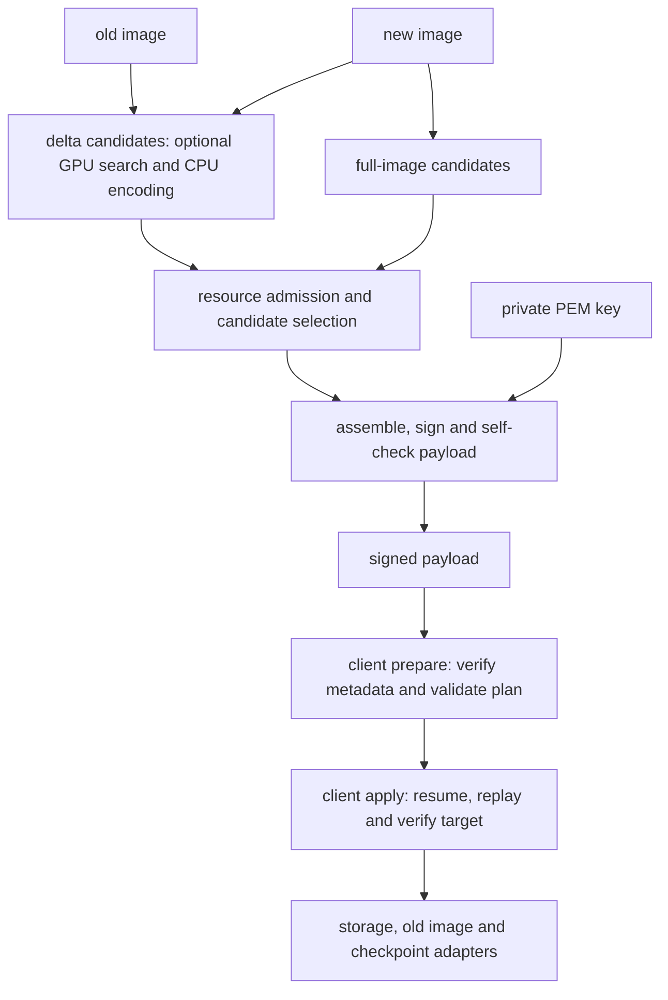

[](https://crates.io/crates/delta-update-client)
[](https://docs.rs/delta-update-client)
[](https://github.com/thives/delta-update.rs/actions/workflows/ci.yml)

# Rust OTA delta update engine

A Rust implementation of the A/B byte-range update flow: generate a signed delta
between two partition images, then verify and apply it to byte-addressed storage,
resumably, one operation at a time. The protobuf schema is vendored into
`delta-update-payload/schema/`; the project does not require an `update_engine/` source tree.

> [!WARNING]
> This crate is in early development. The API is not yet stable and may change.

> [!CAUTION]
> This crate is not yet production-ready. It has not been widely tested and may contain bugs.

## Scope

| In scope | Out of scope |
| --- | --- |
| byte-range A/B delta: `REPLACE`, `ZERO`, zlib-compressed chunk frames (`REPLACE_FRAMES`), sparse spans with kept chunks (`REPLACE_SPARSE`), copies from an immutable old image (`SOURCE_COPY`), and copies within the target (`TARGET_COPY`), applied with durable per-operation checkpoints | payload transport: hosts either hand over complete payload bytes or pull them through a `Source`; fetching or storing the package is never ours |
| full-image payloads: a signed payload that records only the new image and writes its entire prefix over any starting contents of sufficiently large storage, using `REPLACE`, `REPLACE_FRAMES` and `ZERO` (`docs/full-image.md`) | copies or a delta against an unknown old image: a full payload never reads one |
| wire-compatible `CrAU` major-2 framing, protobuf manifest, SHA-256, RSA signing/verification; the project operations are documented in `docs/format.md` and are not upstream-compatible | `REPLACE_BZ`/`REPLACE_XZ`, `SOURCE_BSDIFF`/`MOVE`/`DISCARD` and the patch operations, dynamic partitions, hash trees/FEC, post-install scripts |
| `no_std` apply middleware over trait-abstracted storage, with a bounded resource profile and resumable progress | a specific device model (block stores, dm-verity, partition tables plug in later) |
| independent old/new image lengths, including growth and shrinkage; target capacity at least the new length and operation reach | partition resizing: a payload never pads, truncates or resizes storage; bytes after the new image remain unchanged |

See `docs/` for the format, client, generator and platform designs.

## Crate map

| Crate | Role | Environment |
| --- | --- | --- |
| `delta-update-payload` | resource profile (`profile`), bounded pre-decode scan (`prescan`), framing (`layout`), prost manifest messages (`manifest`, `schema`), metadata policy (`plan`), signatures (`verify`, `sign`), SHA-256, RSA | `no_std` + `alloc` |
| `delta-update-generator` | host-side delta generator: a genetic search over byte-range programs on a Vulkan compute device, scored by exact uncompressed payload size, followed by a CPU pass that chooses frame, sparse and compression encodings; the full-image builder (`full`), which needs no old image and no device; the `builder` for hand-shaped operation lists; and the `ota-gen` binary | `std` |
| `delta-update-client` | apply middleware: `prepare` then `apply`, in a buffered variant (`apply`) and a streaming one (`stream`, `source`), both driven by one resumable engine (`engine`) that commits each operation through a checkpoint (`checkpoint`), with the read-only old image (`image`) that copies read | `no_std` |
| `delta-update-cli` | reference host bindings (file- and RAM-backed devices, read-only file old image, file payload `Source`, file checkpoint store) + the `ota-apply` binary | `std` |
| `delta-update-cli-args` | shared clap parsing and all 12 explicit resource-limit arguments for `ota-gen` and `ota-apply` | `std` only |

The generator and client share format policy and resource admission through
`delta-update-payload`. Both host binaries also use `delta-update-cli-args`; clap stays outside
`delta-update-payload` and `delta-update-client`, preserving their `no_std` boundary.

## Pipeline



The two signed ranges are `metadata = header + manifest` and `payload =
header + manifest + blobs`. Neither includes a signature message body, which
lets the generator reserve the signature slots from the key size alone (267
bytes for RSA-2048, 523 for RSA-4096) before any signing happens. See
`docs/generator.md` and `docs/sign.md`.

## Authentication and application order

With `Trust::Verified`, the manifest is authenticated before it is scanned and
decoded. The streaming pipeline proceeds in this order:

```mermaid
flowchart LR
    H[1 header: bounded by profile] --> R[2 manifest + metadata sig bytes]
    R --> MV[3 verify metadata sig]
    MV --> DC[4 scan, then decode manifest]
    DC --> PL[5 validate plan: no writes]
    PL --> G[6 bind device capacity, resume from checkpoint]
    G --> RP[7 replay operations, committing each one]
    RP --> PS[8 payload sig, end of stream]
    PS --> FL[9 flush, post-flight hash, Complete]
```



Steps 1–5 are `prepare`; they do not access the target. Steps 6–9 are
`apply`. In the buffered pipeline, preparation also verifies the payload signature
and blob hashes before target access. Streaming verifies the final payload signature
after replay, so a failure can occur after writes; use a staged target as described
in `docs/stream.md`. `Trust::Unverified` skips signature checks but still parses
and validates the metadata. See `docs/client.md` and `docs/checkpoint.md`.

## Payload layout

```text
"CrAU" | u64 major=2 | u64 manifest_size | u32 metadata_sig_size
| manifest proto
| metadata Signatures message          (fixed size, key-size padded)
| blobs                    (operation data, raw or framed where applicable)
| payload Signatures message            (offset/size recorded in manifest)
```

The 24-byte header length is `delta_update_payload::layout::HEADER_SIZE`, named so the
emitter and the parser cannot disagree about where the manifest starts.

## Resource profile

Every metadata size and count limit is supplied through one `ResourceProfile`
in `delta_update_payload::profile`. These are admission limits under a documented allocator
model, not a guarantee of total process or device RAM. Both CLIs expose every field independently:

| CLI option / library field (hyphens become underscores) | Meaning | CLI default = `EMBEDDED` | `HOST` library preset |
| --- | --- | ---: | ---: |
| `--max-encoded-manifest` | encoded manifest bytes | 16384 (16 KiB) | 64 MiB |
| `--max-signature-message` | bytes per encoded signature message | 2048 (2 KiB) | 1 MiB |
| `--max-decoded-bytes` | modeled decode peak per message, not total process RAM | 32768 (32 KiB) | 1 GiB |
| `--max-operations` | operations across manifest | 64 | 2²⁰ |
| `--max-extents-per-op` | destination plus source extents per operation | 256 | 2²⁰ |
| `--max-total-extents` | extents across all operations | 128 | 2²⁴ |
| `--max-partitions` | manifest partition count cap | 1 | 4 |
| `--max-signatures` | entries per signature message | 4 | 8 |
| `--max-signature-data` | bytes per signature's data | 512 | 64 KiB |
| `--max-block-size` | maximum accepted codec chunk bytes | 4096 | `u32::MAX` |
| `--max-frame-table-bytes` | packed table bytes per framed/sparse operation | 8192 (8 KiB) | 16 MiB |
| `--max-map-bytes` | sparse map bytes per operation, four blocks per byte | 1024 (1 KiB) | 1 MiB |

Byte arguments are decimal bytes, not KiB. Counts and byte limits must fit the
host's `usize`, except `--max-block-size`, which is a positive `u32`. Other caps
accept zero to forbid that resource; `--max-operations 0` admits no-op updates.
Limits interact: raising one does not bypass another or the decoded-memory budget.
`--max-partitions` above 1 does **not** enable multi-partition apply: the engine
still requires exactly one partition.

The removed `-p` / `--profile` selector is not accepted. `EMBEDDED` and `HOST`
remain library presets, not different execution modes. Use matching explicit
caps for generation and application; defaults match the embedded baseline.
See `docs/image-geometry-and-cli.md` for migration and dependency boundaries,
and `docs/memory.md` for the memory model, allocator assumptions and measurements.

## Command line

Generate a signed payload for an `old -> new` image pair:

```sh
cargo run --bin ota-gen -- [-b block-size] [-n partition-name] [--max-... value]... \
    [--release-version N] [-t seconds] [-s seconds] [-m bytes] [-r seed] [-g generations] [-d auto|software] \
    <old.img> <new.img> <out.payload> <private.pem>
```

Both tools use clap: `-h` / `--help` shows options, units and defaults, and
`-V` / `--version` reports the version without requiring positional arguments.
`--max-...` above denotes the individual options in the resource table, not a
literal flag. The generator's `-n` / `--partition-name` defaults to `A/B`: it is a
nonempty UTF-8 logical label in signed metadata, not a device path or slot lookup.
Both prepared APIs expose `partition_name()` for adapter policy; it is authenticated
only when prepared under `Trust::Verified`. `ota-apply` always uses the explicit
`DEVICE_FILE` argument. See `docs/image-geometry-and-cli.md`.

A nonzero-budget delta search uses a Vulkan compute device; a zero search budget
skips the device search. Device search needs a loader and a driver:
`libvulkan1` and `mesa-vulkan-drivers` (the software device lavapipe) at least, and `glslc`
to build the shaders. `-d software` forces the software device. `vulkaninfo --summary`
lists what is present. The devcontainer installs all of these.

When device search runs, both images are uploaded once and stay resident, the
population is bred, replayed, repaired and scored by compute shaders, and the host reads back a few
counters between batches and the best programs at the end. The device scores a program by its
**uncompressed** size; the CPU then chooses the frame, sparse and compression encodings of the best
programs, accepting a change only when the whole payload shrinks. `-t` bounds the GPU search, and the
encoding pass and the signing follow it. Each image must be smaller than 1 GiB and fit the device's
storage-buffer range; a larger one is refused with the limit that failed. `ota-gen` prints the raw
size the device found apart from the payload it wrote, and the time of each phase.
`docs/generator.md` has the design and measurements. The output is written owner-only (`0600`),
whatever file it replaces. Its mode, ACL and group are not kept, so an operator who needs other access
sets it after generation (`docs/locking-and-recovery.md` §3).

Generate a **full-image** payload, which needs only the new image and no device:

```sh
cargo run --bin ota-gen -- --full [-b block-size] [-n partition-name] [--release-version N] \
    [--max-... value]... <new.img> <out.payload> <private.pem>
```

The full payload writes every byte of the new image prefix on any sufficiently
large device, whatever it holds: zeros, erased flash or unrelated data. Bytes after
the new image are unchanged; storage is never resized, padded or truncated. Use it when the host cannot
name the device's current contents. A delta is smaller when the old image is known, and
there is no automatic conversion: a caller that wants a full payload builds one. The search
options (`-t`, `-s`, `-m`, `-r`, `-g`, `-d`) are refused with `--full`. For both
modes, `--release-version` defaults to zero and must meet the target's release floor.
See `docs/full-image.md`.

Apply it with a public key to verify both signatures. Signatures are skipped only
when `--development` is supplied without `-k`; other integrity checks still run.
Add `--stream` to pull the payload through `delta_update_client::source::Source` instead
of reading it into memory. Only the metadata region is held before the device
is opened. Without `--stream` the whole payload is read into memory, and that read is
bounded by `--max-buffered-payload` (default 67108864 bytes, 64 MiB). A larger payload is
refused before reading if its initially reported size exceeds the limit; growth beyond the
limit is detected during reading. Use `--stream` for larger payloads. The limit is a host setting,
not the embedded budget. Key files are read within a fixed 64 KiB bound, and a file that is
not a regular file, such as a named pipe or a character device, is refused without a read.

`--checkpoint` names the file that records the update's progress, and it is
required. Each operation is committed there after its writes are flushed. After
an interruption, the same command resumes at the first uncommitted operation, and
a streamed run reads the payload from the offset the checkpoint names.

`ota-apply` applies a full-image payload with no `-s`, since the payload needs no old
image. Its target need not hold any particular contents.

`--target-id` is the device's identity, and it is required: 64 hexadecimal
characters for 32 bytes. Assign each device one stable, unique value, and pass
the same value on every run. The checkpoint records it, and a run with a different
value is refused before any write. The tool derives no identity from a path or a
device number, because neither identifies physical storage.

```sh
cargo run --bin ota-apply -- -k public.pem [-k ...]... [-s old-image] [--stream] \
    [--release-floor N] [--max-buffered-payload BYTES] [--max-... value]... \
    --target-id <64 hex> --checkpoint <file> \
    --lock-dir <dir> \
    <payload-file> <device-file>
```

Verified application is the default. `-k` is required: a payload is applied only when
both signatures verify against one of the keys, and the run uses the **strict policy**
(`docs/client.md` §10). That policy refuses, before any write, a payload without a signed
new-image size and hash, a payload without a release version, a release below
`--release-floor`, and a base-dependent update whose destination is not the old image.
A run reports `verified against the signed new image` only after the target has been read
back and matched. `--release-floor` is the lowest release this device accepts, which the
operator supplies from the device's rollback-resistant state. The tool keeps no floor of
its own, so the default of zero disables rollback protection (`docs/platform.md` §3).

`--development` is the explicit opt-in for development. It relaxes the strict policy,
with no release floor. Without `-k` it also skips signature checking, and the run reports
`applied, NOT verified`. Every other integrity check still runs.

The tool holds two exclusive locks for the whole run, taken without waiting and in this order: one on
the checkpoint, and one on the device. The checkpoint's lock, and a block device's, are files in `--lock-dir`, the host's one lock namespace. The
platform provisions it as a real directory, owned by the updater and private to it (mode `0700`), and every
run on the host names the same one. A run refuses a namespace it cannot validate, before it locks or writes.
A regular file is locked on its own file, so every hard link to it contends. A block device is locked
through the namespace, under the device number. A run refused on either lock exits at once. Other devices
and checkpoints in other directories are not blocked. The checkpoint lock is one per directory, so every record in a
directory waits for the run that holds it, whatever its name. Earlier releases kept the checkpoint lock beside the
record as `<name>.lock`, or as a per-name file in the namespace.
Those files are neither used nor removed, so stop every older `ota-apply` before switching. The tool also refuses
a payload, device, checkpoint or old image that
names the same storage object as another (a regular file by device and inode, a block device by its device number),
comparing the open handles before any write. The old image and a streamed payload are read under shared locks, so
another run may read them but may not write them, and a checkpoint
that is a symbolic link or has a second name. A checkpoint name that begins with `.ota-checkpoint.` is refused, since
the tool keeps its own files under that prefix. The locks do not see other writers to the device, mounted filesystems,
or partitions that share one disk (`docs/platform.md` §2 and §7, `docs/locking-and-recovery.md` §1 and §9).

`--reset-checkpoint` clears this payload's checkpoint for this device, instead of applying. It
takes the same arguments, checks and locks, and writes nothing to the device. It does not open the old image, so `-s` does not affect it.
With `--stream` it reads only the payload's metadata, so a large payload is never held whole; without it, the reset
reads the whole payload within `--max-buffered-payload`. A base-dependent update
resets only once the device holds the old image again. The next run then starts the update from
its first operation (`docs/checkpoint.md` §8.1). If the removal cannot be confirmed durable, the reset
exits `1` and says so: the record may be back after a crash. A reset that finds no record still confirms
that its absence is durable, so running the reset again settles either case, and only a successful reset
means the next run starts from operation zero (`docs/checkpoint.md` §8.2).

A resume refuses a checkpoint record whose replacement is not confirmed durable (a directory sync failed after the rename),
until a later run confirms it. It stops before any write, and the record is kept (`docs/checkpoint.md` §5.3).

A checkpoint written by an earlier `ota-apply` carries an identity derived from
the device's path, which an identity the host assigns will not match. Complete any
update in progress with that earlier tool before switching. See
`docs/checkpoint.md` §5.1.

Both tools exit `1` on a payload or device error and `2` on a usage error. The
error vocabulary is `delta_update_payload::error::Code`, deliberately snake_case to
mirror the reference's `ErrorCode`.

## Apply: two phases, two pipelines

The middleware couples to storage through `Sink` (`capacity`, `write_at(offset)`,
`flush`). `flush` is a persistence barrier, not a cache flush. Reads are a
separate `Readable: Sink` capability, needed by in-target copies and by the
image-prefix hashes. Storage alignment, erase and read-modify-write belong to the
adapter, not to the middleware.

| Pipeline | Entry | Pre-flight hash | Resume |
| --- | --- | --- | --- |
| buffered, sink | `apply::prepare(..).apply_to_sink` | none: write-only, and only a destination-independent payload applies | checkpoint |
| buffered, device | `apply::prepare(..).apply_to_device` | fresh only, no separate image: hash target's recorded old-length prefix | checkpoint |
| streaming | `stream::prepare(..).apply` | same readable-target rule | checkpoint, and the payload is reopened at the offset it names |

A supplied `OldImage` is size/hash validated independently of the target, even
without `SOURCE_COPY`; when an old length is recorded, its capacity must match. It is
not copied into untouched destinations or sparse-kept bytes. Those bytes must
already be correct on the target. Without a separate image, fresh readable
sessions check the target's old-length prefix when an old hash is recorded.
Post-flight hashes cover the new-length prefix, not spare storage capacity.
`Geometry.size` is the optional **new** length; old and new lengths may differ.

Every pipeline has the same two phases. `prepare` authenticates (under verified trust), decodes and
validates the metadata, and the buffered path also checks every blob, all with no
target access. `apply` binds the target's capacity, then resumes from the
checkpoint, and commits each operation after its writes are flushed. A resumed
run does not check the target against the old image again, because it has written
part of the target by design. A completed update run again writes nothing: it
re-checks the payload's stream and, on a readable device, the new-image hash. See
`docs/stream.md` and `docs/checkpoint.md`.

## Build and test

Workspace builds require `protoc` on `PATH` (or set `PROTOC`) and `glslc`
(or set `GLSLC`) for generator shaders. The cross-check also requires the Rust
target, installed with `rustup target add riscv32imac-unknown-none-elf`.
The devcontainer supplies these prerequisites.

```sh
cargo build --workspace
cargo test --workspace      # bench_report is ignored by default
cargo check -p delta-update-client --target riscv32imac-unknown-none-elf
```

The suites, by what they pin:

- **Regressions** (`delta-update-client/tests/regressions.rs`, `delta-update-cli/tests/cli.rs`):
  late policy rejection with zero writes, extent overflow, missing operation
  type, malformed hash lengths, a device too small for its update, trailing bytes,
  and memory-limited malformed input on both CLI paths. The scanner's unit tests pin
  duplicate singular fields, which are refused, against repeated fields, which are
  accepted.
- **Independent image geometry and CLI policy** (`delta-update-client/tests/sizes.rs`,
  `delta-update-generator/tests/sizes.rs`, `delta-update-cli/tests/args.rs`, `delta-update-generator/tests/cli.rs`,
  `delta-update-cli-args/src/lib.rs`): growth/shrinkage, independent source bounds, unknown
  growth bytes, prefix hashes, unchanged tails, explicit caps, help/version and
  usage/runtime exit codes. See `docs/image-geometry-and-cli.md` for evidence.
- **Byte ranges** (`delta-update-client/tests/ranges.rs`): unaligned, short, large and
  out-of-order destinations, and overlapping operations, whose later writes win.
  Each is compared with the byte-array model on both pipelines.
- **In-target copies** (`delta-update-client/tests/target_copy.rs`): copies that read the
  target they write, their refusals (self-overlap, cycles, a write-only sink, a
  source hash that does not match), and a copy of what an earlier operation wrote.
- **Resume and failure injection** (`delta-update-client/tests/resume.rs`, `model.rs`): an
  update cut at every write, every flush and every checkpoint replacement resumes to
  the target. Random programs of every operation kind are interrupted and resumed on
  both pipelines and compared with the byte-array model
  (`delta-update-client/tests/support/model.rs`). A damaged checkpoint, another payload's
  checkpoint, another target and a stale device are each refused with no write. A
  completed update run again writes nothing, and a target altered since completion
  is refused with `hash_mismatch`. A resume at the final verification checks the
  payload signature over the restored hash state, on the streamed path.
- **Target scale** (`delta-update-client/tests/target_scale.rs`, generator unit tests):
  16 MiB of 4 KiB blocks in six patterns, each fitting the embedded profile and
  round-tripping through both pipelines. The project pattern carries copies and
  frames or sparse spans, and is resumed from an interruption. `bench_report`
  (ignored by default) prints figures for the current revision; how to read them is in
  `docs/generator.md` §12.
- **Project operations**: compressed frames (`frames.rs`), sparse spans
  (`sparse.rs`), copies from the old image with its refusals (`copy.rs`), and the
  command-line refusals of a source that is the device (`cli.rs`). Each asserts its
  exact error code, and a malformed frame or map is refused before any write.
- **Peak memory** (`delta-update-client/tests/peak_memory.rs`, `peak_stream.rs`): every
  count-valid manifest shape at each growth boundary, the largest manifest the
  budget admits, signature shapes at the encoded limit, the RSA workspace measured
  alone, and the streamed pipeline in each phase against its estimate. A completed
  compressed update's re-apply, which replays nothing, is bounded to its chunk and
  signature buffers (`peak_completed.rs`). They are measured with a simulated
  allocator, and each is checked against its model. See `docs/memory.md` for the
  numbers and what they do not show.
- **Full-image payloads** (`delta-update-generator/tests/full.rs`, `cli.rs`, `delta-update-client/tests/full.rs`,
  `delta-update-cli/tests/cli.rs`): every image shape built and checked; the frame-table split and the
  fallback to raw; the full checker's refusals on signed payloads; `ota-gen --full` and its
  refusals; a full payload applied to zeros, erased flash and unrelated contents through both
  pipelines with no old image; and interrupted runs resumed at every write, flush and checkpoint.
  `docs/full-image.md` has the design and the measured sizes.
- **The GPU search** (`delta-update-generator/tests/gpu_eval.rs`, `gpu_search.rs`, `src/verification.rs`,
  `src/compress.rs`): the device's replay, repair and exact size against the CPU's, on random,
  boundary and capacity cases; every operator bred alone from a known parent; determinism, including
  independence from batching and from the device; one upload and small readbacks; the encoding pass.
  `OTA_TEST_DEVICE=auto` prefers hardware but can fall back to software; verify the
  selected device before claiming hardware coverage. `docs/generator.md` §11.
- **Colocated unit tests** for each stage: the scanner, the plan validator, the
  checkpoint record, the hash snapshots, the storage bindings, and both pipelines.

Nothing in the suite exercises the riscv32 target at runtime. The embedded
build is checked at compile time, including the `size_of` bounds on the prost
types, but runtime memory on device is not measured here.

## Design docs

| Document | Covers |
| --- | --- |
| `docs/image-geometry-and-cli.md` | independent old/new lengths and capacity, prefix hashes, logical-name adapter routing, clap options and resource-cap migration |
| `docs/client.md` | the two phases, storage contracts, metadata policy, bind and pre-flight rules, failure taxonomy, resource profile and API, the strict policy and the outcomes (§10), and the destination contract (§11) |
| `docs/checkpoint.md` | the checkpoint record and its phases, resume rules, the store's atomicity and durability contract, the integrity requirements, and final-check recovery and reset (§8) with the record versions (§9) |
| `docs/platform.md` | the host integration contract: target selection and identity, exclusivity, the release version and rollback floor, the commit order with power loss at each boundary, the threat model, and which claims need platform validation |
| `docs/locking-and-recovery.md` | the design record for the lock scope and identity, the uncertain reset removal, the owner-only output policy, and the device's contract-workspace admission, with the platform validation still required; §10 covers the shared locks of read roles, block-device identity, the reset's independence from the old image, staging-file cleanup, and the publication test |
| `docs/memory.md` | the decoded-memory model, allocator assumptions, phase budget, and host measurements (with what is not measured) |
| `docs/stream.md` | streaming input, the per-operation commit, resume by checkpoint and reopened payload, the trust order, what a rerun repairs, the three failure phases and the staged target (§5.1) |
| `docs/verify.md` | framing, authentication order, signature ranges, the verifier's error model |
| `docs/format.md` | revision 17: byte ranges, chunks, frames, maps, both copy operations, replay safety, what is authenticated when, and the full-image conventions (§12) |
| `docs/generator.md` | the byte-addressed program model, replay on the device and the CPU, exact raw fitness and admission, the GPU session and its stages, the GPU genetic search, the CPU encoding pass, deadlines and progress, self-verification, tests, measurements, known limits, what changed in this revision, design decisions, tuning, and the full-image generator (§17) |
| `docs/full-image.md` | full-image payloads: the contract, the raw and framed candidates, admission and the resource fallback, the full checker, the client's behaviour with unknown contents, the per-operation checkpoint cost, measured sizes, and known limits |
| `docs/protobuf.md` | vendored schema, prost codegen, wire compatibility, bounded pre-decode |
| `docs/sign.md` | signature-slot sizing and padding |
| `docs/rsa.md` | PEM parsing, RSA sign/verify, key-size limits |
| `docs/sha256.md` | hashing primitives, chunking, and the hash-state snapshots that resume the payload signature |
