# Checkpoints: durable progress of one update

A checkpoint is the record that lets an interrupted update resume at its first
uncommitted operation. It is the only state the client keeps between runs. The
client writes it through a host-supplied store (`ota_client::checkpoint`), and
the host must make that store atomic and durable. This document states the
record, the phases, the rules a resume applies, and what the host must provide.

Related: `docs/stream.md` (the resumable pipeline), `docs/client.md` §2.6 (the
contract with storage), `docs/format.md` §7 (what is authenticated).

## 1. What a checkpoint says

| Question | Field | Checked against |
| --- | --- | --- |
| Which payload is this? | `metadata`: SHA-256 of the signed header and manifest | the digest of the metadata that `prepare` just authenticated |
| Which target is this? | `target`: a 32-byte identity the host assigns, stable and unique per device | the identity the host passes to `apply` (`--target-id` in `ota-cli`) |
| How far has the update got? | `phase`, and `next_op`: the index of the first uncommitted operation | the operation count of the manifest |
| Where does the payload resume? | `payload_offset`: the absolute payload offset of that operation's blob | the blob offset the manifest implies (see §3) |
| What has the payload signature covered so far? | `hash`: the SHA-256 state over header, manifest and every committed blob byte | restored, so the prefix is never read again |

The checkpoint never names a device block, sector or partition layout. Its
targets are byte offsets, which the storage adapter maps to whatever it
addresses.

## 2. The record

A record is a fixed 221 bytes, written as one unit.

| Offset | Size | Field | Notes |
| --- | --- | --- | --- |
| 0 | 4 | magic | `OTAC` |
| 4 | 1 | version | `1`. A reader rejects any other value. |
| 5 | 1 | phase | `0` initialized, `1` applying, `2` awaiting final verification, `3` complete |
| 6 | 2 | reserved | zero |
| 8 | 4 | `next_op` | big-endian `u32` |
| 12 | 8 | `payload_offset` | big-endian `u64` |
| 20 | 32 | metadata digest | SHA-256 of header and manifest |
| 52 | 32 | target | host-supplied identity |
| 84 | 105 | hash state | version byte `1`, then the 104-byte SHA-256 state (`ota_payload::sha256::snapshot`) |
| 189 | 32 | record digest | SHA-256 over bytes 0 to 188 |

The record digest detects a torn or damaged record, so a damaged record is
refused rather than partly trusted. It is an integrity check, not
authentication. The record is not signed, because the store is trusted (§5).

## 3. Phases and the offset rule

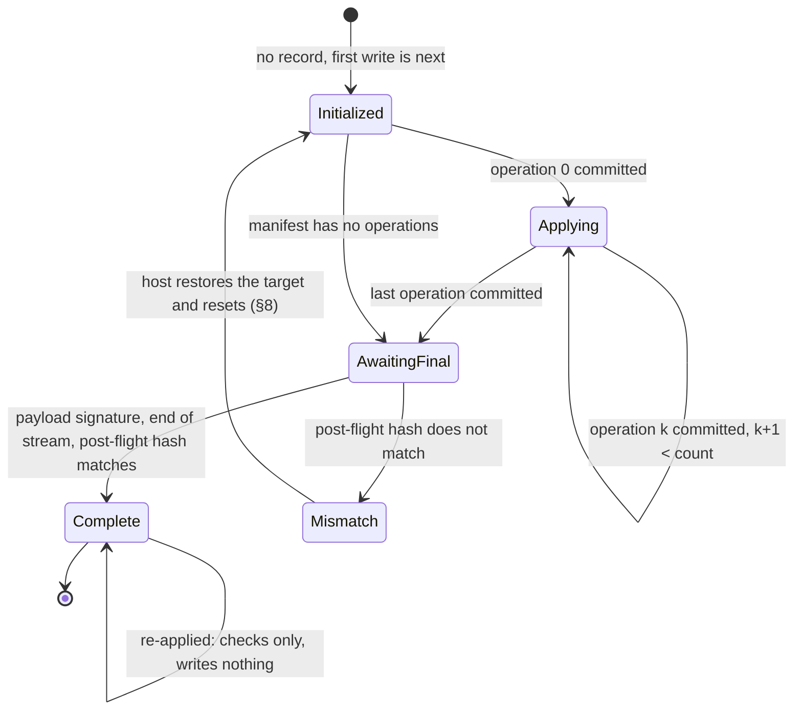

| Phase | `next_op` | `payload_offset` | Meaning |
| --- | --- | --- | --- |
| Initialized | 0 | blobs start | Written before the first write. An interruption in operation zero resumes here, and is not a fresh update. |
| Applying | `1 .. count-1` | blob of `next_op` | Operations before `next_op` are committed and durable. |
| AwaitingFinal | `count` | blobs end (signature start) | Every operation is committed. The payload signature and the post-flight hash are still to be checked. |
| Complete | `count` | blobs end | The update is verified. A repeat of this payload writes nothing and replaces no record. It re-checks the payload signature and the end of the stream, and on a readable target the new-image hash (§4, rule 6). |

`payload_offset` is absolute. The blobs start after the header, the manifest and
the metadata signature, so the first blob is at `24 + manifest_size +
metadata_signature_size`. The operation's blob is at that base plus its
`data_offset`. The offset a record names must equal the offset its operation
index implies, and the resume recomputes it from the manifest. An offset that
disagrees is `checkpoint_invalid`.

Zero-data operations (`ZERO`, `SOURCE_COPY`, `TARGET_COPY`) advance `next_op`
without moving `payload_offset`, since they have no blob.

## 4. Resume rules

A resume reads the record, then checks it in this order. Every refusal happens
before the first write.

1. **Integrity.** Length, magic, version, phase code and record digest must all
   be right, or the record is `checkpoint_invalid`.
2. **Payload.** The metadata digest must equal the digest of the metadata that
   was just authenticated, or the record is `checkpoint_mismatch`. A checkpoint
   of another payload is never resumed.
3. **Target.** The target identity must equal the one passed to `apply`, or the
   record is `checkpoint_mismatch`.
4. **Position.** `next_op` must not exceed the operation count. `payload_offset`
   must equal the offset §3 implies, and the phase must match `next_op`. Any
   mismatch is `checkpoint_invalid`.
5. **Hash state.** The snapshot must restore to a SHA-256 state. Otherwise it is
   `checkpoint_invalid`.
6. **Completed.** A record in the `Complete` phase has nothing left to write. The
   payload signature and the end of the stream are checked, and on a readable
   target the new-length device prefix is hashed against the new-image hash, when
   the manifest records one; spare capacity is excluded. A mismatch is `hash_mismatch`.
   The record is kept, and nothing is written.
7. **Durability.** The store confirms the record durable before the resume trusts it
   (`confirm_stored`, §5.3). A record whose replacement was never confirmed is
   `checkpoint_unconfirmed`: the record is kept, and nothing is written.

Only then does the client write, and it writes from the state the record names.
With no record at all, the session is fresh: without a separate old image, a
readable device's old-length prefix is checked against the recorded old hash.
With a separate image, that image is validated independently of the destination,
even without `SOURCE_COPY`; the target's old hash is not checked. Supplying the image
does not initialize kept or untouched target bytes. The `Initialized` record is
written before the first write (`docs/image-geometry-and-cli.md`).

A resumed target is **not** checked against the old partition hash. It holds the
writes of the interrupted run by design, so that check would refuse it. A separate
immutable old image, if supplied, is still validated on resumed runs.

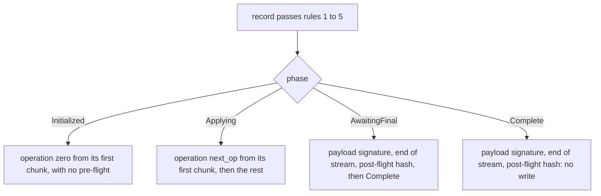

## 5. The store contract

The host supplies a `CheckpointStore` with four operations.

| Operation | Contract |
| --- | --- |
| `load` | Returns the stored record, or reports that none exists. A read error is an error, never "no record". |
| `replace` | Makes the new record the stored one. **Atomic:** after any interruption, a later load returns the old record or the new one, never a mixture. **Durable:** once `replace` returns `Ok`, the new record survives power loss. A store that cannot promise either must not return `Ok`. A failure after the rename leaves the record visible and **unconfirmed** (§5.3). |
| `confirm_stored` | Called by a resume after its checks, before any write, on the record `load` returned. It makes the record durable, which for `FileCheckpoint` is a sync of both directories a replacement changes. It runs on every resume, since a visible record left by an earlier process is not known to be durable. A failure is `checkpoint_unconfirmed`: the record is kept and nothing is written. A reset does not call it, because removing the record syncs the same directory. |
| `clear` | Removes the record, which a reset does only after its checks pass. A failure before the removal leaves the record as it was. A failure to make the removal durable is `checkpoint_removal_uncertain`. |
| `confirm_absent` | Called by a reset that finds no record. Under the record's lock it checks that **no entry** exists at the record's name, a symbolic link included, and it removes nothing. A stored entry is `checkpoint_present`, and it is left in place. A failed look-up of the name is `checkpoint_removal_uncertain` too, since neither presence nor absence is then known. Only when the name is free does it confirm that the absence is durable by syncing the directory. A store that cannot confirm it reports `checkpoint_removal_uncertain`, so an earlier uncertain removal is settled before a retry reports success. |

The client calls `replace` after each operation's writes have been flushed. So a
store that loses a completed replacement can make the next run repeat that
operation, but cannot make the client skip one. A store that reports success
early can, and the host must not do that.

`ota-cli` provides `FileCheckpoint`. It creates `.ota-checkpoint.stage.<digest>.<n>` in the pinned private
`.ota-checkpoint.staging` directory inside the record's parent (§5.2). `<digest>` is 16 hexadecimal digits, the first
eight bytes of the SHA-256 of the record being written, and `<n>` is the attempt, counted from 0. The name depends only
on the record, so the file that produced the current record has a name the store can compute (§5.2). The file is created
exclusively, sets mode `0600`, locks its inode exclusively, writes and syncs it, then renames it across directories over
the record. It retains the inode lock and syncs the record parent followed
by the staging directory. Both directory syncs must succeed for `replace` to return success, and `confirm_stored` repeats
both before a resume trusts the record (§5.3). This relies on the
filesystem providing atomic cross-directory rename and durable file and directory sync; validate those properties on
the deployment storage. `clear` unlinks the record and syncs its parent. The in-memory `MemoryStore` is volatile and
claims no durability; it is for tests and dry runs.

Every run also takes a lock on the record's directory, in the host's lock namespace (`--lock-dir`,
`docs/platform.md` §2.1). The lock's name is derived from the directory's identity alone, so it never sits
beside a record, and every record in the directory contends for the same lock, under any spelling and through
any path. The lock is taken before the record is first read, so runs in one directory never interleave
(`docs/locking-and-recovery.md` §1 and §7). `FileCheckpoint::open` takes the lock and returns the store, and the
store keeps the lock for its whole life, so the two cannot come apart. The directory handle and the name rules
are in §5.2.

**The record's name.** `FileCheckpoint::load` opens the record with `O_NOFOLLOW` and checks
the open file. A symbolic link, a dangling link, a file that is not regular, and a file with a
second hard link are each refused as `checkpoint_invalid`, before any device write. A replacement
renames over the name, so a link would leave its target stale, and a second name for the same
file would keep the old record. Every run reads the record before its first write, so these
checks always come before a write.

`FileCheckpoint::load` reads the record into a fixed-size buffer. The file must be
exactly 221 bytes. Its length is taken from the opened file, so any other size is
`checkpoint_invalid` before a byte is read. A file that grows while it is read is
also refused.

If the rename succeeds but either directory sync fails, `replace` returns a storage error without rolling back: the
new record is visible now, but its crash durability is not confirmed. If the first sync fails, the staging-directory
sync is not attempted. A resume never trusts that record on its own: `confirm_stored` syncs both directories again
first, and until a confirmation succeeds the run stops before any write (§5.3). After a crash the surviving record is
either the new one or the previous one, and either is resumed under the store contract. Completed device writes were
flushed before replacement, so replay from a surviving older record is safe for the operations this format writes,
which do not read the target, and resume from the new one is the intended recovery.

### 5.1 Integrity requirements

The checkpoint is **trusted execution state**. The client does not authenticate
it, because the store is not an input from the payload. The host must therefore:

- keep the record writable only by the updater, so no other process can rewrite
  it between runs;
- keep it on storage that the update does not write to, so the checkpoint
  survives the partition it describes;
- give each target a stable, unique `TargetId`. The client compares it, so a
  different identity for the same device refuses the resume, and one identity
  for two devices lets a checkpoint of one be applied to the other. `ota-cli`
  takes it as `--target-id` and derives none from a path or a device number,
  because neither identifies physical storage;
- delete the record only when the update is complete, or when the host means to
  start the device over. The reference CLI does the latter with `--reset-checkpoint` (§8.1).
- keep one record per target. The checkpoint lock stops two concurrent runs in one checkpoint directory, whatever
  their record names, and the device lock (`docs/platform.md` §2) stops two concurrent runs on one device, whatever
  their paths.
  Neither can tell that a sequential run with a different record name is a second run. That run starts
  with no record, which is the case in §6 where a deleted record is not a universal guard. Removing it
  mid-update makes the next run a fresh update. Without a separate image, recorded old-prefix pre-flight
  can refuse a changed readable target; separate-image and write-only runs have no such guard.

A damaged or forged record cannot cause a write the payload does not describe,
since the operations and their offsets come from the authenticated manifest. It
can cause a resume that skips committed operations. The host therefore protects
the record from writes, as §5.1 requires.

The reserved prefix and the exclusive creation of staging files defend against a planted name. They do not
defend against a directory that others can write to. The directory that holds the record must be controlled by
the updater, because whoever can create or replace entries there can replace the record itself.

Checkpoints from earlier `ota-apply` builds are not compatible with the identity
rule. Those builds identified a device by the SHA-256 of its canonical path. The
record layout is unchanged, but an identity the host assigns will not match that
value, so such a record is refused with `checkpoint_mismatch`. Complete any update in progress with
the earlier tool before switching to this one. Do not delete the in-progress
record to get past the refusal, for the reason given above.

### 5.2 The directory handle, the names and the lock

`FileCheckpoint::open` performs these steps in order; a store exists only if they succeed:

1. It checks the record's name: printable ASCII with no space, and not beginning with the reserved prefix
   `.ota-checkpoint.`, compared without regard to ASCII case. A reserved name is one of the store's own entries,
   so it is refused here, before any lock is taken or any file is made.
2. It opens the record's parent directory once, following any symbolic links in the path. The directory's
   identity (device and inode) is read from that open handle, and the directory must not be the lock namespace.
3. It takes the record entry's exclusive lock, keyed by parent device and inode plus the exact basename, then the
   exclusive checkpoint-directory lock, keyed by parent identity alone. Both are nonblocking.
4. Under the directory lock it runs the **case probe**, creates or validates the private staging namespace, and
   makes a bounded best-effort sweep. It then locks an existing regular record inode, removes a second link to the
   record that a crash left, found by name, and syncs the staging directory (§5.2, *Staging ownership and cleanup*).
   A folding directory, a failed probe, or a second link or sync that cannot be settled is refused.

The store then keeps the directory handle for its whole life, so the run is bound to the directory it opened.
Record operations and the case probe are relative to that handle; staging operations use a separately pinned staging
handle. `openat` refuses final symlinks, `renameat` moves from staging to the record parent, `unlinkat` removes
entries, and `fstatat` checks absence and identity without following links. Both directory handles are synced after
publication.

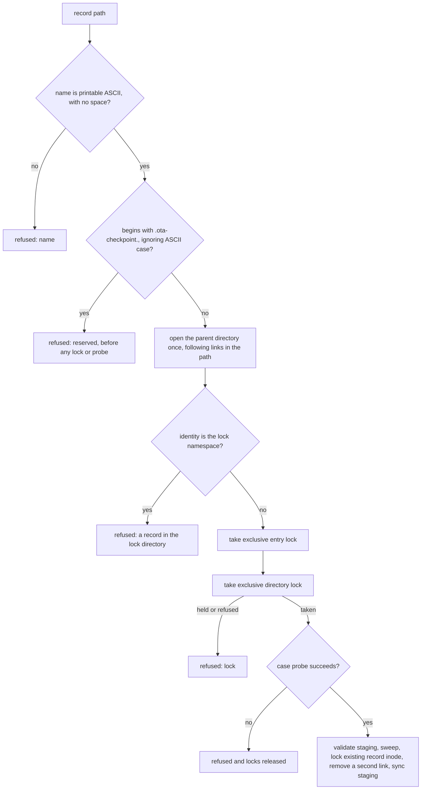

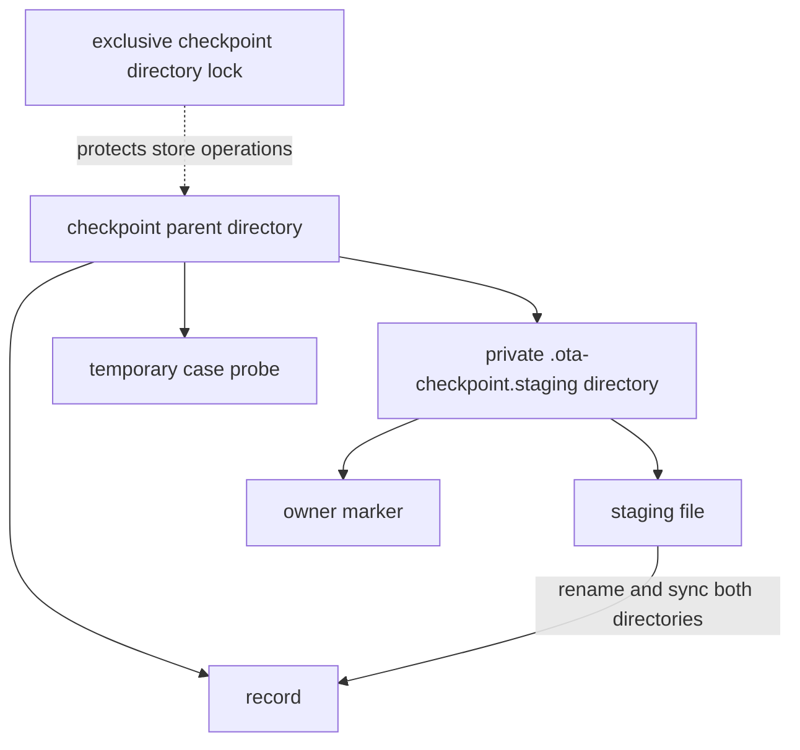

**Why a handle.** A path is checked at one step and used at another. If the parent path is replaced after the
lock is taken, a path-based operation would write the record into a different directory, under a lock that
belongs to the old one. Pinning the directory makes the lock and the record always name one directory. The test
`a_parent_symlink_retargeted_after_the_lock_leaves_the_run_on_its_own_directory` moves the path after the lock,
and checks that the record stays in the original directory, while a run on the new directory has its own lock.

**Names.** The record's name must satisfy three rules, each checked when the store is opened:

- It is **printable ASCII with no space**. The reserved check is made on ASCII bytes. A filesystem that normalizes
  or folds non-ASCII names could otherwise make a non-ASCII spelling equal to a reserved one.
- It **does not begin with `.ota-checkpoint.`**, compared without regard to ASCII case. Every entry the store makes
  in the parent begins with that prefix: its staging directory and case probes (`.ota-checkpoint.probe.<pid>.<time>.<n>`).
  The prefix is matched whole, so `.ota-checkpoints` is an ordinary name. Staging files live inside the private directory,
  not beside records. The reservation alone is not proof of ownership.
- The directory **must not fold the case of ASCII names**. The probe checks this, and it is refused if the probe cannot
  run.

**Why the lock is per directory.** The lock's name is derived from the directory's identity alone, so every record
in the directory shares one lock, whatever its spelling. Two spellings of one entry, such as `state` and `STATE` on
a folding directory, therefore cannot run at the same time: the second is refused while the first holds the lock.
The tool does not need to know how the filesystem equates names for this to hold. The earlier lock was per name, and
it needed exactly that knowledge. One probe of one spelling could not supply it, and a folding directory's other
spellings were never tested. Serialising the whole directory is the cost. One checkpoint per update makes that cost
nothing in practice, and two runs of one update are refused whichever names they use.

The rules fail closed. A probe that cannot run, for example in a directory that is not writable, refuses the store.
Two byte-distinct names that differ only in case are two records on a case-sensitive directory, and they take turns
behind the directory's lock.

**Staging ownership and cleanup.** Under the directory lock, the store creates `.ota-checkpoint.staging` with mode
`0700` and an `owner` marker containing `ota-checkpoint staging directory v1\n`, syncs the marker, staging directory
and parent, or validates an existing directory and marker. The directory must be owned by the effective user and have
no group or other access; the marker must be a private, single-link regular file owned by that user with exactly the
expected contents. A symlink or an invalid or missing marker on the canonical directory is refused without repair. The
canonical directory is published only with its marker complete and synced (§5.3), so an interruption cannot leave it
without one. An interruption leaves `.ota-checkpoint.staging.init`, which the next open completes or refuses (§5.3).
The marker distinguishes an initialized namespace, not a malicious process running as the same user.

The record's own second link is removed by name. A crash after a replacement's rename, before the staging name's removal
is durable, leaves that name as a second link to the record, and `load` refuses a record with two names. The name of the
file that produced a record is a function of the record's bytes (`<digest>` above), so the open computes at most 16
names, one per attempt, and looks each up without following a link. It removes a name only when it is the record's own
inode. Any other entry at those names is left alone. Every open then syncs the staging directory, even when no name was
found. An earlier open may have removed the name and then failed its sync, so the next open finds the name already gone,
and only a sync confirms that the removal is durable. A look-up, removal or sync that fails refuses the open before any
device write, and the next open looks and syncs again. The look-ups do not depend on how many entries the directory
holds, so no run of debris can hide the link.

A best-effort sweep runs at open. It enumerates at most 256 entries through `/proc/self/fd`, and it unlinks only exact
staging-form, single-link regular files inside the validated staging directory, without following links. Enumeration,
lookup and unlink failures are ignored, and sweep removals are not synced. Non-removable entries can occupy the scan
window indefinitely, so the sweep may leave debris; it never affects whether the record loads, since the record's own
link is found by name.

A replacement does not depend on the sweep. If all 16 names in its window are occupied, it looks up each of those names
exactly, removes each one that is a single-link regular file, and tries the window once more. No listing is read, so a
directory full of entries that cannot be removed does not limit this. A failed look-up or removal fails the replacement
before its rename, and the record remains, as it does when the window is still full. A successful replacement's
staging sync, which follows its rename, also makes these removals durable. Legacy sibling staging files and probes in
the record directory, including earlier reserved-prefix staging files, are never swept; an operator must inspect them
before any manual cleanup. See `docs/locking-and-recovery.md` §10.6.

The probe is evidence, not a guarantee. It checks one spelling of one name at one moment, and it cannot see a folding
flag that is changed after it runs. It writes one file, under the reserved prefix with a name that includes the time,
and removes it. A crash between the two leaves that file behind. It is harmless: records cannot name it, and the
store never reads or removes it.

| Property of the storage | Why the store needs it | Who establishes it |
| --- | --- | --- |
| One directory lock covers checkpoint stores under any spelling | checkpoint stores in one directory must not run together | the tool: the lock is named by the directory identity; other roles do not take it |
| Names are printable ASCII with no space | the reserved check is exact on ASCII bytes | the open refuses other names |
| The reserved prefix is not a name the host's own files use | the store's entries and the records cannot collide | the tool refuses records with the prefix; the platform keeps other files out of the directory |
| No casefold, normalization, short-name or other aliases between role entries | exact-basename entry locks may differ for names the filesystem treats as equivalent | the platform: a checkpoint probe checks only one ASCII case example at one moment, not other role directories |
| Renames, unlinks and directory syncs are durable | the `replace`, `clear` and `confirm_absent` contracts | the platform: not checked by the tool (`docs/platform.md` §2.1) |
| Writable only by the updater | §5.1 | the platform: not checked by the tool |
| One namespace per host, and trusted ancestors | a lock that holds across runs | the platform: the tool validates only the handle it opens |

**Lock order.** A streamed run takes the payload's shared entry and identity locks before reading it. The store then
takes the checkpoint's exclusive entry and directory locks and, if present, its regular inode lock. Next come the
device's exclusive entry lock and optional old image's shared entry lock; after opening and comparing roles, the device's
exclusive identity lock and old image's shared identity lock follow. All are nonblocking. The streamed pin survives
through final verification and completion-record publication; buffered apply and reset instead read the payload without
an entry or identity lock. See `docs/locking-and-recovery.md` §10.3 and §11.

**Which roles are compared, and when.** The record's directory is pinned by the store, and the record's entry is read
through that handle with no link followed, so the entry's identity is the one the store will replace. The alias check
(`ota-cli/src/roles.rs`) compares the identities of the open payload, device, record and old image, a block device by
its device number and any other file by device and inode, after all of them are open (`ota-cli/src/identity.rs`). It runs
before the device or old-image identity lock is attempted, and before any device write
(`docs/locking-and-recovery.md` §9).

**Migration.** Stop every older `ota-apply` process before this release runs on a host. Earlier releases locked a
checkpoint with `<name>.lock` beside the record, and a release before this one locked it with a per-name file in the
namespace. This release neither reads nor removes those files, and a run of this release does not contend with an
older run on the same directory, so an older process still running is invisible to it (`docs/platform.md` §2.1).
Staging names change with this release, from `.ota-checkpoint.stage.<pid>.<key>.<n>` to the record-derived form above.
An earlier name is not swept, so it stays as debris. A record that a crash left with an earlier name as its second link
is refused until that link is removed by hand (§5.4); this release never removes a name of the earlier form.

### 5.3 Publication, confirmation and initialization

A replacement is durable only when both directories it changes have been synced. A failed sync after the rename leaves
the new record visible and unconfirmed, so the store has three record states, and a resume may use only the first:

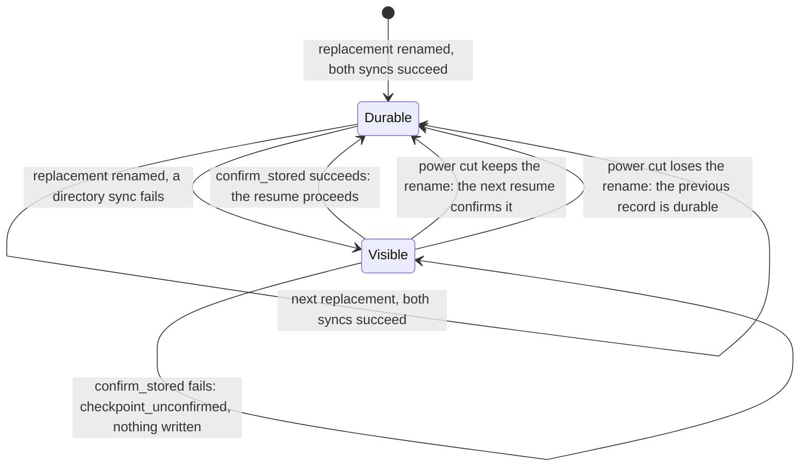

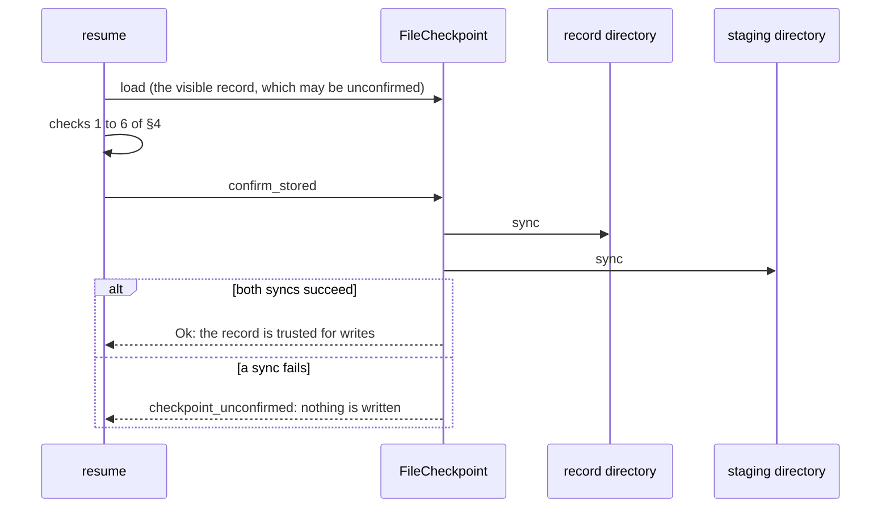

The canonical staging directory is built under a name of its own, so it never exists without a complete marker. The
steps run under the directory lock, in this order. A failure at any step is reported, and the directory is left as a
crash just after that step would leave it. Two of the steps are fault points before any permission is restored, since a
creation under a umask can leave the owner unable to read, write or search the entry:

```mermaid
stateDiagram-v2
    [*] --> Created: mkdir .ota-checkpoint.staging.init, mode 0700 less the umask
    Created --> MarkerCreated: owner created exclusively, mode 0600 less the umask, still empty
    MarkerCreated --> MarkerWritten: owner mode restored to 0600, contents written
    MarkerWritten --> MarkerSynced: owner synced
    MarkerSynced --> InitSynced: init directory synced
    InitSynced --> Published: rename to .ota-checkpoint.staging
    Published --> Complete: parent directory synced, then validated as before
    Complete --> [*]
    Created --> Created: next open: owner permissions restored, then the marker is made
    MarkerCreated --> MarkerWritten: next open: restored, then the marker is kept, or made again
    MarkerWritten --> MarkerWritten: next open: a complete marker is kept and synced; any other marker of its length or less is made again
    Created --> Refused: next open: another entry, or a marker that fails its checks, is refused; the mode is kept unless the owner could not read or search the directory
```

| Step that failed | On disk after it | Next open |
| --- | --- | --- |
| `Created` | an empty initialization directory, mode `0700` less the umask | its owner permissions are restored, and the marker is made |
| `MarkerCreated` | an empty marker, mode `0600` less the umask | the marker's owner permissions are restored, and it is made again (it is empty, so a prefix) |
| `MarkerWritten` | a marker with its contents, not yet synced | the marker is kept if exact, and synced; otherwise it is made again |
| `MarkerSynced`, `InitSynced` | a complete, synced marker | the directory is published |
| `Published` | the canonical directory, complete | validated, as any published directory is |
| `PublishSynced` | the canonical directory, complete | validated; the publication's durability is the parent sync's, which is not confirmed |

**The classification.** The next open decides what an initialization directory is, from the shape the store makes and
nothing more. Every check on an entry is made on a handle that needs no permission on the entry itself, and nothing is
changed until the checks pass, except the owner bits of a directory the owner cannot read or search, which the chart shows.

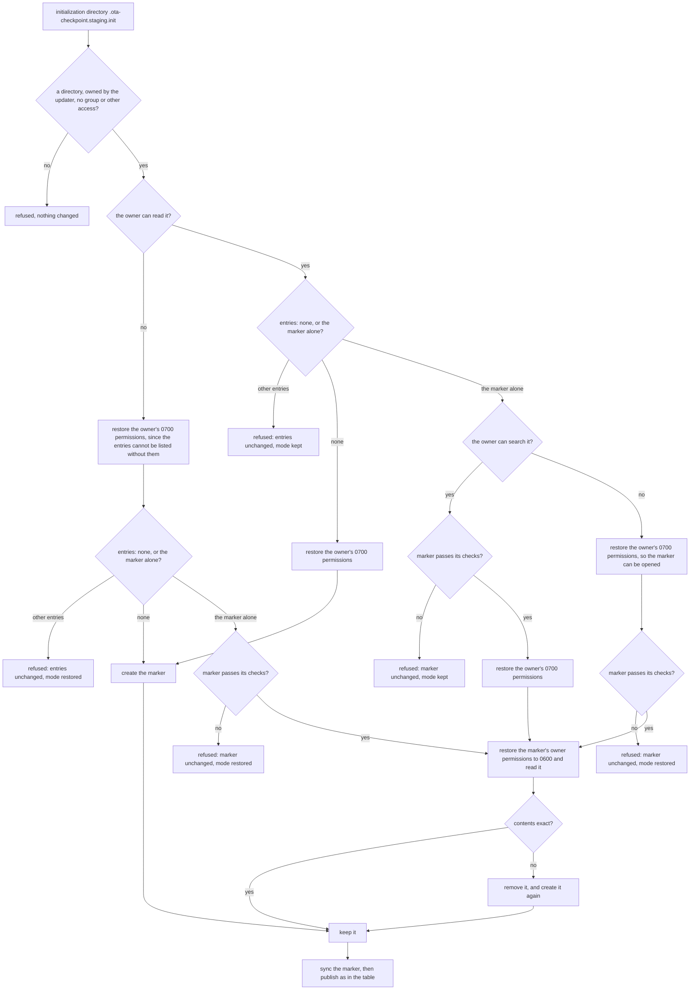

The marker passes its checks when it is a regular file with one link, owned by the updater, with no group or other access,
and at most 36 bytes long. Those checks change nothing.

The rules behind the chart are these.

- **Owner permissions are restored only where a check needs them.** A directory that passes its owner and privacy checks is
  the store's own. Listing its entries needs the owner's read permission, and opening its marker needs the owner's search
  permission. A directory the owner can read and search is listed first, and its marker is checked before anything changes,
  so a refusal keeps its mode. A directory the owner cannot read, or can read but cannot search, has its owner bits restored
  to `0700` before the check that needs them, and that restoration stays when the check refuses. The marker's own
  permissions are restored only after it passes its checks, and a refused marker keeps the mode it had.
- **A torn marker is made again, whatever its bytes.** The initialization directory is the store's own name, which no
  role can use (`roles.rs`). Only the store creates entries in it, and nothing read from it is trusted before publication,
  since publication requires the exact contents. A write of this store is at most the expected length, so a marker of that
  length or less is one of its writes that did not finish, whatever bytes the crash left: nothing, a prefix, zeros, or
  stale bytes. A longer marker could not be such a write, and it is refused. A user other than the updater, or a second
  name, or a symbolic link, is never this store's, and is refused. Replacing a marker can change only the store's own
  initialization directory, which the directory's owner and privacy checks have established.
- **A canonical directory is never repaired.** A pre-existing `.ota-checkpoint.staging` is validated as before, and a
  leftover initialization directory beside it is not used (the test is listed in §7).

A refusal changes no entry. It changes the mode of the initialization directory only where the owner could not read or search
it, as the chart shows. The operator procedure in §5.4 says what to inspect.

**Why a readable directory's marker is checked before its mode changes.** A refusal should leave the store as it found it,
and restoring the owner bits first would make every refusal of a readable directory change its mode. The marker's check
needs only the owner's search permission, and a directory the owner can read and search has that. The check runs through
the directory's handle, before the mode changes, so the refusal of a longer, linked, symbolic or public marker keeps the
mode the owner set. A marker of the expected length or less is still repaired, as before: the check accepts it, and the
owner bits are restored for the repair. Two alternatives were rejected. Refusing every readable directory that holds a
marker would stop a torn marker from being made again. Restoring the owner bits for every directory first is simpler, but
it changes the mode of a directory the store is about to refuse. A directory the owner cannot read, or can read but not
search, is where the check cannot run without the restoration, so the restoration is kept and the refusal says so.

**Why the gate is on resume, not on `load`.** A reset also loads the record, and its removal syncs the directory it
changes, which settles any earlier unconfirmed rename too. Gating `load` would make a reset fail as
`checkpoint_unconfirmed` before it attempts the removal, and the outcomes of §8.2 would change.

**Why a resume confirms every time.** Without a sync, a record that a failed replacement left visible cannot be told from a
durable one, and a later process has no record of the earlier failure. The file store therefore syncs on every resume. The
cost is two directory syncs per resume, which is paid once per run.

**Why every open syncs the staging directory.** A removal of the record's second link can fail its sync after the name is
already gone. Nothing is stored about that failure, and the next open sees only the absence, so it cannot tell that the
removal is unconfirmed. The open therefore syncs the staging directory on every run, whether or not it found a link, and
refuses to go on when the sync fails. The cost is one directory sync per open. A resume also confirms the record
(`confirm_stored`) before any write, so the record itself is durable as well.

**Why a replacement looks up its own names.** The sweep reads at most 256 entries, in the order the filesystem lists them,
and it never removes a directory. A directory full of entries it cannot remove can therefore hide a stale file from it.
A replacement needs only the 16 names of the record it writes, and those names follow from the record's bytes. It looks
up each one exactly, so no listing decides whether a stale file at one of them is reached.

**Why the record's second link is found by name.** A power cut between the record directory's sync and the staging
directory's sync can keep the staging name, which is then a second link to the record's inode. `load` refuses a record
with a second name. The sweep examines at most 256 entries, and a directory full of entries it cannot remove can hide the
link from it indefinitely, so a sweep cannot guarantee progress. A rotating window would need state kept between opens,
or seeks whose meaning depends on the filesystem. Naming the staging file by its record's bytes avoids both: the link is
one of at most 16 known names, and a lookup of each is bounded whatever the directory holds. Two alternatives were
rejected. Keeping the random key and the process ID would leave the name unknown to the next run. A name that the record
itself stores would change the record format, and its version would then have to change too.

**Why the publication is a plain rename.** The existence check and the rename both run under the directory lock, as every
other step of the store does, and the lock is what keeps another updater out. `RENAME_NOREPLACE` would add a guarantee
against a non-cooperating writer, but it is not supported on every filesystem, and a store that refused to start there would
be a regression.

### 5.4 Operator procedure for a staging refusal

These refusals happen at open, before any device write, so the device is not harmed by them. Stop every updater on the
host before touching anything here: the checkpoint lock refuses a cooperating concurrent run, but it does not refuse a removal
by hand, and the locking and trust assumptions of §5.2 hold only while no run is active. Prefer moving an entry aside to
deleting it: a move keeps its contents for inspection, and the store never reads a moved entry.

**Resolve the checkpoint's directory once, and use it everywhere.** The store reaches both staging directories through the
parent of the `--checkpoint` path, so every command of this procedure must address that one directory. Which directory that
is depends on two facts only the operator knows; ask for both before typing any command:

- the exact value the refusing run passed to `--checkpoint`, and
- the absolute working directory that run was started in.

A relative `--checkpoint` value names a directory only relative to the run's own working directory. Read from any other
directory it names another one (often a directory that exists, is empty and looks right), and every command below would
then inspect and move entries the store never touched while the store's own entries stayed where they were. So resolve the
path once, from the directory the run named, keep the resolved directory, and never read the typed value again:

Paste each block into the same shell, then enter each requested value as a literal line (not a shell assignment or a
command). Use POSIX `sh` or bash and GNU coreutils. `read -r` preserves spaces, quotes, backslashes and shell
metacharacters without executing them. A line cannot contain a newline or NUL: if any input contains either, or cannot be
entered exactly, stop and investigate manually. The resolved physical parent is also refused if it contains a newline;
this avoids ambiguous display and shell command-substitution truncation. Do not use these commands if the terminal or shell
cannot faithfully supply the bytes. Never paste an untrusted value as shell code.

```sh
context_valid= parent= record= src= aside= checkpoint= from= path= dir= resolved= lc= confirmation=
if IFS= read -r checkpoint && IFS= read -r from &&
   test -n "$checkpoint" && test -n "$from"; then
  case $from in /*) ;; *) from= ;; esac
  path=$checkpoint
  # Rust Path::file_name ignores trailing separators and trailing dot components.
  while :; do
    case $path in
      */) path=${path%/} ;;
      */.) path=${path%/.} ;;
      *) break ;;
    esac
  done
  case $path in
    ''|.|..|*/..) false ;;
    *)
      record=${path##*/}
      case $path in
        */*) dir=${path%/*}; test -n "$dir" || dir=/ ;;
        *) dir=. ;;
      esac
      LC_ALL=C printf '%s\n' "$record" | LC_ALL=C grep -qx '[!-~][!-~]*' &&
      lc=$(printf '%s' "$record" | LC_ALL=C tr 'A-Z' 'a-z') &&
      test "$lc" = "${lc#.ota-checkpoint.}" &&
      test -n "$from" &&
      resolved=$(CDPATH= cd -- "$from" && CDPATH= cd -- "$dir" && pwd -P && printf '.') &&
      parent=${resolved%.} && parent=${parent%?} &&
      test -n "$parent" &&
      case $parent in *'
'*) false ;; *) true ;; esac &&
      test -d "$parent" &&
      printf 'record directory: %s\nrecord name:      %s\nType YES only if both match the refusing run: ' "$parent" "$record" &&
      IFS= read -r confirmation && test "$confirmation" = YES &&
      context_valid=yes
      ;;
  esac
fi
test "$context_valid" = yes || { context_valid= parent= record= src= aside=; echo 'refused: investigate checkpoint path manually' >&2; false; }
```

Enter the exact checkpoint value first, then the absolute path of the refusing run's original working directory. The shell's working directory
is not changed by resolution. `CDPATH` is neutralized; the sentinel after `pwd -P` preserves trailing newlines through
command substitution, and the block removes only `pwd`'s one terminating newline before checking the result. The record
component follows the store's handling of trailing `/.` and separators, and is checked for the store's printable ASCII and
reserved-prefix rules. This is not a substitute for the store's other checks. Failure clears the context even after an earlier
success; an end-of-file or interrupted input is a failure too.

Before answering the confirmation, verify both printed lines against the refusing run. `$parent` must be the directory that
holds the record, and `$record` is the record's own name. Type `YES` only if both match; any other answer or failed input
invalidates the context. If either is wrong or cannot be verified, stop and investigate; do not proceed.

Every inspection and move requires `context_valid=yes` and nonempty `parent` and `record`, then enters that parent with
`CDPATH` disabled. A new shell, failed resolution, or interrupted input therefore cannot reuse a previous context. The
retained parent is the procedure's trust boundary: as §5.2 says of the store, no non-cooperating process may replace the
checkpoint directory or an ancestor while it runs.

**Choose the source: three routes.** The refusal names what the store refused to work beside, and that entry is the source.
The three setups differ only in `src`, and each sets the destination name `aside` once, to a name of your choosing.

```sh
# Whole initialization directory: enter the destination name.
src= aside=
if IFS= read -r aside && test -n "$aside"; then src=.ota-checkpoint.staging.init; else src= aside=; false; fi
```

```sh
# One initialization entry: enter its literal name, then the destination name.
src= aside= entry=
if IFS= read -r entry && IFS= read -r aside && test -n "$entry" && test -n "$aside" &&
   test "$entry" = "${entry#*/}" && test "$entry" != . && test "$entry" != .. && test "$entry" != owner; then
  src=.ota-checkpoint.staging.init/$entry
else src= aside= entry=; false; fi
```

```sh
# Published staging directory: enter the destination name.
src= aside=
if IFS= read -r aside && test -n "$aside"; then src=.ota-checkpoint.staging; else src= aside=; false; fi
```

Run one setup and then the blocks that follow it; a later setup replaces `src` and `aside` and is run as its own sequence.
The blocks every route shares use `$src` and `$aside` as you set them, and never give them a default of their own, so a value
you left unset stops the block instead of quietly moving an entry you did not mean. The canonical route names nothing inside
the initialization directory and needs no initialization directory to exist: a store that published its directory and then
had it refused has only the canonical name.

**Inspect, and write down what you saw, before anything can change.** Run this block after a setup block, since it stats
the source.

```sh
test "$context_valid" = yes && test -n "$parent" && test -n "$record" && test -n "$src" && CDPATH= cd -- "$parent" && stat -c '%U %a %F %n' -- . "$src"
```

The first line names the checkpoint directory you are standing in, whose owner and mode the move needs; the second names
the source. For the entry route, list the initialization directory too, and take the name from the listing before filling in
that route's `src`:

```sh
test "$context_valid" = yes && test -n "$parent" && test -n "$record" && CDPATH= cd -- "$parent" && ls -la -- .ota-checkpoint.staging.init
```

The listing's own `.` line gives the initialization directory's mode, which is the mode the chart further below is keyed to,
and its other lines give the entry names. Record what you saw: the mode a refusal leaves is not always the mode its owner
had set, and the chart is keyed to the mode before the run, never to the mode afterwards.

Each route needs its own permissions:

- `stat` of the initialization directory needs search on the checkpoint directory. `stat` of an entry inside it also
  needs search on the initialization directory: at `0400`, for example, it fails for a non-privileged owner.
- Listing names needs read permission on the initialization directory; looking up their metadata also needs search. At
  `0400`, `ls -la` can print names but cannot stat them and returns an error; at `0300`, it cannot list the names at all.
  Prefer moving the whole directory aside if either permission is missing.
- Moving the whole directory aside, to a name in the checkpoint directory, needs write and search permission on the checkpoint
  directory, and none on the moved directory itself: source and destination share a parent, so the moved directory's
  `..` entry does not change. This is the preferred route, and the route that works when the owner cannot read or search
  the initialization directory. A destination in another parent would need write permission on the moved directory for that
  same `..` entry, which is why the rules below keep the destination in the checkpoint directory.
- Moving one entry to a name in the checkpoint directory needs search and write permission on the initialization directory,
  and write and search permission on the checkpoint directory. When the entry is itself a directory, it also needs write
  permission on that entry, to change its `..`.
- A move that cannot be made with those permissions is not made by widening the entry's mode: an entry of unknown owner and
  contents is the evidence this procedure is there to read. Take the whole-directory route, which opens nothing inside it, or
  stop and investigate.
- Granting a missing owner bit is done on the initialization directory, whose owner and privacy the store's checks
  established: `chmod u+x` gives search, `chmod u+w` gives write, and `chmod u+wx .ota-checkpoint.staging.init` gives
  whichever is missing. Each changes only the owner's bits. The mode `0500` can be listed and `stat`ed, and a move out of
  it fails until `chmod u+w` is done.
- A privileged operator passes these checks whatever the mode.

**Check the destination and move, as one procedure.** The destination is one name in the directory you entered, and it is
checked before the move runs: a refusing move reports nothing and its own status says nothing, and the case a move cannot
see at all is a destination that is free *and* reserved. Each line is one check; the first that fails stops the block, and
the block prints nothing unless every check passed and the source actually moved.

```sh
test "$context_valid" = yes && test -n "$parent" && test -n "$record" && CDPATH= cd -- "$parent" &&
  test -n "$src" &&
  { test -e "$src" || test -L "$src"; } &&
  test -n "$aside" &&
  test "$aside" = "${aside#*/}" &&
  test "$aside" != "." &&
  test "$aside" != ".." &&
  test "$aside" != "${src##*/}" &&
  test "$aside" != "$record" &&
  lc=$(printf '%s.' "$aside" | LC_ALL=C tr 'A-Z' 'a-z') && lc=${lc%.} &&
  test "$lc" = "${lc#.ota-checkpoint.}" &&
  mv -n -T -- "$src" "$aside" &&
  if { test -e "$src" || test -L "$src"; }; then
    echo "refused: an entry already answers at $aside; neither entry changed"
  else
    echo "moved aside: $src is now $parent/$aside, with the mode it had"
  fi
```

The checks, in order:

- `test -n "$src"` and the line after it say the source is the entry you chose and that it is there. A symbolic link whose
  target is missing answers `-e` as absent, so `-L` is asked too: that is what lets a dangling link be moved at all, and what
  lets a refusal of one be reported as a refusal below.
- `test -n "$aside"` rejects an unset or an empty name.
- `test "$aside" = "${aside#*/}"` keeps the destination one name. `${aside#*/}` removes everything through the first slash,
  so equality says the name holds no slash: the entry lands in the directory you entered and not somewhere else, where
  neither the operator nor the store would look for it.
- `.` and `..` name directories that are already there; a move onto one changes nothing, or moves the entry out of the
  checkpoint directory.
- A destination equal to the name being moved does nothing at all, which is why the source's own basename is compared.
- The record's own name is refused even where no record is present: a reset, or a run that never committed one, leaves that
  name free, and a directory put at the record's name is later refused only as `checkpoint is not a regular file`, which hides
  what the move did. A destination in the checkpoint directory can collide with the record only at that name, so the check is
  against `$record`, the basename the first block printed.
- The `lc` checks reject the store's own prefix in any ASCII spelling: the name is folded to lower case on ASCII bytes
  in the C locale, and `${lc#.ota-checkpoint.}` strips the prefix only from a name that begins with it, so equality says the
  name is outside the updater's namespace. The store compares that prefix ignoring ASCII case (§5.2), so no spelling of it is
  safe: an entry left at such a name is read as the store's own rather than as the operator's moved-aside copy, and the next
  open refuses with a staging refusal that hides why. A name that only resembles the prefix, such as `.ota-checkpoints`, is
  an ordinary name, and this check accepts it exactly as the store does.
- `mv -n -T` is the move. `-T` makes the destination the name itself, so a source directory is never moved *inside* an
  existing directory at that name, which `-n` alone does not prevent, since the name such a move would create does not exist
  yet. `-n` refuses to replace whatever already answers at the name: a file, a directory whether empty or full, a symbolic link
  and a dangling symbolic link are each refused, and neither entry changes.
- The `if` after the move is what decides. GNU coreutils refuses silently, with exit status `0`, and `mv -n -v` prints nothing
  for a refusal either, so `mv`'s own status cannot tell a move from a refusal. Asking whether the source is still there, with
  both `-e` and `-L`, is accurate whichever kind of entry the source is.
- An `mv` that does not know these flags reports an error, fails the chain, and moves nothing. Both flags are GNU coreutils
  options, and this is what the platform table below was checked against. Do not fall back to a plain `mv`: without `-n` it
  can replace the name, and without `-T` it can nest the source inside an existing directory there. Stop, and preserve the
  entries.
- For the entry route, leave the marker named `owner` in place: the store makes a torn one again and refuses one of the wrong
  shape, so a directory holding only that marker is what the next open expects. If an entry cannot be moved with the
  permissions you are willing to grant, take the whole-directory route, or stop and leave everything as it is.
- A refusing move is not a substitute for stopping the updaters. It stops this operator's destination name from colliding with
  an entry; the store's own sequencing depends on its directory lock, on a trusted checkpoint parent and on one updater user
  (`docs/locking-and-recovery.md` §10.6 and §10.8).

**What a move leaves, and what it does not promise.** A successful move removes the entry the store refused to work beside.
It does not make the next open succeed: the store refuses one shape at a time, so a second refusal, or a storage fault, can
still stop the run. What each route leaves differs, which is why the source is chosen and never defaulted.

- The whole initialization directory: the next open builds a new one under the initialization name and publishes it once its
  marker is exact. The moved copy keeps its contents and the mode it had; grant it search with `chmod u+rx` to read it once,
  since it is yours to inspect by then.
- One entry: the initialization directory stays where it was, with its marker, so the next open classifies that directory again
  and the entries you did not move are still there for the next check. This is the route that leaves the directory available.
- The canonical staging directory: the store never repairs a published one, and the next open builds and publishes a new one.
  The staging files stay inside the moved copy for you to read.

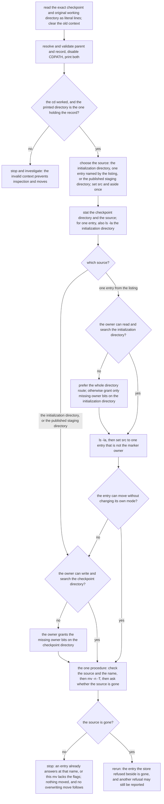

**Why these steps.** The parent is resolved once, from the run's own working directory, because the staging directories are
found through the checkpoint path's parent: a command run from elsewhere names a different directory, and a relative value
read in the wrong directory can name one that looks right and is not the store's. Keeping the resolved directory, and
entering it at the head of every block, is what stops a later block from acting where the shell happens to be standing, and
what stops a nested look-alike of the relative path from being chosen instead of the store's directory. The source is set in
one place per route, and the shared blocks read it with no default, because a default selects whichever route the operator
did not mean. The destination name is checked before the move because the move reports a refusal with neither a message nor a
failing status, and because a destination that is free *and* reserved, the record's own name, is a hazard no move can refuse.
The move refuses rather than merges because an operator's destination may be a leftover of an earlier attempt, and a source
nested inside it would bury the refused entries under a name the next run never uses. The whole-directory route is preferred
because it needs the fewest permissions, changes no mode and opens nothing inside it, which is also why it works for a directory
its owner cannot read or search. A move that keeps the entries is preferred to a removal: the store never reads a moved entry,
and the operator keeps the evidence. An owner bit is granted only on the store's own initialization directory, which the
store's checks established, and never on an entry that has not just been inspected.

What a refusal changes depends on the owner's bits on the directory before the run, as this chart shows. Read a row from
the mode before the run, never from the mode a refusal leaves:

| Owner bits before the run, on `.ota-checkpoint.staging.init` | Refused for other entries | Refused for its marker |
| --- | --- | --- |
| read and search (`0700`, `0500`) | mode unchanged | mode unchanged |
| read, but not search (`0600`, `0400`) | mode unchanged | restored to `0700` |
| not read (`0300`, `0200`, `0100`, `0000`) | restored to `0700` | restored to `0700` |

A `stat` after a refusal cannot always show the mode before the run. Every restoration leaves `0700`, so a `0700` directory
after a refusal is either the mode the owner set or a restoration to it, and nothing on disk says which. Any other mode was
not changed by the refusal, so it is the mode the directory had before the run. The store keeps no record of a restoration:
a record would be one more entry in a directory that must hold only its marker, or a state kept elsewhere that needs its own
durability. The messages say that the restoration is conditional instead.

Each row below names the source that route moves. Read the first block's two lines first: `$parent` is where the destination
name is put, and `$record` is one of the names that destination check rejects.

| Message | Meaning | What to do |
| --- | --- | --- |
| `staging initialization directory holds entries other than its ownership marker` | something else is in `.ota-checkpoint.staging.init` | stop every updater, resolve the context, choose the whole-directory setup, and run the `stat` block; write both modes down. This preferred route needs write and search on the checkpoint directory, and nothing on the initialization directory. To move one entry instead, take its name from the `ls -la` listing and enter it and a destination into the entry setup, then run the one procedure; leave the marker named `owner`. If an entry cannot be moved without changing its own mode, take the whole-directory route or stop. If the owner could not read the directory before the run, its owner permissions were restored, and the message does not establish that. A mode other than `0700` shows that nothing was restored. That mode change, if any, is the only change the refusal made |
| `staging initialization marker must be a private, single-link file owned by the updater, and no longer than its contents` | the marker is a link, a directory, a named pipe, owned by another user, readable by others, or longer than the store writes | resolve the context and inspect the initialization directory; `stat` its marker only if the directory is searchable. Choose the whole-directory setup and run the one procedure: the move needs write and search on the checkpoint directory only, and the next open starts afresh. The chart says whether the owner's permissions were restored, from the mode before the run. The message does not establish that |
| `staging directory must be owned by the updater and private`, or `invalid staging directory ownership marker` | the canonical `.ota-checkpoint.staging` is not this store's, or its marker is not exact | the store never repairs a published directory. Check its owner, mode and marker with `stat` and `cat`, then choose the canonical-directory setup and run the one procedure: the next open builds and publishes a new one, and the staging files stay inside the moved directory for you to read. No initialization directory need exist for this route |
| `cannot settle the checkpoint's staging links, so the run stops before any write` | a look-up or removal of a staging name failed, or the staging directory's sync failed | fix the cause, such as storage errors or a directory that cannot be synced or written, then rerun. Nothing else needs doing |
| `checkpoint file has more than one name` (`checkpoint_invalid`) | the record has a second name, which is not one this release would remove | investigate every name of the record's inode using tools that accept the literal record path safely. Remove each name other than the record itself, only after confirming that it is a staging name of this record or an earlier build's, and that no run is active. Then rerun |

If a refusal does not match any row, do not remove anything. Keep the entry, record its message and the output of `stat` on
it, with `ls -la` where the owner can search it, and ask the updater's maintainers.

**Validation.** `scratch/check_doc_5_4.sh` extracts the seven shell blocks and sources them in one shell, supplying
literal lines via redirected input. It uses a private temporary workspace, runs without privilege, and checks real
`ota-apply` refusals as well as synthetic fixtures. Its coverage includes absolute and relative paths, trailing `/.`, a
`CDPATH` decoy, a failed second context, a physical parent ending in a newline, metacharacters, destination collisions,
and owner modes `0400` and `0300`. An isolated user and mount namespace hides the host's `/tmp` while a nested harness
run checks a sentinel at the old `/tmp/otafix` path. The harness requires Linux user and mount namespaces, Python 3,
GNU tools, `setpriv`, built CLI binaries, and a test signing key. The nested run maps the invoking user to namespace root
only to mount the isolated `/tmp`, then drops all capabilities before running the permission checks. Its snapshots check names, types, modes, links and file contents;
they are not a concurrency or power-loss test.

**What the blocks need from the platform.** The procedure uses GNU `mv -n -T`, `stat -c`, and `ls -la --`, and a shell
supporting `read -r`, `cd --` and the shown parameter expansions. If `mv` rejects either flag, stop: do not fall back to a
move that can replace or nest an entry. It assumes trusted, stable directory ancestry and stopped updaters throughout.

## 6. Failure table

The table below covers the record's behaviour. §8 says what a host does about a
`Mismatch`.

| Event | Stored record | Next run |
| --- | --- | --- |
| Interruption during an operation's writes | the last committed record | replays that operation from its first chunk |
| Flush fails after an operation | the last committed record | replays that operation |
| Replacement fails before rename | the previous record; staging cleanup is best effort | replays the operation whose record failed |
| Rename succeeds, either directory sync fails | new record visible and unconfirmed | storage error. The next resume calls `confirm_stored`: it is refused with `checkpoint_unconfirmed` until a sync works, then resumed (§5.3) |
| Resume's confirmation fails | kept, unconfirmed | `checkpoint_unconfirmed`, no write. The run may be retried |
| Power cut after an unconfirmed rename | the rename kept, or lost (the previous record) | either is resumed: a kept record is confirmed first, and a lost one is the previous record |
| Interruption during staging initialization, under any umask | none, or `.ota-checkpoint.staging.init` in one of the states of §5.3 | the next open restores the owner permissions a umask removed, completes the marker, and publishes; a shape it does not make is refused, with its entries unchanged, and its mode kept unless the owner had to be given read or search access to list it or check its marker (§5.3) |
| Crash after a replacement's rename, before its staging name's removal is durable | the record with two names | the next open removes the staging name by lookup and syncs (§5.2). A failed look-up, removal or sync refuses the open, with no device write, and the next open tries again |
| The open removed the record's second staging name, and the staging directory's sync failed | the name is gone now, and may return after a crash | refused at open, with no device write (§5.4). The next open finds the name gone, syncs the staging directory again, and is refused until that sync works |
| The record has a second name that is not this store's staging name, such as an earlier build's `.ota-checkpoint.stage.<pid>.<key>.<n>` | unchanged | refused with `checkpoint_invalid`, no write; remove that name by hand, as §5.4 describes |
| Interruption in operation zero | `Initialized` | resumes operation zero without a pre-flight |
| Interruption during final verification | `AwaitingFinal` | checks the payload signature from the restored hash state, writes nothing |
| Record damaged, truncated, or of the wrong size | unchanged, but unreadable | refused with `checkpoint_invalid`, no write |
| Record for another payload or target | unchanged | refused with `checkpoint_mismatch`, no write |
| Record is a symbolic link, a dangling link, not a regular file, or has a second name | unchanged | refused with `checkpoint_invalid`, no write |
| Record name is not printable ASCII, or begins with the reserved prefix `.ota-checkpoint.` in any ASCII case, or the directory folds the case of ASCII names | unchanged | store open is refused before record read or device write; the case probe itself creates and removes an entry; a reserved name is refused before the store's locks (§5.2) |
| Base-dependent program applied to a write-only sink | no record written | refused with `target_not_readable`, no write, any existing record unchanged |
| Completed record, target changed since completion | `Complete` | a re-apply refuses with `hash_mismatch`, no write, record kept |
| Final post-flight hash does not match the signed new image | `Mismatch` | refused with `recovery_required`, no write, until the host resets (§8) |
| Writing the `Mismatch` record fails | `AwaitingFinal` before rename; `Mismatch` may be visible if a later sync fails | the mismatch is reported; recovery uses the surviving record and its phase |
| Reset refused, or reset interrupted before the record is removed | unchanged | the next run reports the state it was left in; a refused reset does not write the device |
| Another run holds the lock of the record's directory, whatever the record's name | unchanged | the run is refused at once with "another update holds the checkpoint", before the record is read; no write |
| Reset removes the record, and the directory sync fails | absent now, or back after a crash | `checkpoint_removal_uncertain`, exit `1`: inspect the record and the device, then reset again if the record is present (§8.2) |
| Reset finds no record, and an entry appears at the name before its absence is confirmed | kept | `checkpoint_present`, exit `1`: the reset removes nothing; inspect the record, then reset again (§8.2). The lock makes this impossible for a run of this tool |
| Record deleted mid-update | none | fresh run: without a separate image, recorded old-prefix pre-flight refuses a changed readable device with `hash_mismatch`; it is not a universal guard for separate-image or write-only runs |

## 7. Tests

`ota-client/tests/recovery.rs` injects the failures named here: a final mismatch
on every later run, a retry loop, a failed `Mismatch` write, an interrupted reset, a
reset of another target, a damaged record, and a stream whose payload signature fails.
The unit tests in `checkpoint.rs` cover every single-byte corruption and both record
versions.

The file store's directory rules (§5.2) are tested on the host's own filesystem, which is case-sensitive. A
reserved name is refused before any lock is taken or any probe is made, under every ASCII spelling of the prefix,
and in the two interleavings the reservation exists for: a second store that names another store's staging file, and
one that names a probe in flight. Tests cover the private marker, untouched legacy siblings, bounded sweep, and removal of
eligible single-link staging files on open, and at a replacement's own names when its window is full (§5.2,
`docs/locking-and-recovery.md` §10.6). The window is a listing the test supplies, so the stale files and the record's
second link lie outside it by construction, whatever order the filesystem lists its entries. The replacement test also
checks that the open leaves its stale files in place, so the replacement is what removes them. The mode tests in §5.3
need a non-privileged user, since a privileged process can search any directory. Every open syncs the staging directory,
so a test that injects a failing sync
arms it after its store is open, and the open itself is not the failure under test. Two
spellings in one directory contend for one lock, and a parent symbolic link retargeted after the lock does not move
the run. The case probe's refusal, and its refusal when it cannot run, are tested with injected results. A
**case-folded directory** is not available to the normal suite. The test
`a_case_folded_directory_refuses_the_record_before_and_after_it_exists` runs only when `OTA_TEST_CASEFOLD_DIR`
names a directory on a case-insensitive filesystem, and it prints that it was skipped otherwise. That run is
platform validation: until it has been run on the deployment's storage with the variable set, the case-folded
claim is not validated.

## 8. Final-check failure, recovery and reset

A final hash mismatch is not progress. The checkpoint records it, so the next run
does not repeat the same check as if it were the next step.

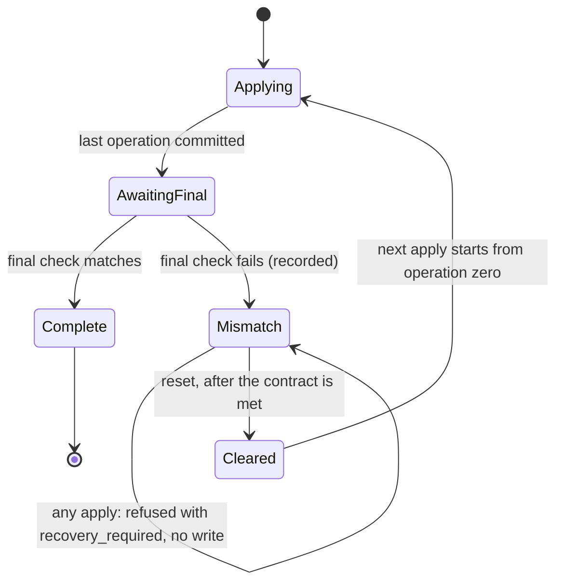

The client reports which recovery the update needs, through `Prepared::contract()`:

| Contract | Meaning | Before a reset | After a reset |
| --- | --- | --- | --- |
| `BaseDependent` | some new-image byte is the destination's own, or a copy reads the target | the destination must match the signed old image. `reset_checkpoint` checks it and refuses otherwise, and the record is kept | the next apply checks the old image again before its first write |
| `DestinationIndependent` | every new-image byte is written, and nothing reads the target | none: the destination may hold anything | the next apply writes every byte from operation zero |

`reset_checkpoint` also requires the record to belong to this payload and this
target, and to be readable. It removes the record only after these checks pass, so a
partly written base-dependent target keeps its checkpoint. An interrupted removal
leaves the `Mismatch` record, and the reset is simply retried.

The host must hold the target exclusively across the reset and the restart
(`docs/platform.md` §2). A reset is a deliberate decision, and the client never makes
one on its own.

### 8.1 The reference reset

`ota-apply --reset-checkpoint` is the explicit form of `reset_checkpoint`. It takes the same
arguments as an apply and the same payload preparation, identity and file checks, and it takes the
device lock before it reads the record. It does not open the old image, so `-s` does not affect it. It writes
nothing to the device. Its report says what it
removed, or that there was nothing to remove, and it always says that the next run starts the
update again from its first operation. No flag clears a record without these checks.

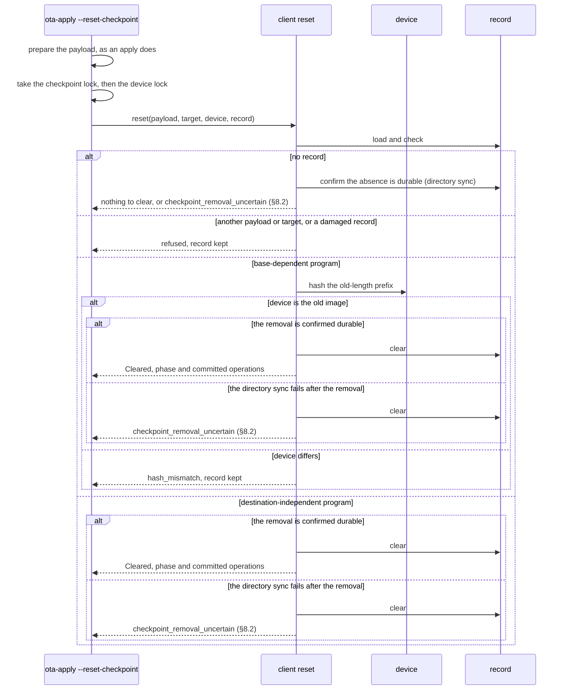

A base-dependent update resets only from the old image, because its kept bytes are the old
image's, and a destination-independent update resets from any contents, because every byte it
leaves is written again. Each refusal happens before the record is removed, and a removal that
fails leaves the record in place for a retry. `ota-client/tests/recovery.rs` and
`ota-cli/tests/reset.rs` test both contracts, the refusals, and a failed removal.

### 8.2 Outcomes of a reset, and recovery from an uncertain removal

A removal has two steps: the record is unlinked, and then the directory is synced so the unlink is
durable. A failure in each step is a different state, and the reset reports them differently.

| Outcome | Record afterwards | Code and exit | What the host does next |
| --- | --- | --- | --- |
| Refused by a check (another payload or target, damaged, base-dependent with a wrong device) | kept | the check's code, `1` | fix the cause, then reset again |
| Unlink fails (for example, the directory is not writable) | kept | `device_io`, `1` | make the directory writable and reset again |
| Unlink succeeds and the directory sync succeeds | absent | success, `0`; the next run starts from operation zero | apply the update again |
| No record, and the directory sync succeeds | absent, and its absence is confirmed durable | success, `0`, reported as nothing to clear; the next run starts from operation zero | apply the update again |
| No record, and the directory sync fails | absent, but its absence is not confirmed durable | `checkpoint_removal_uncertain`, `1` | run `--reset-checkpoint` again |
| No record when it was loaded, and the absence check cannot look up the name | unknown: neither presence nor absence is claimed, and nothing is removed | `checkpoint_removal_uncertain`, `1` | run `--reset-checkpoint` again; it removes a record that is present |
| No record when it was loaded, but an entry is found at the name by the absence check | kept, whatever the entry is (a symbolic link included) | `checkpoint_present`, `1`; nothing is removed | inspect the entry, then reset again. Under the lock this is not reached by a run of this tool |
| Unlink succeeds and the directory sync fails | **absent now**, may reappear after a crash | `checkpoint_removal_uncertain`, `1` | see below |
| Another run holds the checkpoint or device lock | kept | "another update holds", `1`; the record is not read | wait for that run to finish, or stop it |

The uncertain row is the only one where the record and the device can disagree with what the report
suggests, so it has its own procedure. After it, the operator must not assume either state:

1. Do not assume either state. The checkpoint file may or may not exist, so check it, but do not rely on the check.
2. Run `--reset-checkpoint` again, whichever state the file is in. It repeats every check, so a record that no
   longer fits the device is still refused, and nothing is written. It removes a record that is present, and it
   succeeds only when the absence is confirmed durable. An absent record, whose absence the reset cannot confirm,
   is therefore still reported as uncertain.
3. Only a successful reset lets the next apply start from operation zero. A base-dependent update first needs the
   old image on the device, and the apply's pre-flight refuses a device that holds anything else. A
   destination-independent update rewrites every byte.

```mermaid
stateDiagram-v2
    [*] --> Kept: record present
    Kept --> Kept: refused by a check, unlink fails, or lock held
    Kept --> Removed: unlink succeeds
    Removed --> Durable: directory sync succeeds
    Removed --> Uncertain: directory sync fails
    Uncertain --> Kept: a crash brings the removal back; reset again
    Uncertain --> Absent: reset again, and its sync confirms the absence; apply from operation zero
    Durable --> Absent
    Absent --> [*]
```

The reset never writes the device, so none of these outcomes writes a target. The uncertain outcome is
produced in the tests by injecting a failed directory sync after the unlink, and the test asserts both
the reported code and that the record is absent: `ota-cli/tests/reset.rs` and
`ota-client/tests/recovery.rs` (`a_reset_whose_removal_is_not_confirmed_durable_says_so_and_leaves_no_record`,
and `a_retry_that_finds_no_record_confirms_its_absence_before_it_reports_success` for the retries).

## 9. Versions and migration

| Version | Phases | Written by | Read by |
| --- | --- | --- | --- |
| 1 | `Initialized`, `Applying`, `AwaitingFinal`, `Complete` | earlier releases | this release, unchanged |
| 2 | version 1's phases, and `Mismatch` (code 4) | this release | this release |

The field layout is the same in both versions. Only the version byte and the phase
set differ, and a version-2 writer emits `Mismatch` only after a failed final check.
A version-1 record is therefore read exactly as before. A version-1 reader refuses a
version-2 record with `checkpoint_invalid`, so an older tool never parses a record
it does not understand. Its refusal leaves the record untouched, and the newer tool
can still read it.

No record-format migration is needed from version 1 to version 2; a compatible version-1 record is rewritten as
version 2 on its next replacement. This does not remove the separate identity and lock migration requirements in §5.1
and §5.2.

- `ota-client/src/checkpoint.rs`: round trip, every single-byte corruption refused,
  wrong length and version refused, store replacement and its failure.
- `ota-client/tests/resume.rs`: a cut at every write on both pipelines; a cut in
  operation zero of an in-place update, after the fresh pre-flight has passed; a failed
  flush at every barrier; a failed replacement at every record; resume during final
  verification on the streamed path, which reads only the signature message from the
  record's offset and checks it over the restored state, with a damaged signature
  refused with no write and an intact one completing; zero-data operations advancing the index;
  refusals for another payload, another target, a damaged record, a moved offset,
  and a stale device; a completed update re-applied on both pipelines, which
  writes nothing, refuses an altered target with `hash_mismatch`, refuses a
  damaged stream ending, and checks no target when no new hash is recorded.
- `ota-cli/src/filecheckpoint.rs`: missing, exact, short, long and sparse record
  files; new records have no group or other permissions; a leftover staging name;
  a legacy `<path>.tmp` symlink; and a replacement whose names are all taken.
- `ota-cli/tests/cli.rs`: a missing or malformed `--target-id` is a usage error; an
  interrupted stream resumes under its original identity, in either case, and is
  refused under another with no write; a sparse checkpoint of one terabyte fails
  cleanly under the memory limit; a completed update re-run writes nothing, and is
  refused once its target has changed.
- `ota-client/tests/model.rs`: random programs, each interrupted at a random write
  and resumed, on both pipelines, compared with the byte-array model.
- `ota-cli/tests/e2e.rs`: a streamed run cut mid-stream, resumed with a file
  checkpoint and a payload reopened at the offset the record names.
- `ota-cli/src/filecheckpoint.rs`: a symbolic link, a dangling link and a second hard link are
  refused before any device write, and the link target is untouched.
- `ota-cli/tests/policy.rs`: a device held by another process refuses every record name and
  every hard link to it, with no record created, and a different device is not blocked. A record
  that is a symbolic link, or has a second name, is refused with no write.
- `ota-cli/tests/reset.rs`: a completed independent reset and the next run; a base-dependent reset
  refused while the device holds the new image and allowed once the old image is back; another
  target or payload refused with the record kept; no record; a reset under another process's
  device lock; a failed removal that keeps the record and succeeds on retry; a damaged record kept;
  a removal whose directory sync fails, reported as `checkpoint_removal_uncertain` with the record
  absent; a retry whose sync also fails, which is uncertain again; and a later retry whose sync succeeds,
  which confirms the absence and clears nothing (§8.2).
- `ota-cli/src/filecheckpoint.rs`: a failed directory sync after the unlink is uncertain and leaves the
  record absent; a removal that fails before the unlink is a storage error and keeps the entry; a failed
  sync when no record remains is uncertain, until a later sync confirms the absence; the checkpoint lock
  is shared through a symbolic-linked directory before the record exists; two names in one directory
  share one lock, and a record named like a lock file is refused while the directory is held; the two
  spellings of one name in a case-sensitive directory take turns behind that lock; a record inside
  the lock namespace is refused; a path with no file name, or with a missing directory, is refused; a
  reserved name is refused before any lock, in every ASCII case, with the prefix matched whole, and two
  interleavings (a staging name, a probe in flight) are refused and leave the entry untouched; a probe that
  cannot run refuses the store and releases its lock; a failed look-up after an absent load is uncertain
  and confirms nothing; the entry identity is read without following a link.
- `ota-cli/src/filelock.rs`: a new lock file is private and a second attempt is held; a symbolic link,
  even a dangling one, or a named pipe at the lock name is refused without a create, a write or a wait; a
  lock file with a second name is refused; a pre-existing lock file accessible to others is refused and
  left unchanged; a lock file that an access ACL grants a named group is refused; a new lock file in a
  namespace with a default ACL grants nothing; the namespace is usable only by its owner, and a symbolic
  link or a non-directory is refused; locks are taken in the namespace validated at open, even after its
  path is replaced; a failed mode change publishes no name, and a later take succeeds; a lock file an
  interrupted earlier release left without owner access is refused with the recovery pointer and is not
  changed.
- `ota-cli/tests/umask.rs`: under a restrictive umask, a failed mode change publishes nothing, and six
  contenders for one new name, two of them failing their mode change, leave exactly one private lock file
  that the others see as held or refused.
- `ota-cli/src/roles.rs`: a checkpoint parent retargeted after the payload is opened is compared in the
  directory it then names, and refused as an alias of the device; a parent retargeted to a payload alias is
  refused; an old image that is the device is refused and the device is untouched; a payload path replaced
  after it was opened is compared by the file that was opened.
- `ota-cli/src/filedevice.rs`: a regular file is locked through a hard link and released on drop; a
  different file is not blocked; a regular-file lock creates nothing in the namespace; the lock follows
  the device number, and other file types are refused.
- `ota-cli/tests/locks.rs`: a checkpoint held by another run refuses another target on both the buffered
  and streamed paths with no write and no record; a held record refuses a reset and keeps it; a
  symbolic-linked directory names the same lock; a run refused on its device leaves the checkpoint free;
  an unrelated checkpoint and device pair, in another directory, proceeds; a record named `state.lock` is
  refused while `state` is held in the same directory, writes nothing, and runs once `state` is released; a
  record with the reserved prefix is refused before any lock, with the namespace left empty; a missing or
  group-accessible namespace refuses the run with no write; a checkpoint inside the namespace is refused; a
  checkpoint lock file that is a symbolic link is refused with no write; the lock file is private, kept, and
  in the namespace, not beside the record; an old sidecar `<name>.lock` is neither used nor removed. Two
  device nodes for one block device contend, when `OTA_TEST_BLOCK_DEVICE` names a block device and the
  process may create device nodes (§7.1 of `docs/locking-and-recovery.md`).
- `ota-cli/tests/policy.rs`: a checkpoint that is the payload by hard link is refused on both the buffered
  and the streamed path, with no write.
- `ota-client/tests/policy.rs`: a kept sparse chunk with an uncovered range is refused by both
  write-only sink methods with no write and no record change.
- `ota-client/src/checkpoint.rs`: a replacement that fails its sync is visible, is lost by a crash until it is confirmed, and
  is refused by a failed confirmation; a confirmed replacement survives a crash; a durable record confirms without a fault.
- `ota-client/tests/durability.rs`: for every replacement, a visible unconfirmed record is refused by a resume with no
  write, and a resume after confirmation completes; a power cut that loses an unconfirmed record resumes from the record
  that was durable; a reset does not wait for a confirmation.
- `ota-cli/tests/durability.rs`: the same sequence on the file store and a real device, with an injected failed directory
  sync: the retries are refused with no write, and a lost first rename leaves no record, from which the update completes.
- `ota-cli/src/filecheckpoint.rs`: a rename whose record directory sync fails, and one whose staging directory sync fails,
  are refused by the confirmation until a sync works; a crash that keeps or loses the rename resumes the record it leaves;
  a second link to the record left by an unfinished publication is removed on open, by lookup of its name; an
  initialization interrupted at any of the seven steps, and at any pair of steps, is completed by the next open, and no
  canonical directory is ever seen without its complete marker; at each step, the owner permissions a umask removed from
  the directory and marker are restored before the retry (the restrictive modes of `0500`, `0200`, `0000` and the marker
  modes `0400`, `0200`, `0000`); a torn marker of any bytes no longer than its contents is discarded and made again,
  including zero-filled and partly persisted ones; a marker longer than its contents, an initialization directory of any
  other shape, a symbolic link, a named pipe, a foreign owner, a second link or a public mode is refused with nothing
  changed, except the owner bits of a directory its owner cannot read or search, which are restored first, and the modes of other
  refused entries are not changed; an initialization directory the owner can read keeps its mode when refused
  (`an_initialization_directory_the_owner_can_read_is_refused_with_its_mode_and_entries_kept`), and one the owner cannot
  read is restored and then refused (`an_initialization_directory_the_owner_cannot_read_has_its_owner_bits_restored_before_the_refusal`),
  and a refused marker in one the owner cannot read or search is restored, with a refusal that names read and search
  (`a_refused_marker_in_a_directory_the_owner_cannot_read_restores_its_mode_and_the_refusal_names_read_and_search`); a
  directory the owner cannot search is moved aside whole, and the next open starts afresh
  (`an_initialization_directory_the_owner_cannot_search_is_moved_aside_whole_and_the_next_open_starts_afresh`); a second link that is another entry's name, or whose
  removal, look-up or sync fails, refuses the open; every open syncs the staging directory, so a refused removal is
  confirmed by a later open and no write precedes it, with two failing opens followed by one that works, each counted
  (`a_removal_that_is_not_confirmed_durable_refuses_every_open_until_a_sync_confirms_it`); a listing that fails leaves the
  sweep's debris, and the record's own link is still removed by name; a record's own link is removed past a full sweep
  window of at least 256 non-removable entries; a replacement whose 16 names are occupied removes the single-link files
  among them when the sweep's window holds 256 directories it cannot remove and does not reach them, keeps the links and other entries, and fails before its
  rename when a look-up or removal of one of them fails; a published directory wins over a leftover initialization
  directory beside it.
- `ota-cli/tests/staging_umask.rs`: under the umasks `0022`, `0277`, `0577`, `0377` and `0777`, a directory and marker
  left by an interrupted creation (no directory, an empty marker, a torn marker, a complete unsynced marker) are completed
  by the next open, which then loads and replaces the record, and leaves the directory `0700` and the marker `0600`. This
  file holds the only test of its binary, since the umask is process-wide. It is run as a non-privileged user, since a
  privileged user passes the permission checks whatever the mode.
- `ota-cli/tests/reset.rs`: a streamed reset clears the record, writes nothing, and refuses another target, a base-dependent
  device holding the new image, and a held device, with the record kept; a streamed reset needs no payload body, where the
  buffered reset must read it; a payload over `--max-buffered-payload` resets streamed and is refused buffered.
- `ota-cli/tests/limits.rs`: a buffered payload over the limit is refused before any write; a payload of exactly the limit
  applies, and one byte less is refused; a streamed apply is not bound by the limit; a named pipe and a character device are
  refused as payload and as key without waiting or reading; an oversized key file is refused before it is parsed.
- `ota-cli/src/main.rs`: the bounded reader reads a reader of exactly the limit, refuses one byte more as it grows, reports a
  read error with its path, keeps its buffer within the limit, and refuses a regular file over the limit before a read and a
  directory without one.
