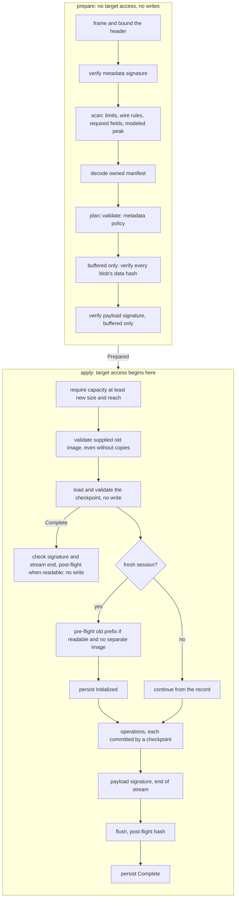
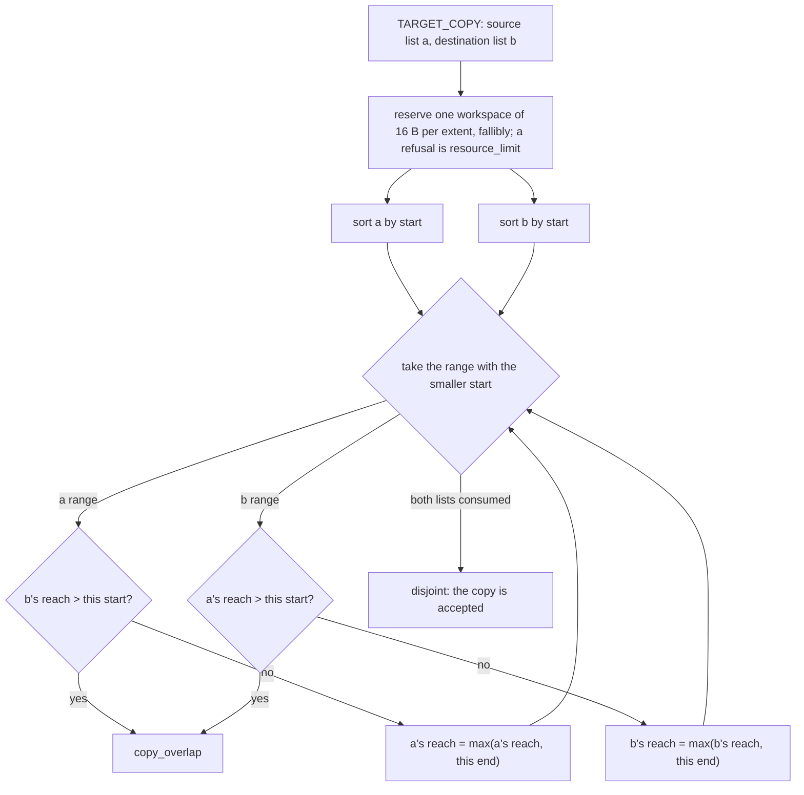
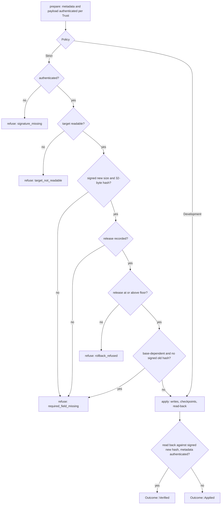
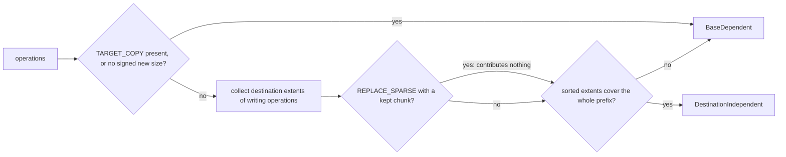

# OTA apply middleware

`ota-client` is the `no_std` middleware between a payload and storage. It owns
signature gating, metadata policy, the replay of operations, the resume contract
and the device guards. It does not own payload transport (out of project scope:
hosts hand over complete bytes or implement `Source`), and it does not own a
device model (hosts implement `Sink` and, where they can read back, `Readable`).

## 0. Scope of the two pipelines

| Pipeline | Entry | Payload | Resume | Pre-flight | Post-flight |
| --- | --- | --- | --- | --- | --- |
| buffered | `apply::prepare(..)` then `apply_to_device` / `apply_to_sink` (+ `_with_image`) | complete, in memory | by checkpoint | fresh readable target, no separate image, recorded old hash | readable target with recorded new hash; also on completed reruns |
| streamed | `stream::prepare(..)` then `apply` / `apply_with_image` | pulled through `Source` | by checkpoint, and the host reopens the payload at the offset it names | fresh readable target, no separate image, recorded old hash | readable target with recorded new hash; also on completed reruns |

Both pipelines have the same two phases, and the same operation semantics
(`docs/format.md`). They differ in when blob bytes are checked and in how the
payload is supplied (`docs/stream.md` §3).

## 1. Two phases, one boundary

Every pipeline is split into `prepare` and `apply`. The split is a type:
`prepare` returns a `Prepared` value, and the only way to obtain one is to pass
every check that can be decided from the payload alone.



Two consequences follow from the split:

- A metadata failure is always raised in `prepare`, so it always leaves the
  target untouched. The regression tests check this at the process boundary.
- `apply` binds capacity before target reads or writes. Capacity must be at least
  the recorded **new** image size and the operation reach, not equal to either.
  An undersized target is refused without being touched. Old and new image lengths
  are independent; `Geometry.size` is the optional new length. Storage is never
  resized, padded or truncated, and bytes beyond the new length stay unchanged.

See `docs/image-geometry-and-cli.md` for the geometry and adapter-routing design.

## 2. Storage contracts

All storage is byte-addressed. The middleware never assumes a sector size, an
erase unit or an alignment. An adapter that sits on block hardware owns that
translation: it reads and rewrites whole blocks around a byte range, erases what
it must, and keeps each write inside the range it was given.

### 2.1 `Sink` and `Readable`

| Member | Contract |
| --- | --- |
| `capacity()` | Bytes. Fixed for the storage's lifetime. Must hold the recorded new image and all target-addressed ranges; checked before target access. |
| `write_at(offset, data)` | Writes `data` at byte `offset`. Acceptance is not persistence. A failed write may leave part of its range modified, and must not modify any byte outside it. |
| `flush()` | **Persistence barrier.** On `Ok`, every write made before the call survives power loss. A sink that cannot promise that must not return `Ok`. |
| `read_at(offset, out)` | Fills `out` from `offset`. Used by in-target copies, the pre-flight and the post-flight hashes. Only a `Readable` target can run those. |

`ota_client::sink::check_range` is the one definition of the range rule. Every
bundled sink calls it before touching storage.

### 2.2 `OldImage`: the read-only source of `SOURCE_COPY`

| Member | Contract |
| --- | --- |
| `capacity()` | Bytes. Must equal the recorded old partition size, when one is recorded. Checked before any write. |
| `read_at(offset, out)` | Read-only. The image is immutable for the whole update, including resumed runs. |

A plan with no copy from the old image needs no image, and `apply` without one
behaves as before. A plan with one is refused with `source_missing` if no image is
given. The platform contract that makes immutability true is in
`docs/format.md` §8.

### 2.3 Bindings in `ota-cli`

| Binding | Capacity | Durability |
| --- | --- | --- |
| `FileDevice` | the file's size, read by seeking to the end, so block devices work | `flush` calls `fsync`. The sync function is injectable for tests, and a sync failure is propagated. |
| `FileImage` | the file's size, read-only | none needed: nothing is written |
| `FileSource` | payload bytes, from a cursor that starts at `open_at(offset)` | none needed |
| `FileCheckpoint` | the record file (§5), read as one fixed-size record, in the directory opened once for the run (`docs/checkpoint.md` §5.2) | an exclusively created temporary file beside it, set to mode `0600`, `fsync`, rename, directory `fsync`. A removal unlinks the record, then syncs the directory; a failed sync after the unlink is `checkpoint_removal_uncertain` (`docs/checkpoint.md` §8.2) |
| `RamDevice` | its length | volatile: `flush` is a no-op and claims no durability. Tests and dry runs only. |

### 2.4 What the middleware guarantees, and what the host must

| Guarantee | Owner |
| --- | --- |
| No write happens if the metadata is refused | middleware (`prepare`) |
| No write happens to a target too small for the recorded new image or operation reach | middleware (`bind`) |
| Every range is checked against the capacity before its write | middleware (`check_range` in every binding) |
| A completed update re-applied is checked against the new-image hash | middleware, on a readable device only. A write-only sink cannot read back, so it cannot make this check. |
| A full-image payload overwrites its new-image prefix on any sufficiently large target, leaves its tail unchanged, and checks the new prefix after flush on a readable device (§2.6) | middleware (`bind`, post-flight). A write-only sink cannot check the result. |
| A successful `flush` means the sink's persistence barrier succeeded | the sink implementation |
| Every operation is committed by a durable checkpoint after its writes are flushed | middleware (`engine`), given a durable store |
| The checkpoint store is atomic and durable, and writable only by the updater | the host (`docs/checkpoint.md` §5) |
| The old image is unchanged, and the target is exclusive | the host (`docs/format.md` §8) |

### 2.5 Old-image validation, before any write

Whenever a separate `OldImage` is supplied, `apply` validates it before target
reads or writes, including resumed runs and plans without `SOURCE_COPY`:

1. The image's capacity equals the recorded old size, when one is recorded. A
   mismatch is `source_geometry`.
2. Every copy's source extent lies inside the image. A copy outside it is
   `extent_out_of_range`.
3. The whole-image hash equals `old_partition_info.hash`, when one is recorded. A
   mismatch is `source_mismatch`.
4. Each copy's source hash equals the SHA-256 of the bytes it reads. A mismatch
   is `source_mismatch`.

A copied chunk is read for its source hash, and once more for the whole-image
hash when one is recorded. Replay then reads it again, which is safe because the
image is immutable.

The separate image is an independent input, not an initializer for the target.
Untouched bytes and sparse-kept bytes still refer to the destination's existing
contents. The adapter must arrange for those bytes to be correct; merely supplying
an old image does not make a delta suitable for an arbitrary blank A/B slot.

Without a separate image, a fresh readable session hashes `[0, old_size)` of the
target against the recorded old hash. It must have enough capacity for that prefix,
even for a shrink. Resumed sessions skip this target pre-flight because the target
is already partly modified. Post-flight, including reapplying a completed update,
hashes `[0, new_size)` against the recorded new hash. Spare capacity is excluded.
An absent or empty hash skips its check; when its size is absent, the hash uses
the target capacity. Generated deltas record both image lengths and hashes; full payloads record only
new-image info.

### 2.6 Full-image payloads: unknown starting contents

A full-image payload (`docs/format.md` §12) records no old partition, so the host
need not know what the target holds, and the middleware does not check for it:

- `apply` needs no old image: `needs_source` is false. An explicitly supplied
  image still follows §2.5; normally none is supplied.
- No pre-flight hash runs, because the manifest records no old hash. Zeros, erased
  flash and unrelated data are all overwritten, and a device that holds any of them
  is updated the same way.
- The device's capacity must be at least the recorded new size. A smaller target
  is refused with `partition_mismatch` and no write.
- On a readable device the new-image hash is checked after the flush, as for any
  payload. A write-only sink cannot read back, so it cannot make that check.

The host supplies a device large enough for the image. The payload writes its
entire new prefix and leaves bytes after it unchanged; the middleware does not
pad, truncate or resize storage.
The resume rules of §5 apply unchanged. An operation is the unit of commit, so a large
raw operation is rewritten in full after an interruption (`docs/full-image.md` §6).

## 3. Metadata policy (`ota_payload::plan`)

`plan::validate` is the single device-independent definition of a well-formed
plan. The generator runs the same function as a self-check, so the generator
cannot emit a payload that the client's policy rejects.

| Rule | Code on failure |
| --- | --- |
| minor version is 17 | `unsupported_minor_version` |
| chunk size (`block_size`) in `1 … profile.max_block_size` | `unsupported_block_size` |
| payload signature size within the profile | `resource_limit` |
| exactly one partition | `partition_mismatch` |
| partition name is nonempty UTF-8 (decoder rule; a logical label, not a storage lookup) | `required_field_missing` for empty; invalid UTF-8 is rejected by decode |
| operation type is one of the six in `docs/format.md` §1 | `unknown_operation` |
| source extents and `src_length` only on the two copies; `frame_table` only on the two frame operations | `unsupported_field` |
| every extent states `start_byte` and `num_bytes`; every extent is non-empty and does not overflow; totals do not overflow | `required_field_missing`, `extent_out_of_range`, `overflow` |
| blobs are contiguous, in operation order, and `signatures_offset` equals the blob total | `extent_out_of_range`, `overflow` |
| destinations and `TARGET_COPY` sources lie within the recorded new length; `SOURCE_COPY` sources lie within the recorded old length, when present | `extent_out_of_range` |
| `REPLACE`: blob length equals the destination's total, and a data hash is present | `blob_mismatch`, `required_field_missing` |
| `ZERO`: no blob; hash absent, empty, or the empty digest | `blob_mismatch` |
| `REPLACE_FRAMES`: data hash; a frame table with one entry per chunk, each zlib length below its chunk, summing to the blob | `required_field_missing`, `frame_table_invalid`, `blob_mismatch` |
| `REPLACE_SPARSE`: data hash; a chunk map of the canonical length with unused bits clear; a table with one entry per zlib chunk; empty blob has the empty digest | `required_field_missing`, `block_map_invalid`, `frame_table_invalid`, `blob_mismatch` |
| packed components within their limits, by chunk count | `resource_limit` |
| `SOURCE_COPY` and `TARGET_COPY`: equal logical lengths, no blob, no data hash, a source hash | `blob_mismatch`, `unsupported_field`, `required_field_missing` |
| `TARGET_COPY`: source and destination ranges do not intersect, checked by the sorted sweep of §3.2 | `copy_overlap` |
| `dst_length` and `src_length`, when present, match | `blob_mismatch` |
| all sums and products are checked | `extent_out_of_range`, `overflow` |

Revision 17 removed three rules of the earlier format: destinations had to
advance across operations, extents had to be sorted and disjoint within one, and
a partition's size had to be a whole number of blocks. The format now puts no
constraint on where an operation writes, beyond the bounds and the copy rule
above.

Device-dependent rules are checked in `apply::bind` and in the checkpoint
resume:

| Rule | Code |
| --- | --- |
| device capacity is at least the recorded new size, when recorded | `partition_mismatch` |
| target-addressed operation reach fits the device (excludes `SOURCE_COPY` sources) | `extent_out_of_range` |
| the target is readable, when an operation needs to read it | `target_not_readable` |
| the old image's geometry and hashes (§2.5) | `source_missing`, `source_geometry`, `source_mismatch`, `extent_out_of_range` |
| the checkpoint belongs to this payload and target, and its position is consistent (`docs/checkpoint.md` §4) | `checkpoint_mismatch`, `checkpoint_invalid` |

### 3.1 The end of the payload (`layout::locate`)

A declared payload-signature region must end exactly where the payload ends. The
rule lives in `layout::locate`, which both the buffered verifier and the
unverified buffered path call. It therefore holds with or without
authentication.

| Case | Trust | Result |
| --- | --- | --- |
| declared region ends exactly at the payload's end | any | accepted |
| declared region runs past the end | any | `overflow` |
| bytes after the declared region, buffered | verified or unverified | `parse`, before any write |
| bytes after the declared region, streamed | verified or unverified | `parse` at end of stream, after the blobs were written (`docs/stream.md` §3) |
| no declared signature region | any | the blob-length check governs framing |

Wire-level rules are not in `plan`. They are applied before decoding, in
`ota_payload::prescan`, and are listed in `docs/protobuf.md`.

### 3.2 The copy check: a sorted sweep

A `TARGET_COPY` is refused when any byte of its source is also a byte of its
destination. The rule covers whole range sets. Every source extent is compared
with every destination extent of the same operation, and each list may overlap
itself.

The check used to compare pairs, which costs the product of the two list lengths.
The embedded profile bounds that to 64 × 64 = 4,096 comparisons. The host profile
admits 2²⁰ extents per operation, where the product reaches about 2³⁸. The check
now sorts instead.



The sweep is exact, for three reasons:

- Of two ranges from different lists that share a byte, the one taken second in the
  merged order starts no earlier than the other. When it is taken, the other is
  already among the ranges taken, so it has been recorded in its list's reach.
- That earlier range shares a byte with the later one exactly when it still reaches
  past the later one's start, since it starts no later. The reach of a list is its
  furthest end so far, and it covers every range of that list already taken. So the
  test needs one number per list.
- Overlap inside one list raises that list's reach, but it never hides a meeting. A
  meeting is found when the later range of the pair is taken.

| Form | Work | Workspace |
| --- | --- | --- |
| pairwise (before) | a × b comparisons | none |
| sorted sweep (now) | sort a and b, then one merge: O((a + b) log (a + b)) | 16 B per extent of the operation, in one allocation |

The workspace is the one `SPAN_COST` interval per extent, which the scanner charges
for the whole manifest. One operation's workspace can never exceed that charge, so
the copy check adds no term to the memory model (`docs/memory.md` §2.5). A
workspace the allocator refuses is a `resource_limit`, and nothing is written.

## 4. Authentication and trust

- `Trust::Verified(keys)` requires both embedded signatures to verify against at
  least one key each. The metadata signature is checked over the raw header and
  manifest bytes **before** the manifest is decoded.
- `Trust::Unverified` skips signature checks and nothing else. Every structural
  and policy check still runs, and every blob's hash still verifies it. That
  includes the end-of-payload rule in §3.1.
- Buffered and streamed `Prepared::partition_name()` expose the validated logical
  name for adapter allowlists/routing before opening storage. The name is authenticated
  only under `Trust::Verified`; `Trust::Unverified` does not make it trusted.
  Neither the engine nor `ota-apply` resolves it to a device path or A/B slot.
- The `Authenticated` type can only be constructed by the verifier, so code that
  accepts one can rely on the signatures having been checked.

The verified and unverified paths differ on exactly one point. Without
signatures, a payload is only as trustworthy as its manifest's own hashes, so the
unverified path is for trusted media and tests.

## 5. Progress, resume and the checkpoint

Every run of an update is identified by three things: the authenticated metadata,
the target identity the host passes, and the checkpoint record the host stores.
`docs/checkpoint.md` states the record and the rules. In brief:

- A **fresh** session has no record. It is checked against the old partition hash
  when the manifest records one, and then the record `Initialized` is written
  before the first write.
- Each operation is committed by a record after its writes are flushed. A
  **resumed** session starts at the record's `next_op`, reads the payload from the
  record's offset, and does not check the target against the old hash again.
- A completed session writes nothing, and it still checks the payload signature
  and the end of the stream. On a readable target it also checks the new-image
  hash, so a target altered since completion is refused with `hash_mismatch`.

A checkpoint of another payload or another target is refused, with no write. A
damaged checkpoint is refused, with no write.

**Completing an operation is not verifying the update.** An operation is complete
when its writes are flushed and its checkpoint is durable. The update is verified
only at `Complete`, which follows the payload signature, the end of the stream and
the post-flight hash. A target whose operations are all committed but not yet
verified is in the `AwaitingFinal` phase: it holds the new content, and the
client has not yet vouched for it.

## 6. Failure taxonomy

| Class | When | Target afterwards |
| --- | --- | --- |
| **Metadata error** | header, scan, signature, decode, plan, layout (including trailing bytes), or capacity bind fails | untouched |
| **Blob corruption, buffered** | a blob's data hash mismatch, found in `prepare` | untouched |
| **Blob corruption, streamed** | a blob's data hash mismatch, found after that operation's writes | earlier operations committed; the failing one is replayed on resume |
| **Frame corruption** | a zlib frame that does not decode to its chunk | chunks before it in the operation written; the operation is replayed on resume |
| **Old image refused** | a missing, mis-sized or changed old image, or a copy whose source hash does not match | nothing written: the image is checked before the first write |
| **Target copy refused** | a target-copy source that does not match its hash | nothing written by that operation; earlier operations committed |
| **Checkpoint refused** | a checkpoint of another payload or target, or a damaged record | nothing written |
| **Stream corruption or truncation** | the payload is short, has trailing bytes, or has a bad payload signature | streamed: written up to the failure, and resumable; buffered: untouched |
| **Device I/O** | a read or write fails | the operation is replayed on resume, once the device is healthy |
| **Flush failure** | `flush` returns an error | the operation is replayed; durability is unknown until then |
| **Checkpoint store failure** | `replace` returns an error | the previous record stands, or, if the rename happened and only a sync failed, the new record is visible but unconfirmed. A resume confirms it (`confirm_stored`) before it writes, and refuses it with `checkpoint_unconfirmed` until a sync works (`docs/checkpoint.md` §5.3). The operation is replayed |
| **Post-flight mismatch** | the new-image prefix hash does not match | written and flushed, but wrong: the caller must treat the target as failed |
| **Altered after completion** | a re-applied completed update finds that the new-image hash no longer matches | nothing written, and the record stays `Complete`: the caller must treat the target as failed |

The middleware never writes a range it has not bound to the capacity, and never
writes on a metadata error.

## 7. Memory

The memory model, its allocator assumptions and the measurements are in
`docs/memory.md`. In short: the decoded manifest is bounded by a modeled budget of
32 KiB; the replay holds one chunk buffer, plus a staging buffer and the codec
when a zlib frame is decoded; the signature check holds the decoded manifest, the
signature slot, the chunk buffer and the RSA workspace. The largest modeled phase
is the streamed payload-signature check at 64,040 B.

### 7.1 Completed updates need hash scratch, not replay staging

A completed re-apply replays nothing. It checks the payload signature and the end of
the stream, and on a readable target it hashes the new image. So the run allocates the
chunk buffer, which the hash reads through, and the buffer the signature is read into.
It never allocates the staging frame that replay reads a compressed chunk into, or the
codec that decodes it.

```text
  run
   │
   ├─ Buffers::new ─────────────────────────► chunk buffer (every run)
   │
   ├─ validate old image, resume_point (checkpoint only, no write)
   │
   ├─ phase = Complete
   │     │  signature buffer, end of stream, post-flight hash (chunk buffer)
   │     └─► return                          no staging frame, no codec
   │
   └─ phase = Initialized | Applying | AwaitingFinal
         │
         ├─ stage_frames ───────────────────► staging frame (a frames or sparse operation is still to replay)
         ├─ fresh only: preflight, record Initialized
         ├─ replay: codec allocated on the first zlib frame
         ├─ release frame and codec
         └─ finish: signature buffer, flush, post-flight, record Complete
```

| Run | chunk buffer | staging frame | codec | signature buffer |
| --- | --- | --- | --- | --- |
| fresh or resumed replay | yes | when a frames or sparse operation is still to replay | on the first zlib frame | after replay, with the frame and codec released |
| completed re-apply | yes | never | never | yes |

The staging frame is allocated before the first device check and the first record,
so a refusal to allocate it leaves the device and the checkpoint as they were. It is
allocated only after the `Complete` branch, so a completed re-apply cannot be refused
for want of it. A run that resumes at `AwaitingFinal` has no operation left to replay,
so it allocates no frame either. That path is not measured separately: the allocation
follows from the check, which only looks at operations from the record's `next_op` on.

The measured effect is on the unverified streamed path, `ota-client/tests/peak_completed.rs`.
There the completed re-apply's peak above its prepared state is 4,400 B (a 4,112 B chunk
buffer and a 288 B signature buffer), where HEAD's was 8,224 B, the chunk buffer plus the
staging frame. A verified re-apply does not show the difference. Its signature check holds the RSA
workspace, which is larger than the frame and is never live beside it, because HEAD
released the frame before the check. Measured with the RSA-2048 fixture key, the
verified re-apply peaks at 16,528 B on HEAD and on this change alike.

## 8. API

```rust
use ota_client::checkpoint::TargetId;

// Buffered: the complete payload in memory. prepare checks every blob.
let prepared = ota_client::apply::prepare(payload, Trust::Verified(&keys), &EMBEDDED)?;
let g = prepared.geometry();         // optional NEW length, chunk size, operations, reach
let name = prepared.partition_name(); // adapter policy; authenticated under Verified only
prepared.apply_to_device(&mut dev, &mut store, &target, &progress)?;
prepared.apply_to_device_with_image(&mut dev, &old, &mut store, &target, &progress)?;
prepared.apply_to_sink(&mut sink, &mut store, &target, &progress)?;        // no reads
prepared.apply_to_sink_with_image(&mut sink, &old, &mut store, &target, &progress)?;

// Streamed: prepare reads only the metadata region; apply opens the payload where
// the checkpoint says to start.
let prepared = ota_client::stream::prepare(src, Trust::Verified(&keys), &EMBEDDED)?;
prepared.apply(open, &mut dev, &mut store, &target, &progress)?;
prepared.apply_with_image(open, &mut dev, &old, &mut store, &target, &progress)?;
```

`apply_to_sink` refuses a plan with an in-target copy, and a base-dependent plan, with
`target_not_readable`, before the checkpoint is read or the sink is written (§11). It runs no
pre-flight or post-flight hash, because it cannot read the target.
On a re-apply of a completed update it likewise runs no post-flight hash, so a
write-only sink cannot detect a target changed since completion.

Migration from the previous API:

| Previously | Now |
| --- | --- |
| `Sink::block_size`, `Sink::num_blocks`, `Sink::write_at(block, data)` | `Sink::capacity`, `Sink::write_at(offset, data)` |
| `OldImage::block_size`, `num_blocks`, `read_at(block, out)` | `OldImage::capacity`, `read_at(offset, out)` |
| `check_block(block, ..)` | `check_range(offset, len, capacity)` |
| `apply_to_device(dev, prog)` | `apply_to_device(dev, store, target, prog)` |
| `stream::apply(dev, prog)` with one payload source | `apply(open, dev, store, target, prog)`, where `open` returns the source at the offset |
| revision 4 and 16 payloads | refused: revision 17 only |

## 9. Tests

- `plan` has one test per rule in §3, including the `ZERO` digest rule and the
  in-target copy rules. Each asserts the exact code. The copy sweep (§3.2) is also checked
  against the pairwise definition on generated lists, and an extent-heavy copy at the
  embedded limit is checked across the whole lists.
- `ota-client/tests/ranges.rs`: unaligned, short, large and out-of-order ranges;
  overlapping operations resolve to the last write; a large range costs one write
  per chunk.
- `ota-client/tests/target_copy.rs`: an in-target copy on both pipelines, a copy
  of what an earlier operation wrote; self-overlapping and cyclic copies refused at
  prepare; a write-only sink refused; a source hash mismatch refused before the
  copy's write.
- `ota-client/tests/resume.rs`: the failure-injection suite (`docs/checkpoint.md` §7).
  A cut during operation zero of an in-place update comes after the fresh preflight has
  passed, leaves the record `Initialized`, and resumes to the target past a modified old
  prefix. A damaged payload signature is refused on the streamed path when the resume
  reads it, over the restored hash state, and the intact payload then completes from the
  same record.
- `ota-client/tests/model.rs`: random programs of every operation kind, built and
  applied on both pipelines, interrupted and resumed, checked against the byte-array
  model (`ota-client/tests/support/model.rs`).
- `ota-client/tests/frames.rs`, `sparse.rs`, `copy.rs`: each operation kind, its
  refusals, and the reapplication of a completed update.
- `ota-client/tests/target_scale.rs`: 16 MiB of 4 KiB chunks in six patterns, each
  applied through both pipelines and checked against the target. The project payload's
  operations are inspected in the same payload that is applied. An interrupted project
  payload resumes at three quarters of its blobs.
- `ota-client/tests/regressions.rs`: hand-encoded payloads for the metadata
  policy, late rejection with zero writes, trailing bytes, and oversized signature
  declarations.
- `ota-client/tests/full.rs`: full-image payloads from the generator, applied to
  zeros, erased flash and unrelated contents on both pipelines and a write-only sink,
  with no old image; an undersized device refused with zero writes; a damaged
  frame table refused before any write; a corrupt raw block refused after its writes on
  the streamed path, at its documented boundary; a cut at every write, flush and
  checkpoint resumed to the image; and a completed update that writes nothing when run
  again. The buffered refusal of a corrupt blob, verified and unverified, is in
  `ota-client/src/apply.rs`.
- `ota-client/tests/sizes.rs`: independent grow/shrink source and destination lengths,
  prefix hashes and unchanged tails, insufficient capacity, separate-image validation
  without copies, sparse-kept/untouched destination semantics, and interrupted resume.
- `ota-client/tests/peak_memory.rs`, `peak_stream.rs`: the measured peaks stay
  within their modeled bounds (`docs/memory.md`).
- `ota-client/tests/peak_completed.rs`: a completed compressed update's re-apply peaks
  at its chunk buffer and signature buffer, and allocates no staging frame (§7.1).
- `ota-cli/tests`: the binary on a signed payload, with and without keys, on both
  paths; resume through the binary; the required checkpoint and target identity
  options; a device that is too small; a completed update re-applied through the
  binary; and a sparse checkpoint file under the memory limit.

## 10. Application policy and outcomes

Two decisions are kept apart. `Trust` (chosen at `prepare`) says how the metadata
was authenticated. `Policy` (chosen at apply) says what the host requires before
the first write. `Outcome` says how strong a success is.



Every refusal in the strict path happens before the first write, and before the
checkpoint is replaced. A refused update leaves the target and the checkpoint as they
were (`ota-client/tests/policy.rs`).

| Policy | Requires | Success is |
| --- | --- | --- |
| `Strict(&floor)` | authenticated metadata, a readable target, a signed new size and hash, a release at or above the floor, and a signed old size and hash when the program is base-dependent | `Verified` |
| `Development` | whatever `Trust` established | `Verified` only when the metadata was authenticated and the read-back matched; otherwise `Applied` |
| write-only sink (`apply_to_sink*`) | the same metadata checks, and no readback is possible | `Applied`, always |

`Outcome::Verified` is the only result that means "the target holds the signed new
image". The write-only sink cannot produce it, and `Development` produces it only when
every check it could make has passed. `Applied` is not an installation a host may
activate on the client's word.

The floor is a `ReleaseFloor` the host implements, read once before the first write.
`VolatileFloor` in `ota_client::policy` is for tests and dry runs. It is not
rollback-resistant (`docs/platform.md` §3).

## 11. The destination contract

Some programs do not depend on what the target held before the update, and others
do. The difference decides what a host must check before writing, so the client
derives it from the operations rather than trusting a claim in the payload. `plan::validate`
derives it once and stores it in `Validated`, and `Prepared::contract()` returns that value. Its
interval workspace is charged in the memory model (`docs/memory.md` §2.5).

A write-only sink can supply none of the destination's own bytes, so it applies only a
`DestinationIndependent` program. `apply_to_sink` and `apply_to_sink_with_image` refuse a
`BaseDependent` one with `target_not_readable` before the first read, checkpoint or write.
The refusal names the cause: an in-target copy, or bytes the destination must supply.

- **`DestinationIndependent`**: the union of the destination extents that write every
  byte they name covers `[0, new size)`, and nothing reads the target. The writing
  operations are `REPLACE`, `ZERO`, `REPLACE_FRAMES`, `SOURCE_COPY`, and a
  `REPLACE_SPARSE` that keeps no chunk.
- **`BaseDependent`**: anything else. A gap in the prefix, an in-target copy, a
  `REPLACE_SPARSE` with a kept chunk, or no signed new size.



A `REPLACE_SPARSE` operation with a kept chunk contributes nothing to coverage. Its
gaps must be covered by other operations. That is the conservative direction: it can
make a program look base-dependent, and it never makes a base-dependent program look
independent.

Two consequences follow for the apply path:

- A **base-dependent** update is checked on a fresh session. Its destination must
  match the signed old image before the first write, even when a separate old image
  supplies the copies. On resume, the checkpoint is trusted instead.
- A **destination-independent** update is not checked against any base. It applies
  from any contents, and a signed old hash it records is not enforced. A host that
  must restrict an update to one base must enforce that itself, for example by an
  identity check on the device, because the client does not.

The generator's `--full` mode produces destination-independent payloads by
construction. A delta is base-dependent unless the search happens to cover the whole
prefix without a kept chunk. The generator has no pass that rewrites a delta to be
independent, so it does not promise one.
