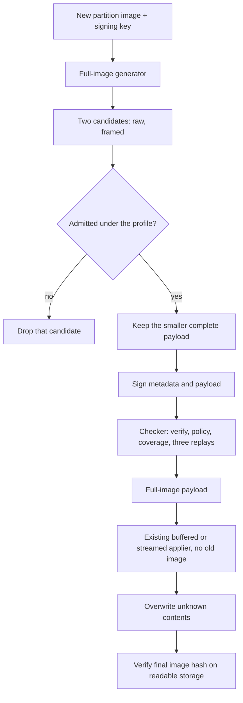
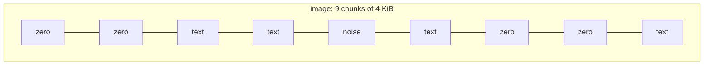
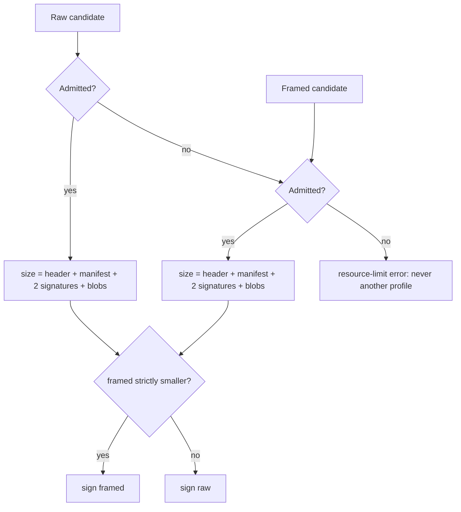
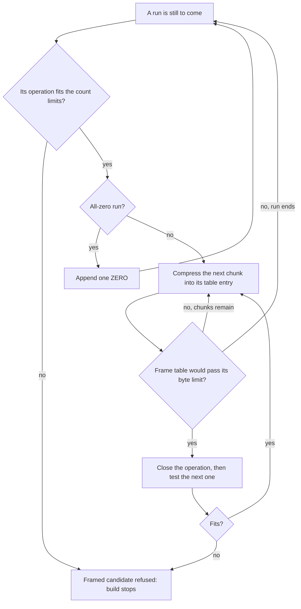
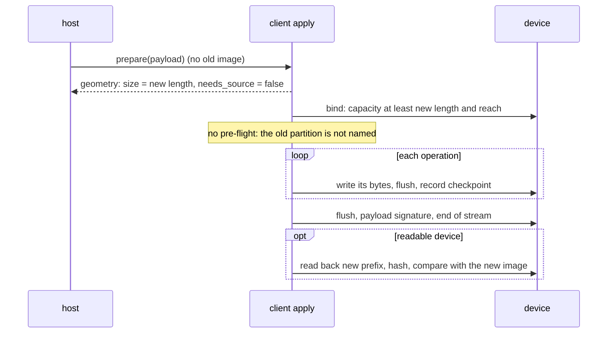

# Full-image payloads

A **full-image payload** writes a complete partition image from nothing. It records the new image and
no old one, so one signed payload writes the new-image prefix of any sufficiently large device,
whatever that prefix holds: zeros, erased flash, or unrelated data. Bytes after the new image stay
unchanged. It is the form for a device whose current contents the host cannot name. A delta instead
describes a transition from known old contents; supplying an old image alone does not initialize
untouched or kept destination bytes (`docs/image-geometry-and-cli.md`).

The format is unchanged. A full-image payload is an ordinary revision-17 payload that omits
`old_partition_info`, uses three existing operations, and covers the partition in order. The client
applies it with the pipelines it already has, and no client code path is added for it. What is new is
the generator's full form (`delta_update_generator::build_full_payload`, `ota-gen --full`), the checker's full
rules (`delta_update_generator::check::check_full_payload`), and the tests that hold both to the client's behaviour.

This document covers the design, why each part is shaped as it is, what it costs, and what it does not
do. The normative rules are in `docs/format.md` §12 and `docs/client.md` §2.6; the generator's own
design is in `docs/generator.md` §17.

## 1. Contract

| Part of the payload | A full-image payload |
| --- | --- |
| `old_partition_info` | **absent**: no old size, no old hash, no source image required |
| `new_partition_info` | the image's exact size and its SHA-256 |
| operations | `REPLACE`, `REPLACE_FRAMES` and `ZERO` only |
| destinations | one ascending run: operation order, then declared extent order, from `0` to `len`, no gap, no overlap |
| copies (`SOURCE_COPY`, `TARGET_COPY`) | none |
| sparse operations (`REPLACE_SPARSE`) | none: a kept chunk depends on known destination contents |
| signatures, checkpoints, resume | as revision 17 |

**Size policy.** The image length is the required new prefix, not the storage capacity.
The exposed capacity must be at least that length and the operation reach; a device below the
recorded new size is refused with `partition_mismatch` before a write. Larger devices are accepted.
The payload never pads, resizes or truncates storage, and trailing bytes remain unchanged.

**Starting contents.** Any. The payload does not depend on what the target holds, so the client runs no
pre-flight hash for it: a delta's pre-flight checks the old hash, and a full payload records none.

## 2. The two sides



The generator and the checker are separate code. The generator decides what to write; the checker decides
whether the bytes it would return say what the rules require, using only the client's verifier, the
client's metadata policy and a replay of its own. A payload that fails the checker is never returned.

## 3. Construction

The construction is deterministic and deliberately not a search. Two candidates are built from the
image, each is admitted under the profile, and the smaller one is signed. Neither candidate reads an old
image, so no synthetic old image is passed to the delta mapper, and no Vulkan device is opened.

### 3.1 The raw candidate

One `REPLACE` over `[0, len)`, whose blob is the image. An empty image has no operations.

Its payload is the image plus a fixed overhead: a 24-byte header, the manifest, and two signature messages
of the key's size. For a 2048-bit key the overhead is 669 bytes, of which 534 are the signatures.

### 3.2 The framed candidate

The image is cut into codec chunks of `block_size` bytes, and the chunks are grouped into runs:



Each maximal run of all-zero chunks becomes one `ZERO` operation. Each other run becomes one or more
`REPLACE_FRAMES` operations. Within a frames operation, each chunk is stored as a zlib frame when the
frame is strictly smaller than the chunk, and raw otherwise. That is the same rule the delta mapper uses,
so both generators store a chunk the same way.

Runs are whole chunks, so every operation starts on a chunk boundary, and the chunks of an operation are
the image's chunks. A frames run is cut wherever its frame table would take the operation past
`profile.max_frame_table_bytes` (8 KiB under the embedded profile). The cut is greedy and deterministic:
an operation closes before the first chunk whose table entry would overflow it.

For the 9-chunk image above, the framed candidate has four operations, in this order:

| Operation | Destination | Chunks | Blob |
| --- | --- | --- | --- |
| `ZERO` | `[0, 8 KiB)` | c0, c1 (zero) | none |
| `REPLACE_FRAMES` | `[8 KiB, 24 KiB)` | c2, c3 (text), c4 (noise), c5 (text) | three zlib frames, and c4 raw |
| `ZERO` | `[24 KiB, 32 KiB)` | c6, c7 (zero) | none |
| `REPLACE_FRAMES` | `[32 KiB, 36 KiB)` | c8 (text) | one zlib frame |

The cut is a function of the image and the profile alone, not of a search, so every run over the same
image and profile makes the same cut.

### 3.3 Admission and choice

Each candidate is admitted before it is compared. Its complete encoded size is computed with the same
scanner and metadata policy the client runs, so a candidate the client would refuse is never chosen:



A tie goes to the raw candidate, the simpler one. A candidate that the profile refuses is dropped, not
reported, because the other candidate may still fit. Only when neither fits does the build fail, with
`resource_limit`.

The refusals that matter in practice come from these embedded limits:

| Limit (`EMBEDDED`) | Value | What it stops in the framed form |
| --- | --- | --- |
| operations | 64 | a fragmented image: every zero run and every data run is an operation, and the build stops at the 65th (§3.4) |
| encoded manifest | 16 KiB | a very large operation count, or a very large frame table |
| frame table per operation | 8 KiB | a run longer than the table can hold; cut into more operations |
| decoded-memory budget | 32 KiB | the modeled manifest decode peak, across all operations |

The fallback is visible in the measurements (§7): an image that alternates zero and data chunks
produces 80 operations, past the 64-operation limit, so its framed form is refused and the raw form is
the payload. The choice depends on the profile, not on the image alone. Under `HOST`, the same image
takes the framed form.

### 3.4 Early refusal by count

The count limits are checked while the framed candidate is built, so an image that the profile cannot hold is
refused after reading at most `max_operations` runs, whatever its size. Every framed operation has one
destination extent and no source extents, so the operation count is also the extent count. The three count
limits (`max_operations`, `max_total_extents` and `max_extents_per_op`) then reduce to one test, run before an
operation is started: one more operation must keep the count within `max_operations` and `max_total_extents`,
and `max_extents_per_op` must allow one extent. The limits are inclusive, as the client's scanner applies
them: a candidate with exactly the limit is built, and one past it is refused.

The test runs at two points. The first is before each run that is still to come, zero or data, and it runs
before that run is read. The second is at each frame-table split that would open another operation. When
it fails, the build stops and the framed candidate is refused. The run that would need the refused operation
is not read, nothing after it is, and no chunk after the one that reveals a split is compressed. Once the
image is covered, no test runs, so a candidate at exactly the limit is not refused.



The reproduction in §7 shows the cost. It is a 1 MiB image of alternating zero and nonzero bytes, built at
`-b 1`, so every byte is a run:

| | Before the early refusal | With it |
| --- | ---: | ---: |
| runs read from the image | all 1,048,576, into a list first | 64; the 65th is refused before it is read |
| operations built for the framed candidate | 1,048,576: a 201,326,592-byte allocation, which the 192 MiB limit refused | 64, then the candidate is refused |
| result under the 192 MiB limit | allocation failure, and the process aborts | one `REPLACE` |

The early refusal changes cost, not selection. The count test agrees exactly with the scanner the client
runs, so a framed candidate it refuses is one the scanner would also refuse. The choice is therefore the
one it was before: any candidate the count test admits still goes through the scanner, which remains the
final authority for every other limit: the encoded manifest, the decoded-memory budget and the metadata
policy.

A refused candidate is not a failure, and it is dropped the way a profile's refusal is dropped (§3.3). A
generation error is still returned as an error. A compression error in a chunk after the refusal point is
never observed, because that chunk is never built into a candidate.

### 3.5 Choices that were not made

- **No search.** The delta search is expensive and needs a device. For full images the candidates are
  few and their sizes are exact, so a search would add cost without a defined gain.
- **One compression level, 6.** Level 6 is zlib's default and the search's most common choice. A
  per-chunk level choice would add a dimension the format does not need for a fallback.
- **Every all-zero run is a `ZERO`.** A short zero run inside a data run could instead be stored in a
  frame, which costs a table entry and a few compressed bytes, not an operation. That would reduce the
  operation count for a fragmented image, and it is the first refinement to consider. It is not done now,
  because the fallback already covers the fragmented case and keeps the construction a single pass.
- **No automatic conversion of a failed delta.** A caller that wants a full payload builds it separately.

## 4. The checker

`check_full_payload` runs on every built payload, and it is the independent statement of the form.

```mermaid
sequenceDiagram
    participant C as checker
    participant V as verifier (client)
    participant P as metadata policy (client)
    C->>V: verify both signatures and the framing
    V-->>C: authenticated manifest
    C->>P: validate the plan (one partition, extents, frame tables)
    C->>C: old partition absent; new size and hash equal the image
    C->>C: every operation is REPLACE, REPLACE_FRAMES or ZERO
    C->>C: destinations form one ascending run from 0 to len
    loop starting contents: zeros, erased flash, pattern
        C->>C: replay every operation, check each blob hash
        C->>C: result must equal the image exactly
    end
```

**Why coverage is structural, and the replays are not enough.** A replay from zeros proves only that every
byte of the image that is zero was already zero, so a payload that never writes those bytes would still
replay correctly. The coverage rule is what proves every byte is written. The replays then check the
bytes that were written: a byte left stale shows up in a replay unless the image happens to hold that
starting value at that position, and the three starting contents make that unlikely for every position at
once.

The test `a_gap_is_refused_even_when_a_replay_from_zeros_would_match` makes this concrete: the image
begins with eight zero bytes, the payload writes only the other eight, and a replay from zeros matches.
Only the coverage rule refuses it, with `partition_mismatch`.

The checker also refuses, with the code named in `docs/format.md` §12, a payload that records an old
partition, uses a copy or a sparse operation, has an overlap, writes out of order, or carries a wrong
size or hash. Each is a test in `delta-update-generator/tests/full.rs`, with a payload signed under the test key,
so the refusal comes from the rule and not from a bad signature.

## 5. The client

A full payload uses the same apply paths as a delta, with no special full-image engine:

| Step | Full payload | Why it is safe |
| --- | --- | --- |
| `prepare` | authenticates, validates the plan, verifies every blob's hash (buffered) | the same checks as any payload |
| needs source | no: `needs_source` is false, so no old image is required or read | no copy exists |
| `bind` | capacity must be at least the new image length and target reach | an undersized device is refused with zero writes |
| pre-flight | none: the manifest records no old hash | the starting contents are unknown by design |
| operations | each one is written, flushed, then checkpointed | a resume restarts at the first uncommitted operation |
| `finish` | payload signature and end of stream, flush | the same as any payload |
| post-flight | hash of the new-length prefix, on a readable device only | spare capacity is excluded; a write-only sink cannot read back |



The guarantees a host can rely on, by pipeline:

| Pipeline | Starting contents | Writes before refusal | Final image checked |
| --- | --- | --- | --- |
| buffered, device | any | none: metadata, every blob hash and the payload signature are checked in `prepare` | yes, by post-flight |
| streamed, device | any | the operations up to and including a corrupt one, whose bytes are written before its hash is checked | yes, by post-flight |
| buffered or streamed, write-only sink | any | as the device row for the same pipeline | no: it cannot read back |

The streamed row is the documented boundary (`docs/stream.md`): each operation's blob is hashed after its
own writes and before its checkpoint, so a corrupt operation is found after its bytes are written, and
the rerun cannot finish until the stream is good.

## 6. Resume, and the cost of a per-operation checkpoint

A checkpoint is written after each operation's writes are flushed. A resumed run restarts at the first
operation whose checkpoint is missing, and it rewrites that operation in full. So the cost of an
interruption is the size of the operation that was running, not the size of the bytes written so far.

| Form | Operations for a 16 MiB image | Worst rewrite after an interruption |
| --- | --- | --- |
| raw | 1 | the whole image, 16 MiB |
| framed, compressible | 1 to 64 (the embedded operation limit) | the operation that was running: at most its own chunks |

This is a deliberate trade. Smaller operations would bound the rewrite, but each operation costs
manifest bytes and an operation slot, and the embedded profile allows 64. The raw form has the largest
rewrite, and the generator picks it only when the framed form is larger or is not admitted. The rule in
`docs/client.md` §5 is unchanged: an operation is the unit of commit.

## 7. Measurements

Historical measurements from the full-image implementation, using `ota-gen --full`
(debug build, 4096-byte blocks, embedded-baseline limits, the 2048-bit fixture key).
They have not been rerun for the geometry/CLI change; omit the removed profile selector
when reproducing them with the current CLI.
The payload sizes are exact for the forms shown. The images were written by shell commands: repeated text,
zeros, and random bytes from `/dev/urandom`, assembled into the shapes the tests use. The random rows are
exact in form and size, but not byte-for-byte reproducible, since the random bytes differ on each run.

| Image | Image bytes | Payload bytes | Overhead | Form chosen |
| --- | ---: | ---: | ---: | --- |
| 64 KiB zeros | 65,536 | 631 | -- | one `ZERO` |
| 64 KiB repeated text | 65,536 | 1,903 | -- | `REPLACE_FRAMES` |
| 64 KiB random bytes | 65,536 | 66,205 | 669 | one `REPLACE` |
| 36 KiB mixed (zero, text, random, zero) | 36,864 | 9,208 | -- | `ZERO` and `REPLACE_FRAMES` |
| 320 KiB alternating zero and text, 80 chunks | 327,680 | 328,349 | 669 | one `REPLACE`: framed form refused (80 operations > 64) |
| 16 MiB zeros | 16,777,216 | 633 | -- | one `ZERO` |
| 16 MiB repeated text | 16,777,216 | 316,070 | -- | `REPLACE_FRAMES`, 1.9% of the image |
| 16 MiB random bytes | 16,777,216 | 16,777,889 | 673 | one `REPLACE` |
| 1 MiB alternating zero and nonzero bytes, `-b 1`, under a 192 MiB address-space limit | 1,048,576 | 1,049,244 | 668 | one `REPLACE`: the framed form is refused at its 65th run (§3.4) |

The last row is deterministic, so it can be reproduced exactly. It is the image of the process-level test
`full_mode_alternating_bytes_at_block_size_one_fit_a_192_mib_address_space`. Before §3.4, the same build failed
under that limit with an allocation failure.

The overhead is the payload minus the image, and for the raw form it is fixed by the key and the image's
length: a 24-byte header, the manifest, and two signature messages of 267 bytes each for the 2048-bit key.
The manifest is 111 bytes at 64 KiB and 115 at 16 MiB, because its offset and size fields are varints that
grow with the image. So the overhead is 669 bytes at 64 KiB and 673 at 16 MiB.

A 16 MiB build of the repeated-text image takes about 2.6 seconds in a debug build of `ota-gen`, which
includes the checker's three replays. The time was measured once, on the sandbox, and was not profiled.

## 8. Tests

The counts below describe the original full-image test snapshot, not the current
workspace total. Current growth/shrinkage and larger-device coverage is also in
`delta-update-client/tests/sizes.rs`; CLI parsing/cap coverage is in `delta-update-cli/tests/args.rs`
and the expanded `delta-update-generator/tests/cli.rs`.

| Test | What it establishes |
| --- | --- |
| `delta-update-generator/tests/full.rs` (29 tests) | metadata and coverage of every image shape; determinism; zero, compressible, random, mixed, tiny, empty and partial-chunk images; frame-table splitting; the framed-to-raw fallback, at one-byte blocks and at the operation and extent limits; no-candidate resource errors; a 16 MiB image under the embedded profile; key-size signature slots; each checker refusal, with signed payloads |
| `delta-update-generator/tests/cli.rs` (7 tests) | `ota-gen --full` success and its options; the exact argument count; each search-only option refused with no output; the unchanged delta form; the 1 MiB alternating image at `-b 1` under a 192 MiB limit |
| `delta-update-client/tests/full.rs` (10 tests) | every image shape applied from zeros, erased flash and unrelated contents, on the buffered and streamed pipelines and a write-only sink; an undersized device refused with zero writes; a damaged frame table refused before any write, and a corrupt raw block refused after its writes on the streamed path, at their documented boundaries; a cut at every write, flush and checkpoint resumes to the image; a completed update rerun writes nothing and refuses an altered target |
| `delta-update-cli/tests/cli.rs` (one new test) | `ota-apply` applies a full payload with no `-s`, on the buffered and streamed paths, to a device of unrelated contents |
| `delta-update-generator/src/full.rs` unit tests (8) | the lazy run decomposition; each count limit at its value and one past it; a framed candidate at the operation limit, and a zero run, a data run or a frame-table split past it; a refused candidate drawing no run past the one that refuses it; the frame-table budget closing an operation |

The original full-image change passed the workspace suite with these tests included.
For focused validation of the geometry/CLI changes, see `docs/image-geometry-and-cli.md` §7.

## 9. Known limits

- **Fragmentation falls back to raw.** An image with more runs than the operation limit is written raw. A
  short zero run could be folded into a frames operation to avoid this (§3.5).
- **Random data is not compressed.** A full payload of random data is the image plus its metadata: 669
  bytes at 64 KiB, and 673 at 16 MiB. There is no smaller form without a known old image.
- **One compression level.** Only zlib level 6 is used.
- **Per-operation checkpoints.** A large raw operation is rewritten in full after an interruption (§6).
- **No automatic delta-to-full conversion.** The caller builds and supplies the full payload.
- **Write-only sinks cannot check the final image.** The post-flight hash needs a readable device, as for
  any payload.
- **The device fit is modeled, not measured.** The apply engine is the same one whose 100 KiB fit is
  modeled in `docs/memory.md`. A full payload adds no state to it.

## 10. Files

| File | Change |
| --- | --- |
| `delta-update-generator/src/full.rs` | new: the two candidates, admission and choice, and the build |
| `delta-update-generator/src/check.rs` | the verification prefix shared by both checkers; `check_full_payload` and its rules |
| `delta-update-generator/src/lib.rs` | `build_full_payload`; the name and block-size checks shared with the delta API; the manifest builder takes an optional old partition |
| `delta-update-generator/src/evaluate.rs` | `admitted_size`, the admission arithmetic shared with the delta search; the signature-slot check made crate-visible |
| `delta-update-generator/src/mapper.rs` | `stored_frame`, the zlib-or-raw rule shared with the delta mapper; the wire helper made crate-visible |
| `delta-update-generator/src/main.rs` | `--full`, its refusals of the search-only options, and its report |
| `delta-update-generator/tests/full.rs`, `cli.rs` | new tests (§8) |
| `delta-update-client/tests/full.rs` | new apply, refusal and resume tests (§8) |
| `delta-update-cli/tests/cli.rs` | one new binary-level apply test (§8) |
| `docs/full-image.md` | this document |
| `docs/format.md` §12, `docs/client.md` §2.6, `docs/generator.md` §17, `README.md` | the normative and reference updates |
