# OTA delta generator

`delta-update-generator` is the `std` side of the format. Given old and new partition images whose lengths
may differ, it finds a short ordered program of byte-range operations that turns the old image
into the new one, writes that program as a signed `CrAU` major-2 payload, and checks its own
output with the verifier and replay the client runs. The format is in `docs/format.md`; this
document is the generator.

The search is a genetic algorithm that runs **entirely on the GPU**. Both images are uploaded
once and stay resident. The population, the mutation, the replay of every candidate on a memory
model, the repair of what it leaves wrong, and the exact **uncompressed** payload size all happen
in compute shaders. The CPU submits batches of generations and reads back a few counters; it
touches no individual candidate while the search runs. When the search ends, the CPU takes a
small archive of the best programs and chooses their **encodings** (framed, sparse, compressed),
because compression is not something the device models.

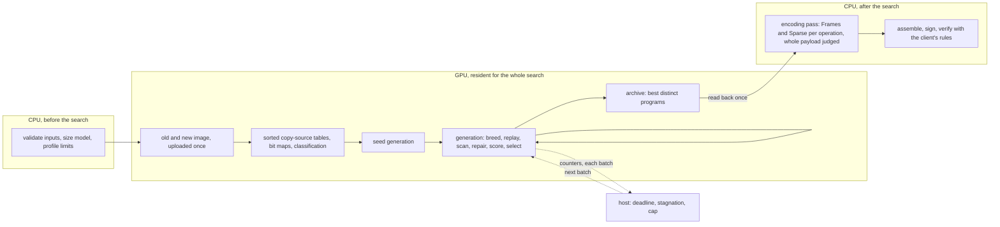

Contents: §1 scope · §2 images and chunks · §3 programs and the chromosome · §4 replay: the
memory model · §5 admission and exact fitness · §6 the GPU session · §7 the GPU search · §8
control, deadlines and progress · §9 the encoding pass, output and self-check · §10 command line ·
§11 tests · §12 measurements · §13 known limits · §14 what changed in this revision · §15 design
decisions · §16 tuning and benchmarking · §17 full-image generation · §18 encoding reuse and the
streaming cut · §19 review fixes: count refusal, retained storage and cancellation.

## 1. Purpose and scope

- **Input:** `old`, `new` (independent lengths, including empty images and lengths that are not a
  multiple of the chunk size, each smaller than 1 GiB), a nonempty UTF-8 logical partition name,
  an RSA private key (PEM), a codec chunk size, a resource profile, and a search configuration
  (§8.5).
- **Output:** a signed payload that the client accepts under the profile, and that replays to
  `new` exactly. A payload is returned only after the client's own rules accept it (§9.4).
- **In scope:** `REPLACE`, `ZERO`, `SOURCE_COPY`, `TARGET_COPY`, `REPLACE_FRAMES` and
  `REPLACE_SPARSE`, with byte-addressed destinations and sources. The first four are searched on
  the device; the last two are chosen on the CPU after it (§9.1).
- **Out of scope:** binary patches, dynamic partitions, resizing storage, and transport. The old
  image is an input to generation, not something the payload carries (`docs/format.md` §8).

The unit of addressing is the byte. The block size is only the **codec chunk size**: the unit that
frames are cut at. It constrains neither an address nor the length of an operation.

**Two sizes, reported apart.** The device scores a program by its **raw size**: the payload it
would make with every data operation stored uncompressed. The payload that is written is the CPU's
best encoding of the best programs. They are different numbers, and the generator reports both
(`Built::raw_fitness` and the payload's own length), because a program that is smallest raw is not
necessarily smallest compressed (§9.1, §13).

## 2. Images, chunks and the logical stream

An operation's destination is a list of byte spans. Those spans, concatenated in declared
order, form the operation's **logical stream**. The stream is cut into chunks of `c` bytes
(`docs/format.md` §3.3), so a chunk is anchored to its own operation, not to the image.

```text
destination spans (declared order):   [19, +5)     [100, +3)     [40, +6)
logical stream (14 bytes):            0 1 2 3 4 | 5 6 7 | 8 9 10 11 12 13
chunk size c = 4                      chunk 0 = 0..3 | chunk 1 = 4..7 | chunk 2 = 8..11 | chunk 3 = 12..13 (partial)
```

A chunk may start and end anywhere in the image, and a split or merge of an operation
re-anchors its chunks. Frames and maps are described in stream terms, so their lengths
depend only on the stream length and `c`. Chunks matter only to the CPU's encoding pass; the
device's operations are raw and have no chunks.

## 3. Programs and the chromosome

A **program** is an ordered list of operations, executed in declared order. On the device each
has:

| Field | Meaning |
| --- | --- |
| `kind` | `Replace`, `Zero`, `SourceCopy` or `TargetCopy` |
| `dst` | destination spans, in declared order; they may overlap each other and other operations |
| `src` | source spans of a copy, in declared order; the stream lengths must be equal |

The host-side `Op` also carries `Frames` and `Sparse` kinds and a compression `level`. They are
**not in the chromosome**. The device searches over *what* is written and in what order; the CPU
then chooses how each data operation is stored (§9.1). Compression levels therefore do not appear
in the device's mutation operators at all, and a `Sparse` operation's keep and zero chunks are
derived by the mapper from the target state at that point of the program (§5), not stored.

### 3.1 Why order matters, and why intermediate writes are allowed

Operations execute in order, and a later write wins. A program may therefore write bytes
that differ from the new image, provided a later operation overwrites them:

```text
old  : 9 9 9 9 9 9 9 9
new  : 0 0 7 7 0 0 0 0
ZERO [0, 8)               -> 0 0 0 0 0 0 0 0   (intermediate: bytes 2,3 are wrong here)
REPLACE [2, 4) from new   -> 0 0 7 7 0 0 0 0   (final)
```

Validity is decided by replay, not by a rule that each write must already be final.

### 3.2 The grammar, and the domain of every parameter

The grammar is the set of programs the search can reach. Each parameter has a **domain**: the
values the search can take for it. The domains are the reachability contract: a value outside them
cannot appear in a payload, so a domain that excludes a useful value is a defect.

| Parameter | Domain | How a value is chosen (all on the device) |
| --- | --- | --- |
| Destination start | any byte with a data, zero or copy destination | a changed cell (§7.4), a byte the program writes as data, or a zero byte found by a bounded scan |
| Copy length | `1..=room` of the extent that holds the start | the whole verified match, or a random part of it |
| Copy source (source copy) | any offset of the old image whose bytes equal the new bytes at the destination | the sorted table of the old image (§7.5), or a bounded scan extended to the real match |
| Copy source (target copy) | any offset of the new image, disjoint from the destination | the same, from the new image's table, refused where it would overlap the destination |
| Destination extents | any number, any order, any overlap | split, merge, regroup, reorder, shift and shift-start moves |
| Stream position of a split | any interior stream position | uniform |
| Zero run | any run of zeros in the new image, including zeros inside a changed cell | a bounded scan of the image for a zero byte |

Copies may sit over zeros and over other copies, so `carve` splits a copy's source stream with its
destination. A copy's destination may be rotated (`reorder`) because its streams pair by
position. Copies are not regrouped between operations, since that would move a destination
without its source; they are joined by `compact` instead (§7.4).

### 3.3 What a program may not do

- A span is non-empty and its offsets and totals do not overflow. Destinations and `TARGET_COPY`
  sources fit the new image; `SOURCE_COPY` sources fit the old image. Totals on the device are
  32-bit and are refused past `SUM_LIMIT` (2^31 - 1), which the CPU, summing in 64 bits, would
  admit (§13).
- A copy's two streams have equal total length.
- An in-target copy's source does not intersect any of its own destinations (`copy_overlap`).
- A source-copy source is read from the old image only; the replay decides everything else.
- An in-target copy does not read bytes whose contents are unknown (§4).
- The program fits the profile: its operation and extent counts, its manifest and its
  decoded-memory model (§5).

A program that breaks a structural rule is refused before replay. A program that is valid but
incomplete is repaired (§5.1) or discarded.

## 4. Replay: the memory model

`memory.rs` (CPU) and `shaders/replay.glsl` (GPU) replay a program on the target without storing
the target byte by byte. The target is a set of **runs**: a range whose bytes all come from one
origin. An origin is the old image at an offset, the new image at an offset (bytes the program
wrote), or zero. Runs cover `[0, new_length)` exactly once, and a write splits and replaces the
runs it covers. Initially only `[0, min(old_length, new_length))` has known old bytes. Growth
beyond the old length is **unknown**, not implicitly zero, even when the new image wants zeros
there. It must be explicitly written before it can be kept or used as a `TARGET_COPY` source. See
`docs/image-geometry-and-cli.md`.

```text
initial          [ Old(0) ..................................... ]
write [10, 20) New   [ Old(0) .. | New(10) ........ | Old(20) ............ ]
write [15, 18) Zero  [ Old(0) .. | New(10) .. | Zero .. | New(18) .. | Old(20) .... ]
```

The final check compares each run with the new image by **content**: an `Old(x)` run matches
when the old bytes at `x` equal the new bytes at its position, whatever the offsets are. Mismatched
bytes are reported as spans, merged where they touch.

The model is exact for the client's semantics. A copy reads the target as the earlier operations
left it and writes chunk by chunk, but its source and destination are disjoint, so copying as a
whole gives the same result. A kept sparse chunk writes nothing, which is the model's "no write".
The independent checker (§9.4) shares no code with this model, so a defect in the model cannot
pass its own check.

### 4.1 The model on the device

The CPU model keeps runs in a `BTreeMap`. The device keeps them in a flat array of 128-bit
vectors `{start, length, origin kind, origin offset}`, one array per candidate, bounded at
`RUN_CAP` (16,384) runs. The semantics are the same and the arena is bounded, so the device's
memory is proportional to the candidates' fragmentation and **not** to `population × image size`.

```text
runs of one candidate        start  length  kind  offset
                              0      4096    Old   0          one 128-bit vector each
                              4096   300     New   4096
                              4396   200     Zero  -
                              4596   ...
```

A write splits the runs it overlaps, replaces them, and **coalesces** neighbours that continue each
other (the same kind, and the second's origin follows the first's), so a run is as long as it can
be. A write that would need more than `RUN_CAP` runs is refused and counted, never truncated.

**Bulk writes.** Writing an operation's extents one at a time costs the tail of the array for each
extent. An operation whose pieces are disjoint (a raw replacement, a zero, a source copy, whatever
its order) is applied in one pass instead:

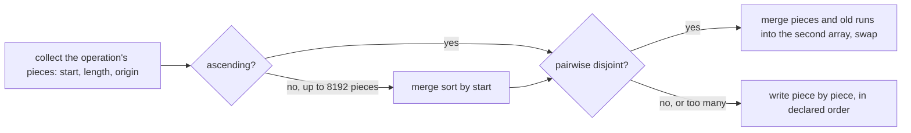

Pieces that overlap each other must keep their declared order (the last wins), so they take the
piece-by-piece path; so does a `TARGET_COPY`, whose pieces come from the runs it reads. The result
is the same runs either way, so this is an optimisation and not a second model. The repair of a
badly fragmented program is an operation with thousands of ascending pieces, which is why it matters.

**A work bound.** Every replay counts the run moves and merged pieces it spends against
`REPLAY_BUDGET` (2^20 units). A candidate that needs more is refused as `replay work budget
exhausted`, so no single candidate can hold up the dispatch it runs in.

## 5. Admission and exact fitness

A [`Mapping`](../delta-update-generator/src/mapper.rs) is the immutable context of one partition
update: its two images, its codec chunk size, and the compressed frames of those images. Its
frame cache is private to it, so a frame can only be reused for the images it was made from.
It is the **CPU's reference and admission machinery**: the encoding pass, the final assembly and
every test of the device go through it. The device never calls it.

The mapper replays a program in order and emits the wire operations:

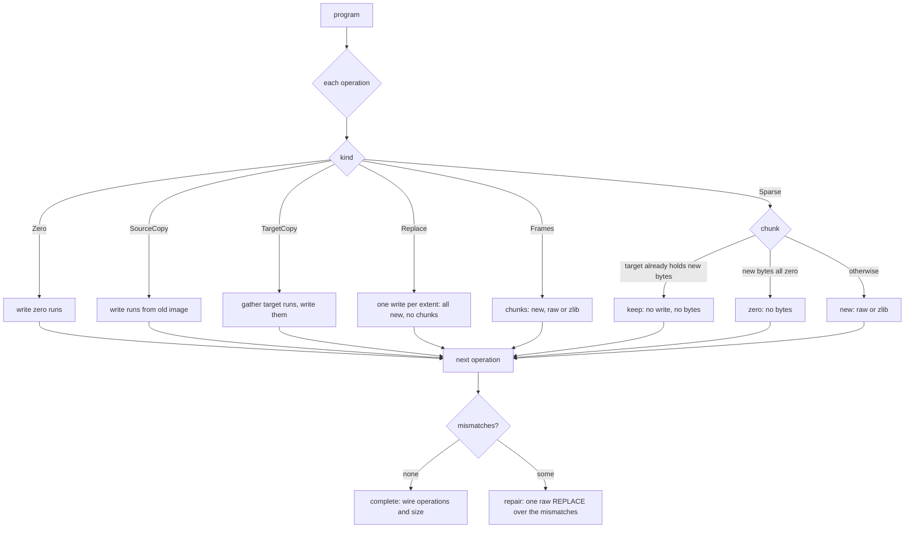

**Keep is always safe.** A sparse chunk is kept only when the target already holds the new bytes
over it at that point. Writing nothing then leaves the same bytes, so keeping never changes the
result, and it is the cheapest encoding.

**Empty blobs.** A sparse operation whose chunks are all kept or zero carries no blob. The client
requires its data hash to be the digest of the empty blob, so the fitness replay uses that digest in
that case, as the final replay does.

**Admissibility.** A program is admissible when all of these hold:

1. it is structurally valid (§3.3);
2. its replay reproduces the new image, after the repair in §5.1;
3. its manifest passes the client's pre-decode scan (`scan_manifest`) and metadata policy
   (`plan::validate`) under the profile.

Only admissible programs receive a size. On the CPU this is `evaluate`, and it is **authoritative**:
a program the device scored is not a payload until the CPU admits it. The device applies the same
rules to the raw encoding (§5.3) so that nearly everything it keeps is admitted, but it is the
CPU's answer that counts.

### 5.1 Repair

A program that leaves bytes unwritten is valid if one raw `REPLACE` over exactly those bytes can
finish it. The repair is appended as the last operation and kept only if the repaired program is
admissible. A repair never replaces a plan that already fits, because a complete program is not
repaired, and it cannot exclude a plan at the profile limit, because a repair that exceeds the
profile is refused and the program stays as it was. The mismatch spans are in ascending order and
merged where they touch. **On the device the repair is part of the stored chromosome**, not just an
addition to its score: the repair operation and its extents are written into the candidate's slot,
so the program that is kept, mutated and returned is the program whose size was scored (§7.7).

### 5.2 Exact fitness and the profile preflight

The fitness of an admissible program is the length of the payload that would be emitted:

```text
size = header (24) + |manifest| + 2 · signature message + Σ blob lengths
```

The manifest is encoded with the same encoder the output uses. Its hashes are placeholders of
their final length, except where the validator requires an exact digest, and a placeholder's value
does not change any length, so the size is exact.

**Profile preflight.** The search starts from a `Problem`, whose constructor is the only way to
make one. Every size that the placeholder signature message depends on is checked before any of
its storage is allocated, in this order:

1. the key's data length is not zero;
2. it does not exceed the profile's `max_signature_data`;
3. the entry and message sizes fit `usize`, by checked arithmetic in one helper
   (`sign::checked_message_size`), which the signer also uses before it reserves a buffer;
4. the message size does not exceed the profile's `max_signature_message`.

Only then is the placeholder built, with the signer's own encoder, and the profile's signature
scanner (`scan_signatures`) runs over it. It remains the authority for the entry count
(`max_signatures`), the decoded memory budget, and the shape of the whole message. A key or profile
that the client would refuse on its signatures is refused there, before any clock starts, and no
caller of the search can skip the check. The emitted signatures are unaffected: `seal` signs the
real unpadded length.

**Count preflight.** Before a program is mapped, its operation count and its total extent count are
checked against the profile (`within_count_limits`, which every evaluation calls first, and so does each
trial of the encoding pass, §18.5). Mapping is the expensive step, since it compresses the chunks it
writes, so a program the profile cannot count costs no replay. That refusal is `Ok(None)` even under an
expired control: no amount of time would make such a program admissible, so it is not a deadline (§19.1).

### 5.3 The device's arithmetic

The shaders compute the size without any host help beyond three constants (`SizeModel`): the encoded
bytes of a `PartitionUpdate` and of a manifest with no operations, which the host measures with the
real encoder, and the decode model's charge for that empty manifest. Everything that depends on the
program is integer arithmetic over its extents, following the wire form of a raw program:

| Piece | Bytes |
| --- | --- |
| operation | `1 + len` of: type (1 + varint), `data_offset` (1 + varint of the running blob offset), `data_length` (1 + varint), each extent (4 + varint start + varint length), one 32-byte hash (34) unless the operation is `ZERO` |
| type value | `REPLACE` 0, `ZERO` 6 and `SOURCE_COPY` 4 are one byte; `TARGET_COPY` is 258, two bytes |
| `PartitionUpdate` | the fixed part + every operation, with its tag and length prefix |
| manifest | the fixed part + `signatures_offset` (1 + varint of the blob total) + the partition with its tag and length prefix |

A field is present even when zero. Varint widths change at 128, 16,384, 2 MiB and 256 MiB, so the
tests cross each (§11). Two admission checks that are exact for a raw program run on the device as
well: the encoded manifest against `max_encoded_manifest`, and the client's **decode-memory model**
(`prescan::Usage`) against `max_decoded_bytes`, ported with its vector growth rule
(`vec_slots`: a power of two, at least four) and its contract workspace: `extents × 16 + 24` as a
transient, which the CPU charges for every extent of the program and nothing when there is none
(`docs/memory.md` §2.5, `docs/locking-and-recovery.md` §4). The profile's operation, per-operation extent and
total extent counts are exact on the device, too. What the device does *not* do is anything that
depends on the encoding the CPU will choose: frame tables, maps and compression. A candidate
that the device keeps is therefore a candidate the CPU's raw evaluation admits, with one exception
class: totals past `SUM_LIMIT`, which only the device refuses (§13).

The decode model matters for the default profile. `EMBEDDED`'s 32 KiB budget binds at about 45
operations, well inside its 64-operation limit, so a search that counted only operations would
spend its generations on programs the CPU refuses. The test
`the_decode_memory_budget_of_the_embedded_profile_is_modeled_on_the_device` checks that the device
stops at exactly the operation count where the CPU's scanner does. The workspace has its own boundary
tests in `delta-update-generator/tests/gpu_eval.rs`: a program whose workspace is its largest transient is
checked one byte either side of its charge, on the device and on the CPU.

## 6. The GPU session

The generator uses Vulkan compute, through `ash`. The search is a set of compute stages written in
GLSL under `delta-update-generator/shaders/` and compiled to SPIR-V by `build.rs` with `glslc`. A
[`Session`](../delta-update-generator/src/gpu.rs) owns everything the search needs on the device, from the
upload of the images to the readback of the finalists.

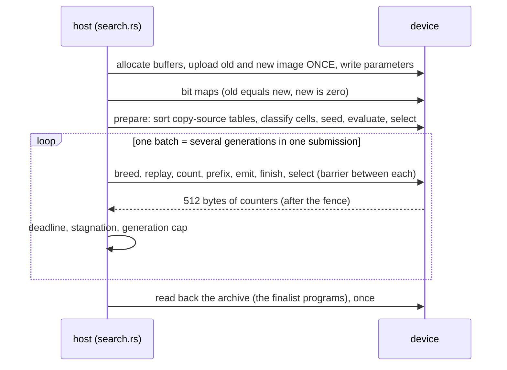

### 6.1 What lives on the device

| Buffer | Binding | Contents | Size |
| --- | --- | --- | --- |
| images | 0 | the old image, then the new image, each padded with zero words | `2 · (len + 8)` bytes in all |
| state | 1 | parameters, control counters, population ids, free list, candidate ids, scan records, and every chromosome slot | about 48 MB |
| index | 2 | the sorted copy-source table of each image, the cell classification and the changed-cell list, and two bit maps | about `len · 1.3` bytes |
| runs | 3 | three run arrays per candidate (§4.1) | 75 MB |
| staging | host | upload pieces | up to 16 MiB |
| readback | host | the counters, and the finalists at the end | 4 MiB |

For two 16 MiB images the device-local buffers total 178 MB. The images, the state, the tables and
the runs are **device-local**: VRAM on a discrete GPU, reached through the staging buffer; shared
memory that the driver reports as device-local on an integrated one; ordinary memory on the
software device. Only staging and readback are host-visible. The memory type is chosen from each
buffer's own requirements, preferring device-local memory that is not host-visible.

The old and the new image share **one** buffer, at word 0 and at word `P_NEW_BASE`. This is not a
convenience. Two buffers chosen between at run time (`target ? new_image[i] : old_image[i]`) make
the compiler select a buffer descriptor per invocation, and Mesa's software device crashes on that
for some inputs. One buffer and a selected offset has no such selection (§6.7).

**Upload once, read back once.** The images go up once, in pieces that fit the staging buffer.
During the search the host reads back only the control words (512 bytes per batch). The
archive is read when the search ends. `SessionStats` reports the bytes moved each way and the
device memory held, so the claim is measured: a 60-generation search of two 64 KiB images moves 128
KiB up and under 1 MB back; per-generation readback grows with the control block size and batching (§11).

### 6.2 One layout, two languages

Every size and offset the host and the shaders share is written once, in
`shaders/layout.glsl`, as `#define NAME expression`. `build.rs` evaluates each line and writes it
as `pub const NAME: usize` in `gpu_layout`, so the host cannot disagree with the shaders about a
word. Records are fixed-layout `u32` words and nothing else crosses: a slot is a header, `OP_CAP`
operation records `{kind, dst_first, dst_count, src_first, src_count}` and `EXT_CAP` extents
`{start, length}`. The host never passes a `Vec` or an enum layout to the device.

```text
slot (one chromosome)            words
  header                         16     operation count, extent count, raw size, fingerprints,
                                        status, blob length, mismatch counts, run count, work
  operation records              OP_CAP (512) x 5
  extents                        EXT_CAP (16,384) x 2
```

A program uses a prefix of the operations and a prefix of the extents, and only those words are
moved between host and device (`write_slots`, `read_slots`).

### 6.3 Limits, and what is refused

The device's word is 32 bits, so a position or a length is 32 bits and an image must be smaller than
`MAX_IMAGE` (1 GiB). Before it allocates anything, the session checks that the images, the state,
the tables and the runs each fit the device's `maxStorageBufferRange`, and refuses an image that does
not, naming the buffer. It does **not** fall back to streaming the image in windows: a search that
cannot see both images whole cannot replay a target copy against them. Capacities of the chromosome
and the replay (`OP_CAP`, `EXT_CAP`, `RUN_CAP`) are the workspace's and are separate from the
profile's payload limits; both are enforced, and exhausting either rejects the candidate and counts
the reason (§7.9).

### 6.4 Dispatch

A generation is seven compute dispatches with a memory barrier between each:

| Stage | Threads | Work |
| --- | --- | --- |
| `breed` | one per child, each its own work group | choose immigrant, crossover or a mutation; write the child into a free slot |
| `eval_replay` | one per candidate, own work group | check counts, replay on the run model, build the run array |
| `eval_count` | one per (range, candidate) | count the mismatch spans of each byte range of the target |
| `eval_prefix` | one per candidate | prefix the counts; append the repair operation |
| `eval_emit` | one per (range, candidate) | write the repair's extents, ascending |
| `eval_finish` | one per candidate | exact raw size, admission checks, fingerprints |
| `select` | one work group | next population, free list, archive |

A stage with one thread per candidate gives each candidate **its own work group** (`LOCAL_SIZE 1`).
Threads of one work group run in lockstep, and candidates take different paths for different times,
so a group holding all of them runs them one after another. Separate groups run side by side. This
one change took replay from the sum of the candidates' times to the slowest candidate's.

A **batch** records several generations into one command buffer and waits once. The host sizes a
batch so that it takes about 60 ms, so it regains control often enough to honour a deadline and
rarely enough that submissions do not dominate. No stage spins on another work group; every
dependency is a barrier between dispatches. Because every random choice is a pure function of the
seed, the generation and the candidate (§7.6), splitting a run into batches changes timing and
nothing else.

### 6.5 Device selection and fallback

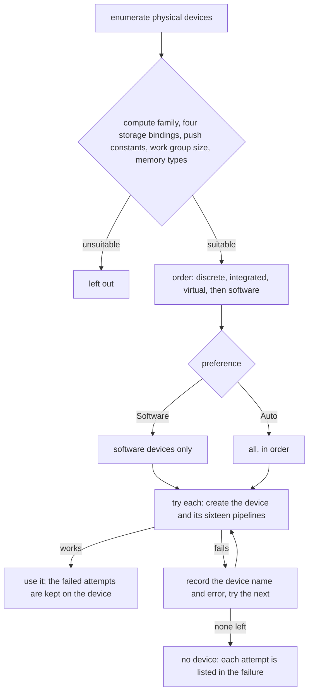

Each attempt is a function of the candidate, so the order and the fallback are tested by injecting
failures. The failures keep the device name and the error, which the caller can read through
`Gpu::skipped` or through the `DeviceFailure` of `Gpu::open_detailed`. `Auto` tries hardware first.
`Software` tries only the `CPU`-type device (Mesa lavapipe), which is how the test suite runs on any
machine. Lavapipe is provided by `mesa-vulkan-drivers`, and the loader by `libvulkan1`.
`vulkaninfo --summary` lists the devices.

### 6.6 Ownership and cancellation

Every Vulkan object is held by a wrapper that releases it when it drops, a buffer unmaps before it
frees its memory, and the device and the instance are released last, after a drain. A failure at any
step leaves nothing allocated.

The Vulkan loader and the drivers behind it keep process-wide state that is not safe when one
thread opens a device while another releases one. A process-wide mutex therefore covers the
lifecycle: `Gpu::open_detailed` holds it from loading the library to the finished context, and
`Gpu`'s drop holds it while it releases the device, then the instance, then unloads the library.
The lock is declared before every Vulkan object in the open, so a failure at any step releases its
partial objects, and unloads the library, before the lock is released. A submission does not take
it, so searches on different devices still run in parallel, and the lock is not held for the
lifetime of a `Gpu`. The cost is that opens in one process take turns, pipeline compilation
included (about 0.8 s per open on lavapipe), so a caller that opens several devices at once, such as
the test suite, sees the later ones wait. A poisoned lock is taken over, so a panic on one thread cannot stop another
from releasing its device.

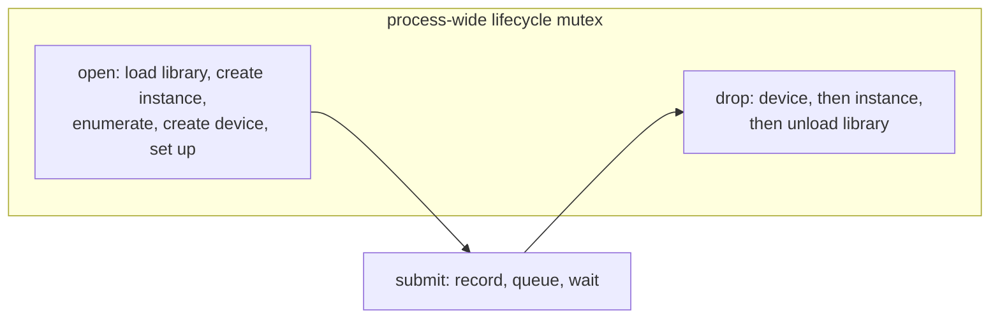

The host decides to stop between batches, so a batch that has been submitted runs to completion and
is waited for. The bound on how long that takes is one batch (sized to about 60 ms, and never fewer than one
generation), and inside a generation every candidate's work is bounded (§7.9). Driver calls cannot be cancelled: device
creation, pipeline creation and one submission run to completion once started. An in-process
application cannot safely preempt a driver call that has hung, and a finite fence timeout would only
abandon work the driver still holds. A strict return deadline under a hung driver needs process
isolation, which this project does not do.

### 6.7 Portability notes that are not obvious

These were found by running the shaders on both devices. Each is now a rule in the shaders.

- **Do not select between two buffers at run time.** See §6.1. The failure is a crash in the
  software device, deterministic for a given seed, and it did not appear on the hardware device.
- **Do not use `bool` for state that a function modifies.** On the Intel device a `bool` global that
  `sc_bad` and `sc_good` set and read gave wrong counts, while the same code was right on the
  software device. The scan and the writer keep such state in `uint` words.
- **Four storage bindings** are the guaranteed minimum for a compute stage, and the search uses
  exactly four.
- **First use compiles.** The software device compiles a pipeline the first time it runs after the
  SPIR-V changes. A search started with a short budget on a cold cache can spend most of it in the
  compiler; later runs are warm.

## 7. The GPU search

The search is a genetic algorithm whose individuals are programs. Its population, its operators, its
evaluation and its selection run on the device.

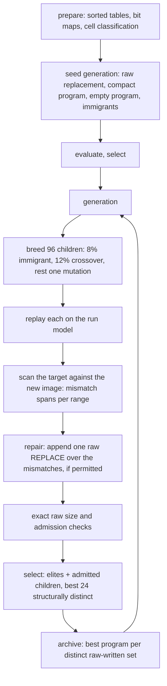

### 7.1 Population, elites and children

The population keeps `POP` = 24 programs. Each generation keeps its best `ELITES` = 3 unchanged and
breeds `CHILDREN` = 96 more. The next population is the best 24 structurally distinct programs of those 99
(§7.2). The numbers 24 and 3 are the earlier search's, kept so that this rewrite changes the architecture and not
the evolutionary schedule. The number of children is not, and it is the one place where the device
changes the schedule on purpose: a child costs one thread, the device has hundreds of them, and 96
children cost little more wall time than 21 did, so the search evaluates about four times as many
candidates per second (§12). The constant lives in `layout.glsl` (§16).

### 7.2 Slots and the pool

Every program lives in a **slot** (§6.2). The pool holds `POP + NCAND` = 120 slots, plus
`ARCHIVE` = 8 for the finalists and two scratch slots per candidate for moves that build in steps.
Nothing is copied to make a population: it is a list of slot ids.

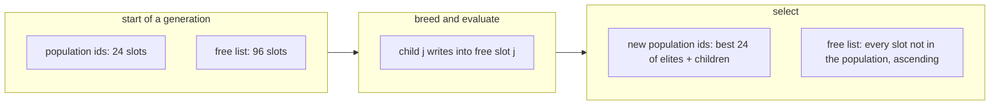

A child is written into a free slot. Selection sorts the elites and the admitted children by raw size,
then structural fingerprint for ordering, and drops structural duplicates: programs whose operations and
extents are identical (`FP`). Programs that write the same bytes raw but copy or zero them differently are
not duplicates, so both stay available for breeding. Only the archive merges by the raw-written fingerprint
(`DFP`, §7.8). It keeps 24; every other slot becomes free. A move writes a
child by **reading a parent and appending to the child front to back** through a writer, never by
shifting data in place, so a child is always packed: its operations in order, and each operation's
extents contiguous. The writer checks every capacity before it writes; when one runs out it sets a flag
and stops, the child is marked with the capacity that failed, and nothing is truncated or written
outside the slot.

### 7.3 Seeds

The seeding generation evaluates `NCAND` candidates:

| Candidate | Program |
| --- | --- |
| 0 | the raw replacement of the whole new image: one `REPLACE` |
| 1 | the **compact** program: one operation per run of changed cells, `ZERO` where the new bytes are zero |
| 2 | the **empty** program, which the repair turns into exactly the changed bytes |
| 3 | a greedy seed: one piece per changed cell, a guided old-image copy where the source table has one, otherwise the cell's new bytes, zero or raw |
| 4.. | random immigrants |

The greedy seed reuses the guided source-table matcher, and it is bounded in four ways. It is one
proposal, so it compares within `MAX_COMPARE` in all, and it probes the source tables at most `MAX_LOOKUPS`
(16,384) times in all, hit or miss. A probe is a binary search whether or not anything matches, so a cell
with no match costs its probes without a comparison, and the lookup bound is what keeps an image of unrelated
bytes from spending the seed's work. Once either budget is spent, the remaining cells are written raw or
zero, and the matcher is not entered for them at all, so their hashes are not computed either. A copy is
looked for only where the profile admits two extents in one operation (`P_MAX_EXT_OP`), and it is chosen only
where it fits the operations and extents left; a copy that does not fit gives way to the cell's own bytes.
Adjacent pieces of one kind that continue each other join into one operation, so a run of changed cells of
one kind costs one operation however long it is. A seed that covers every changed cell needs no repair, so it
may use all of the profile's operations and extents. A copy shorter than its cell leaves the rest of that cell
unwritten, and the seed keeps it only where that rest is already right: where the old image, which the target
starts as, holds the same bytes. The check compares the rest with the old image within the same comparison
budget, and a rest that runs past the end of the old image, or that the budget cannot cover, is not shown to
be right and counts as wrong. Then the whole cell is written raw or zero, which needs no repair. The seed does
not keep a short copy and reserve room for repairing its rest, because it cannot predict that repair: a rest
that differs from the old image in several runs repairs as one operation of as many extents, which a tight
profile refuses. A short copy that is kept leaves nothing behind, so it needs no reserve and may use the
profile's last operation. Only a seed that stops early leaves bytes to the repair: its next piece does not
fit, so the rest of the changed cells is the repair's, its last pieces give way if they must, and it keeps one
operation and one extent back for the repair. The evaluation then refuses the seed if the repair cannot fit.
Every candidate still receives the same admission and correctness checks, so a seed the repair cannot finish is
refused like any other program.
The earlier search had a sparse seed and a compressed compact seed; those are encodings, and
the encoding pass makes them from the raw programs (§9.1). The raw replacement is always the first
candidate, so a valid program exists the moment the first generation is evaluated, subject to the
profile admitting it.

### 7.4 Moves

A mutation applies one move. The weight is its relative chance.

| Move | Weight | What it proposes |
| --- | --- | --- |
| `CopyCreate` | 16 | a guided copy: a probed changed position, its longest verified match in the old image (§7.5) |
| `ShortCopy` | 10 | a general copy: a position from the bytes the program writes as data (60%) or a changed cell, a source a bounded scan finds, any length from one byte |
| `CopyShift` | 6 | the source of an existing copy moved to another exact source of the same bytes |
| `TargetCreate` | 4 | a guided in-target copy from the new image at a probed position, if disjoint |
| `Shift` | 10 | one destination extent grown or shrunk by a power of two; a copy's streams change together |
| `ShiftStart` | 6 | one destination extent moved by a power of two, keeping its length |
| `Split` | 8 | an operation at a random stream position into two of the same kind |
| `Merge` | 8 | two adjacent operations of one kind into one; contiguous extents join |
| `ZeroCreate` | 6 | a zero operation over a zero byte found by a bounded scan of the whole image |
| `InsertZero` | 4 | a zero operation over a random range, which the repair finishes if needed |
| `Remove` | 5 | one operation; the repair writes what it left unwritten |
| `Swap` | 5 | two adjacent operations |
| `Regroup` | 5 | one destination extent moved from a raw operation to another |
| `Reorder` | 4 | the destination extents of one operation rotated (copies included) |
| `Sweep` | 16 | two to eight copies, guided or general, then a compaction |
| `Compact` | 8 | the source copies that may move joined into one operation at the front, adjacent raw operations joined, contiguous extents merged |

The earlier search's `Kind` and `Level` moves, which choose an encoding, are gone, and so are the
`Frames`, `Sparse` and compression-level choices in immigrants and compaction. Crossover (12% of
children) and immigration (8%) are chosen before the move. A move returns "no valid form" when it has
none for its parent, and the child is then skipped, not evaluated.

**What `Compact` may move.** A source copy reads only the immutable old image, so a copy gives the same
bytes in one operation as in many, and joining the copies saves each operation's header and source
hash. Moving a copy to the front is not free, though: if an earlier operation that stays where it is
writes some of the same bytes, the copy would now run first and be overwritten. So a copy moves only
when its destination overlaps no earlier operation that stays. The test is made in two steps, because
the exact one is quadratic in extents: an operation's bounds (one interval) are compared first, and only
when two meet are the extents inside compared, at most `COMPACT_COMPARES` (4,096) pairs per compaction.
A copy the budget does not cover is taken to conflict and stays in place as its own operation. Bounds
alone were tried and cost up to a fifth of the payload at long budgets on the 16 MiB pair (§12), since a raw
operation of many extents has bounds that cover everything between them, and the copies between its
pieces are the ones worth joining.

**Sampling discipline.** Moves that need a value scan a domain in bounded windows: `SCAN_WINDOW`
(65,536) positions from a random start that wraps, sampling uniformly among the valid ones (reservoir
sampling), four bytes per load. A random start means no consistent bias toward low addresses.

**A work budget per proposal.** Every comparison a proposal makes draws on a budget of
`MAX_COMPARE` (256 KiB). When it is spent, further candidates of that proposal fail instead of
running on. This is what keeps one child from holding up its generation with a long match: a longer
copy is built from several proposals and joined by compaction, and compaction merges contiguous
extents so that it costs one extent.

### 7.5 The copy-source tables

A guided copy needs, for the bytes at a changed position, every offset of an image that holds the same
bytes. The device builds, once, a **sorted table of `{hash, position}`** for each image: the rolling
hash of the 64 bytes at every `stride`-th position (`stride` is 16, or more for a very large image,
so a table has at most 4 Mi entries), sorted with a bitonic sort by the pair, so the table is the same
whatever the order the threads ran in.

```text
old image   ... | 16 | 32 | 48 | 64 | 80 | ... positions sampled every 16 bytes
new bytes at pos:   probe windows at pos+0, pos+1, ... pos+15  (rolling hash, one step each)
                    each looked up by binary search; each hit is a candidate (x, t)
                    source for `pos` is x - t, once the t bytes before x are verified
```

A source is sampled only every `stride` bytes, so the probe is moved through `stride` offsets to meet
one, and the source extended backwards to start where the destination does. Every candidate is
**verified byte for byte**, forward by a word at a time up to the room of the extent that holds the
position, so a hash collision costs a comparison and nothing else. The test
`a_guided_copy_never_uses_a_hash_collision` builds two windows with equal hashes and different bytes
and shows the operator never copies through the collision (it fails if verification is removed). A
lookup visits at most `CANDIDATES` (32) entries and four per offset, sampling among an equal-hash run,
so an image where every window is alike (all zeros, a short period) costs the same as any other.

The same table machinery serves the new image for `TargetCreate`, with the source required to be
disjoint from the destination.

### 7.6 Randomness and determinism

Each child draws from its own stream: a PCG generator seeded by a hash of the seed, the generation
and the child's index. A restart's immigrants draw from streams numbered by the restart sequence instead
(§8.4), so they depend on the seed and the number of restarts, not on the generation. Within a device, a
generation-capped run is reproducible independently of its batching. Results are not required to match
across devices: guided seed and move proposals may select different valid sources, although the pinned
fixed-generation payload (§11) comes out the same on both. The software and hardware tests therefore
validate finalists independently against the CPU evaluator rather than comparing their search trajectories.

### 7.7 Evaluation

Every candidate, seed or child, goes through the same five stages.

**Replay** (`eval_replay`): the counts are checked against the profile, each operation's own rules
are checked, and the program is replayed on the run model (§4.1). A refusal is recorded in the
candidate's header with its reason.

**Scan** (`eval_count`, `eval_prefix`, `eval_emit`): after the replay, the target is compared with the
new image, by content, and the bytes that differ become the repair. The comparison is the expensive
step and the one that grows with the image, so it is split. The target is cut into at most 1,024
equal byte ranges and one thread scans each:

```text
target   | range 0 | range 1 | range 2 | range 3 | ... one thread per (range, candidate)
pass 1   count: spans that START in the range, mismatching bytes, first matching byte
prefix   running total of spans: each range's output position; for each range,
         the first matching byte of any LATER range, where an open span ends
pass 2   emit: write the spans that start in the range, ascending, at its position;
         a span still open at the range's end ends at that recorded byte
```

A span belongs to the range that holds its first byte, so spans are neither lost nor duplicated at a
boundary, and the result is the ascending, merged list the CPU makes. For two kinds of run the scan
does not read the images at all: **bit maps**, built once, hold a bit per byte of the new image for
"the old image has the same byte" and "the new byte is zero", so the old image at its own place (most
of an update) and zero runs are compared 32 bytes to a word. This more than halved the time of the scan
stages (§12).

**Repair** (`eval_prefix`, `eval_emit`): if spans were found and the profile and the workspace allow one
more operation with that many extents, a raw `REPLACE` over them is appended to the stored program. If
not, the candidate is refused with the reason (`repair not permitted` for the profile,
`extent capacity` or `operation capacity` for the workspace).

**Fitness** (`eval_finish`): the exact raw size of §5.3, the manifest and decode-memory admission, the
fingerprint of the whole program and the fingerprint of its raw-written bytes (§7.8).

### 7.8 The archive

The population keeps the best programs of each generation, but a program that is best raw may not be
best compressed, so the search keeps a small **best-ever archive** too: `ARCHIVE` = 8 slots, one per
distinct set of *raw-written bytes*. Two programs that write the same bytes raw compress alike, so
keeping the better raw program of each set spends the archive on programs that differ in what the
encoder will see. Selection offers each admitted child to the archive and replaces the worst entry
when a child is better; the copy into an archive slot is done by the whole work group. The archive is
what the host reads when the search ends; it is sorted best first. The population does not use this key:
it drops only structural duplicates (§7.2), so programs that differ in their copies stay available for breeding.

### 7.9 What one candidate may cost

Every stage is bounded per candidate, so a generation takes the time of its slowest candidate, and
that is bounded:

| Resource | Bound | When exceeded |
| --- | --- | --- |
| operations in a program | `OP_CAP` = 512, and the profile's | refused: `operation capacity` or `profile count limit` |
| extents in a program | `EXT_CAP` = 16,384, and the profile's totals | refused: `extent capacity` or `profile count limit` |
| runs in the replay | `RUN_CAP` = 16,384 | refused: `run workspace exhausted` |
| run moves and merged pieces in the replay | `REPLAY_BUDGET` = 2^20 | refused: `replay work budget exhausted` |
| bytes compared by one proposal | `MAX_COMPARE` = 256 KiB | the proposal fails; the parent is kept |
| bytes compared by the greedy seed, in all | `MAX_COMPARE` = 256 KiB | the seed makes no more copies; its cells are written raw or zero |
| source-table probes by the greedy seed, in all, hit or miss | `MAX_LOOKUPS` = 16,384 | the seed makes no more guided lookups; its cells are written raw or zero |
| bytes compared by the greedy seed to check the rest of a short copy | the seed's `MAX_COMPARE` above | a rest not shown to match the old image (a mismatch, the end of the old image, or the budget) is taken as wrong: the copy gives way to its whole cell, raw or zero |
| operations and extents the greedy seed writes | the profile's and `OP_CAP` | a complete seed may use all of them; a seed that stops early leaves bytes to the repair and keeps one operation and one extent for it |
| bytes scanned by one thread of the scan | the image over at most 1,024 ranges | by construction |
| sum of lengths in a program | `SUM_LIMIT` = 2^31 - 1 | refused: `length overflow` |

The refusals are counted by reason in the control words, and `Found::counters` reports them, so a run
that is starved by a capacity says so instead of silently searching a smaller space. Selection also
keeps saturating per-mutation counts of proposals, skipped attempts, evaluation admissions and strict
new global bests. A generation credits at most one mutation for a new best. These are diagnostics,
not adaptive weights; seeds, immigrants and crossovers are excluded. The counters reset on prepare,
load or diagnostic evaluation, and survive archive restart.

## 8. Control, deadlines and progress

A single [`Control`](../delta-update-generator/src/control.rs) owns the clock, the deadline, the generation cap,
the progress history, and the reason the search stopped. The host consults it **once per batch**,
before the batch is submitted. A step the deadline cuts short returns `Halt::Deadline` and no result,
so an interrupted step can never be mistaken for a finished one.

### 8.1 Where the control is consulted

| Step | Checkpoint |
| --- | --- |
| Search | at the start of the search, before the device opens; before each batch |
| Equality of the images | on entry, and before each 4,096-byte piece |
| Replay of a program (mapper) | before each operation; before each codec chunk is cut; before every 64th extent a chunk visits, zero-length extents included (§19.3) |
| Encoding pass | none: it runs after the search, unbounded in time, bounded in work (§9.3). Its replays take the unbounded control, so the chunk checks bind only callers that pass a deadline |
| Final assembly | none: it must finish |

Inside a batch the host does not look at the clock, and the device does not either. The search can
therefore run past its deadline by at most one batch: about 60 ms, or one generation when a generation
is longer, which it is on a very large image (§12). The cost of a generation is itself bounded (§7.9).

### 8.2 The incumbent, and the zero budget

The device keeps its best programs in the archive, so the answer at any moment is the archive as of
the last completed generation; a generation is complete when its selection has run, and a stop between
batches never leaves a half-selected population.

**The zero budget is seed-only.** With `max_search_seconds` of zero, the search compares nothing, opens
no device, and returns no finalists with `Stop::Deadline` and no generation. The only candidate the
encoding pass then has is the whole-image raw replacement. If the profile admits it (in some encoding),
that is the answer; if not, the build fails with `no admissible candidate found within the budget`. Equal
images with a zero budget therefore get the raw replacement's encoding, not the empty program, because
recognising them is a comparison the budget does not allow. With any positive budget, equal images are
recognised and return the empty program without opening a device.

**No candidate, no answer.** When no candidate is admitted by the CPU in any encoding, the build returns
no program. The error names the budget, and does not claim the profile can admit nothing.

### 8.3 Progress history

`Progress` keeps `(seconds, best raw size)` at each improvement, with the time it was seen, which is
the end of the batch that produced it. The history is returned with the result as `Found::history`. The
stagnation rule looks back over a full window and **measures raw size**, since that is what the device
optimizes. Let `best(t)` be the best size known at time `t`:

```text
progress = best(now − window) − best(now)
stop if a generation has run since the last restart, now − restart ≥ window, and progress < min_improvement_bytes
```

`restart` is the time of the last population restart, or zero when there has been none (§8.4). Nothing
before a restart counts toward its window, so the search cannot be called stagnant until a full window has
elapsed since the restart. Once it has, the window slides as before. The rule is not consulted at all until
a generation has run on the restarted population, so a window that expires between two reads of the clock
still gives the restart its generation. The deadline and the generation cap are checked separately, and
neither waits for that generation.

### 8.4 Plateau restarts

Stagnation is measured on the best raw size using the full rolling window in §8.3. On a stagnant
window, the session restarts its population from the archived finalists plus deterministic immigrants.
Each restart is numbered in sequence from one, and its immigrants draw from a stream of that number, so
they depend only on the seed and the restart count. Consecutive restarts propose different programs, and
a fresh session with the same seed repeats them whatever its generation count. The archive survives as the
elite seed, and the generation count continues across restarts. Each restart opens a new progress window at
its own time, and its population must run a generation before the stagnation rule may stop the search
(§8.3), so no restart is followed by a stagnation stop without a generation between them. The restart's best raw size is recorded in the history like any improvement, so the reported history is not
erased. Any new best raw size resets the consecutive-restart count. The search stops with `Stop::Stagnation`
only after three consecutive restarts have failed to produce an improvement; the deadline and generation
cap remain independent upper bounds. `Found::restarts` counts every restart.

Raw size is used because the final compressed payload is chosen after the search. Measuring compressed
progress inside the loop would require CPU encoding on every candidate, which the GPU search avoids.

### 8.5 Settings and disabled criteria

| Setting | Default | Accepted values | Meaning |
| --- | --- | --- | --- |
| `max_search_seconds` | 30 | finite, zero or more | the longest elapsed time of the **GPU search**; zero is seed-only (§8.2). Infinity is refused: use `max_generations` for a bound that does not depend on the clock. The CPU's encoding pass and the final signing are extra |
| `stagnation_seconds` | 5 | finite, above zero | the length of the window in which progress is measured before a population restart |
| `min_improvement_bytes` | 1 | any | the smallest raw gain within a full window. **Zero disables the stagnation rule** |
| `max_generations` | none | any | stop after this many generations. **`None` disables the cap**. Zero runs the seeding generation and no more |
| `seed` | 1 | any | the seed of every random choice |
| `device` | `Auto` | `Auto` or `Software` | see §6.5 |
| `readable_target` | `true` | any | with `false` the search proposes no target copies and the device refuses any (the client refuses one on write-only storage) |

The library validates these before the search starts, and so does the command line, whose numbers are
parsed from text, which accepts `NaN` and `inf`.

### 8.6 Reproducibility, and what a deadline does not promise

A run with a generation cap is reproducible from its seed alone: the same images, seed, cap, profile
and chunk size give the same bytes, on any batch size and either device. A run that stops on the clock
or on stagnation depends on the speed of the machine, so it is reproducible only up to the number of
generations it happened to run, which the result reports. The clock bounds the time the search
*decides* to run. The time to return is the search, plus the encoding pass, plus the final assembly
and self-check, and the last two are not counted against the limit.

## 9. The encoding pass, output and self-check

### 9.1 The encoding pass

[`compress.rs`](../delta-update-generator/src/compress.rs) runs on the CPU after the search. The device's
programs are raw, and its best raw program is not necessarily the one that compresses best, so the pass
considers several:

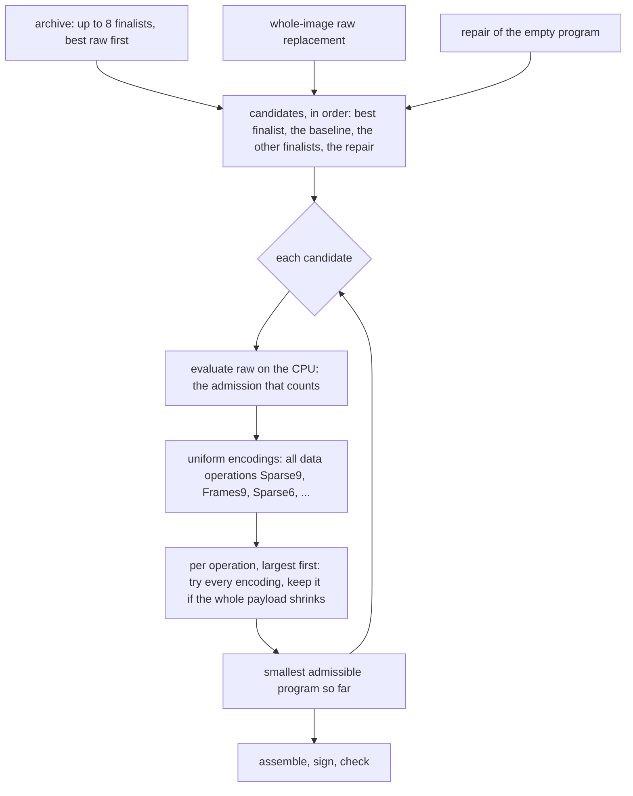

- **Candidates.** The device's finalists, best raw first; the **whole-image raw replacement**, kept
  independently of the device, so its encoded form competes with whatever the search found (its sparse
  form keeps every chunk that already matches, and when the search has had little time it is often the
  strongest answer); and, when a device search ran, the **repair of the empty program**, which writes
  exactly the bytes that differ. Equal images need only the empty program.
- **Encodings.** For each data operation: the raw blob, or `REPLACE_FRAMES` or `REPLACE_SPARSE` at level
  1, 6 or 9. A sparse operation keeps the chunks the target already holds, zeroes the zero chunks, and
  stores the rest, raw or zlib per chunk, so it is almost always the smaller. The levels tried are 1, 6 and 9, and a sparse operation may also store its changed chunks without compression. `ZERO`, `SOURCE_COPY` and
  `TARGET_COPY` have no other encoding and are left alone. The order of operations and each operation's
  extent stream are never touched, so a trial changes what one operation stores and nothing about what
  the program writes.

### 9.2 Acceptance

A trial is an ordinary evaluation: the mapper replays the variant on the CPU's model, compresses the
chunks (through the frame cache), builds the manifest and applies the profile. A variant is accepted only
when the **whole payload** is smaller, counting the manifest and the frame tables, and the profile
admits it. So an encoding that costs more than it saves is never taken, incompressible data stays raw
when framing costs more (`incompressible_data_stays_raw_when_framing_costs_more`), and the result is
never larger than the smallest admissible raw candidate. A raw candidate that the profile refuses is
not dropped: its encodings are still tried. The result is deterministic.

### 9.3 Cost, and why the pass is bounded by work

The pass has no clock, so it is bounded in work. A trial that compresses costs the data bytes of its
program plus `CHUNK_COST` (512) for every codec chunk they are cut into (`op_cost`), since a chunk is
compressed, framed and mapped on its own and with small chunks that costs more than the bytes. A trial
whose frames are already cached only maps and compares, which costs a sixteenth of the bytes plus the
same per-chunk charge (`mapping_cost`). Once the total passes `WORK_BUDGET` (2^28, a few seconds of
work) no more variants are tried and the best so far is kept. The first uniform encoding of the first
`FREE_CANDIDATES` (2) candidates, the device's best raw program and the whole-image baseline, is tried
whatever the budget, so a small budget cannot return an unencoded program. The per-operation
refinement visits at most `REFINED_OPS` (64) operations of a candidate, largest first. Compressors are
kept and reset between chunks, which is three times cheaper than building one per chunk.

A payload with one-byte chunks is the worst case, since every byte is a chunk and each trial costs
about a second: a 262 KB image whose changed region is 200 KB takes 12.6 s to encode and fits 13
trials. (Nothing compresses at one byte per chunk, so the payload there is the raw 200,711 B either
way; with 4 KiB chunks the same image encodes in 0.04 s to 71,293 B.) The pass reports the programs it
considered and the trials it ran.

Since §18 a trial is evaluated from an analysis of its candidate, so its real cost is lower than the
charges above. The charges are logical and unchanged: the same budget buys the same trials, and the pass
chooses the same payload.

### 9.4 Output and self-check

The chosen program is replayed once more in **finalize** mode, which produces the blob bytes and the
real hashes: each data operation's hash over its blob, each copy's source hash over the bytes it read
(from the old image, or from the target at that point). The manifest is then encoded and sealed:
header, manifest, metadata signature, blobs, payload signature. The final replay runs without a
deadline, since it must finish.

Before returning, the generator checks its own output in `check.rs`, which shares no model with the
mapper:

1. `verify::verify_payload` authenticates both signatures and every range under the profile;
2. the payload names exactly one partition, and `plan::validate` applies the metadata policy;
3. each supplied image is bound to the manifest: its length equals the recorded size, and a recorded,
   nonempty hash equals the image's digest. These are the client's own pre-flight and post-flight rules,
   so an image of the wrong size or content is refused even when the operations would replay;
4. ranges are bound independently whether or not the manifest records sizes: destinations and
   `TARGET_COPY` sources fit the new image, and `SOURCE_COPY` sources fit the old image. An
   out-of-range operation is refused, not indexed, including a kept sparse chunk that writes nothing;
5. every operation is executed on a flat target of the new length, initialized with the overlapping old
   prefix. For growth the checker repeats this with zero, erased-flash and patterned starting contents
   beyond the old length, rather than assuming that region is zero. Each frame is decoded, each data
   and source hash is recomputed, and every final image must equal the new one exactly. A raw `REPLACE`
   decodes nothing, so it returns before any decoder or frame buffer is made. A framed operation's frame
   buffer is one chunk, or its whole stream when that is shorter, since no frame is longer than either. The
   buffer is reserved fallibly, so a refusal is a `resource_limit` rather than an abort (`check::frame_len`).

This replay model does not resize a real device or initialize a separate A/B target: the adapter must
provide correct untouched/kept target bytes, or use operations that write them explicitly. The client's
target capacity may exceed the new length, and its tail remains unchanged.

A payload that fails any step is not returned. The same path, `assemble`, builds the winner and every
program the tests check, so the checked path and the emitted path cannot diverge.

**Output access.** The payload is written owner-only, `0600`, whatever the file it replaces had. The
mode is set before the first byte is written, and the file is renamed into place only after it is
synced, so a failure leaves the output as it was. The replaced file's mode, ACL and group are not kept:
a copy of mode bits does not carry an ACL, and a new file takes its group from its directory. So a setgid
directory gives the output its group, and a default ACL on the directory is masked by the owner-only
mode. An operator who needs other access sets it after generation
(`docs/locking-and-recovery.md` §3).

`0600` masks an inherited extended ACL. It does not delete the entries: the ACL stays on the output, and its
mask is zero, so every named user and group in it gets no access. `getfacl` shows them. An operator who widens
access must inspect that ACL and change it deliberately, since changing the mode alone can re-open the mask.


## 10. Command line

```sh
ota-gen [-b block-size] [-n partition-name] [--max-... value]...
        [-t seconds] [-s seconds] [-m bytes] [-r seed] [-g generations]
        [-d auto|software] <old.img> <new.img> <out.payload> <private.pem>

ota-gen --full [-b block-size] [-n partition-name] [--max-... value]...
        <new.img> <out.payload> <private.pem>
```

- clap supplies `-h` / `--help` and `-V` / `--version`, both successful without files.
- `-p` / `--profile` has been removed. `--max-...` above denotes the 12 explicit resource caps
  listed in `README.md`, each defaulting to `EMBEDDED`. `HOST` and `EMBEDDED` remain library presets,
  not execution modes. Raising a cap may produce output that a client with lower caps refuses.
- `-n` / `--partition-name` defaults to `A/B`. This signed logical label does not resolve a device
  path or slot. The adapter owns that policy.
- The full option/default table, bounds, exit statuses and migration are in
  `docs/image-geometry-and-cli.md`.
- `-d software` forces the software Vulkan device, which is how the test suite runs.
- Every output is written `0600`, whatever the file it replaces had (§9.4).
- `-t`, `-s` and `-m` follow §8.5. `-t` is the time of the **GPU search**; the encoding pass and the
  final signing come after it and are not counted. `-m` is in **raw** bytes. `-t 0` opens no device and
  encodes the raw replacement.
- The command reports why the search stopped (the clock, stagnation, the generation limit, or equal
  images) and how many generations ran, then the phases of the run, which is what a measurement needs:

  ```text
  search stopped: the time limit after 89 generations
  device: Intel(R) Iris(R) Xe Graphics (ADL GT2) (177887704 bytes resident, images uploaded once; 103448 bytes read back; 7525 candidates evaluated)
  best raw size scored on the device: 692814 bytes (uncompressed)
  time: upload 0.296 s, search 9.770 s, encoding 6.857 s (10 programs, 4024 trials), finalizing 0.045 s
  payload written: 496074 bytes
  ```

  The raw size the device optimized and the payload that was written are separate lines on purpose.
- `--full` builds a self-contained payload with no search (§17). It takes three positional arguments,
  and it refuses `-t`, `-s`, `-m`, `-r`, `-g` and `-d`.

## 11. Tests

Run with `cargo test -p delta-update-generator`. The device-backed tests run on the software device, which
needs `mesa-vulkan-drivers`; `OTA_TEST_DEVICE=auto` runs the same tests on the hardware device first.
**Both must pass**, since a driver can disagree with the software device (§6.7). The suite is grouped by
what each part guards. Independent image-size coverage is in `tests/sizes.rs`; command-line parsing
and caps are in `tests/cli.rs`, see `docs/image-geometry-and-cli.md` §7.

**The device against the CPU** (`tests/gpu_eval.rs`). Programs are evaluated by the same stages the
search uses, and the result is compared with `evaluate`, which replays with the CPU's model, repairs,
and sizes with the real manifest encoder. They must agree on whether a program is valid, on the repair
extent by extent, and on every byte of its size.

- random programs, including ones that break a rule on purpose (an extent past the image, copy streams
  of different length, a target copy over its own source), over a changed image, a growing and a
  shrinking one, odd lengths, empty images and repetitive images;
- operations with many ascending extents, and shuffled ones, which take the bulk path, the sorted bulk
  path and the piece-by-piece path (§4.1);
- an image of many scan ranges, and a mismatch that crosses range boundaries and is one span;
- the `EMBEDDED` profile's limits, including the operation count at which its decode-memory budget
  refuses a manifest, which the device must stop at exactly;
- the varint boundaries (128, 16,384 and 2 MiB) of an offset, a length and the running blob offset;
- a `TARGET_COPY` that reads unknown growth bytes before and after they are written, and one across a
  target of mixed origins;
- the workspace capacities, each refusing with its own reason: the extent arena (by the repair), the
  operation arena, the run arena (merged and unordered), and a repair the profile cannot hold; and a
  length past `SUM_LIMIT`, which only the device refuses.

**The search** (`tests/gpu_search.rs`):

- every finalist replays to the new image on the CPU and costs exactly what the device scored;
- a seed and generation cap reproduce the same finalists and counters on a device; **batching does
  not change the result** (one batch of twelve, twelve of one, five, sixty-four, and time-sized batches
  agree exactly); software and hardware finalists are each validated against the CPU evaluator, but
  need not match one another;
- each operator is bred alone from a known parent with one move forced, and checked: proposals are
  well formed, every copy copies exactly what it claims, and each move does what it is for. A guided copy
  is found at an odd source offset; a copy through a hash collision is never made (the test fails if
  verification is removed); a copy shorter than a probe is reachable; target copies are exact and never
  overlap; a zero is found inside a changed cell; a copy shift reaches another exact source; split,
  merge, shift, shift-start, insert-zero, remove, swap, regroup, reorder, compact and sweep, crossover and
  immigration each do their job. Two tests pin down compaction: a copy is never moved ahead of an earlier
  write to the same bytes, and a copy lying in the gap between the extents of an earlier write does move
  (the second fails if only bounds are compared);
- no target copy is proposed when the target is not readable; a repetitive image, where every window
  is alike, still searches; a search that is starved by a capacity counts the refusals;
- the images go up once and only small records come back; an image of 1 GiB or more, and two images
  that together exceed the device's storage buffer range, are refused with the limit that failed.

**The CPU's reference and the pipeline.** `tests/regressions.rs`, `tests/search.rs`,
`tests/sizes.rs` and `src/verification.rs` keep the earlier suite where it still applies, and port the
rest:

- the exhaustive oracle replays every one- and two-operation program over length-4 images on the CPU's
  model, on the device, and on a flat copy of the bytes, and requires all three to agree on validity and
  completeness, with the exact cost of a complete program;
- finalists are assembled and checked by the client's rules, and their raw size equals the length of the
  payload the CPU builds from them;
- a clock that moves a fixed step per read places the deadline at a known batch, and every stop returns
  programs the client accepts; the stop reasons, the progress history and the refusal of invalid time
  settings are checked; a zero budget opens no device and reads the clock a bounded number of times;
- a restart is not stagnant until a full window has elapsed since it, at the restart, half a window after
  it and just before the window expires; each restart opens its own window; the window slides after it;
  and the restart's best joins the history (`control.rs`, unit tests). A restarted population must run a
  generation before it can be called stagnant, even when the window has expired
  (`a_restarted_population_must_run_a_generation_before_it_can_be_stagnant`). With a clock that moves a second
  per read, so that every window expires between reads, each restart of a search is followed by a generation
  (`a_window_that_expires_between_reads_still_gives_each_restart_a_generation`), and a search that restarts
  runs at least one generation after each restart (`stagnation_restarts_the_population_before_ending_the_search`);
  the generation cap and the deadline still end a search that restarts, since neither waits for that generation,
  and a deadline that falls after a restart and before its generation stops the search there, after exactly one
  restart and no generation, as the clock's reads place it
  (`the_generation_cap_and_the_deadline_still_stop_a_search_that_restarts`);
- a restart's immigrants come from a stream of their own: consecutive restarts differ, and a fresh session
  with the same seed repeats them whatever its generation count
  (`consecutive_restarts_propose_different_immigrants`,
  `a_fresh_session_repeats_the_restart_sequence_whatever_its_generations`);
- the greedy seed copies a relocated range from its source; joins 600 changed cells into one operation;
  stops at its operation bound and leaves the rest to the repair; stops copying once its comparison budget is
  spent; makes no probe past its lookup bound, although a copy at the start of the same image is found, and
  enters the matcher for exactly the cells its lookups cover (`Seed::searched`), so the cells past the bound are
  not hashed (`the_greedy_seed_makes_no_probe_past_its_lookup_bound`); a complete single copy fits one operation
  and exactly its two extents, a copy the extents cannot admit gives way to raw bytes, a partial seed leaves one
  operation for the repair, and a profile of one extent per operation gets raw bytes
  (`a_complete_single_copy_seed_*`, `a_copy_the_extents_cannot_admit_*`, `a_partial_seed_leaves_*`,
  `a_profile_with_one_extent_*`); a short copy whose rest is already right is kept under a profile of one
  operation and repairs nothing (`a_short_copy_whose_rest_is_already_right_*`); a short copy whose rest differs
  from the old image in several runs gives way to its whole cell under a tight extent limit, and is admitted
  without a repair (`a_short_copy_with_a_fragmented_rest_*`); and a rest that runs past the old image, or that
  the comparison budget cannot cover, is not assumed right: the same image with the block held once keeps its
  copy, and held twice, so that finding the copy spends the budget the rest needed, writes its cell whole
  (`a_short_copy_whose_rest_runs_past_*`, `a_short_copy_whose_rest_cannot_be_compared_*`); and every seed it
  writes is evaluated with its repair (`the_greedy_seed_*`, `a_run_of_changed_cells_*`);
- programs that write the same bytes raw but copy them differently all stay in the population, structurally
  identical programs collapse, and the archive keeps one program per raw-written set
  (`programs_that_write_the_same_bytes_raw_but_copy_them_differently_all_stay_in_the_population`);
- the raw seed, a one-byte update under a profile that refuses the raw replacement, a profile that
  admits `ZERO` and not the raw replacement, and a profile with no admissible candidate (which reports
  the budget) still behave as they did;
- the GPU classification of cells uses the new image's grid and never keeps growth, and the changed-cell
  list is the ascending list of the cells that differ.

**The encoding pass** (`src/compress.rs`; `tests/search.rs` builds a payload with one-byte chunks under
both profiles, which keeps the worst case in the work budget and checked by the client's rules): a compressible replacement is framed or sparse and smaller
than raw; incompressible data stays raw; a sparse form keeps the chunks the raw baseline rewrote; the
result is never larger than the smallest admissible raw candidate; a candidate the profile never admits
yields nothing; copies, zeros and the order of operations are left alone; identical candidates are
tried once.

**Encoding reuse and the cut** (`src/compress.rs`, `src/program.rs`, `src/mapper.rs`). The cursor gives
`slice_stream`'s pieces for every chunk of unsorted, overlapping, repeated and tiny extents. The pass
with its analysis decides exactly as the pass that evaluates every trial by replay (200 random candidates,
images, chunk sizes and profiles, refusals included), and makes fewer whole-program replays in all. Each
analysed trial equals `evaluate` on its admission, its program with its repair and its size, over uniform,
random and repaired variants (over a thousand compared). An analysed sparse operation with no blob carries
the digest of no bytes. Blob offsets that pass the 128 and 16 Ki varint boundaries are sized as the replay
sizes them. An expired control interrupts the analysis and a new encoding. A trial the profile cannot count
is refused without a replay, under an expired control too (§19.1). The retained storage is bounded: a repair
of 2^20 spans is refused after one replay, the budget is exact at its boundary, a cache entry is kept only
while it fits, and a refused analysis decides as the analysed pass does (§19.2). The checked cut consults the
control before each chunk and every 64 extents: an expired control builds no chunk, an interrupted cut leaves
the cursor where it was, and zero-length extents count as visited work (§19.3). Two ignored measurements
print the cost of the cut (§18.2).

**Repair emission** (`tests/gpu_eval.rs`): the scan-range test also covers spans that end exactly where a
range does.

**Pinned payload** (`tests/search.rs`, `a_fixed_generation_search_reproduces_its_recorded_payload`): a
64 KiB pair searched for 40 generations gives 1,183 bytes with a fixed digest. The value is the one the
seed bounds, restart streams, structural selection and short-copy rule of this revision produce, and it matches
on the software and the hardware device. The short-copy rule (§7.2) alone moved it from 1,313 bytes: with the
reserve it replaced, the same revision gives 1,313 on the software device. An earlier pin, 1,660 bytes, did not
match HEAD on either device, and the two devices disagreed there. The greedy seed read an uninitialized
comparison budget, which is the likely cause; the fixed seed agrees on both. So a change in what the generator
writes fails here, while a change in how fast it writes does not.

**The device layer** (`src/gpu.rs`, `src/gpu_layout.rs`): the fallback order and the attempts recorded
on failure (a failure is injected, not a broken driver), software-only selection, the memory-type
preference, the table shapes, and the chromosome round trip.

**The client** (`delta-update-client`, `delta-update-cli`): payloads the search produces are applied through the client,
buffered and streamed, including interrupted and resumed runs. Two sparse-replacement tests that need
one raw replacement build it with the `builder` instead of asking the search for it, since the search
may now find a smaller plan.

**Full-image** (`tests/full.rs`, `tests/cli.rs`, `src/full.rs`): unchanged by this revision.

**Benchmarks** (`tests/bench.rs`, ignored by default): per-stage times of one generation
(`Session::profile_generation`, which runs the stages of a real generation one submission each), the
cost of the first use of each stage, and the compressor's setup cost per chunk. They print numbers and
assert none (§16).

## 12. Measurements

All figures are from this revision, in release builds, on one machine: an Intel Iris Xe iGPU
(`ADL GT2`, Mesa ANV) and Mesa lavapipe (`llvmpipe`, LLVM 21.1.8, 256-bit) on the same host. They show
what the design does on that machine; they are not a promise for another. The images are generated from
fixed seeds by a script (text-like regions and noise, with some regions relocated, some zeroed and some
patched); the generator's tests describe the shapes they use.

**Equal search budgets against the previous revision.** The previous revision (a CPU genetic search
over programs, with the GPU used for scans and compression inside the loop) was built from commit
`3ba1e8e` and run with the same command line. 16 MiB images, host-class limits, Intel iGPU:

| Search budget | Previous: payload (generations) | This revision: payload (generations, candidates) | Ratio |
| --- | --- | --- | --- |
| 2 s | 1,722,346 B (1) | 1,005,364 B (19, 1,635) | 0.58 |
| 5 s | 1,381,241 B (13) | 687,606 B (49, 4,184) | 0.50 |
| 10 s | 1,091,067 B (33) | 489,271 B (92, 7,773) | 0.45 |
| 20 s | 778,205 B (77) | 335,732 B (170, 14,218) | 0.43 |
| 40 s | 592,471 B (128) | 237,475 B (302, 25,148) | 0.40 |

```text
payload size, 16 MiB images, by search budget          previous = #   this revision = *
  2 s   #########################################################  1.72 MB
        *********************************                          1.01 MB
  5 s   ##############################################             1.38 MB
        ***********************                                    0.69 MB
 10 s   ####################################                       1.09 MB
        ****************                                           0.49 MB
 20 s   ##########################                                 0.78 MB
        ***********                                                0.34 MB
 40 s   ####################                                       0.59 MB
        ********                                                   0.24 MB
```

The new revision's time is the search plus an encoding pass of 1.4 to 4.1 seconds, which the budget does
not include; the previous revision's compression was inside its budget. Counting both, the new
revision at 5 s of search (about 7 s in all, 0.69 MB) is still ahead of the previous at 20 s (0.78 MB). The
small-image results, which are not an advantage by construction, are in the next table.

| 1 MiB images, host-class limits | Previous (generations) | This revision (generations) |
| --- | --- | --- |
| 2 s, software device | 62,447 B (102) | 53,618 B (35) |
| 5 s, software device | 42,713 B (241) | 30,290 B (105) |
| 20 s, software device | 24,937 B (829) | 20,915 B (342) |
| 2 s, Intel iGPU | 63,021 B (97) | 51,678 B (36) |
| 5 s, Intel iGPU | 46,511 B (195) | 31,889 B (88) |
| 20 s, Intel iGPU | 25,254 B (682) | 21,244 B (317) |

On the default `EMBEDDED` profile (64 operations, 128 extents, a 32 KiB decode budget), 16 MiB at 10 s:
1,532,615 B against 2,186,442 B previously (166 generations; the encoding pass found room for only 25
trials). The profile's limits keep both close to the encoded raw replacement, and the new search's gain
there is smaller than with host-class limits.

**Where the time goes.** 16 MiB images, host-class limits, 10 s budget, Intel iGPU:

| Phase | Time | Notes |
| --- | --- | --- |
| upload | 0.30 s | opening the device, 33.5 MB of images, parameters, bit maps |
| search | 9.76 s | 92 generations, 7,773 candidates evaluated (796 per second), 106 KB read back |
| encoding | 2.00 s | 10 programs, 797 trials, on one CPU core |
| finalizing | 0.05 s | final replay, hashing, signing, the independent check |

The device held 177.9 MB, and the host moved 33.5 MB up and 106 KB down in all. On the software device
the same run did 57 generations (4,852 candidates) and wrote 633,323 B: it is slower per generation, and
the software device compiles a stage the first time it runs after the SPIR-V changes (§6.7). The
encoding pass's work is bounded (§9.3), so it grows slowly with the search: 1.4 s after 2 s of search,
4.1 s after 40.

**One generation, by stage.** Mean milliseconds over twelve generations after a 100-generation warm-up,
96 children:

| Stage | 16 MiB, Intel iGPU | 1 MiB, software device |
| --- | --- | --- |
| breed | 40.2 | 8.3 |
| replay | 24.2 | 3.2 |
| count (scan) | 41.6 | 23.3 |
| prefix | 0.7 | 0.2 |
| emit | 13.2 | 10.5 |
| finish | 10.4 | 0.7 |
| select | 1.9 | 0.3 |
| sum of the stages (one submission each) | 132 ms | 46 ms |
| one generation in a batch | about 125 ms (8.0 per second, 766 candidates per second) | about 44 ms (22.9 per second, 2,200 candidates per second) |

The stages sum to a little more than a batched generation because each is timed with its own submission
and wait.

**What the profile found, and what each change gained** (measured while developing, at 21 children
on the 16 MiB pair; the figures are indicative, since the search changed between them):

| Change | Effect |
| --- | --- |
| first port, one work group of candidates | 216 ms per generation |
| one work group per candidate (§6.4) | breed 83 → 43 ms; replay no longer the sum of its candidates |
| runs as 128-bit vectors in their own buffer (§4.1) | replay worst case 2.4 s → 0.9 s |
| bit maps for old-equals-new and zero (§7.7) | scan 25 → 10.5 ms, emit 12.5 → 3.8 ms |
| merge sort for a rotated or shuffled operation (§4.1) | replay 177 → 27 ms |
| compressors reused between chunks (§9.3) | a chunk costs one third |
| capacities raised from 2,048 to 16,384 | the seeds fit an image with thousands of changed spans; the population no longer collapses to three near-full programs |
| children 21 → 96 (§7.1) | candidates per second about 4×; 1 MiB at 20 s: 33.6 KB → 21.2 KB |
| compaction checks extents, not one bound (§7.4) | 16 MiB at 20 s: raw size 510 KB → 464 KB, payload 380 KB → 336 KB. Conflict checking by bounds alone, added to stop copies overwriting earlier writes, had cost this; the exact test restores it |

**A large image.** 128 MiB images (about 60% of the new image differs), 20 s on the iGPU: 47 generations,
1.7 s of upload, 494 MB resident, a 43.6 MB payload. The previous revision ran one generation in the same
time and wrote 43.3 MB. At this size neither search has left its seeds: a generation costs about 300 ms, and the program
needs hundreds of copies to be found. The payload is the encoding pass's sparse form of the raw
replacement. Larger images need a longer budget, and the generations per second, not the design, are
what limit them (§13).

**Encoding reuse and the cut (this revision).** In eight of the nine matrix workloads the encoding pass makes between a
twentieth and about a quarter of its former whole-program replays. One replay of many short extents cut
into one-byte chunks takes 0.027 s, against 1.02 s before. The
payloads are unchanged. The measurements, and what did not change, are in §18.7.

## 13. Known limits

- **Not optimal.** The search is a bounded heuristic over the grammar in §3. On large, fragmented
  images its result is not a minimum, and convergence depends on how many generations it runs. A copy
  plan that exists in the grammar may take more generations to reach than the budget allows; the
  reachability tests check that the move is proposed, not that the budget finds it.
- **Raw is not compressed.** The device optimizes the raw size. A program that is smallest raw may not
  be smallest compressed, because the encoder's gain depends on what the raw operations contain. The
  archive keeps programs that differ in what they write raw, and the baseline is retained, which reduces
  the loss without removing it. A search optimizing compressed size directly would need compression on
  the device.
- **Image size.** Each image must be smaller than 1 GiB, and the two together must fit the device's
  `maxStorageBufferRange`: 128 MiB on the software device, 4 GiB on the Intel device. A larger image is
  refused with the limit that failed. There is no streamed fallback.
- **Capacities.** A program has at most 512 operations and 16,384 extents, and a replay at most 16,384
  runs, whatever the profile allows. An update with more changed spans than that cannot be represented
  by one program, and the search then works from the raw replacement and what it can build; the
  refusals are counted (`Found::counters`). Totals of lengths are 32-bit and refused past 2^31 - 1,
  which the CPU would admit.
- **Population.** 24 programs and 3 elites, as before, bred with 96 children per generation. Other
  values are a constant (§16), not a mode.
- **Speed grows with the image.** A generation scans every candidate's target against the new image, so
  its cost grows with the image, and the number of generations a budget buys falls with it (§12). The
  parallelism the device offers is spent on candidates, not on a single candidate's replay, which is
  sequential.
- **Encoding is on the CPU, and after the search.** Its time is not in `-t`. It is bounded in work
  (§9.3), so it is a few seconds for ordinary images. With tiny codec chunks the bound is loose in time:
  one-byte chunks on a 262 KB image took 12.6 s, with only the unconditional first trials run.
- **Device interruption.** A batch is not interrupted, and device setup is not either (§6.6). The return
  time is bounded by the work between checks, not by a guarantee about the driver.
- **Trajectory dependence.** The same seed reaches different sizes under different profiles, and a
  different seed reaches different sizes under the same profile.
- **Hardware coverage.** The tests ran on one integrated GPU and the software device. Another
  driver may differ in speed, and a driver bug would show as a test disagreeing with the CPU. No
  validation layer was available in the sandbox.
- **One-byte chunks are still slow to encode.** The replays that the analysis removes are not where their
  encoding time goes: the one-byte workload makes 13 replays where it made 25, and its encoding time is
  unchanged (§18.7). Its cost is in the per-chunk path, which this revision does not change. The frame
  cache holds 16,384 frames, fewer than a 64 KiB stream of one-byte chunks, so it does not retain them.
  Retaining frames is deferred until profiling justifies it.
- **Identical images** need no operation: with a positive budget the search returns the empty program
  without opening a device. A zero budget returns the raw replacement's encoding instead (§8.2).
- **Memory is bounded by a model, not measured.** `ANALYSIS_BYTES` charges the analysis's storage with an
  assumed allocator overhead (§19.2). It does not count the frame cache, which is bounded by a count of
  frames: with large codec chunks it can hold more bytes than the analysis budget. The process's peak memory
  is not measured in these changes.

## 14. What changed in this revision

The search moved from a CPU genetic algorithm that used the GPU for scans to one that runs entirely on
the GPU, with a CPU pass that chooses encodings after it.

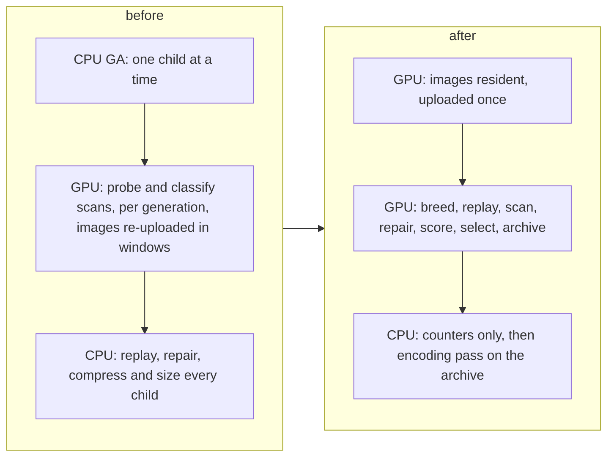

| Part | Before | After |
| --- | --- | --- |
| `search.rs` | the genetic algorithm on the host | configuration, size model, batches, stopping rules |
| `gpu.rs` | two scan kernels, host-visible buffers, windows | a session: device-local resident buffers, 16 stages, batches, transfers of used words only |
| `shaders/` | `probe.comp`, `classify.comp` | `layout.glsl`, shared headers, 16 stage shaders |
| `gpu_layout.rs` | none | the layout constants (generated), chromosome encode and decode, counters |
| `compress.rs` | none (encoding was a gene) | the encoding pass |
| `scan.rs`, `rng.rs` | host scans and sampling, host random numbers | removed |
| chromosome | six kinds and a compression level | four kinds; encoding chosen after |
| fitness | exact compressed size, computed on the host per child | exact raw size, computed on the device; compressed size computed by the CPU for the archive |
| `mapper.rs`, `evaluate.rs`, `memory.rs` | the search's evaluator | the CPU's reference and admission machinery |
| `Built` | payload, stop, generations | also raw fitness, candidates, trials, device, phase times, device memory and transfers |

**Removed, and why.** The host scan `scan.rs` and the host random source are gone because nothing on
the host chooses a candidate any more. `Gpu::match_hashes` and `Gpu::classify` are gone because the
tables and the classification are built once on the device from the resident images. The `Kind` and
`Level` moves are gone because the chromosome has no encoding. A sparse seed and a compressed compact
seed are gone because they are encodings. This is a breaking change to the generator's library API
(`search::run` now returns `Found` with finalists, not one winner) and to its timing (`-t` bounds the
GPU search, and encoding follows it); the payload format, the client and `--full` generation are
unchanged.

**Defects the work found, in the shaders and the layer around them.** Each is covered by a test or a rule
(§6.7, §11): a crash in the software device when a stage chose between two buffers at run time (the images
now share one buffer); wrong counts on the Intel device from a `bool` global (state is `uint`); a
quadratic replay of a rotated operation (a merge sort); a store followed by a dependent load on every merged
run (the last run is kept in registers); a TargetCopy overlap test that was quadratic and unbounded (it
counts against the replay's work); a compaction that could move a copy ahead of an earlier write to the same
bytes, and whose first fix, a single bound per operation, lost up to a fifth of the payload at long budgets (§7.4);
and a test that only passed on the software device and failed on
hardware for the first of those reasons, which is why the suite now runs on both.

## 15. Design decisions

| Decision | Why | What was rejected |
| --- | --- | --- |
| The whole genetic algorithm on the device, nothing per candidate on the host | the host's per-candidate work and the transfers it needs were the cost, and a GPU that waits for the host is idle | a GPU that only scans, as before |
| Score by raw size; encode after | the device cannot compress, and a compressed size inside the loop would put the CPU back in it | modelling compression on the device |
| Report raw fitness and payload size apart | they differ, and a reader should not take one for the other | a single "size" |
| An archive keyed by the raw-written set, and a separate baseline | a program best raw may compress worse; the baseline's sparse form is often the best safety net | keeping only the winner |
| Runs, not a target image per candidate | memory stays proportional to fragmentation, not to `population × image` | a byte image per candidate |
| One buffer for both images | choosing between two buffers at run time crashes some drivers | two bindings |
| A writer that appends, slots in a pool, ids not copies | no in-place shifting, packed programs, capacity checked in one place | arrays edited in place |
| One work group per candidate | candidates diverge; a group runs its threads in lockstep | one group of all candidates |
| Sorted tables, built by a bitonic sort | deterministic whatever the thread order; lookups are binary searches | atomic hash chains, whose order depends on scheduling |
| A stride in the table, probed at every offset | a table of every position costs four bytes per byte | indexing every position |
| Bit maps for old-equals-new and zero | most of an update is the old image at its own place, which the maps compare 32 bytes a word | reading both images per candidate |
| A bulk merge for disjoint operations, with a sort | the repair and compacted operations have thousands of pieces, and a piece-by-piece write costs the whole run array each time | writing every extent separately |
| Capacities and work bounds that refuse and count | a generation takes the time of its slowest candidate, and a silent truncation would hide that | growing arenas, or truncating |
| `uint` flags, not `bool`, for state a function changes | a driver mishandled the latter | relying on the standard |
| 32-bit offsets and sums; images under 1 GiB | the device's word, and no 64-bit arithmetic in the shaders | emulated 64-bit |
| The CPU decides admission, the device models it for raw | the device cannot know the encoding it will not choose; modelling the raw case spares generations spent on programs the CPU refuses | trusting the device, or ignoring the profile on it |
| 96 children, 24 survivors, 3 elites | the device's threads are many and a child costs one | 21 children, as before |
| The encoding pass bounded by work, not time | deterministic, and testable without a clock | a wall-clock limit |
| Stagnation on raw size | the compressed size is not known during the search | a CPU encoding inside the loop |

## 16. Tuning and benchmarking

The structural constants of the search are in `shaders/layout.glsl`, and `build.rs` turns them into
the host's constants, so changing one changes both. Structural changes rebuild the shaders; the software
device then recompiles a stage the first time it runs. The GA schedule parameters (`TOURNAMENT`,
`IMMIGRANT_PERCENT`, `CROSSOVER_PERCENT` and `ELITES`) are instead written into the parameter buffer
when a session opens, so they can be varied without rebuilding a shader. `SessionConfig` defaults them
to the values below.

| Constant | Value | Notes |
| --- | --- | --- |
| `POP`, default `ELITES`, `CHILDREN`, `NCAND` | 24, 3, 96, 96 | `ELITES` is a per-session parameter; its default is 3. `NCAND` is the larger of `CHILDREN` and `POP`. More children cost memory (every candidate has three run arrays and two scratch slots) and gave a few percent more at 192 on the 16 MiB pair |
| `OP_CAP`, `EXT_CAP`, `RUN_CAP` | 512, 16,384, 16,384 | the workspace; memory is `NCAND · 3 · RUN_CAP · 16` bytes of runs, and `(POOL + ARCHIVE + 2 · NCAND) · SLOT_WORDS · 4` of slots. The runs buffer must fit the device's storage buffer range: 128 MiB on the software device |
| `REPLAY_BUDGET`, `SORT_MAX`, `MAX_COMPARE` | 2^20, 8,192, 256 KiB | the bounds of §7.9 |
| `COMPACT_COMPARES` | 4,096 | extent pairs the compaction move compares per child (§7.4) |
| default `TOURNAMENT`, `IMMIGRANT_PERCENT`, `CROSSOVER_PERCENT` | 3, 8%, 12% | per-session parameters in `SessionConfig`; percentages are evaluated on each non-elite child |
| move weights, percentages | as in §7.4 | in `moves.glsl` (`move_weight`) and `layout.glsl` |
| `compress::WORK_BUDGET`, `CHUNK_COST`, `FREE_CANDIDATES`, `REFINED_OPS` | 2^28, 512, 2, 64 | the encoding pass's bounds (§9.3). Raising the work budget fourfold bought nothing on the 16 MiB pair at 20 s (379,861 B against 379,799 B) and cost five more seconds |
| `compress::ANALYSIS_BYTES` | 8 MiB | the bytes one candidate's analysis may retain (§18.6); beyond it the candidate is evaluated by replay |

To measure on a device:

```sh
OTA_BENCH_OLD=old.img OTA_BENCH_NEW=new.img OTA_BENCH_WARMUP=100 OTA_TEST_DEVICE=auto \
    cargo test --release -p delta-update-generator --test bench -- --ignored --nocapture
```

reports the upload, the first population, the mean and worst time of each stage over twelve generations
after the warm-up (`Session::profile_generation`), the generations and candidates per second, the population's shape and the device and
transfer volume. `ota-gen` prints the phases of a whole run (§10). Compare two builds with `-g` and `-r`
for the same work, or with `-t` for the same time. Wall-clock budgets depend on the machine and on the
software device's shader cache, so a comparison should say which.

## 17. Full-image generation

`ota-gen --full` and `delta_update_generator::build_full_payload` build a payload that records only the new
image. The design, the contract and the measurements are in `docs/full-image.md`; this section is the
generator's side of it.

It is not a search. It builds two candidates from the image, and it signs the smaller of those the
profile admits:

- **raw**: one `REPLACE` over the whole image;
- **framed**: each all-zero run of chunks as one `ZERO`, and each other run as `REPLACE_FRAMES`, cut
  wherever the frame table would pass `max_frame_table_bytes`. A chunk is a zlib frame at level 6 when
  the frame is strictly smaller, and raw otherwise. That is the delta mapper's rule (`stored_frame`).

Admission uses the delta search's own arithmetic (`evaluate::admitted_size`): the client's scanner and
metadata policy on the complete manifest, and the complete encoded size. A candidate the profile refuses
is dropped. If neither fits, the build returns `resource_limit`, and it never retries under another
profile. A tie goes to the raw candidate.

The payload is then sealed with the delta path's `seal`, and it is checked by
`check::check_full_payload` before it is returned. That checker verifies both signatures, runs the
metadata policy, requires the full-image metadata and coverage rules (`docs/format.md` §12), and replays
the operations from zeros, from erased flash and from a fixed pattern. Each replay must produce the image.

Nothing in this path opens a Vulkan device, and no old image is constructed. The output is deterministic:
the same image, name, key and profile give the same bytes.

**Command line.** `ota-gen --full [-b bytes] [-n name] [--max-... value]... <new.img> <out.payload>
<private.pem>`. The search options `-t`, `-s`, `-m`, `-r`, `-g` and `-d` are refused with `--full`,
since they have no meaning without a search, and the report names the payload size rather than a stop
reason.

**Refused, not converted.** A failed delta is not converted into a full payload. The caller builds
the full payload separately, and `ota-apply` needs no old image for it.

## 18. Encoding reuse and the streaming cut

This revision is the first increment of the search-construction plan. It implements milestone A (the
streaming cut, and repair emission that skips empty ranges) and milestone B (an encoding analysis that
trials reuse). **It changes no result.** The thirty-six builds of the workload matrix (§18.7) have the
same payload and digest as HEAD, and so does the pinned payload of §11. The later milestones (search
proposals, copy-rich seeds, radix sorting and interval sweeps, compression-aware selection) are not in it.

### 18.1 What changed

| Part | Change | Why |
| --- | --- | --- |
| `program.rs` | `Chunks`, a cursor over the codec chunks of a stream | the replay cut each chunk with `slice_stream`, which walks every extent: O(chunks × extents) |
| `mapper.rs` | `encode_op` replaces the body of `data_op`; the per-chunk mode is supplied by the caller; `packed_mode`, `zero_wire`, `copy_wire`, `Mapping::encode`, `Mapping::maps` | one encoder for the replay and for analysed trials, so they cannot disagree on a byte |
| `compress.rs` | `Prepared` (one analysis per candidate), `Trials`, `optimize_with`, `ANALYSIS_BYTES` | a trial encodes the operations it changes and takes the rest from the analysis |
| `shaders/eval_emit.comp` | a range whose span count is zero writes nothing and is skipped | span endings still come from the prefix, so the result is the same |
| `lib.rs`, `compress.rs` | `Built::encoding_mappings`, `Outcome::mappings` | count the whole-program replays a build makes |
| `tests/bench.rs` | `workload_matrix`, the workload matrix (ignored) | a reproducible comparison whose digests show any change in result |
| `tests/search.rs`, `tests/gpu_eval.rs` | the pinned payload; span endings at range boundaries | a regression fixture; a boundary case of the repair |

### 18.2 The streaming cut (A.1)

A stream is the declared extents concatenated (§2). `Chunks` walks the extents once, keeping its place in
the current extent, so the pieces of each chunk come out in declared order without a search. Its cost is
O(extents + chunks + pieces). It returns exactly what `slice_stream` returns for each chunk (tested on
unsorted, overlapping, repeated and tiny extents), and `slice_stream` stays for callers that need arbitrary
access. The cut has one implementation: `Iterator::next` and the checked advance `next_checked` share it, and
the checked advance consults a control while it cuts (§19.3).

```text
extents (declared order):  [19,+5)   [100,+3)   [40,+6)        chunk c = 4
stream:                    0 1 2 3 4 | 5 6 7 | 8 9 10 11 | 12 13
chunk 0 pieces:            [19,+4)
chunk 1 pieces:            [23,+1)  [100,+3)
chunk 2 pieces:            [40,+4)
chunk 3 pieces:            [44,+2)                         (partial)
```

The cut was the dominant cost of a replay of many short extents with small chunks. Measured on the same
160,000 one-byte chunks of 20,000 extents:

| Measurement | HEAD | this revision |
| --- | --- | --- |
| cutting the chunks alone: `slice_stream` per chunk (unchanged code) against the cursor | 0.634 s | 0.0017 s |
| one replay of the sparse operation (`Mapping::map`, same blob, 19,920 B) | 1.021 s | 0.026 to 0.029 s (three runs) |

### 18.3 Repair emission (A.2)

The repair's extents are written by one invocation per (range, candidate). A range that no span starts in
writes nothing: a span is counted and written in the range that holds its first byte, and a span that runs
on into a later range ends at the position the prefix recorded (§7.7). So a range with a zero count is
skipped, and the endings are unchanged. The boundary cases (a span ending exactly at a range's end, a span
crossing many empty ranges) are in `tests/gpu_eval.rs`.

It is **not a measured speedup**. The emit stage averaged 9.2 ms at HEAD and 8.9 ms here over three runs
each, and count is within its spread (§18.7). Most of the stage is the dispatch of one invocation per
range and candidate, and a range that holds the old image at its own place, or zeros, is compared 32 bytes a word through the bit maps
(§7.7), so the skipped scan was small. The change is kept because it is strictly less work and its tests pass. A real
gain would need the non-empty ranges compacted before dispatch, which this does not do.

### 18.4 Why one analysis serves every encoding

The candidate's encoding pass (§9) chooses, per data operation, between raw, `REPLACE_FRAMES` and
`REPLACE_SPARSE`. The analysis rests on this fact about the replay:

| Chunk mode | Target bytes over the chunk afterwards | Origin recorded for them |
| --- | --- | --- |
| Keep (the target already holds the new bytes) | unchanged, which are the new bytes | unchanged |
| Zero (the new bytes are all zero) | zero, which are the new bytes | `Zero` |
| Content (raw or zlib) | the new bytes | `New` |
| every chunk of a raw or framed operation | the new bytes | `New` |

Whatever the encoding, the bytes of the target over a data operation's destination are the new image's
bytes afterwards. By induction, the bytes at every point of a program do not depend on the encodings, so
the keep and zero decisions, which read bytes and not origins, do not either. An encoding changes only the
origin each run records, and two places read origins:

1. **The refusal of a target copy that reads growth bytes.** It refuses an `Old` origin past the old image.
   A kept chunk is never such a run, because matching an `Old` run that extends past the old image is
   false (`memory.rs`, `Images::matches`), so keeping cannot create or remove the refusal.
2. **Nothing else.** Mismatches and the payload size are functions of bytes and of the wire operations.

So one replay of the candidate, with every data operation sparse and uncompressed, gives the chunk modes
of every encoding. Each mode is a two-bit value, and the replay writes it into the operation's frame table
(the packed modes come first, as on the wire).

### 18.5 Analysis and trials

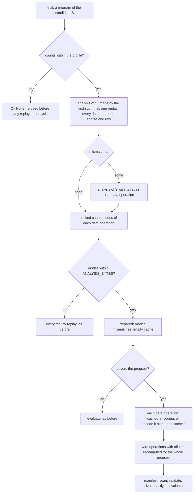

The analysis is made by the first trial that needs it, and only after that trial's own counts pass
`within_count_limits`, so a trial the profile cannot count costs no replay and makes no analysis (§19.1).
A trial's program is either the candidate's own encoding or the candidate's encoding with its repair
appended (a repair the earlier trial added). The analysis covers both, because the repair of an
incomplete candidate is the last data operation of its repaired form. A repair that a trial appends for
an incomplete candidate is written raw, as `evaluate` writes it, so it needs no mode.

**What a trial costs.** Its changed operations are encoded (one compression per chunk, and nothing else
unless the frame cache misses), and the rest come from the cache. Every trial still builds the whole
manifest, encodes it and admits it under the profile, so the admission is the one `evaluate` makes, and
the wire forms and offsets are the same (`a_sparse_operation_with_no_blob_carries_the_digest_of_no_bytes`).

**What does not change.** The order of trials, the unconditional first trials, the tie-breaking, and every
logical work charge (§9.3). The result is therefore the same under the same budget, and a budget that is
exhausted in the same place in both.

### 18.6 Bounds and memory

| Retained | Charge | When the bound is reached |
| --- | --- | --- |
| packed chunk modes: two bits per chunk, per data operation, with the buffers and the outer vector that hold them | each buffer's capacity, plus `ALLOCATION_OVERHEAD` (32 B) | the candidate's analysis is refused and every trial is evaluated by replay |
| the repair's spans, when the candidate is incomplete (16 B each) | the spans' capacity, plus `ALLOCATION_OVERHEAD` | refused right after the first replay, before the repair is copied and replayed again (§19.2) |
| the kept encodings' outer vector, one element per data operation and one for the repair (24 B each) | its capacity, plus `ALLOCATION_OVERHEAD` | the analysis is refused, as for the modes |
| kept encodings: each operation's entry buffer, allocated by its first kept encoding, and each kept table (the frame table of each changed operation) | the buffer's capacity times the entry's size, plus `ALLOCATION_OVERHEAD`; the table's capacity, plus `ALLOCATION_OVERHEAD` | the encoding is computed for the trial that needs it and not kept (§20) |
| the frame cache (§9.3), which the mapping owns and this budget does not count | 16,384 frames | cleared, as before |

All the analysis's charges share `ANALYSIS_BYTES` = 8 MiB, and every addition is checked, so a total that
overflows is refused rather than wrapped. `ALLOCATION_OVERHEAD` is an assumption about the host allocator
(glibc's malloc adds an eight-byte header and rounds to sixteen), not a measurement. The budget therefore
bounds **retained analysis storage**. It does not bound the process's resident memory, which also holds the
replay's transient storage (the target's runs, one trial's wire operations, the repair's copy for the second
replay, and the first replay's mismatch list, which exists before it can be checked), the frame cache, and
the device's buffers. The frame cache is bounded by a count of frames, so with large codec chunks it can hold
more bytes than `ANALYSIS_BYTES`; that is outside this change and is not claimed here.

Other limits: one candidate is analysed at a time, and its analysis is dropped with it. No target is kept
per operation: the analysis keeps two bits per chunk, not a snapshot of the target. For 4 KiB chunks, 8 MiB
of modes covers 128 GiB of data operations. With one-byte chunks it covers 32 MiB, so only one-byte chunks
on very large images reach the bound.

### 18.7 Measurements

**Method.** `workload_matrix` (`tests/bench.rs`) builds nine workloads, each under the `HOST` and the
`EMBEDDED` profile and with seeds 1 and 2, at a fixed 20 generations, so every build is reproducible. The
images are 1 MiB; the one-byte workload uses 64 KiB images with one-byte chunks. The device is the Intel
Iris Xe iGPU. Each build's digest is compared with HEAD's (the baseline was taken from HEAD with only the
counters added, which change nothing).

```sh
OTA_MATRIX_SEEDS=1,2 OTA_MATRIX_GENERATIONS=20 OTA_TEST_DEVICE=auto \
    cargo test --release -p delta-update-generator --test bench workload_matrix -- --ignored --nocapture
```

**Equality.** All 36 builds have the same payload length and digest before and after, and the same trial
count. The pinned payload of §11 was 2,276 bytes with the same digest before and after that change, on the
software and the hardware device. §11 now records the value of the later seed and selection revision.

**Work.** Whole-program replays per build, and encoding seconds per build, averaged over the four builds of
each workload (two profiles, two seeds). The search time is unchanged in every workload (the device
search is untouched), and it is not shown.

| Workload | Block | Payload (seed 1, host) | Trials | Replays before → after | Encode s before → after |
| --- | --- | --- | --- | --- | --- |
| sparse edits | 4096 | 1,879 | 80 | 81 → 21 | 0.082 → 0.064 |
| relocated regions | 4096 | 157,769 | 73–381 | 224.5 → 20.5 | 0.154 → 0.114 |
| short extents | 4096 | 76,574 | 80–353 | 193 → 20.5 | 0.206 → 0.167 |
| compressible | 4096 | 6,949 | 374–444 | 410 → 21 | 0.099 → 0.052 |
| incompressible | 4096 | 1,049,286 | 65–93 | 76.5 → 18.5 | 0.225 → 0.213 |
| repetitive | 4096 | 2,882 | 80 | 81 → 21 | 0.035 → 0.040 |
| growth | 4096 | 132,561 | 80 | 81 → 21 | 0.102 → 0.097 |
| shrink | 4096 | 2,617 | 80 | 81 → 21 | 0.055 → 0.056 |
| one-byte chunks | 1 | 1,873 | 24 | 25 → 13 | 4.834 → 4.690 |

Replays per build, mean over the four builds (one `#` is 11.25 replays; the same scale in both rows):

```text
                  whole-program replays per build, scale 0-450
sparse-edits     base #######                                    81.0
                 new  ##                                         21.0
relocated        base ####################                      224.5
                 new  ##                                         20.5
short-extents    base #################                         193.0
                 new  ##                                         20.5
compressible     base ####################################      410.0
                 new  ##                                         21.0
incompressible   base #######                                    76.5
                 new  ##                                         18.5
repetitive       base #######                                    81.0
                 new  ##                                         21.0
growth           base #######                                    81.0
                 new  ##                                         21.0
shrink           base #######                                    81.0
                 new  ##                                         21.0
one-byte-chunks  base ##                                         25.0
                 new  #                                          13.0
```

Encoding seconds, eight workloads (one `#` is 0.00625 s; the one-byte workload is off this scale):

```text
                  encoding seconds per build, scale 0-0.25 s
sparse-edits     base #############                            0.082
                 new  ##########                               0.064
relocated        base #########################                0.154
                 new  ##################                       0.114
short-extents    base #################################        0.206
                 new  ###########################              0.167
compressible     base ################                         0.099
                 new  ########                                 0.052
incompressible   base ####################################     0.225
                 new  ##################################       0.213
repetitive       base ######                                   0.035
                 new  ######                                   0.040
growth           base ################                         0.102
                 new  ###############                          0.097
shrink           base #########                                0.055
                 new  #########                                0.056
```

**Reading the charts.** Replays fall by three-quarters or more in eight workloads, and by about half in the
one-byte workload, because a trial no longer maps the whole program. Encoding time falls by 1.2 to 1.9 times
where the pass makes many trials per candidate (compressible, relocated, short extents and sparse edits), and
it is unchanged in the others. The one-byte workload's encoding time does not move at all, which is why the
per-chunk path is the next thing to look at (§13). The differences below about 0.03 s are inside the
run-to-run variation of a single matrix run, so they are not claimed.

**Repair emission and the cut, three runs each on the same machine** (`per_stage_times`, 4 MiB images,
warm-up of 100 generations, Intel iGPU; the HEAD runs were built in their own target directory):

| Stage, ms | HEAD: three runs | this revision: three runs | mean, HEAD → this revision |
| --- | --- | --- | --- |
| breed | 51.56, 52.03, 52.03 | 51.20, 51.36, 51.17 | 51.9 → 51.2 |
| count | 10.41, 9.85, 9.89 | 10.53, 9.92, 12.75 | 10.1 → 11.1 |
| emit | 9.42, 8.82, 9.42 | 8.21, 9.45, 9.05 | 9.2 → 8.9 |
| finish | 23.02, 23.55, 24.10 | 23.42, 22.89, 23.38 | 23.6 → 23.2 |

The change touches only emit, and its spread overlaps HEAD's, so the stage numbers show no change. Breed,
count and finish run no code that the change modifies, so their spread is the run-to-run variation of the
machine, and it is wider than the emit difference. The cut has its own measurement (§18.2), which is where
the gain is.

### 18.8 Verification

- The library suite (94 tests) and the generator suite pass on the software device, debug build.
- Differential tests (§11): the analysed pass against the pass that replays every trial, the analysed trial
  against `evaluate`, the cut against `slice_stream`, the varint boundaries, the empty-blob digest, and the
  deadlines.
- Mutation checks, run to see that the tests can fail: removing the raw repair of an incomplete candidate,
  and keying the cache one operation off, each fail both the pass-level and the trial-level test.

### 18.9 Not in this increment

- **Milestones C, D and E** (proposals and seeds, interval sweeps and radix sorting, compression-aware
  archive and selection) are not started. C and E change the search trajectory and need a benchmark
  comparison at equal total time, which this increment does not run.
- **Follow-ups that the measurements point to.** (1) Each candidate is replayed twice, once for its
  admission and once for its analysis. Admission could come from the analysis, which would remove about one
  replay per candidate. (2) One-byte chunks are compression-bound and need frame
  retention, which the plan defers. (3) Emit would need compacted non-empty ranges to benefit from A.2.

## 19. Review fixes: count refusal, retained storage and cancellation

A review of §18 found three defects. Each is fixed in its own commit, with regression tests that the removal
of the fix makes fail (§19.4 says which), and the three together change no result: the workload matrix keeps
every payload digest. The fixes keep the encoding reuse, the streaming cut, the trial order and every logical work
charge, so the pass decides as it did and only the work it does changes.

| Finding | Where it was | Fix | Section |
| --- | --- | --- | --- |
| a trial the profile cannot count was analysed (a replay) before it was refused | `compress.rs`, `Trials::evaluate` | count check first, shared with `evaluate` | §19.1 |
| retained analysis storage was bounded by the modes alone, not by a repair's spans or the cache's metadata | `compress.rs`, `Prepared` | one checked accounting path, checked before the repair is copied | §19.2 |
| the cut's control was read after each chunk was built, and not at all within one large chunk | `program.rs`, `mapper.rs`, `encode_op` | checkpoint before each chunk is cut, and before every 64th extent a chunk visits | §19.3 |

### 19.1 Count refusal before analysis

**The defect.** `Trials::evaluate` made the analysis before it asked whether the profile could count the
trial. Making the analysis replays the candidate. So a candidate the profile refuses on its counts (too
many operations, or too many extents) cost a whole-program replay before the refusal was reached, and it
cost a second one when the candidate was incomplete. With an expired control that replay returned
`Halt::Deadline`, so the pass could report a deadline for a program no time could make admissible.

**The fix.** `within_count_limits` (`evaluate.rs`) holds the two count rules. Every evaluation calls it
first: `evaluate`, `Prepared::manifest`, and `Trials::evaluate` before `Prepared::new`. A
trial's own program is checked, so a repair that an earlier trial appended is counted too.

```text
trial ──► within_count_limits? ──no──► Ok(None)            no replay, no analysis, no deadline
              │yes
              ▼
        Prepared::new (one replay) ──► covers? ──► manifest, admission as before
```

**What does not change.** The manifest and metadata admission (`admitted_size`) are unchanged, so a count
the profile refuses only in the manifest is still refused there. A refused trial is still counted in
`trials` and charged to the work budget before it is evaluated, exactly as before.

**Regression test** (`compress.rs`): `a_program_the_profile_cannot_count_is_refused_before_any_mapping_or_analysis`.
One replacement is tried under `max_operations = 0`, then under `max_total_extents = 0`. For each, under an
unbounded control and under an expired one: the trial returns `Ok(None)`, no analysis is initialised, the
ordinary evaluation and the pass return `Ok(None)`, and the whole-program replay count does not move.
Removing the trial's check makes the test fail at the analysis assertion.

**Measured.** The workload matrix (§19.4) keeps all 36 builds: the same payload and digest, the same
trials, and 710 whole-program replays before and after. None of its candidates is refused on counts, so
the matrix has no refused trial to save. The saving is the one the regression test pins: a refused trial
costs no replay, where it cost one or two before. The encoding seconds of the two runs (31.9 s and 19.5 s
on an unchanged code path) differ by more than this change could move them, so they are not claimed.

### 19.2 Retained analysis storage

**The defect.** The analysis budget counted the packed chunk modes and nothing else. A candidate with a
large repair was therefore admitted however much its repair held. Two images that differ in every other
byte give the empty program a repair of 2^20 one-byte spans, which is 16 MiB of `Span`s, while the modes
of the same analysis are a few kilobytes. The repair was also copied and replayed a second time before the
analysis was checked at all.

**The fix.** One accounting path charges everything the analysis keeps, with checked arithmetic
(`compress.rs`):

- `heap_bytes(capacity, size)`: the elements of a buffer and `ALLOCATION_OVERHEAD`, which is zero for a
  buffer with no capacity, and `None` on overflow;
- `Prepared::base_bytes`: the outer vector of modes, each mode buffer, and the repair's spans, each by its
  capacity, since that is what the allocator holds;
- `cached_bytes` (replaced by §20): a kept encoding's table, and its slot in a hash map, charged as
  `CACHE_SLOT`, three times the slot's size. That charge assumed the map's layout, so §20 removes it;
- `Prepared::charge`: adds a charge to one running total, and refuses a charge that overflows or exceeds the
  budget. A refused charge changes nothing.

```text
first replay ──► repair spans: heap_bytes(capacity) within budget? ──no──► None
     │yes                                                        (nothing copied, no second replay)
     ▼
second replay ──► base_bytes charged within budget? ──no──► None   (nothing retained)
     │yes
     ▼
Prepared ──► each new kept encoding: retain (§20)? ──no──► encoded for this trial, not kept
```

**What does not change.** A refused analysis still falls back to ordinary evaluation, so admission, the
selected program and the payload size are the same. An analysis is not refused because its raw encoding
fails admission: the analysis makes no admission check, and every trial is still admitted by `evaluate`'s
own rules.

**Regression tests** (`compress.rs`):

- `a_repair_too_large_to_retain_is_refused_after_one_replay`: the 2 MiB alternating-byte fixture, with 2^20
  repair spans. The analysis is refused, and only one replay is made. A version of the code without the early
  check replays twice (the test fails at that count).
- `the_analysis_budget_is_exact_at_its_boundary`: a budget equal to the analysis's retained bytes admits it,
  and one byte less refuses it, both for a candidate without a repair and for one whose repair is an operation.
- `a_cached_encoding_is_kept_only_while_it_fits_the_budget`: one byte short of an entry, the encoding is
  computed for the trial and not kept, and the total stays within the budget. Exactly the entry, it is kept.
  Without the charge on insertion the test fails.
- `a_refused_analysis_decides_as_the_analysed_pass_does`: one byte short of the analysis, the pass chooses the
  same program with the same counts, and it makes more replays, which shows the fallback was taken.
- `an_analysis_is_not_refused_because_the_raw_program_is_refused`: under a manifest limit that refuses the raw
  program, and so every encoding, the analysis is still made, and each trial agrees with `evaluate`.
- `the_retained_charges_cannot_wrap` and `the_analysis_is_charged_by_the_capacity_its_buffers_hold`: an
  overflowing charge is refused and changes nothing, and a buffer is charged by its capacity, not its length.

**Measured.** The workload matrix (§19.4) keeps all 36 builds: the same payload and digest, the same trials,
and 710 whole-program replays before and after. A refused analysis falls back to replays, so the unchanged
replay count shows that no analysis in the matrix was refused by the new charges. The matrix therefore does
not exercise the fixes; the regression tests do, at the sizes they name. Encoding seconds (31.9 s, then 21.4 s)
vary by more than this change could move them, so they are not claimed.

### 19.3 Cancellation inside chunk construction

**The defect.** `encode_op` read the control after a chunk had been cut: it took the next chunk from `Chunks`
and then called `ctl.checkpoint()`. So a deadline saw each chunk only once it was whole, and a chunk with many
extents was cut without any read of the control. A cut visits every extent its chunk spans, so one chunk of
10,000 one-byte extents could not be interrupted before it was complete.

**Who sees it.** The production encoding pass runs under `Control::unbounded()` (`lib.rs`), and the search
does not replay programs, so the command-line tool's timing is not changed by this fix. The pass is bounded
in work, not time (§9.3). The defect is in the contract the library gives a caller that passes a deadline,
which the tests do, and which any bounded caller would.

**The fix.**

- `Chunks::next_checked(&Control)`: the checked advance. It reads the control before the chunk is cut, and
  before every 64th extent (`CUT_CHECK_EXTENTS`) the chunk visits. Zero-length extents count as visited.
- `Chunks::cut(Option<&Control>)`: the one cutter. `Iterator::next` calls it with `None`, so there are not two
  chunk cutters. It moves the cursor on local copies and commits them only when the chunk is whole. An
  interrupted cut leaves the cursor where it was, so a later call cuts the same chunk.
- `mapper::encode_op`: `while let Some(..) = cut.next_checked(ctl)?`. The checkpoint that followed the cut is
  gone, so each chunk is decided only after the control has allowed it to be cut.

```text
cut of one chunk, with its checks      c = read of the control, e = extent visited

c  e e e ... e (63)  c  e e ... e (63)  c  e ... e  commit the cursor
^                    ^                  ^
before the chunk     before extent 64   before extent 128
```

**Why the checks are where they are.** The check before the chunk is the one the replay had, moved so that an
expired deadline builds nothing. The check every 64 extents bounds the work between two reads of the control.
The count includes zero-length extents, which a chunk can visit without taking a byte, so a long run of them
cannot pass the control unobserved. The interval is a choice, not a fitted tuning value: with the unbounded
control a check is a call that returns at once, and with a real clock one read costs tens of nanoseconds,
against the cost of the 64 extents between reads.

**What does not change.** Chunk boundaries, the pieces of every chunk, the modes, the frames and the finalized
bytes. The checked cut returns the pieces `slice_stream` returns, and the matrix digests are unchanged (§19.4).

**Regression tests.** `program.rs`:

- `an_expired_control_cuts_no_chunk_and_moves_no_cursor`: the control is read once, no chunk is cut, and the
  cursor keeps its position.
- `an_interrupted_cut_leaves_the_cursor_where_it_was_and_the_next_cut_is_whole`: an expiry partway through one
  chunk of 1,000 extents stops the cut after four reads, which is at most 191 visited extents. The cursor is
  unchanged, and the same chunk cut afresh is the whole stream.
- `zero_length_extents_count_toward_the_checks`: 1,000 zero-length extents before a one-byte chunk stop the cut
  at four reads.
- `the_checked_cut_is_the_iterator_cut_under_an_unbounded_control`: the checked cut returns `slice_stream`'s
  pieces for the unsorted, overlapping, repeated and tiny extents, for chunk sizes one to seven.

`mapper.rs`:

- `an_expired_control_builds_no_chunk_of_a_many_piece_operation`: a chunk of 48 extents, fewer than one check
  interval, so only the check before the chunk can refuse it. No mode is decided, and the control is read once.
- `a_deadline_inside_one_chunk_stops_after_bounded_work`: a chunk of 10,000 extents and a clock that expires at
  its fourth read. No mode is decided, and the control is read four times, not 10,000.
- `a_replay_interrupted_inside_a_chunk_returns_no_mapping`: the same chunk through `Mapping::map` returns
  `Halt::Deadline` and no partial mapping.

Mutation checks: removing the check before the chunk fails both expiry tests, since the 48-extent test needs it
(a chunk longer than one interval would be refused by the check at extent 64 instead, which hid the gap at
first). Disabling the check every 64 extents fails both mid-chunk tests.

**Measured.** See §19.4.

### 19.4 Validation

**Tests.** All pass on both devices. `cargo test --release -p delta-update-generator` on the software device, and the
same with `OTA_TEST_DEVICE=auto` on the Intel device, each give 109 library tests (two ignored) and the
integration suites: `cli` 14, `full` 29, `gpu_eval` 16, `gpu_search` 22, `regressions` 20, `search` 11 and
`sizes` 4. The library suite also passes in a debug build, so the checked arithmetic has no overflow panic.
`cargo test --workspace --release` passes in every crate, which includes `delta-update-payload`, `delta-update-client` and the
command-line crates. `git diff --check` is clean.

**Regression fixtures.** Each fix has the fixture its test names, and the mutation checks were run on the
fix's own code:

| Finding | Fixture | Mutation that the test catches |
| --- | --- | --- |
| §19.1 counts | one replacement under no operations, then no extents, under an unbounded and an expired control | the trial check removed: the analysis is made (the test fails at its assertion) |
| §19.2 storage | 2 MiB of alternating bytes: 2^20 repair spans | the early repair check removed: the candidate is replayed twice |
| §19.2 storage | a budget equal to, and one byte below, the retained bytes; one cache entry | the cache charge removed: the entry is kept beyond the budget |
| §19.3 cancellation | 48 extents (pre-chunk check only); 1,000 and 10,000 extents in one chunk; a run of zero-length extents | the check before the chunk removed: both expiry tests fail; the check every 64 extents removed: both mid-chunk tests fail |

Where the fixture is a guard rather than a regression, the table says so. Two of them match HEAD's
behaviour on their own outcome: the 48-extent case is refused at HEAD too, after its chunk is cut, and only
the reads and the cursor (`program.rs`) show the difference. The count and storage fixtures fail on HEAD
because HEAD had no check there (the count) and charged only the modes (the storage).

**Workload matrix** (`workload_matrix`, 1 MiB, 20 generations, seeds 1 and 2, both profiles, Intel device).
HEAD `68e2841` and the final build were run in the same session, and HEAD's first run agrees with its second
on all 36 digests, so the digests are reproducible across the session's changing machine speed:

| Measure | HEAD `68e2841` | final build |
| --- | --- | --- |
| builds with the same payload and digest | 36 of 36 | 36 of 36 |
| whole-program replays, all builds | 710 | 710 |
| trials, all builds | 4,976 | 4,976 |
| encoding seconds, all builds | 19.1 | 18.7 |

The count and storage fixes do not occur in the matrix, so the matrix shows no change in replays. Its
payloads and trials are unchanged, which is the result the fixes had to keep. The encoding seconds differ by
less than the spread between runs of the same build (31.9 s and 19.1 s for HEAD in two sessions).

**The one-byte cut and replay** (`cutting_one_byte_chunks_over_many_extents_is_timed`,
`one_byte_chunks_over_many_short_extents_are_timed`, both ignored). Three interleaved rounds each, HEAD and the
final build:

| Measure | HEAD | final build |
| --- | --- | --- |
| cursor cut of 160,000 one-byte chunks | 0.0018 s, 0.0018 s, 0.0018 s | 0.0019 s, 0.0018 s, 0.0018 s |
| one replay of the 20,000-extent sparse operation | 0.028 s, 0.026 s, 0.027 s | 0.027 s, 0.028 s, 0.028 s |

The cursor's speed-up over `slice_stream` (§18.2) is kept: in the same runs `slice_stream` cut the chunks in
0.59 s. The new checks add nothing to these runs. Each chunk here visits one extent, so the check before the
chunk is the only one, and HEAD made that same check after the chunk.

**Overhead of the checks with a real clock.** A replay of 20,000 eight-byte extents with 4 KiB chunks, about
500 extents to a chunk, so eight checks every 64 extents per chunk. The mean of eight replays per pass, five
interleaved passes:

| Control | HEAD | final build |
| --- | --- | --- |
| unbounded | 10.53 ms | 10.56 ms |
| `SystemClock` | 11.76 ms | 11.79 ms |

The difference is about 0.3 per cent, which is inside the spread between passes (about 0.4 ms for the unbounded
control). So the measured overhead is not distinguishable from noise. The machine's speed moved by about four
times during the session (the unchanged `slice_stream` baseline ran at 2.6 s and later at 0.6 s), so only the
interleaved comparisons above are cited.

**Differential checks, and where each is covered.**

- Prepared against ordinary evaluation: `analysed_trials_match_ordinary_evaluations_on_every_variant` (150
  random candidates), `reused_trials_decide_exactly_as_ordinary_evaluations` (200), and the trial checks of
  §19.1 and §19.2.
- Raw-refused candidates and repair handling: `an_analysis_is_not_refused_because_the_raw_program_is_refused`,
  `an_incomplete_program_is_repaired_by_a_raw_suffix`, and `an_encoding_rescues_a_raw_candidate_the_manifest_limit_refuses`.
- Sparse empty-blob hashes: `a_sparse_operation_with_no_blob_carries_the_digest_of_no_bytes`.
- Overlapping writes, target copies and growth bytes: `later_writes_win_and_runs_stay_a_partition` (`memory.rs`),
  `an_in_target_copy_reads_what_an_earlier_write_left` (`mapper.rs`), and the growth fixtures
  `mapping_requires_writes_for_growth_even_when_the_new_bytes_are_zero` (`tests/sizes.rs`) and
  `the_checker_refuses_unwritten_growth_without_recorded_sizes` (`tests/regressions.rs`).
- Exact profile and varint boundaries: `analysed_trials_size_the_manifest_across_the_varint_boundaries`,
  `sizes_agree_at_every_varint_boundary` (`tests/gpu_eval.rs`).
- Pinned payload reproducibility: `a_fixed_generation_search_reproduces_its_recorded_payload`
  (`tests/search.rs`, 1,183 bytes), and the matrix digests above.
- Cursor against `slice_stream`: `the_chunk_cursor_cuts_exactly_as_slice_stream_does` and
  `the_checked_cut_is_the_iterator_cut_under_an_unbounded_control`, over unsorted, overlapping, repeated and
  zero-length extents.

**What is not claimed.** The matrix's encoding seconds, the one-byte replay's time on this machine (which is
not the time of a device), and any change in the process's resident memory, which these tests do not measure.

## 20. Cache storage: no hash-table layout, and every buffer charged

§19.2 charged each kept encoding `CACHE_SLOT`, three times the size of a hash-map slot. The argument was that a
table's buckets are a power of two and at most seven eighths full, so a slot costs up to about 2.3 times its size.
That argument describes the standard library's private table layout. The library does not promise it, and the
charge left out the control bytes and a small table's minimum allocation. So the charge described the map's
internals, not what the cache held. This section replaces the map with storage whose every buffer the accounting
reads by its capacity.

### 20.1 The storage model

```text
Prepared.coded : RefCell<Vec<Vec<Entry>>>      one element per data operation, and one for a repair

  [0] ─► Vec<Entry>   allocated by the operation's first kept encoding, with room for ENCODINGS.len() entries
           ├─ ((Sparse, Some(9)), Coded { data_len, table })    table: its own buffer
           └─ ((Frames, Some(9)), Coded { data_len, table })    table: its own buffer
  [1] ─► Vec::new()   no allocation: no encoding kept for this operation yet
  [2] ─► the repair's slot (the repair is one more data operation)
```

| Storage | Allocated when | Charged |
| --- | --- | --- |
| outer vector, one element per data operation and one for the repair (24 B each) | the analysis is made | `heap_bytes(capacity, 24)`, in the base charge |
| entry buffer of one operation, holding `Entry = ((Kind, Option<u8>), Coded)` | the operation's first kept encoding | `heap_bytes(capacity, size_of::<Entry>())` |
| table of one kept encoding | when it is kept | `heap_bytes(capacity, 1)` of the copy the cache holds |

The entry's key and the `Coded` header are inside the entry buffer, so the per-entry overhead is part of the buffer's
capacity. `CACHE_SLOT` is gone, and nothing in the accounting depends on how a map arranges its buckets.

### 20.2 Insertion

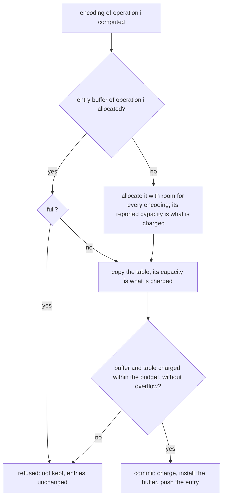

The insertion follows the four steps of the review plan:

1. **Determine the increase**: the entry buffer, if this is the operation's first encoding, and the table.
2. **Verify the actual capacities**: the buffer is allocated and its reported capacity is read, and the table copy's
   capacity is read. The charge is the sum, checked, and it must fit the budget.
3. **Commit together**: the charge is added and the buffer is installed and the entry pushed. Nothing that can fail
   lies between the charge and the push, and the push writes into capacity that was already reserved.
4. **Otherwise** the encoding is returned for its trial and not retained. The probe buffer and the table copy are
   dropped before `retain` returns, and no entry or charge changes.

Lookup scans only the operation's own entries, at most one per encoding. It replaces a map keyed by the operation
and the encoding, so a lookup no longer depends on how many other operations are cached.

### 20.3 Why one buffer per operation, and where the plan differs

An operation can take only the encodings in `ENCODINGS`, eight in all, so its entries never need more room than that.
A buffer allocated with that room never grows, never moves its entries and never reallocates. The plan anticipated a
growth path with its own test. Growth would need a replacement buffer and a move of the entries into it, and with a
bounded key set that path is not needed. The implementation therefore has no growth path. The guard that refuses an
entry when its buffer is full is kept, so the bound holds even for a key outside `ENCODINGS`. The tests check that
the capacity stays fixed, and that a full buffer refuses and keeps its entries.

### 20.4 Allocator assumptions

- `ALLOCATION_OVERHEAD` (32 B) is charged to each non-empty buffer. It models glibc's malloc, which adds an
  eight-byte header and rounds to sixteen. It is an assumption, not a measurement, and a different allocator changes
  the real footprint.
- The charges read `Vec::capacity()` and `size_of` only. `Vec::with_capacity` may reserve more than it was asked
  for, and the capacity it reports is what is charged.
- Transient storage is not charged: the probe buffer and the table copy of a refused insertion exist only inside
  `retain`. As in §18.6, the budget bounds the retained storage of the analysis. It does not bound the process's
  resident memory.

### 20.5 Tests

`compress.rs`. Expected charges are computed in the test from the buffers' actual capacities and the element sizes,
not from `heap_bytes` or `table_bytes`.

| Test | What it establishes |
| --- | --- |
| `the_first_kept_encoding_is_charged_its_entry_buffer_and_its_table` | the first kept encoding costs its buffer and its table, from their capacities |
| `the_analysis_charges_an_entry_slot_for_each_data_operation_and_the_repair` | the base charge includes the outer vector, one element per operation and one for the repair |
| `an_empty_table_owns_no_buffer_and_costs_only_the_entry_buffer` | an empty table costs nothing, so only the buffer is charged |
| `later_encodings_of_an_operation_are_charged_only_their_tables` | a later encoding of an operation does not regrow its buffer |
| `a_full_operation_refuses_another_encoding_and_keeps_its_entries` | a full buffer refuses; its entries and capacity are unchanged |
| `operations_and_levels_are_kept_apart_and_each_is_charged` | lookup is per operation and per level; each buffer and table is charged once |
| `a_kept_encoding_is_admitted_at_its_exact_charge_and_refused_one_byte_short` | a budget equal to the charge admits it; one byte less refuses it, with no change |
| `a_charge_that_overflows_the_total_is_refused_and_changes_nothing` | the first and a later encoding, each near `usize::MAX`, are refused without a change |
| `kept_and_recomputed_encodings_decide_exactly_alike_at_every_budget` | 80 random candidates at six budgets, from none to the full 8 MiB, decide as the replay does |

The existing `a_cached_encoding_is_kept_only_while_it_fits_the_budget` was updated for the new structure, and the
differential tests `reused_trials_decide_exactly_as_ordinary_evaluations` and
`analysed_trials_match_ordinary_evaluations_on_every_variant` are unchanged.

**Mutation checks.** Each mutation was made on a copy and the file was restored afterwards:

| Mutation | Tests that fail |
| --- | --- |
| an entry is installed without its charge | 7 |
| an entry buffer is charged as zero | 3 |
| a full buffer grows instead of refusing | 1 (`a_full_operation_refuses_another_encoding_and_keeps_its_entries`) |
| the outer vector is not charged | 1 (`the_analysis_charges_an_entry_slot_for_each_data_operation_and_the_repair`) |
| a charge equal to the budget is refused | 4 |
| a table is not charged | 4 |

### 20.6 Measurements

**Equality.** `workload_matrix`, as in §18.7 and §19.4, on the Intel device, with the change and with HEAD `54ff65b`
built from `git archive` in its own target directory. Three rounds, each a HEAD and a change run adjacent in one
session. All 36 builds of every round have the same payload length and digest as HEAD. The trials are 4,976 and the
whole-program replays are 710, the same as in §19.4.

**Encoding seconds.** These are the encode column of the matrix, summed over the 36 builds of each run. The sandbox's
speed moved by a factor of up to four between sessions, so only the adjacent pairs are compared.

| Round | HEAD | change |
| --- | --- | --- |
| 0 | 25.94 s | 19.52 s |
| 1 | 26.38 s | 25.88 s |
| 2 | 26.38 s | 26.99 s |

Per workload, the mean encode time of a build over the three rounds:

| Workload | HEAD | change |
| --- | --- | --- |
| sparse edits | 0.079 s | 0.066 s |
| relocated regions | 0.129 s | 0.110 s |
| short extents | 0.175 s | 0.193 s |
| compressible | 0.051 s | 0.048 s |
| incompressible | 0.236 s | 0.200 s |
| repetitive | 0.031 s | 0.034 s |
| growth | 0.109 s | 0.098 s |
| shrink | 0.060 s | 0.062 s |
| one-byte chunks | 5.689 s | 5.221 s |

The short-extent and repetitive rows are about 10 per cent higher for the change, but that is one round in each. The
short-extent pairs were 0.146 s and 0.144 s, 0.153 s and 0.210 s, and 0.226 s and 0.224 s, and the repetitive pairs were
0.028 s and 0.028 s, 0.028 s and 0.044 s, and 0.036 s and 0.030 s. The one-byte pairs range from 4.2 s to 5.9 s, so the
round-to-round spread is larger than the differences. The change is not measured to be slower, and no speed-up is
claimed either.

**Suites.** `cargo test --release -p delta-update-generator` passes on the software device, and with `OTA_TEST_DEVICE=auto` on
the Intel device. The library suite has 118 tests (two ignored), which is the 109 of §19.4 plus nine new ones. Each
integration suite has the same count as before.

**What is not claimed.** The process's resident memory, the time of a device, and any speed-up. The budget counts the
retained storage under the allocator assumption of §20.4 and nothing else.

## 21. Test-surface cleanup, removed helpers, and one manifest builder

This revision removes tests that duplicated a stronger test or asserted less than their names
claimed, removes two public helpers that only tests called, and builds every manifest in one
place. Its allocation change is on the client and is described in `docs/client.md` §7.1. Nothing
here changes an emitted byte: the payloads, the sizes and the search are the same, and the
checks that compare an evaluated size with an emitted length are kept.

### 21.1 Removed public helpers

Both helpers were `pub`, reachable through `pub mod evaluate` and `pub mod memory`, and neither
had a production caller.

| Removed | Its only callers | Use instead |
| --- | --- | --- |
| `evaluate::raw_seed` | its own unit test, and one `tests/regressions.rs` assertion that the next line already made | `evaluate(problem, raw_baseline(len), ctl)`, the evaluation every search program takes |
| `memory::zero_prefix` | its own unit test | `memory::all_zero`, which the search uses and which keeps a test that a nonzero byte in any piece is found |

These are breaking changes for library callers, which the project's rules permit (`AGENTS.md`).
The search never called `raw_seed`, so the search's results are unchanged. The zero-budget test
`a_zero_budget_returns_the_raw_seed_with_a_bounded_number_of_clock_reads` keeps its name: it
describes the search's seed, not the function.

The raw replacement's size is still checked against an emitted payload, not only against the
sizing. `evaluate::tests::the_raw_baseline_is_admitted_at_the_length_of_the_payload_it_emits`
assembles the payload with the production `assemble` for each size and chunk shape of the old
test and requires its length to equal the evaluated size.

### 21.2 One manifest builder

`manifest_for` (the search's sizing) and `manifest_of` (the delta assembly and the full-image
builder) built the same `Manifest`. They differed only in whether the partition information was
a placeholder or the real hash, and in whether the old partition was present.

```text
                    manifest_of(name, ops, old: Option<PartInfo>, new: PartInfo,
                                block_size, blob_len: u64, sig_msg_size)
                                      ▲                ▲                ▲
            lib.rs: assemble          │                │                │  evaluate.rs: manifest_for
            real hashes, old present  │                │                │  placeholder hashes,
                                      │                │                │  old present
                          full.rs: build and admitted  │
                          real hashes, old absent (full image)
```

The shared function keeps three properties in one place:

- the signature fields, `signatures_offset = blob_len` and `signatures_size = sig_msg_size`, which
  both the sizing and the emitted payload must agree on;
- the omission of the old partition, which a full-image payload must not record;
- the `u32` block size, which `checked_block_size` checks before any `Problem` or candidate is built.
  The delta entry point calls it there, and `full::build` calls it first, so a direct call with a size
  the builder cannot cut by is refused, not panicked.

The operations are moved in. Assembly and the full-image build used to copy them, and now they
move them, so each saves one copy of the whole operation list. The admission check in `full.rs`
still copies its candidate's operations, because the candidate is needed for the choice that
follows. That copy existed before this change, and it is now written at its call site.

### 21.3 The encoded-rescue test was inadequate, and its claim is corrected

`compress.rs` had a test named for the claim that a raw candidate a profile refuses "still competes
through its encodings". It accepted `Ok(None)` and any positive size, so it passed whether or not an
encoding was admitted. A test that cannot fail is no evidence for its name, so it is removed.

The claim it named is possible. The earlier argument was that an encoding only adds bytes: a frame
table or a chunk map to the manifest, which `max_encoded_manifest` bounds, and the same bytes to the
decode model, which `max_decoded_bytes` bounds. That holds for the operation and extent counts, which
no encoding changes. It leaves out the length fields, which are varints whose width grows with their
value. Compression can shorten the blob length and the offsets enough to pay for the metadata it adds,
so an encoding can clear a manifest limit that the raw replacement exceeds.

The reproduced case is a 2,097,153-byte image of ones that becomes zeros, given as one whole-image
replacement with codec chunks the length of the image, under `max_encoded_manifest` of 158. The
regression is `an_encoding_rescues_a_raw_candidate_the_manifest_limit_refuses` in `compress.rs`.

| Form | Manifest size | Admission at 158 bytes |
|---|---:|---|
| Raw | 159 bytes | Refused |
| Sparse | 158 bytes | Admitted |

Every sparse form measured, at levels 1, 6 and 9 and with no compression, is 158 bytes and admitted.
The framed forms are 161 bytes at each level and refused. The byte accounting, from the two manifests,
is:

| Field | Raw | Sparse | Change |
|---|---:|---:|---:|
| `signatures_offset`, the blob length | 5 bytes: `20 81 80 80 01` | 2 bytes: `20 00` | −3 |
| operation `data_length` | 5 bytes: `18 81 80 80 01` | 2 bytes: `18 00` | −3 |
| operation `type`, REPLACE (0) or REPLACE_SPARSE (257) | 2 bytes: `08 00` | 3 bytes: `08 81 02` | +1 |
| chunk table, field 100 | none | 4 bytes: `a2 06 01 01` | +4 |
| **manifest** | **159 bytes** | **158 bytes** | **−1** |

The blob length is written twice, once as `signatures_offset` and once as the operation's
`data_length`. Each is the four-byte varint of 2,097,153. A sparse operation stores no blob, so both
become zero, one byte each: six bytes of varints saved. The sparse form adds five. Its chunk table is
one byte, `01`, the packed mode of its single chunk, which is zero; with its tag and length it takes
four bytes in field 100. Its type, 257, takes one byte more than REPLACE's 0. Six saved less five added
is one byte, which is the difference between 159 and 158. The block size and the destination extent
are the same in both forms.

The earlier probe, not committed, swept `max_encoded_manifest` and `max_decoded_bytes` over 1,025
values each, for four images. At every value that refused the raw replacement, it tried eight
encodings: sparse and frames at four levels. Of the 300 refused pairs, none was admitted. That is
evidence for those four images and those limits. It is not a proof of a universal invariant, and the
reproduced case above is an admission that the earlier claim ruled out.

The retained `an_analysis_is_not_refused_because_the_raw_program_is_refused` checks something narrower.
Under a limit that refuses the raw program and every encoding it tries, each trial decides as
`evaluate` does. It does not show that no encoding is admitted.

The 158-byte limit depends on the current manifest layout. If the layout changes, the regression's
assertion on the raw manifest size names the new figure, and the limit moves with it.

The regression fails if the optimizer skips encodings once the raw candidate is refused. That mutation
was checked, and the test then reports `no candidate admitted`. This test adds one to the generator
library, which now runs 118 passing tests. §21.6 predates it, so its counts for the library and the
workspace are each one lower than the tree now has.

### 21.4 Test corrections and deletions

| Change | Why the coverage stands |
| --- | --- |
| Removed `src/full.rs` `a_framed_candidate_at_the_operation_limit_remains_eligible` | `a_candidate_that_covers_the_image_at_the_limit_reads_no_further_run` builds the same four runs at the same limit and asserts the same four operations. It also counts the runs drawn. |
| Removed `tests/cli.rs` `the_delta_form_still_takes_exactly_four_positional_arguments` | `missing_arguments_unknown_flags_and_removed_profiles_are_usage_errors` refuses the same three-positional delta form, and checks the usage text, the `--help` hint and empty stdout. The standalone test checked fewer of those. |
| Removed two buffered corruption cases from `delta-update-client/tests/full.rs` | `apply.rs` `verified_tampering_is_rejected_before_any_write` and `unverified_blob_tampering_is_caught_by_its_hash_before_any_write` assert the same refusal codes and zero writes. Their input is a searched delta, not a full image. The checks they reach, `verify_payload` and `verify_blobs`, do not branch on operation type, so the frame case is not a separate path. |
| `gpu_eval.rs`: `assert_agree` returns the device's results | Once agreement holds, `size.is_some()` is the CPU's verdict. `fuzz`, the decode-budget test and the wide-extent test count from the returned results, and three tests read the returned results where they re-evaluated the same programs. Each re-evaluation and each separate CPU pass is gone. |
| `compress.rs`: budget zero removed from the budget list | Budget zero is the `slow` reference pass the test compares every budget with. Budget one still refuses the analysis of any candidate with a data operation, because that analysis always holds more than one byte, so the refused-analysis path is covered. |

Four tests were rewritten rather than deleted, because they asserted less than their names claimed.
All four are in `delta-update-client`. They are listed here so that the whole test-surface change is in one place.

- `sparse.rs`: two handcrafted raw replacements (65 spans of 4,096 blocks, and 65,536 one-byte
  blocks) became one 64-byte raw replacement at one-byte blocks, with zero and nonzero bytes. The
  large cases built a single raw operation, so they never reached the sparse span cap their
  name and comment described.
- `target_scale.rs`: `project_operations_round_trip_at_target_scale` inspected a payload from
  one search configuration and then applied a payload from another. The helper `apply_both` now
  applies the payload the test inspected.
- `resume.rs`: the operation-zero test passed an old image, which turns off the fresh preflight,
  so the test never checked the old prefix. It now uses an in-place fixture, where the preflight
  runs, and asserts that the failing write is the first one. The restored-hash test checked the
  signature in the buffered path, where `prepare` checks it before any resume. It now resumes
  through the streamed path, which reads only the signature message from the record's offset.
  A mutation that replaces the restored hash state with a fresh one makes it fail.

### 21.5 Deferred

- The repair-prefix replay optimization is deferred, as the plan decided. It is a larger change to
  replay than the test and allocation fixes, which this pass was limited to.
- The memory-measurement binaries are not merged. Each has one test function, because the counters
  are process-global. `peak_completed.rs` is a new binary for that reason.
- The preflight and postflight hash helpers are not combined. The plan judged that cleanup less
  valuable than the test and allocation fixes.

### 21.6 Validation

Every check below ran on the tree that is committed, with the software device unless stated.

- `cargo test --workspace --no-fail-fast`: exit 0, no warnings. The total is 502 passed and 7 ignored,
  against 507 and 7 at HEAD. Four binaries changed their counts, and each change is a deletion or a
  replacement from §21.4: `delta-update-client` `full` 12 to 10, `sparse` 12 to 11, and `delta-update-generator` library
  119 to 117 and `cli` 14 to 13. `peak_completed` is new, with one test. Every other binary has the count
  it had.
- `OTA_TEST_DEVICE=auto cargo test -p delta-update-generator --no-fail-fast`: exit 0, on the Intel iGPU.
- `cargo check -p delta-update-client --target riscv32imac-unknown-none-elf`: passes.
- `cargo test --release -p delta-update-client --test peak_memory --test peak_stream --test peak_completed`: passes.
  The peak figures are in `docs/memory.md` §5.7.
- Workload matrix (`delta-update-generator/tests/bench.rs`, `workload_matrix`, 9 workloads under both
  profiles, 18 builds): HEAD and this change were run in one session. The matrix exercises only the
  generator, which the last client edit does not touch. Digests, payload sizes, raw
  fitness, generations, evaluated and trial counts, whole-program replays, device bytes and
  uploaded bytes are identical on every build. The `read_back` transfer counter differs on
  13 of the 18 builds. A second HEAD run also differs on 10 rows, so the counter varies between
  runs of the same code, and `gpu.rs`, which keeps it, is not changed here.
- Mutations, to check the new assertions bite. HEAD's `engine.rs` makes
  `peak_completed` measure 8,224 B against its 4,400 B bound. Replacing the restored hash state
  with a fresh one makes the streamed resume test fail at its intact resume.
- The encoded-rescue sweep was probed before its test was removed. The reproduced rescue in §21.3
  is the regression that replaces that test.

## 12. Output, release version and the time budget

**Output.** `ota-gen` writes the payload to a new file beside the output path, syncs
it, and renames it over the output. The output must not be the same file as an input,
by device and inode, so a symlink or a hard link to the old image, the new image or
the key is refused before anything is written. A failed write leaves the existing
output as it was, and the temporary file is removed. A replaced output is always
complete: it is never part old and part new (`delta-update-generator/tests/output.rs`).

**Output permissions.** Every output is `0600`, whether it is new or replaces an existing file, and whatever
the umask (`NEW_OUTPUT_MODE`). The temporary file is created exclusively, and its mode is set to `0600`
before the first payload byte is written, before it is synced, and before it is renamed. A replacement does
not keep the old file's mode, so a `0644` output that is replaced becomes `0600`, and an operator who needs
other access sets it after generation (§9.4). A symbolic link at the output is replaced by the private file,
and its target keeps its own mode. If setting the mode fails, the output is untouched and the temporary file is
removed, like any other failure before the rename (`delta-update-generator/src/main.rs`, and
`delta-update-generator/tests/output.rs`).

**Release version.** `--release-version N` (default 0) sets the signed release counter
of the payload. Both delta and `--full` payloads record it, and the search's sizing
includes it, so the admission checks describe the bytes that are written. The client
refuses a release below its floor under the strict policy (`docs/platform.md` §3).
Changing the value changes the signed bytes, and the search itself is unchanged.

**Time budget.** `-t` bounds the GPU search, and only the search. It is not an
end-to-end generation deadline. The encoding pass is bounded by its own work (§9.3),
and the self-check and the signing run to completion after it. A GPU call that never
returns cannot be interrupted from the host, so a generation has no hard timeout.
The deadline semantics, what a deadline does not promise, and the reproducibility that
follows are in §8.6.
