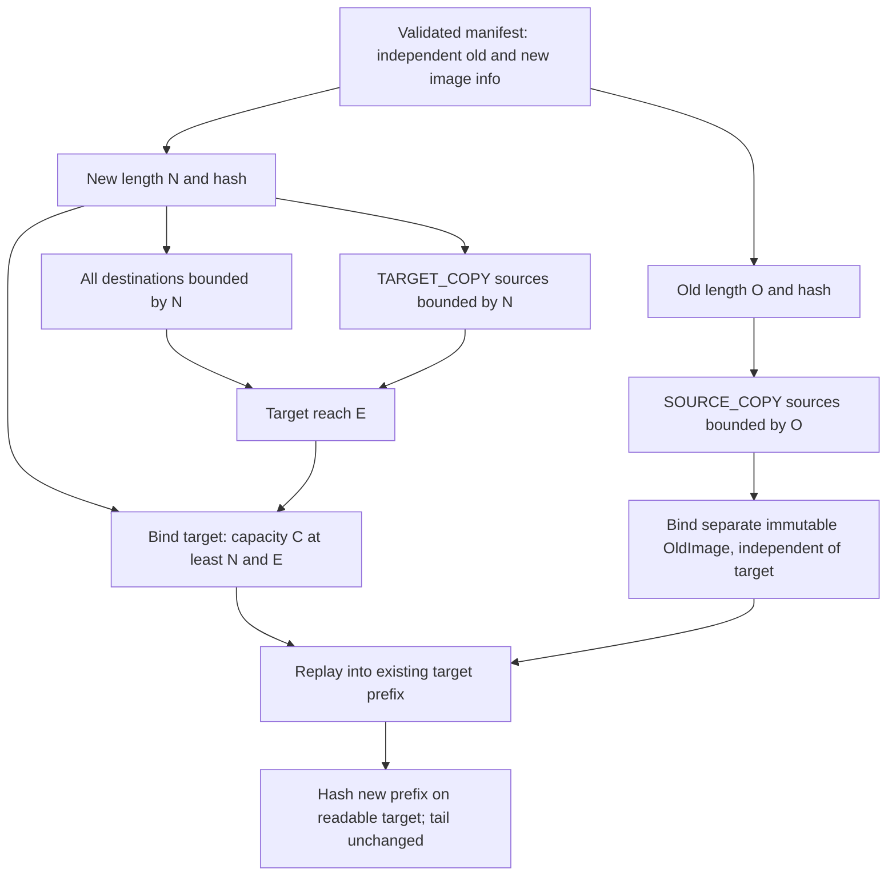
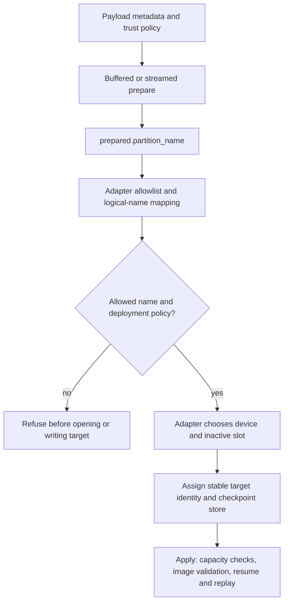
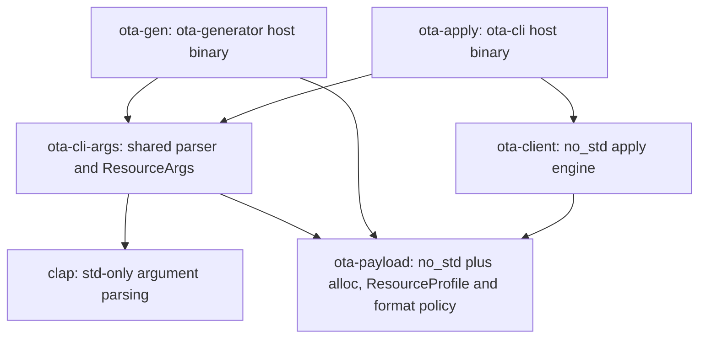

# Independent image geometry, adapter routing and host CLIs

This document explains three boundaries: image lengths versus storage capacity,
a logical partition name versus a physical target, and CLI arguments versus the
`no_std` payload/client libraries. The wire format remains revision 17. No payload
transport, device discovery, partition resizing or multi-partition engine is added.

## 1. Geometry: three independent quantities

An old image, a new image and the destination device do not have to have the same
length. The image lengths describe content; capacity describes available storage.

| Quantity | Source | Meaning and constraint |
| --- | --- | --- |
| `O`, old length | `old_partition_info.size` | Independent source-image bound; may exceed or be below the new length |
| `N`, new length | `new_partition_info.size`, exposed as `Geometry.size` | Length of the resulting image prefix, not the required exact device capacity |
| `C`, destination capacity | `Sink::capacity()` | Fixed adapter-owned storage size; must satisfy `C >= N` when recorded |
| `E`, target reach | `Geometry.end` | Maximum exclusive end of all destinations and `TARGET_COPY` sources; must satisfy `C >= E` |
| source capacity | `OldImage::capacity()` | Must equal `O` when recorded; independent of `C` |
| chunk size | manifest `block_size`, exposed as `Geometry.chunk_size` | Codec framing only; no storage alignment or image-size multiple requirement |



`SOURCE_COPY` source ends do not contribute to target reach. For example, a
32-byte old image can supply bytes `[24, 32)` to a new 8-byte image on an 8-byte
destination. Conversely, a large destination cannot make an out-of-bounds old
source valid. `TARGET_COPY` reads the destination, so its source belongs to the
new-image domain even if that source was written by an earlier operation.

Recorded sizes are optional in general revision-17 metadata. Missing new size
means `Geometry.size == None`, not a fallback to the old length: the engine still
checks operation reach against capacity. The generator's checker always bounds
operations by the actual supplied image lengths, even when metadata omits sizes.
Generated deltas record both sizes and hashes; full payloads record only new info.

### Growth and shrinkage are not storage resizing

```text
Growth, O = 7, N = 12, C = 16:
  before: [ old bytes 0..7 ][ unknown 7..12 ][ spare 12..16 ]
  after:  [          new bytes 0..12       ][ same  12..16 ]

Shrink, O = 12, N = 7, C = 16:
  before: [       old bytes 0..12          ][ spare 12..16 ]
  after:  [ new bytes 0..7 ][ unchanged destination bytes 7..16 ]
```

The engine neither allocates a larger device nor pads, truncates, erases or
zero-fills a tail. Growth requires the adapter to expose enough capacity before
apply. Shrinkage does not securely erase obsolete old bytes beyond `N`. Storage
layout, erasure and any later filesystem/partition resizing are adapter policy.

The generator models only the new-length target. Initially its overlapping old
prefix is known; `[O, N)` is unknown when growing. Unknown is not zero, even if
the desired new bytes are zero. These bytes require an explicit write (`ZERO`,
data or a valid copy) before they may be kept or read by `TARGET_COPY`.
The mapper and the device's replay enforce this known-content rule, and GPU classification uses the
new-image grid without marking growth as unchanged. The independent flat checker
replays growth against three different initial tails (zeros, `0xff`, pattern),
checking hashes and final bytes; it does not share the mapper's run model.

## 2. Hash scope and the separate-image contract

Content hashes describe image bytes, not all storage the adapter happens to
expose. Nonempty recorded hashes govern the following checks:

| Context | Bytes checked | When / failure |
| --- | --- | --- |
| Supplied separate `OldImage` | Its whole image; capacity must equal recorded `O` | Every apply attempt, including resume and plans with no `SOURCE_COPY`; wrong size: `source_geometry`, wrong old hash: `source_mismatch` |
| `SOURCE_COPY` | Each source logical stream in the immutable image | Validated before any destination write; bad bounds: `extent_out_of_range`, bad hash: `source_mismatch` |
| No separate image, readable target | Target `[0, O)` | Fresh session only, when old hash is recorded; insufficient old-prefix capacity: `partition_mismatch`, bad hash: `hash_mismatch` |
| `TARGET_COPY` | Source logical stream in the current target | Before that copy's first write; bad hash: `source_mismatch` |
| Readable target post-flight | Target `[0, N)` | After flush, also on completed reruns; bad hash: `hash_mismatch` |

If a hash is absent or empty its image check is skipped. For general metadata
with a hash but no corresponding size, target pre/post-flight uses target
capacity; separate-image hashing uses the image capacity. Generated payloads
supply lengths, so normal image checks use the precise old/new prefixes.
Write-only sinks cannot perform target pre/post-flight checks or `TARGET_COPY`.
They can still validate a separately supplied old image.

A fresh no-image shrink may need `C >= O` in addition to `C >= N`: checking the
old hash requires reading the entire old prefix. With a separate validated old
image, a destination only large enough for `N` is valid; there is no target
old-prefix check. Resumed targets skip the old-prefix pre-flight because earlier
writes have already modified it. Separate immutable images remain validated.

### Supplying an old image does not initialize an A/B slot

`OldImage` is a read-only input to validation and `SOURCE_COPY`, **not** an implicit
copy of all old bytes into the target. An omitted destination or sparse **keep**
leaves that target byte as it already was. A valid separate old image can pass
validation while a blank destination still produces a wrong final hash.

For example, a delta that writes only `[7, 12)` and keeps `[0, 7)` requires the
correct seven bytes already on the destination. Passing a separate old image
holding those bytes does not install them. The adapter must provide the required
starting contents, or choose a payload with explicit writes/copies covering them.
Use a full payload when the starting contents are unknown: it writes every byte
of `[0, N)` on any sufficiently large target, checks that prefix when readable,
and leaves `[N, C)` unchanged.

This separation keeps source validation useful for A/B updates without falsely
requiring the inactive destination to contain the old image. It also avoids
silently weakening validation when a caller supplies an image to a delta that
happens not to use `SOURCE_COPY`.

## 3. Logical partition names and adapter routing

`ota-gen -n NAME` / `--partition-name NAME` stores a nonempty UTF-8 logical label
in `PartitionUpdate.partition_name`; the default is `A/B`. It is bounded by the
existing metadata string/resource rules. Its spelling has no built-in path,
partition-table or A/B-slot semantics. Even a path-looking label remains a label.

Both buffered and streamed prepared APIs expose `prepared.partition_name()` as
`&str`. This lets adapters inspect the label after preparation and before opening
storage, without interpreting protobuf themselves. The label is authenticated
**only with `Trust::Verified`**: unverified preparation runs structural checks but
does not establish who chose the name. Streamed verified preparation authenticates
the metadata before routing; the payload signature is still deferred to stream end.



The diagram describes an adapter's policy hook, not automatic engine routing.
`ota-apply` always opens its explicit `DEVICE_FILE`; it does not resolve the
label. A production adapter should use an explicit allowlist/mapping, not treat
an untrusted string as a pathname. `--target-id` remains a separate, stable
32-byte device identity: the name neither replaces it nor uniquely identifies
physical storage. The engine still applies exactly **one** partition; raising
`max_partitions` above 1 only changes the scanner's cap, not that policy.

## 4. Shared CLI arguments without a `no_std` dependency leak

Both host commands use clap for help, versions, option parsing and usage errors.
The new `ota-cli-args` crate is `std`-only and owns `ResourceArgs`, the one-to-one
conversion into `ResourceProfile`, and the parser wrapper that includes usage
on argument errors. It does not implement device selection, payload transport,
generation or application.



Arrows show relevant dependency directions, not every third-party dependency.
The clap dependency stays in the host layer; neither `ota-payload` nor
`ota-client` depends on the argument crate or clap. Sharing all 12 cap fields
prevents the two binaries from drifting on defaults, units or option spellings.
The libraries retain `EMBEDDED` and `HOST` presets and arbitrary custom profiles:
these are sets of numeric limits, not branches selecting different behavior.

## 5. CLI reference

```text
ota-gen [OPTIONS] <OLD_IMAGE> <NEW_IMAGE> <OUT_PAYLOAD> <PRIVATE_KEY>
ota-gen --full [OPTIONS] <NEW_IMAGE> <OUT_PAYLOAD> <PRIVATE_KEY>
ota-apply [OPTIONS] --checkpoint <FILE> --target-id <HEX> <PAYLOAD_FILE> <DEVICE_FILE>
```

Use `-h` / `--help` for help and `-V` / `--version` for versions; both exit 0
without required files or options. Runtime file/key/payload/device errors exit 1.
Usage errors exit 2 with an error, usage and help hint, before runtime I/O.
Options may be interleaved with files; `--` ends option parsing for filenames
beginning with a dash. The full form requires exactly three positional files,
the delta form exactly four, and apply exactly two.

| `ota-gen` option | Default | Semantics / bounds |
| --- | --- | --- |
| `--full` | false | No old image and no search; conflicts with explicitly supplied search-only options below |
| `-b`, `--block-size BYTES` | 4096 | Positive `u32` (`1..=4294967295`), also bounded at runtime by `--max-block-size` |
| `-n`, `--partition-name NAME` | `A/B` | Logical label, not device/slot selection |
| `-t`, `--max-search-seconds SECONDS` | 30 | Finite, nonnegative; the time of the GPU search (the encoding pass and signing follow it); zero opens no GPU and encodes the raw replacement; search-only |
| `-s`, `--stagnation-seconds SECONDS` | 5 | Finite, strictly positive; search-only |
| `-m`, `--min-improvement-bytes BYTES` | 1 | `u64`, in raw (uncompressed) bytes; zero disables stagnation; search-only |
| `-r`, `--seed` | 1 | `u64`, including zero; search-only |
| `-g`, `--max-generations COUNT` | none | `u64`; zero runs no generations; search-only |
| `-d`, `--device` | `auto` | `auto` or `software` Vulkan preference; search-only, unrelated to the apply target |

| `ota-apply` option | Requirement / semantics |
| --- | --- |
| `-k`, `--key PUBLIC_PEM` | Optional, repeatable trusted public keys; without any, signatures are **not** verified |
| `-s`, `--source OLD_IMAGE` | Optional separate read-only old image; required for `SOURCE_COPY`; must not alias `DEVICE_FILE` |
| `--stream` | Optional one-pass payload reading instead of buffering. With `--reset-checkpoint`, reads only the payload's metadata |
| `--max-buffered-payload BYTES` | Default 67108864 (64 MiB), minimum 1. The largest payload the buffered path reads, checked before and while it is read; a larger payload is refused, and `--stream` applies it. Key files have a separate fixed 64 KiB bound |
| `--reset-checkpoint` | Clears this payload's checkpoint for this device, with the same checks and locks as an apply; writes nothing to the device. Honours `--stream` |
| `--checkpoint FILE` | Required persistent progress store; reuse for resume |
| `--target-id HEX` | Required stable device identity: exactly 64 hexadecimal characters (32 bytes), case-insensitive hex |

Both commands flatten the same 12 `--max-...` options. The complete defaults,
units and `HOST` comparisons are in the `README.md` resource table. All defaults
equal `EMBEDDED`. Byte arguments are decimal **bytes**, not KiB and not suffix
expressions. Resource integers must fit host `usize`, except `--max-block-size`,
which is a positive `u32`. Other caps accept zero to forbid their corresponding
resource; `--max-operations 0` permits an empty no-op program, not a changed image.
Negative, fractional, nonnumeric and overflowing resource integers are usage errors.
A syntactically valid cap that makes a payload inadmissible is a runtime error,
not a usage error. Caps constrain each other: a larger block cap alone does not
raise the frame-table or decode budget, for example.

## 6. Migration and rationale

| Previous assumption or invocation | Current contract / migration |
| --- | --- |
| Old and new images must be equal length | Supply actual independent images; the generator and client accept growth/shrinkage |
| `Geometry.size` describes both images or exact storage capacity | It is only the optional new-image length; use old info for source bounds and `Sink::capacity()` for available storage |
| Device capacity must equal image length | It must hold the new prefix and operation reach; fresh no-image old hashing also needs the old prefix |
| Hash the whole device | Hash the recorded old/new image prefixes; unrelated spare capacity is excluded |
| Growth is implicit zeros | Unknown bytes must be explicitly written, even when desired bytes are zero |
| Separate old image makes kept/untouched target bytes correct | It does not; supply the required destination contents or explicitly write/copy them |
| `-p embedded` or `--profile embedded` | Remove the selector; all 12 defaults already match `EMBEDDED` |
| `-p host` or `--profile host` | Replace with the individual numeric caps actually required, on both generation and application; see the `HOST` column in `README.md` |
| A partition label chooses a target | Route through adapter policy using the prepared name under verified trust; CLI target remains explicit |

The old profile selector is deliberately rejected, not silently ignored. Resource
budgets should be visible in deployment commands, and increasing one must not
silently opt into unrelated allowances. There is no automatic fallback to `HOST`.
Library callers may continue passing either preset or a custom `ResourceProfile`.
Historical measurements in other design docs retain their original image shapes,
limits and numbers; removing `-p embedded` from an old command preserves its cap
values, but does not claim a fresh performance measurement on this revision.

## 7. Test evidence and focused validation

Final validation on 2026-10-26 passed the workspace suite with
`cargo test --workspace -- --skip project_operations_round_trip_at_target_scale`,
including the prepared-label regression, and the
`riscv32imac-unknown-none-elf` client compile check. The excluded target-scale
project-pattern test exceeded an earlier 120-second timeout; it is not claimed
as passed. Both binaries' `--help` output was also checked directly. These checks
are not new performance/memory measurements.

| Evidence | Contract pinned |
| --- | --- |
| `ota-generator/tests/sizes.rs`, `gpu_eval.rs` | Generated grow/shrink and empty images; unknown zero growth needs writes; target-copy reads need prior writes, on the CPU's model and on the device's; old source bounds independent of new bounds; GPU classification never keeps growth |
| `ota-generator/tests/regressions.rs` | Checker bounds even without recorded sizes; unwritten growth refused rather than accepted as zero |
| `ota-client/tests/sizes.rs` | Both pipelines: prepared logical label under verified and unverified trust, grow/shrink prefix hashes, unchanged capacity/tails, independent A/B source sizes, old-image validation without source copies, insufficient old/new prefix capacity, kept/untouched target semantics, interruption and resume |
| `ota-client/tests/full.rs` | Full payload starting contents, undersized-target refusal, corrupt data boundaries and resumability |
| `ota-cli-args/src/lib.rs` tests | Defaults equal `EMBEDDED`; every field independent; zero/native maxima and invalid integer bounds |
| `ota-generator/tests/cli.rs` | Help/version, option names/defaults, removed-profile rejection, full-mode conflicts, numeric bounds, explicit caps, no-op zero cap, positional counts, option placement and runtime exit status |
| `ota-cli/tests/args.rs` | Help/version and usage exit 2; explicit caps refuse before writes/checkpoints on both paths; larger destination keeps tail; no-op zero cap; missing files exit 1 |

Focused commands (generator size tests require the software Vulkan setup described
in `README.md`):

```sh
cargo test -p ota-cli-args
cargo test -p ota-generator --test sizes --test cli
cargo test -p ota-generator --test regressions
cargo test -p ota-client --test sizes --test full
cargo test -p ota-cli --test args
cargo check -p ota-client --target riscv32imac-unknown-none-elf
```

The embedded check verifies the dependency boundary at compile time; it is not
runtime hardware or RAM evidence. The existing memory-model assumptions and
historical phase measurements remain documented in `docs/memory.md`.
