# Locking, reset durability, output policy and admission parity

This is the design record for one change set. It covers six things: which locks a run holds, how their
identity is chosen and where their files live (the lock namespace); the directory a checkpoint is kept in for the
whole run, and the names it may use (§8); what a reset reports when its removal, or the absence it finds, cannot
be confirmed durable (§8.3); the access policy of generated outputs, including what an inherited ACL does under
the owner-only mode; the mode a new lock file gets under any umask (§8.4); and the device's decoded-memory
admission, which now matches the CPU's. The normative statements live in `docs/platform.md` §2, `docs/checkpoint.md`
§5 and §8, `docs/generator.md` §9.4, and the README. This file says why they are shaped as they are, and what is
left for platform validation. §10 is the design record of the next change set: the shared locks that protect the old
image and a streamed payload, the identity of a block device, a reset that does not open the old image, the form and
the cleanup of staging files, and a publication test that does not depend on scheduling.

Everything here runs on the host. No privileged device, power cut or real flash is exercised, and the items in §6
are the follow-up work that needs them.

## 1. Locks: scope, identity and order

### 1.1 Why the checkpoint needs locks

The device lock stops two runs from writing one target. It did not stop two runs on different targets
from sharing one checkpoint name. Both can load the same record, or both can find none, and each then
replaces the record with its own. The last rename wins, so the other run's progress is lost from the
record while its device writes stay on the device. The record's checks refuse a resume with the wrong
target, so the loss shows as a stuck update rather than a silent skip, but it is still a loss. The
record therefore needs its own lock.

The store takes an exclusive **entry** lock for the parent identity and exact basename, even when the record is absent,
and a separate exclusive **directory** lock shared by all records in that directory. It also locks the inode of an
existing regular record, and retains the new inode lock across replacement. Entry and inode locks protect against other
roles naming the same entry or a hard link; the directory lock serialises all checkpoint stores there (§11).

### 1.2 Identity of each lock, and where its file lives

| Lock | Protects | Identity | Lock file |
| --- | --- | --- | --- |
| role entry | one exact basename, present or absent | pinned parent device and inode plus basename; exclusive for checkpoint and device, shared for old image and streamed payload | `<namespace>/entry-<sha256>.lock` |
| checkpoint directory | every record in one directory | parent device and inode; the record's name plays no part | `<namespace>/checkpoint-<sha256>.lock` |
| checkpoint record | existing or newly published regular inode | the record's open file | exclusive `flock` on the record itself |
| device, regular file | one target | the file's inode, through its open file | none: `flock` on the device itself |
| device, block device | one target | the device number (`st_rdev`), shared by every node for it | `<namespace>/block-<major>-<minor>.lock` |
| old image and streamed payload, shared (§10.3) | one file, read for the run | as the device: the inode of a regular file, or the device number of a block device | as the device, and shared with other readers |

The namespace is the directory given by `--lock-dir`, which the platform provisions for the host (§7). The
checkpoint's lock name is a digest, so it is a fixed length whatever the record's name, and it cannot equal a
record's name, because records are never kept in the namespace. A record that would be kept there is refused.

Two paths that reach one directory through different symbolic links have one identity, because the directory
is identified by its device and inode and not by its path. A regular file is locked on its own open file, so
every hard link to it contends. A block device has one device number per device, but many device nodes can
name it, and different partitions have different numbers. The lock is therefore keyed by the number, not by a
node or a partition.

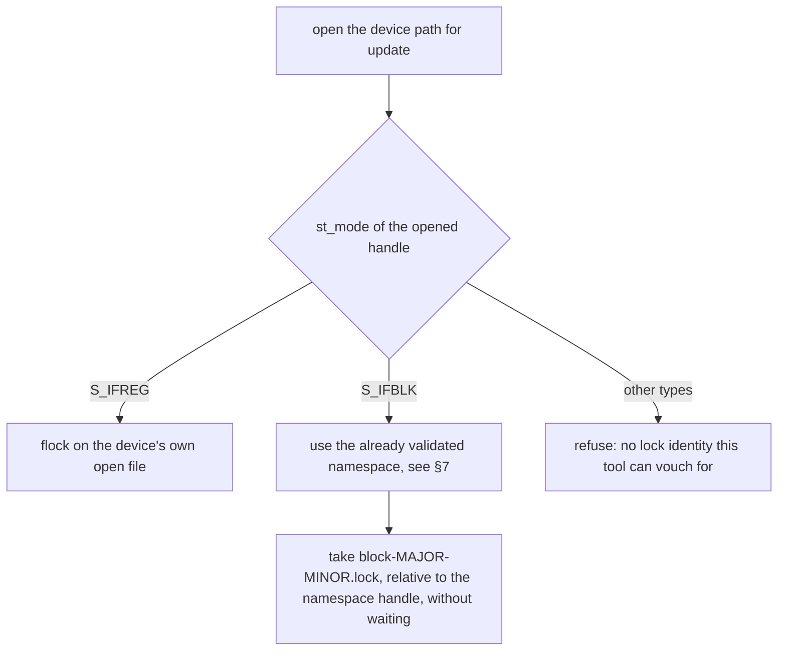

### 1.3 Order, and why it cannot deadlock

Every run opens the namespace once. A streamed run pins and locks its payload first; the checkpoint entry, directory
and existing record inode follow, then the device and optional old-image entries. The identity comparison precedes the
device and old-image identity locks. The full order and buffered/reset exceptions are in §10.3 and §11. Every lock is taken with a nonblocking
attempt, so a run that finds one held exits at once, and the locks it already holds are released with the process. With
no waiting there is no cycle, so the order is documentation for a reader, not a deadlock guard. It is written down so
that a future change which waits must also fix the order.

```mermaid
sequenceDiagram
    participant R as ota-apply run
    participant N as namespace handle
    participant C as checkpoint lock
    participant D as device lock
    participant K as checkpoint record
    R->>N: open and validate --lock-dir
    R->>C: take checkpoint entry, directory and existing record inode locks
    alt held by another run
        C-->>R: refused at once: "another update holds the checkpoint"
    else free
        C-->>R: held
        R->>D: take device identity (flock, or block-MAJOR-MINOR.lock)
        alt held by another run
            D-->>R: refused at once; the checkpoint lock is released with the process
        else free
            D-->>R: held
            R->>K: first read, then apply or reset
        end
    end
```

### 1.4 Lock files: lifecycle and permissions

- The namespace is opened once and validated (§7.2). Each lock file is then opened **relative to that handle**,
  so a path replaced during the run cannot redirect a lock.
- A lock file is opened with `O_NOFOLLOW`, so a symbolic link planted at its name is refused, dangling or not,
  and its target is not touched. It is opened with `O_NONBLOCK`, so a named pipe cannot make the run wait. A
  file that is not a regular file, has a second name, or belongs to another user is refused.
- A new lock file is **published only once it is private** (§9.1). It is created with no name (`O_TMPFILE`), its
  mode is set to `0600` **through its open handle**, and only then is it linked to its name. The link fails if the
  name exists, so an existing lock file is never replaced. No run can open a lock file that is not yet `0600`, and
  an interruption or a failed mode change before the link leaves no name behind. The umask cannot change this: a
  file created as `0400` would fail the next open for writing (§8.4). The namespace's filesystem must support
  `O_TMPFILE` (`docs/platform.md` §2.1).
- An **existing** lock file is checked the same way, and it must also be accessible to no one but its owner: it
  must have no group or other permission bits. A file that fails is refused and **left unchanged**. The tool does
  not widen or repair access it did not grant, so the operator sees what the file allows.
- Access granted by an extended ACL is covered by the same check on Linux, because the group bits of the mode
  hold the ACL mask. A named user or group entry that grants anything sets those bits, so it is refused. A
  default ACL on the namespace is masked by the `0600` of a new file, so it grants nothing
  (`docs/generator.md` §9.4 describes the same masking for outputs).
- A lock file made by an **earlier release**, which created the name before it set the mode, can be left without
  owner access if that release was interrupted at the wrong moment. Such a file is refused, with its name in the
  message, and it is left unchanged. The updater never repairs it. The operator does, as §8.5 describes.
- A lock file is **never removed** by the updater. A removal would let a second run lock a new file while the first
  still held the old one, so two runs could both believe they held the lock.
- The kernel releases a lock when its holder exits. A crash therefore leaves no lock held, although the file
  stays on disk.

### 1.5 Denial of service, and its limits

A process that can open a lock file can hold it and refuse every update of that target. The defences are the
namespace's own access (owner-only, §7.2), the private lock files (§1.4), and the trusted ancestors that the
platform must provide (§7.4). Another user cannot create or open a lock file in a namespace it cannot reach.

What remains: the updater's own user, and root, can always hold a lock. A process running as the updater can
therefore refuse updates by holding a lock, and no check in this tool can prevent it. A namespace that was
provisioned for another user, or a path that another user can rename, is outside the tool's guarantees. The
tool refuses the first it can see, and the platform must prevent the second.

The locks are advisory, so they stop only cooperating processes using the same namespace and lock protocol. They do not
stop another writer, a mounted filesystem, or overlapping storage with different identities. Exact-basename entry locks
also cannot identify filesystem aliases such as case-folded names. Bind mounts and ancestor renames limit the reserved
namespace checks. Trusted storage and filesystem validation are required (§11.6).

## 2. Reset: what an uncertain removal, or an uncertain absence, reports

`--reset-checkpoint` removes the record only after the library's own checks pass. The removal then has two
steps, an unlink and a directory sync. A failure in each is a different state. A reset that finds no record has
no removal to make, but it still has to confirm that the absence is on disk, because an earlier removal in a
previous reset may not have been.

| Failure | Observed record | Code | Report |
| --- | --- | --- | --- |
| before the unlink (for example, the directory is not writable) | unchanged | `device_io` | storage error; the record and the check are unchanged, so a retry is safe |
| after the unlink, during the directory sync | **absent now**, may reappear after a crash | `checkpoint_removal_uncertain` | "checkpoint removed, but its removal is not confirmed durable" |
| no record found, and the directory sync confirming the absence fails | **absent now**, not confirmed durable | `checkpoint_removal_uncertain` | "checkpoint is absent, but its absence is not confirmed durable" |
| no record found, and the look-up of the name fails before the sync | **unknown**: neither presence nor absence is claimed, and nothing is removed | `checkpoint_removal_uncertain` | "checkpoint absence cannot be checked, so it is not confirmed" |
| no record found, and the directory sync confirming the absence succeeds | absent, confirmed | success, nothing to clear | "no checkpoint to reset; its absence is confirmed durable" |

The absence check itself removes nothing: it looks up the entry and syncs the directory. Opening the store first still
requires a writable directory for its case probe and may initialize staging.

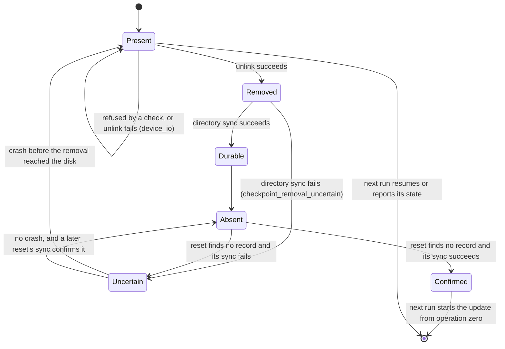

The uncertain state is reported as a failure, with exit status `1`. A run that reports success must mean the
record is gone for good, and an uncertain reset cannot say that. The operator has to decide what to do, so the
message gives the steps, and the one step that settles both cases is to run the reset again. It removes a record
that is present, and it succeeds only after the absence is confirmed durable.

A reset writes nothing to the device. The worst outcome is a reset that has to run twice, or an operator who
restores the old image before the next apply.

## 3. Generated outputs: an explicit, owner-only policy

Before this change, `ota-gen` copied the mode bits of an existing regular output onto the replacement.
That promised less than it seemed to. A copy of mode bits carries no access control list, and it does not
carry the group either: a new file takes its group from its directory, not from the file it replaces.
Keeping "the same access" was therefore a claim the tool could not honour.

The policy is now explicit:

- every output is `0600`, whatever the output it replaces had;
- the mode is set **before** the first payload byte is written, and before the rename publishes the file;
- the group is whatever the directory gives (for example, under a setgid directory), and an inherited
  default ACL is masked by the owner-only mode;
- an operator who needs other access sets it after generation, and inspects and changes any ACL deliberately.

**What `0600` does to an inherited ACL.** A default ACL on the directory is inherited by a new output as an
extended ACL entry. The owner-only mode does not delete that entry. It sets the ACL's mask to zero, so the
named users and groups in the ACL get no effective access. The ACL is still present on the file, and `getfacl`
shows it. An operator who widens access must therefore inspect the ACL and update it on purpose; changing the
mode alone can re-open the mask.

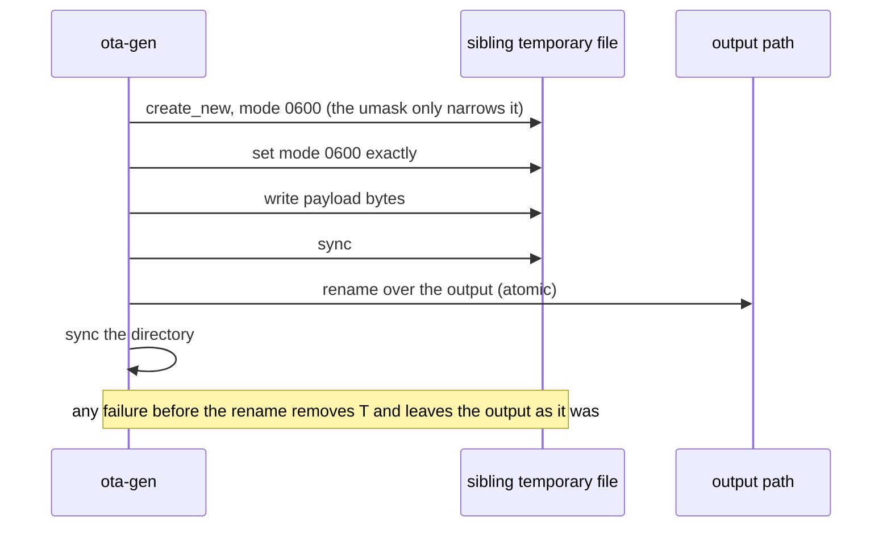

| Case | Result | Test |
| --- | --- | --- |
| new output | `0600` | `output.rs::a_new_output_is_created_private` |
| replaced output with mode `0644` | `0600`, the old mode is not kept | `output.rs::a_replaced_output_takes_the_owner_only_mode_and_does_not_keep_the_old_one` |
| mode set fails | old output and directory unchanged, no temporary file | `main.rs` unit tests |
| mode is set before the first byte | the temporary file is empty when its mode is set | `main.rs::the_mode_is_set_before_the_first_payload_byte_and_replaces_the_old_mode` |
| directory has a default ACL naming a group | output has no group or other access, and the ACL mask is `0` | `output.rs::a_new_output_in_a_directory_with_a_default_group_acl_grants_that_group_nothing` |
| setgid directory in another group | output takes the directory's group, with `0600` | `output.rs::an_output_takes_its_group_from_the_directory_and_not_from_the_file_it_replaces` |

The ACL test sets the default ACL's extended attribute directly, since `setfacl` is not installed in the
sandbox. It skips only where the filesystem has no ACLs at all, which the kernel reports as `ENOTSUP` or
`EOPNOTSUPP`. Any other error in setting the ACL up is a failure of the test, with its own error. A skip is
therefore never a pass of the ACL claim: it is printed on stderr, and the claim is then validated on a
filesystem that supports ACLs. On this host the test runs, because `/tmp` supports them.

## 4. Device admission: the contract workspace is charged on the device

The CPU admits a manifest only if its decoded peak fits the budget. The peak is the slot, heap and
largest-transient total from `Usage`. Validation derives a **contract workspace** from the extents after
decoding, and the scanner charges it as a transient of `extents × 16 + 24`, or nothing when there are no
extents (`docs/memory.md` §2.5). The copy check (`docs/client.md` §3.2) uses the same workspace, one
operation at a time, so the same charge covers it. The device's size shader did not charge it. For a
program with few operations and many extents, the workspace is the largest transient, so the device
could admit a program the CPU refuses. The search could then keep an inadmissible candidate.

The shader now charges the same term, with the same rules:

- zero extents: no workspace, so no transient is raised;
- a transient is the maximum over the operation's vectors, the hash buffers and the workspace, since
  decoding is sequential;
- a workspace too large for the device's arithmetic is refused as past the budget, which is what the
  CPU's saturating sum does;
- the decoded total is added with `sum_add`, which never wraps; a sum past the limit is refused.

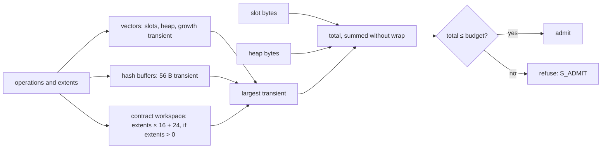

The shape that makes the workspace bind is a few operations with several extents each. Take five
operations: three copies, each with ten source and ten destination extents, and two replacements, each
with ten destination extents. That is 80 extents in all, so the workspace is `80 × 16 + 24 = 1,304 B`.
The largest vector transient is `792 B`, the operation vector growing from four slots to eight. The
workspace is the largest transient by 512 B, so it decides the budget.

### 4.1 Parity tests

`ota-generator/tests/gpu_eval.rs` checks the device against the CPU on this shape:

- `the_contract_workspace_is_charged_on_the_device_one_byte_either_side_of_the_decoded_limit`: four
  shapes, each first checked to have the workspace as its largest transient. For each, the device and the
  CPU must agree at the charge minus one, the charge, and the charge plus one, and the verdict must be
  "admitted exactly when the budget reaches the charge". The copies carry source and destination
  extents, and the replacements carry destination extents only.
- `a_program_with_no_extents_is_admitted_exactly_at_its_charge_on_the_device`: the zero-extent case.
- `a_search_under_a_budget_that_binds_on_the_workspace_keeps_only_programs_the_cpu_admits`: a search under
  a budget one byte under the five-operation charge keeps only programs the CPU admits, with the same raw
  size.

The boundary test is the discriminating one. With the workspace term removed from the shader, it fails,
because the device admits a program the CPU refuses at one byte under its charge. The search test is an
end-to-end guard. It passed with the term removed, so it does not, by itself, show that the search
meets the boundary. It holds because the device and the CPU agree exactly at the boundary, and the search
can keep only what the device admits.

## 5. What each change does not cover

- Real block devices. The identity rule and the lock key are tested as pure functions of `st_mode` and `st_rdev`
  (`identity.rs`, `filelock.rs`). Two device nodes for one block device, refused as one device and contending
  through one lock file, are tested only when the operator names a block device in `OTA_TEST_BLOCK_DEVICE` and
  the process may create device nodes (§6, §10.9).
- Flash and device durability, torn writes, write ordering and power loss. These need hardware (§6).
- Case-folded directories. The probe's refusal is tested with an injected result, and the directory lock does not
  depend on the probe. A real case-insensitive filesystem is platform validation (§6).
- Power loss during lock-file creation. The creation is tested with injected failures and with concurrent contenders,
  but no test cuts power. A lock file holds no data and is private before it has a name, so a power cut leaves either
  no name or a private one. A name that a power cut loses is created again by the next run (§9.1, §6).
- Concurrent writers the locks cannot see: another tool, a mounted filesystem, a second partition on
  the same disk.
- Who holds the lock namespace's ancestors. The tool checks the namespace it is given, not the path to it (§7.4).
- Access policy for an output after generation. The tool sets `0600` and nothing else, and it leaves an
  inherited ACL in place, masked.

## 6. Platform validation required

| Item | Why it is needed | Where it is stated |
| --- | --- | --- |
| Two device nodes naming one real block device, locked through one namespace | the identity rule for block devices is tested only as a function, and the node test needs a device and `CAP_MKNOD` | `docs/platform.md` §2 |
| The namespace provisioned for the updater, with trusted ancestors, and refused when it is not | the handle check is tested on a directory the test creates; the ancestors are not checked by the tool | `docs/platform.md` §2.1 |
| The lock on the target filesystem, including any network or FUSE filesystem | `flock` semantics differ by filesystem | `docs/platform.md` §2 |
| The directory sync after an unlink, and the sync that confirms an absence, on the storage the device uses | the uncertain states are produced by an injected failure | `docs/checkpoint.md` §8.2 |
| Power cut between the unlink and the directory sync, and between a reset's absence check and the next apply | the state after a crash is what the operator must inspect | `docs/checkpoint.md` §8.2 |
| The output's group and ACL on the deployment filesystem | the tests use the filesystem of the test host | `docs/generator.md` §9.4 |
| A case-folded checkpoint directory, refused before and after the record exists under either spelling | the env-gated test needs `OTA_TEST_CASEFOLD_DIR` on a case-insensitive filesystem; this host cannot mount one, so the test was not run | `docs/checkpoint.md` §5.2, §7 |
| A lock-namespace filesystem that supports `O_TMPFILE`, with `linkat` through `/proc/self/fd` working for an unprivileged user | the tests run on this host's ZFS and on overlay `/tmp`, both supporting it; another filesystem is refused with a message, and that path is not exercised | `docs/platform.md` §2.1, §9.1 |
| The storage's directory sync makes an unlink and a rename durable | the sync is injected as a failure; a real writeback failure is not reproduced | `docs/checkpoint.md` §8.2, §5.2 |
| Two device nodes for one real block device, refused as one device and shared through one lock file, and one device with an exclusive writer and shared readers | the env-gated test needs `OTA_TEST_BLOCK_DEVICE` and `CAP_MKNOD`; this host has no block device the tests may use, so it was not run | §10.9 |
| Two partitions of one disk, which have different device numbers, kept non-overlapping by the platform | the tool sees two numbers and cannot tell that the storage overlaps | §10.8, `docs/platform.md` §2 |
| A power cut during staging initialization, cross-directory rename or sweep | no test cuts power. Each initialization step is tested by an injected failure, and a retry completes it; a crash between a rename and its sync is modelled by restoring the earlier state. Validate both directory syncs and the crash recovery on the deployment filesystem | §10.6, §10.9 |
| The lock on the deployment's filesystems, for both a writer and a shared reader | `flock` semantics differ by filesystem, and only the exclusive and shared behaviour on the test host was run | §10.8 |

## 7. The lock namespace: one directory, validated once

### 7.1 Why a namespace, not a sidecar

The earlier checkpoint lock was a sidecar, `<name>.lock`, beside the record. Two things were wrong with it.
The sidecar shared its directory with the records, so a record named `state.lock` was the lock file of `state`.
Replacing that record renamed over the lock file `state` was holding, so a later run on `state` locked a new
file and did not contend. The sidecar scheme would also have refused the run on `state.lock` at its first read,
since the empty lock file is not a record. The test `a_checkpoint_named_like_another_checkpoints_lock_leaves_that_lock_held`
covers both effects. It was written against the new scheme and not run against the old one, so the failure is
argued from the code, not observed.

A namespace is a directory of lock files that no record shares. The checkpoint directory lock is a digest of the
parent identity alone; the separate entry lock also includes the exact basename. Neither depends on the spelling of
the parent path.

### 7.2 Validating the handle

```mermaid
sequenceDiagram
    participant R as run
    participant FS as filesystem
    participant H as namespace handle
    R->>FS: open --lock-dir with O_NOFOLLOW (no O_DIRECTORY)
    alt final name is a symbolic link
        FS-->>R: ELOOP: refused, the namespace is named by its directory
    else opened
        FS-->>H: handle
        R->>H: fstat: is a directory, owned by this user, no group or other bits
        alt a check fails
            H-->>R: refused before any lock or write
        else all checks pass
            alt the lock file does not exist
                R->>H: O_TMPFILE, fchmod 0600, then linkat to lock name
                H-->>R: published privately, or open the winner on EEXIST
            else it exists
                R->>H: openat(lock name, O_RDWR), no mode change
            end
            R->>H: check type, owner, links and mode, then take the lock without waiting
            H-->>R: lock file, checked and locked
        end
    end
    Note over FS,H: the path may be replaced now; the handle still names the validated directory
```

The handle is checked with `fstat`, not with a path. So the check and the use refer to the same directory, and
a path replaced after the check cannot change which directory is used. The test
`locks_are_taken_in_the_directory_that_was_validated_even_after_its_path_is_replaced` moves the namespace aside,
puts another directory at its path, and then takes a lock, which lands in the validated directory. It then
replaces the path with a symbolic link and takes a second lock, which also lands in the validated directory.

`O_DIRECTORY` is not used, because on Linux it reports a symbolic link as "not a directory", which hides the
more useful message. The type is checked on the handle instead. `O_NONBLOCK` stops the open from waiting if the
path is a named pipe, and the handle then fails the directory check.

### 7.3 Identity of a checkpoint's lock

The record's parent directory is opened by an ordinary path, so symbolic links in the path are followed, and
its device and inode are the identity. The lock name is `checkpoint-` and the SHA-256 of `checkpoint`, a NUL
byte, the device and the inode. Two paths to one directory give one name, and every record in one directory gives
that same name, whatever its spelling (§8.2 says why). A record whose parent is the namespace itself is refused
before anything is locked. The lock is then taken on the handle, so it is never a name the record could also take.
The store keeps both that lock and the directory's handle for the run, and §8 gives the reasons.

### 7.4 What the platform must provide, and why the tool cannot check it

The handle protects one run. It cannot make the next run reach the same directory, because `--lock-dir` is a
path, and a path can be changed between runs. Two runs that reach different directories do not contend, and the
tool cannot see that. The protection therefore rests on the platform:

- one path per host, the same on every run, including reset runs;
- the directory at that path is owned by the updater and private to it (`0700`);
- the ancestors of that path are owned by a trusted user and not writable by others, so nobody can rename the
  directory or put another one at the path;
- the namespace's filesystem supports unnamed files (`O_TMPFILE`) and links them through `/proc/self/fd`. A lock
  file is published by that link (§9.1). A filesystem without it is refused with a message that names this
  requirement, so the platform must choose another filesystem for the namespace.

The tool checks the first two properties of the handle it opens. It does not walk the ancestors. A walk by path
is racy, and the answer it gives is only as good as the path it walked.

### 7.5 Migration

Lock files from earlier releases are not read, removed or followed. Those are the sidecars `<name>.lock` beside a
record, and the per-name `checkpoint-<sha256>.lock` files that a release before this one keyed by the record's
name. A run of this release does not contend with an older run that still holds one of them, or a block-device
lock in an older `--lock-dir`. So the older updater must be stopped before the new one runs on that target. After
that, the operator can delete the old files, once no older updater can run. The tool does not delete them, because
an older process may still hold one.

### 7.6 Test map

| Claim | Test |
| --- | --- |
| a namespace validated at open refuses a symbolic link, a non-directory, a missing path, and group or other access | `filelock.rs::a_lock_directory_is_usable_only_when_no_one_but_its_owner_can_reach_it`, `filelock.rs::a_lock_directory_that_is_missing_a_file_or_a_symbolic_link_is_refused`, `locks.rs::a_missing_or_group_accessible_lock_namespace_refuses_the_run_before_any_write` |
| a lock is taken in the validated directory, even after the path is replaced | `filelock.rs::locks_are_taken_in_the_directory_that_was_validated_even_after_its_path_is_replaced` |
| a lock file at the name that is a symbolic link, dangling or not, or a named pipe, is refused without creation or waiting | `filelock.rs::a_symbolic_link_at_the_lock_name_is_refused_and_its_target_is_untouched`, `filelock.rs::a_dangling_symbolic_link_at_the_lock_name_is_refused_and_creates_nothing`, `filelock.rs::a_named_pipe_at_the_lock_name_is_refused_without_waiting`, `locks.rs::a_checkpoint_lock_file_that_is_a_symbolic_link_is_refused_with_no_write` |
| an existing lock file accessible to others is refused and its mode is left alone | `filelock.rs::a_pre_existing_lock_file_accessible_to_others_is_refused_and_its_mode_is_left_alone` |
| an access ACL that grants a named group is refused through the mode's mask bits | `filelock.rs::a_lock_file_that_an_access_acl_grants_a_named_group_is_refused` |
| a default ACL on the namespace gives a new lock file no group or other access | `filelock.rs::a_new_lock_file_in_a_namespace_with_a_default_acl_grants_the_named_group_nothing` |
| a checkpoint's lock is keyed by directory identity alone, so every record in a directory contends for one lock, and a record named `state.lock` is refused while `state` is held | `filecheckpoint.rs::two_checkpoint_names_in_one_directory_share_one_lock`, `filecheckpoint.rs::a_record_named_like_a_lock_file_contends_for_the_directory_lock_and_writes_nothing_while_it_is_held`, `locks.rs::a_checkpoint_named_like_a_lock_file_is_refused_while_its_directory_is_held_and_writes_nothing` |
| a lock file is published only once it is private: a failed mode change publishes no name, and a later take succeeds | `filelock.rs::a_lock_file_whose_mode_cannot_be_set_is_never_published_and_a_later_take_succeeds` |
| an entry left by an interrupted earlier release without owner access is refused, named in the message, and not changed | `filelock.rs::a_lock_file_an_interrupted_release_left_without_owner_access_is_refused_and_is_not_changed` (skipped under root) |
| under a restrictive umask, a failed mode change publishes nothing, and six contenders for one new name leave one private lock file | `tests/umask.rs::lock_and_record_files_are_0600_and_reopen_under_a_restrictive_umask` |
| a record kept in the namespace is refused, and the lock is in the namespace, not beside the record | `filecheckpoint.rs::a_checkpoint_record_in_the_lock_directory_is_refused`, `filecheckpoint.rs::the_checkpoint_lock_lives_in_the_namespace_and_never_beside_the_record`, `locks.rs::a_checkpoint_record_inside_the_lock_namespace_is_refused_with_no_write` |
| an old sidecar is neither used nor removed | `locks.rs::an_old_sidecar_lock_beside_the_record_is_neither_used_nor_removed` |
| two device nodes for one block device contend through one namespace | `locks.rs::two_device_nodes_for_one_block_device_contend_through_the_namespace` (skips unless `OTA_TEST_BLOCK_DEVICE` names a block device and `CAP_MKNOD` is held) |
| a reset that finds no record confirms its absence, and an uncertain confirmation is retried | `filecheckpoint.rs::a_failed_sync_when_no_record_remains_is_uncertain_until_a_later_sync_confirms_the_absence`, `reset.rs::a_removal_not_confirmed_durable_fails_the_reset_and_leaves_the_record_absent`, `recovery.rs::a_retry_that_finds_no_record_confirms_its_absence_before_it_reports_success` |
| a lock name must be one plain file name, and every other form is refused before any open | `filelock.rs::a_lock_name_must_be_one_plain_file_name_and_every_other_form_is_refused_before_any_open`, `filelock.rs::a_rejected_name_neither_opens_nor_changes_a_file_outside_the_namespace` |
| a new lock file and a new record are `0600` under a restrictive umask, and reopen | `tests/umask.rs::lock_and_record_files_are_0600_and_reopen_under_a_restrictive_umask`, which is alone in its binary because the umask is process-wide, and so holds its contender race too |
| a parent path replaced after the lock leaves the run on its own directory, and a run on the new directory has its own lock | `filecheckpoint.rs::a_parent_symlink_retargeted_after_the_lock_leaves_the_run_on_its_own_directory` |
| byte-distinct names that differ only in case are separate records on a case-sensitive directory, and one lock serialises them | `filecheckpoint.rs::case_variants_on_a_case_sensitive_directory_are_separate_records_that_one_lock_serialises` |
| a record name that is not printable ASCII, or has a space, is refused before any lock is taken | `filecheckpoint.rs::a_checkpoint_name_that_is_not_plain_ascii_is_refused_before_any_lock_is_taken` |
| a record named as a staging file or a case probe is refused before the lock, and the other store's entry is left as it was | `filecheckpoint.rs::a_record_named_as_a_staging_file_is_refused_before_the_lock_and_no_staging_file_is_taken_over`, `filecheckpoint.rs::a_record_named_as_a_case_probe_is_refused_and_a_probe_in_flight_is_left_alone`, `locks.rs::a_checkpoint_named_with_the_reserved_prefix_is_refused_before_any_lock_or_write` |
| the reserved prefix is refused in any ASCII case and matched whole | `filecheckpoint.rs::the_reserved_prefix_is_refused_in_any_ascii_case_and_only_as_a_whole_prefix` |
| a probe that cannot run refuses the store and releases the lock | `filecheckpoint.rs::a_probe_that_cannot_run_refuses_the_store_and_releases_its_lock` |
| a failed look-up after an absent load is uncertain, and confirms nothing | `filecheckpoint.rs::a_failed_look_up_after_an_absent_load_is_uncertain_and_confirms_nothing`, `ota-cli/src/main.rs::tests::an_uncertain_reset_tells_the_operator_to_run_the_reset_again_and_not_to_apply` (the operator's guidance) |
| the entry identity is read through the pinned directory without following a link | `filecheckpoint.rs::the_entry_identity_is_the_records_or_none_and_a_link_at_the_name_is_its_own_entry` |
| roles are compared using open handles and the pinned checkpoint entry, before device writes, after a parent or payload path is retargeted | `roles.rs::a_checkpoint_parent_retargeted_after_the_payload_is_opened_is_checked_in_the_directory_it_now_names`, `roles.rs::a_checkpoint_parent_retargeted_to_a_directory_holding_the_payload_is_refused_as_its_alias`, `roles.rs::a_payload_path_replaced_after_it_was_opened_is_compared_by_the_file_that_was_opened`, `roles.rs::an_old_image_that_is_the_device_under_a_retargeted_parent_is_refused_and_the_device_is_untouched` |
| a streamed payload pass reads the file that was authenticated, after its path is replaced | `filesource.rs::a_copy_of_the_pinned_handle_reads_the_file_that_was_opened_after_its_path_is_replaced` |
| a checkpoint that is the payload by hard link is refused on both paths, with no write | `policy.rs::a_checkpoint_that_is_the_payload_by_hard_link_is_refused_on_both_paths_before_any_write` |
| a folding directory refuses the store, before and after the record exists, and releases its lock | `filecheckpoint.rs::a_folding_directory_is_refused_whether_or_not_the_record_exists_and_releases_its_lock` (injected result); `filecheckpoint.rs::a_case_folded_directory_refuses_the_record_before_and_after_it_exists` (env-gated: platform validation, not run here) |
| the case probe leaves nothing behind on a case-sensitive directory | `filecheckpoint.rs::the_case_probe_of_a_case_sensitive_directory_passes_and_leaves_no_probe_behind` |
| `confirm_absent` refuses a stored record and leaves it, and refuses a dangling link at the name | `filecheckpoint.rs::confirm_absent_refuses_a_stored_record_and_removes_nothing`, `filecheckpoint.rs::confirm_absent_refuses_a_dangling_link_at_the_record_name_and_removes_nothing`, `ota-client/src/checkpoint.rs::confirm_absent_refuses_a_stored_record_and_leaves_it_in_place` |

## 8. The checkpoint's directory, names, absence and lock-file mode

This section covers the changes that make the checkpoint's locking and I/O agree with one directory. It has five
parts: why the directory is pinned (§8.1), the names the store accepts and why the lock is per directory (§8.2),
what `confirm_absent` promises and what it cannot (§8.3), and why a lock file is published only once it is private
(§8.4). The operator steps are in §8.5, and the checks made before a run's first write are in §9.

### 8.1 Pin the directory the lock is taken in

Before this change, the store took its lock on the directory that the path named at lock time, and then it
opened, renamed and unlinked the record by its path. A path is checked at one step and used at another. If
the parent path was changed in between, the run held a lock for one directory and wrote the record in another,
so a second run that named the new directory did not contend with it.

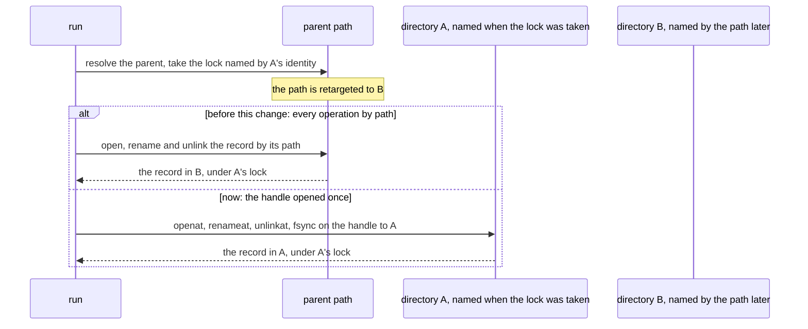

The store opens the parent once, reads the identity from that handle, and keeps the handle for the run. The
lock's name comes from the same handle. So the lock and every operation on the record name one directory, and a
run on another directory has another lock. The lock is owned by the store, so it cannot be kept while the store
is replaced, and it cannot be taken for one directory and used with another.

### 8.2 Names, and why the lock is per directory

The earlier lock was per name. Two names that the filesystem treats as one entry then needed one lock, and two
names that it treats as different needed none. So the store had to know which spellings were equal, and it could
not: the case probe checks one spelling at one moment, and equivalence can depend on the filesystem and on the
directory. Four options were weighed.

| Option | Serialises equivalent names | Serialises unrelated records | Verdict |
| --- | --- | --- | --- |
| Key the lock on a folded name | yes, if the folding rules are known | no | rejected: the rules depend on the filesystem and the directory, and an absent record has no inode to ask |
| Lock by name, and refuse folding or non-ASCII names | only for the spellings the probe sees | no | rejected as the guard: the probe cannot see every equivalence, such as a filesystem's short-name aliases |
| Only support filesystems whose naming the platform provisions | by declaration | no | kept as a platform requirement (`docs/platform.md` §2.1), not as the guard |
| One lock for the whole checkpoint directory | yes, whatever the equivalence | yes: records in one directory take turns | **chosen** |

The chosen lock is named by the directory's identity alone. Every record in the directory, under any spelling and
through any path, contends for it. For checkpoint stores the directory lock does not depend on name equivalence. Its cost is that two records in one
directory cannot be used at once. It does not protect a differently spelled device, old-image or payload entry: those
roles do not take the checkpoint directory lock, and exact-name entry locks can differ on a folding filesystem (§11.6).

The rules that remain are checked when the store is opened:

- A record name must be printable ASCII with no space. The reserved check is made on ASCII bytes, so a normalizing
  filesystem cannot make a non-ASCII name equal to a reserved one.
- A record name must not begin with `.ota-checkpoint.`, in any ASCII case (§9.3). Every entry the store makes in
  the directory has that prefix.
- The directory must not fold the case of ASCII names. The probe creates a file under the reserved prefix, looks up
  its upper-case spelling, and removes the file. It runs on the pinned directory, under the lock, so it applies
  whether or not the record exists.

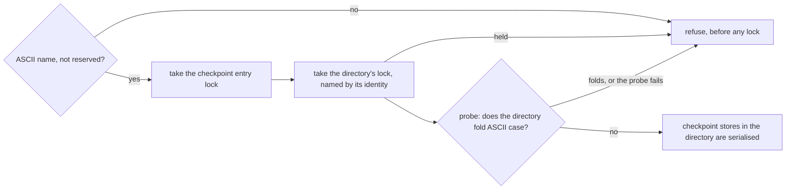

Refusal is the default, and the probe is kept as one. It is evidence and not a proof, because it checks one spelling
at one moment and cannot see a folding flag set after it ran. The lock does not depend on it. A folding directory is
refused because the supported configuration is a case-sensitive one. The directory lock serialises checkpoint stores,
but cannot close casefold-alias gaps against other role entries.

### 8.3 `confirm_absent`: what it checks, and what the sync proves

`confirm_absent` promises that no record is stored and that the absence is durable. Before this change it synced
the directory and did not check the name, so a stored record was not refused. Now it:

1. looks up the record's name on the pinned directory, without following a link, and refuses any entry as
   `checkpoint_present`, leaving it in place. A look-up that fails is `checkpoint_removal_uncertain`: presence and
   absence are both unknown, so neither is claimed and nothing is removed. The message says only that the absence is
   not confirmed. The error type carries no text beyond a fixed message, so the operator is not given the cause;
2. only then syncs the pinned directory, and reports `checkpoint_removal_uncertain` if the sync fails.

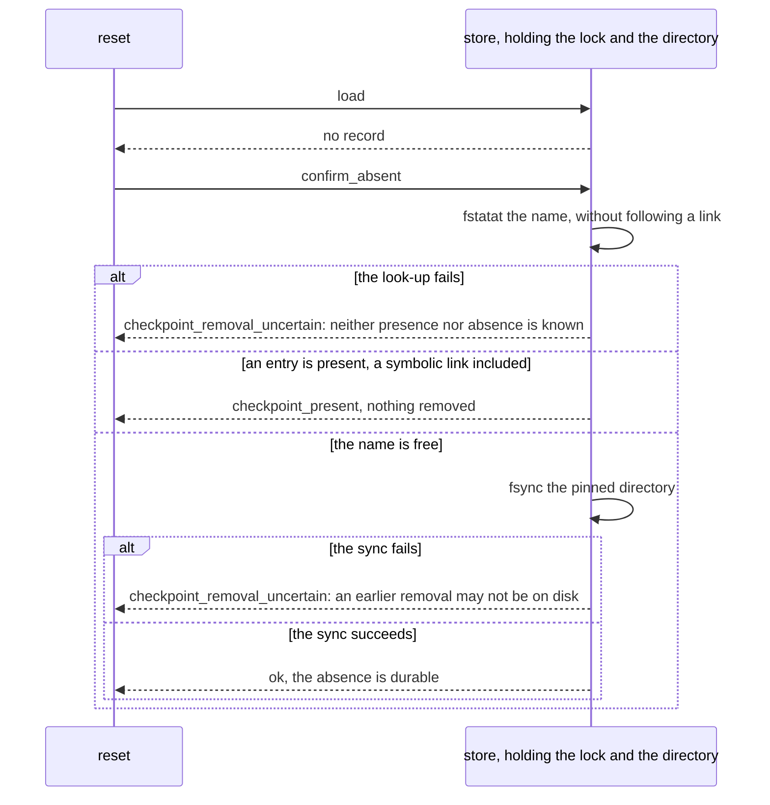

The sync is the assumption, and the code cannot check it. A successful `fsync` of the directory is taken to mean
that the unlink, and any earlier rename, are on stable storage. That holds on a local POSIX filesystem whose
directory sync is honest. The tests inject a sync failure to exercise the reporting, and so they do not show
what a real writeback failure looks like. The platform must establish the assumption for its storage (§6).

### 8.4 Why a lock file is published only once it is private

`open(O_CREAT, 0600)` creates the file with `0600 & ~umask`. A umask of `0277` makes it `0400`. The creating open
still returns a read-write descriptor, so the first run appears to work. The next run opens the file for writing,
and that fails with `EACCES`, so every later update of the target is refused. The regression `tests/umask.rs`
reproduced this: the lock file was `0400`. Setting the mode through the handle fixed the umask, but it left a second
window. The name existed from the `open` until the `fchmod`, so an interruption in that window, or a failed
`fchmod`, left a persistent name with the wrong mode. No later run could open it, and the tool refused it and never
repaired it. This release removes the window. The name appears only after the mode is final (§9.1):

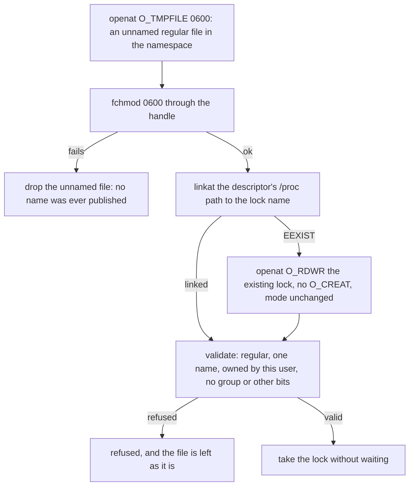

An existing file is never chmodded, so the tool does not widen or repair access it did not grant (§1.4). The tests
`filelock.rs::a_lock_file_whose_mode_cannot_be_set_is_never_published_and_a_later_take_succeeds` and
`tests/umask.rs` cover the failed `fchmod`, and the contenders in `tests/umask.rs` cover the race under the restrictive
umask. That test is alone in its binary, because the umask is process-wide.

### 8.5 What an operator must do

- Stop every older `ota-apply` before the first run of this release on a host. Older releases lock with
  `<name>.lock` beside the record, or with a per-name lock file in the namespace. This release sees neither
  (`docs/platform.md` §2.1).
- Provision the lock namespace on a filesystem that supports unnamed files (`O_TMPFILE`). On any other, every run
  is refused with "does not support unnamed files (O_TMPFILE)". Choose another filesystem for `--lock-dir`.
- Keep the checkpoint directory writable only by the updater, on a local, case-sensitive filesystem whose directory
  sync is honest (`docs/checkpoint.md` §5.2).
- Do not name a checkpoint with the prefix `.ota-checkpoint.`. It is refused in any ASCII case (§9.3).
- If a store is refused with "folds the case", move the checkpoint to a case-sensitive directory. Renaming the
  record does not help, since the refusal is about the directory, not the name.
- If a reset reports `checkpoint_present`, inspect the entry at the record's name, and then reset again. Nothing
  was removed.
- If a reset reports `checkpoint_removal_uncertain`, the record may be present or absent. Run the reset again. It
  removes a present record, and it succeeds only once the absence is confirmed durable. Do not apply until it does.
- If a run is refused with "cannot open lock file ...: Permission denied", a release that was interrupted during
  lock-file creation may have left the file without owner access (§1.4). Repair it once no updater can run:
  1. stop every updater on the host, and confirm that none is running;
  2. restore owner read and write on that one file with `chmod 0600 <file>`. It is the same inode, so nothing else
     changes, and the updater does not do this itself;
  3. run the update again. The file is then an ordinary lock file.
  Do not delete the file while an updater might run. A deleted name lets a second run lock a new file while the
  first still holds the old one (§1.4).

## 9. Roles, names and lock files: what this release checks, and when

This section states the three checks that run before the first write of a run, and the one rule for publishing a
lock file. Each is a property of the code, and each has a test (§7.6, §8.5).

### 9.1 Publishing a lock file

A lock file is published by a link, and never by a create that names the file. The create makes an unnamed file, its
mode is set through its handle, and then `linkat` gives it the name. `linkat` fails if the name exists, so two runs
that race for a new lock file cannot replace each other's. The run that loses opens the winner's file, which is
already private.

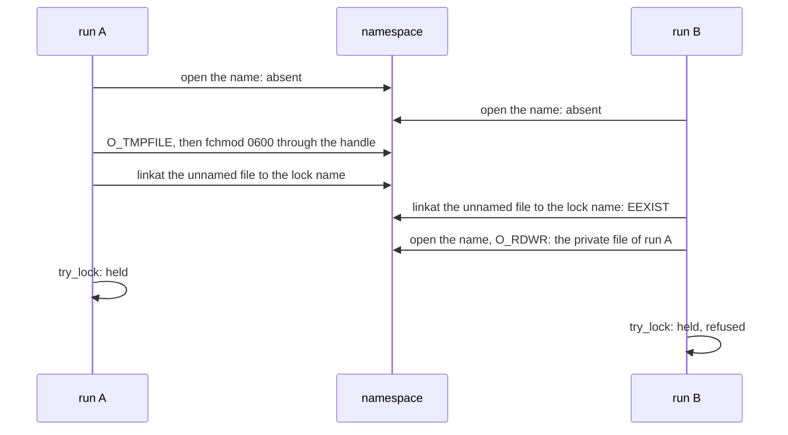

An interruption before the link leaves no name, because an unnamed file is freed when its last descriptor closes.
A namespace on a filesystem without `O_TMPFILE` is refused with a message, rather than falling back to the create that
§8.4 removed. The platform provides the filesystem (`docs/platform.md` §2.1).

### 9.2 Roles compared by the identity of their handles

A run names four files: the payload, the device, the checkpoint and the old image. Before this release, an alias check
read each path with `stat` before anything was opened, and a link in a path could be retargeted between that check and
the open. The check now runs on the handles, after all four are open, and before any write (`ota-cli/src/roles.rs`):

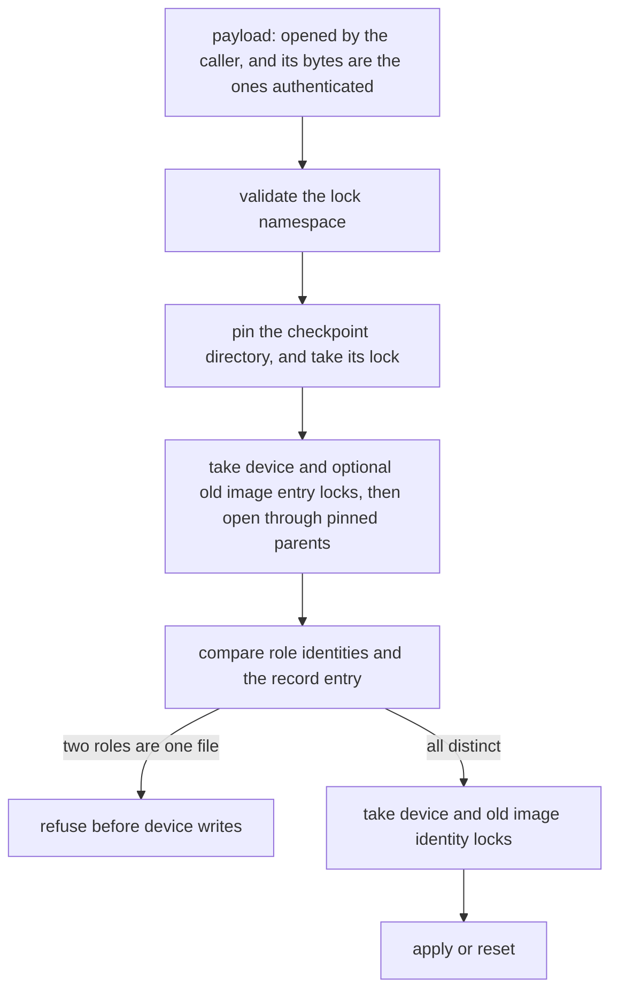

Two consequences follow. A checkpoint parent retargeted after the payload was opened is read in the directory it then
names, because the store opens that directory once, and the check then compares that directory's entry. A streamed run
reads every pass through a copy of the handle that authenticated the payload (`FileSource::from_file`), so a payload path
replaced during the run is never read. Each role's check uses the file the run writes, not the file a path names later.

### 9.3 Reserved names

The store makes a private `.ota-checkpoint.staging` directory and case probes, `.ota-checkpoint.probe.<pid>.<time>.<n>`,
in the checkpoint parent. Staging files live inside the private directory (§10.6). A record's name may not begin with `.ota-checkpoint.`, in any
ASCII case, and the prefix is matched whole. The reservation is checked before the lock and before any probe, so a
refused name takes nothing and changes nothing.

- The marker and private directory distinguish the staging namespace; a reserved-looking name alone does not prove
  ownership. Cleanup only considers eligible entries inside that namespace (§10.6).
- Device, old-image and streamed-payload paths are also checked for reserved components and staging ancestors (§11.6).
  Buffered and reset payloads use an ordinary open and are not covered by those entry checks.
- Legacy sibling staging files and probes, including older reserved-prefix staging names, are not swept or removed.

The reservation holds for the names a store can produce, under ASCII folding. It does not hold for a filesystem that
aliases names some other way, such as FAT short names. Such a filesystem is outside the supported set (§8.2, and
`docs/platform.md` §2.1).

## 10. Read roles, block-device identity, reset, staging files and publication

This section is the design record of one change set, in six parts. §10.1 says what changed and why. §10.2 is the identity
that decides whether two roles are one object. §10.3 gives the lock each role takes and the order they are taken in, and
§10.4 says why the identity comparison comes before device and old-image identity locks. §10.5 is the reset, which no longer opens the old image.
§10.6 is the staging files: their names, and when a stale one is removed. §10.7 is the publication test. §10.8 separates
what the tool enforces from what the host must provide, §10.9 lists the validation that remains, and §10.10 maps each claim
to its test. The code is in `ota-cli/src/identity.rs`, `filelock.rs`, `filedevice.rs`, `fileimage.rs`, `roles.rs`,
`filecheckpoint.rs` and `main.rs`.

### 10.1 What changed, and why

| Before | After | Why |
| --- | --- | --- |
| A reader of the old image or of a streamed payload took no lock, so a writer of that file in another run went unnoticed | A reader takes a shared lock on the identity of its file, which a writer's exclusive lock contends with | The engine reads those files for the whole run. A writer that changed one would change what the run reads, and a reader that holds nothing does not stop it |
| A block device was identified by its device and inode. Two device nodes for one device have different inodes, so they looked like two devices | A block device is identified by its device number, `st_rdev` | Every node for a device carries the same number, so a second node for a device is an alias of it |
| A reset opened `-s`. A missing path, or a path that aliased the device, failed a reset | A reset does not open the old image | A reset writes nothing and reads no image. Its own checks decide it |
| Earlier staging files were siblings of records | Staging lives in a private marked directory; a bounded best-effort sweep runs at open, and a replacement whose name window is full removes the stale files at its own names by lookup; a record's second link is removed by lookup of names derived from its bytes | The namespace establishes the cleanup boundary; sweeps can still fail or leave debris, and the second link does not depend on them |
| The publication race test used a barrier at function entry, so which contender reached the link first depended on the scheduler | A seam runs once the name is seen absent and before the link is attempted, and the test holds every contender there | The contenders reach the link together on every run, so the test asserts the outcome and not an interleaving |

### 10.2 Identity: what makes two roles one object

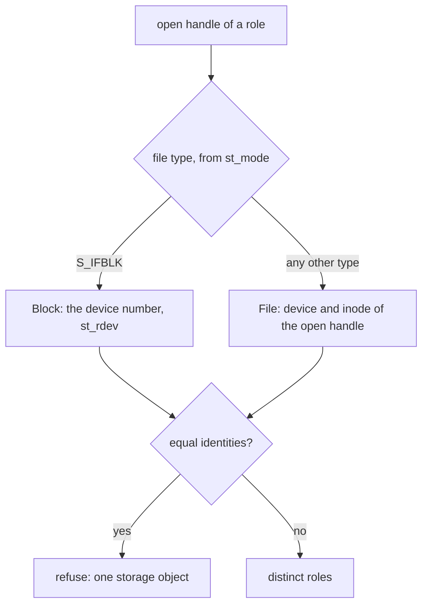

- A regular file has one inode. Every path and every hard link to it has the same device and inode, so two handles with
  equal `(dev, ino)` are one file.
- A block device's device nodes each have an inode of their own, but every node for one device has the same `st_rdev`.
  Two nodes with equal numbers are one device, whatever their inodes.
- The variant is part of the identity. A block device never equals a file, even when the numbers coincide, since a device
  number and an inode are not numbers of one kind.
- Two partitions of one disk have different numbers, so the tool sees two devices. They may still overlap on the disk, and
  no identity in the tool can show it. The platform must keep their storage apart (`docs/platform.md` §2).

The identity is read from the open handle, after the open, so a path retargeted later is not what is compared (§9.2).

### 10.3 The locks of a run

A lock is either **exclusive**, which a writer takes and which excludes every other lock on its identity, or **shared**,
which a reader takes and which excludes an exclusive lock but admits another shared one. Its identity decides its file:
a regular file is locked on its own open file, and a block device through `block-<major>-<minor>.lock` in the
namespace (`docs/platform.md` §2).

| Role | Locks | When and how long |
| --- | --- | --- |
| streamed payload (`--stream`) | shared entry, then shared identity | before the first read; pin lives through apply, final verification and completion record |
| buffered or reset payload | none | ordinary path open and buffered read before namespace and role locks |
| checkpoint | exclusive entry, directory, and existing regular record inode | in that order at store open; store retains them and transfers the inode lock on replacement |
| device | exclusive entry, then exclusive identity | entry before role open; identity after comparison; retained for the run |
| old image (apply with `-s`) | shared entry, then shared identity | entry after device entry; identity after device identity; retained for the run |
| old image (reset) | not opened | not applicable |

The conflicts, for one identity:

| Held by another run \ this run takes | shared | exclusive |
| --- | --- | --- |
| shared | admitted | refused: `another update holds <path>` |
| exclusive | refused | refused |

A streamed run with `-s` takes its locks in this order, and each is taken without waiting:

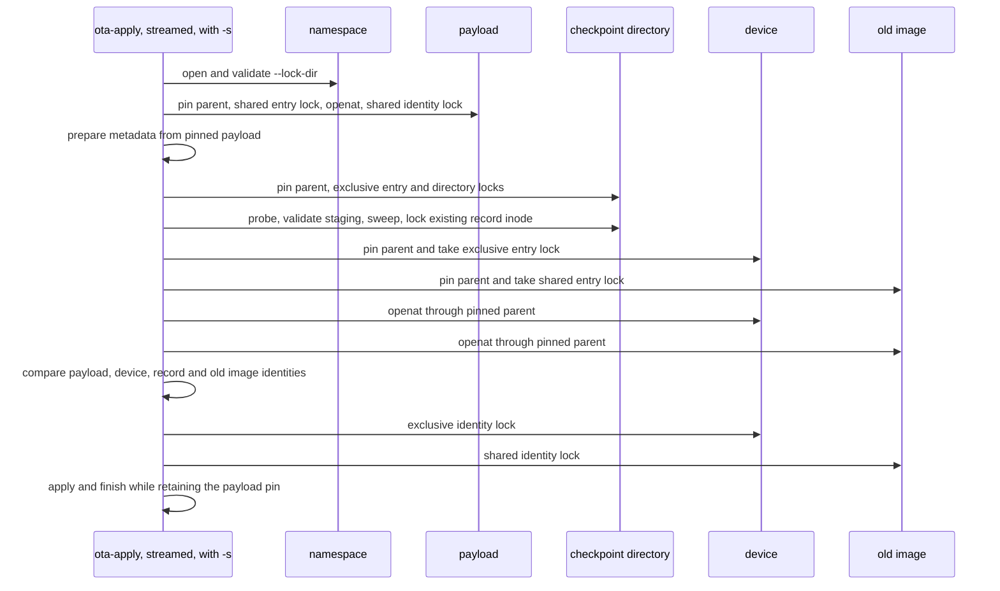

Each lock attempt is nonblocking, so no run waits for another and no lock-wait cycle can form. The store's case probe,
staging initialization and sweep can modify checkpoint storage before the role comparison; the comparison precedes device
writes, not every filesystem write.

### 10.4 Why the identity comparison comes before device and old-image identity locks

Two roles that are one file would contend with each other. A `flock` lock belongs to an open file description, and every
`open` makes its own, so a reader's shared lock and a writer's exclusive lock on one inode conflict inside one process,
exactly as they would between two runs. If the device's lock were taken before the old image was compared, the run would
refuse itself as "another update holds" and never name the alias.

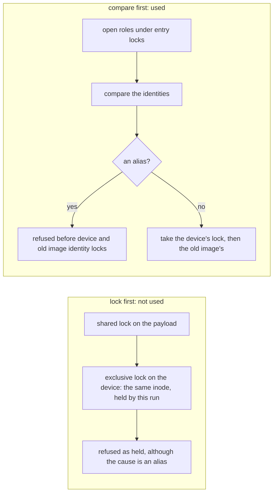

The test `roles.rs::a_device_that_is_the_payload_is_refused_as_an_alias_even_while_the_payload_is_held_for_reading` holds
the payload's shared lock and names the payload as the device. It expects the alias, and not a lock.

The comparison also takes the place of deduplication. The device's and the old image's locks are attempted only after every
alias is refused, so neither is attempted on an identity that another role of the run holds. The streamed payload's shared
lock is taken earlier, and a shared lock never conflicts with a shared lock, so only a writer could meet it, and the
comparison normally refuses a device or old-image alias before its identity lock is attempted. The checkpoint entry and
record inode are locked earlier; a streamed payload alias can encounter those locks first, with a best-effort alias
diagnostic on store-open failure. Entry locks already held by the same run are deduplicated where `roles::open` takes them.

### 10.5 Reset does not open the old image

A reset checks the payload's authenticated bytes, the identity of the record, the device and the payload, the checkpoint
and device locks, and, for a base-dependent update, the base: the device must hold the old image, which is read from the
device itself. It does not check `-s`. A reset reads no image, so whether a named old image exists, has the right size or
aliases the device has no bearing on whether the record may be cleared.

| `-s` given to a reset | Before | Now |
| --- | --- | --- |
| a path that does not exist | refused: the old image cannot be opened | decided by the reset's own checks |
| a second name for the device | refused as an alias | decided by the reset's own checks. A reset writes nothing, so the alias does not matter |
| a base-dependent update whose device does not hold the old image | refused by the base check | refused by the base check, as before |

The tests are `reset.rs::a_reset_does_not_open_the_old_image_so_a_missing_source_path_does_not_fail_it`,
`reset.rs::a_reset_does_not_refuse_a_source_that_aliases_the_device` and
`reset.rs::a_base_dependent_reset_still_refuses_for_its_own_base_whatever_source_is_named`.

### 10.6 Staging files: names, creation and cleanup

Staging lives in the pinned `.ota-checkpoint.staging` directory inside the record's parent, not beside the record. Under
the checkpoint directory lock the store creates it with mode `0700`, creates an `owner` file with mode `0600` and exact
contents `ota-checkpoint staging directory v1\n`, syncs the marker, staging directory and parent, or validates an existing
directory and marker. The directory must be owned by the effective user and have no group or other access; the marker
must additionally be a single-link regular file of exactly the expected length and contents. Opens refuse final symlinks.
An invalid marker on the canonical directory refuses the store without automatic repair. The canonical directory is
published only once its marker is complete and synced, so an interruption leaves an initialization directory instead,
`.ota-checkpoint.staging.init`. The next open completes the initialization: it keeps an exact marker, makes a marker of at most the expected length again,
and refuses any other shape. It restores the owner permissions that a umask can remove before it lists the directory and
checks its marker, but only where the owner cannot read or search the directory, since its entries and marker cannot be
reached otherwise, and a refusal then keeps that restoration. Otherwise a refused directory keeps its mode
(`docs/checkpoint.md` §5.3). These checks are not authentication against
the updater's user or a writer of the parent.

A replacement writes a staging file first (`docs/checkpoint.md` §5.2). Its name is the prefix, a digest and an attempt:

| Part | Example | Purpose |
| --- | --- | --- |
| `.ota-checkpoint.stage.` | | staging-name prefix inside the private directory |
| digest: 16 hexadecimal digits | `0123456789abcdef` | the first eight bytes of the SHA-256 of the record the file holds. The name of the file that produced a record is known from the record, so the open can find a second link to it by lookup |
| attempt, in decimal | `7` | counted from 0 for each replacement. A name taken by a leftover is skipped, and a replacement tries at most 16 |

The digest replaces the process ID and random key of earlier designs. Those values were unknown to the next run, so the
second link of a crash could be found only by enumerating the directory, and a bounded sweep cannot always reach it. Two
replacements that write the same bytes contend for the next attempt, and the exclusive create keeps them apart.

Creation, with the bounded attempts kept:

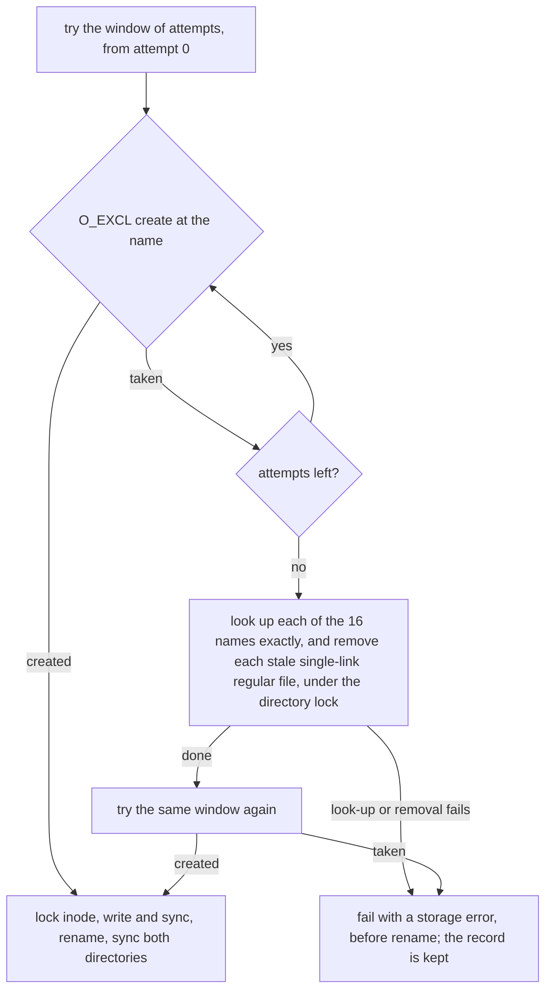

A cleanup removes an entry only when every one of these holds, whether it is a sweep at open or a replacement's own names:

| Condition | Why |
| --- | --- |
| the entry is inside the validated staging directory and has the exact staging form: prefix, 16 hexadecimal digits, decimal attempt | the namespace defines the ownership boundary; the name alone does not |
| looked up through the pinned staging directory without following a link, it is a regular file | a symbolic link or a directory at the name is not eligible |
| it has one name (`nlink` is 1) | another name may be a hard link to a file that matters |
| it is removed under the directory lock | no cooperating updater is between its create and its rename |

Not swept: any sibling in the record directory, including legacy staging files of either naming form and case probes;
the marker; and entries inside staging that fail the conditions above.

What the cleanup does and does not do:

- **When and how much.** A sweep runs at store open. It enumerates at most 256 entries via `/proc/self/fd`; enumeration,
  lookup and removal failures are ignored. Non-removable entries can occupy the scan window, so later sweeps are not
  guaranteed to reach all debris. A replacement whose 16 names are all occupied does not sweep. It looks up each of those
  names exactly, removes the stale files among them, and retries the window once, so no listing decides whether they are
  reached. The record's own second link does not depend on the sweep either. Its look-ups are at most 16, whatever the
  directory holds, and they run at every open before the store is used (below).
- **Durability.** Sweep removals are not explicitly synced. A crash may restore debris, and a later sweep may remove it.
  A successful replacement's staging sync, which follows its rename, also makes its own removals durable. Every open
  syncs the staging directory, which covers the removal of a record's second link: a failed sync refuses the open.
- **Failure.** If the window remains occupied, or a look-up or removal of one of its names fails, replacement returns a
  storage error before rename and keeps the old record. A failed look-up, removal or sync of the record's second link,
  or a failed staging sync at open, refuses the open, with no device write. The probe, initialization or sweep may
  already have changed storage before a failure.

The record's second link is the name a crash can leave after a replacement's rename. It is found by name, from the
record's own bytes:

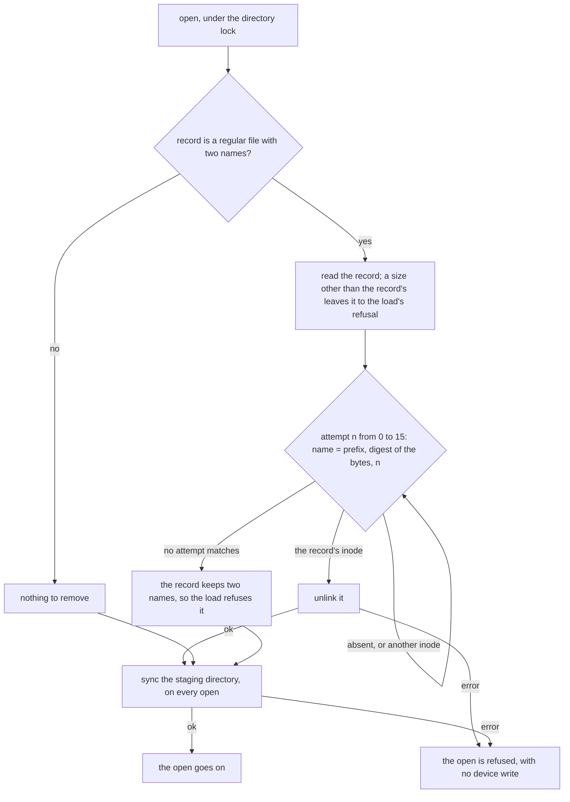

Only the record's own inode is removed, and only at a name this store derives from the record. Any other entry at those
names is left alone, so a second name that is not this store's is refused, not removed.
- **Publication.** The fresh file is locked before writing, synced, then renamed from staging to the parent; its inode
  lock is retained without a gap. The parent is synced first, then staging. Before rename a failure leaves the record
  unchanged and cleanup is best effort. After rename, a sync failure returns an error without rollback; the new record is
  visible but crash durability is unconfirmed. A resume syncs both directories again (`confirm_stored`) before it writes,
  and refuses the record until a sync succeeds. Recovery after a crash relies on the filesystem's atomic cross-directory
  rename and sync guarantees; both directories must sync for success.

If the canonical directory has an invalid marker, stop all updaters and inspect it before repairing or moving it aside. An
initialization directory that holds anything beyond its marker is refused, and its entries are left alone. Its owner
permissions are restored only where a check needs them, which is when the owner could not read or search it, so its mode
may have changed: the restored mode is `0700`, and the refusal's message does not establish whether a restoration happened, so
the mode before the run decides it. Inspect the directory before moving anything aside. `docs/checkpoint.md` §5.4 says how
to resolve the checkpoint's directory once, from the `--checkpoint` value and the working directory the refusing run was
started in, which owner permission to grant, and how to move an entry aside with one procedure that names its source first
and checks the destination against the record's name and the store's own prefix, then moves with a no-replace move, so an
existing entry is never replaced and the source is never nested inside it. Cleanup is best effort, so an operator may need to
inspect remaining debris. Legacy siblings are never swept: do not assume a matching name proves ownership before manual
removal. The procedure for each refusal, and for a record with a second name, is in `docs/checkpoint.md` §5.4.

### 10.7 The publication seam, and a race test that does not depend on timing

A new lock file is published by a link, and two contenders can both see its name absent (§9.1). The seam sits at that point.
`take_in` calls its `before_publish` closure after it has found the name absent and before it attempts the link. In
production the closure does nothing. A test uses it to hold each contender at the same point, so that every contender
attempts the link while the name is still free.

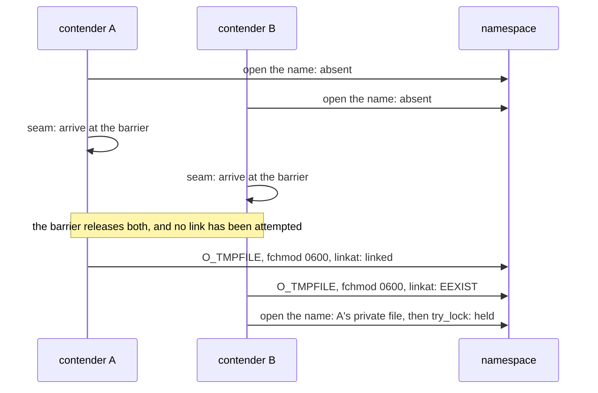

The order of the two links is not fixed, and the assertions hold for either order:

- Three contenders. Exactly one result holds the lock, and each of the others is `Held`. The name exists once, with mode
  `0600`. This is `filelock.rs::contenders_that_all_see_a_new_name_absent_publish_one_file_and_the_others_are_held_by_it`.
- A contender whose mode change fails at the seam. It stops before its link, so it publishes no name, and its rival
  publishes one. This is `filelock.rs::a_contender_whose_mode_change_fails_at_publication_publishes_no_name_while_its_rival_publishes_one`.
- An injected mode failure is counted, so the test shows that the failure happened and not only that no name is left.
  This is `filelock.rs::an_injected_mode_failure_is_reached_and_publishes_no_name_and_a_later_take_succeeds`.
- The seam runs only when the name is absent. This is `filelock.rs::the_publication_seam_runs_only_when_the_name_is_absent`.

The six-contender race in `tests/umask.rs` is removed. Its barrier stood at function entry, so the interleaving that the
test relied on was up to the scheduler. The umask test keeps what the race was for: under a restrictive umask, a failed
mode change publishes no name, and a later take creates a private file. The contention itself is now tested above.

### 10.8 What the tool enforces, and what the host must provide

| Claim | Enforced by the tool | The host must |
| --- | --- | --- |
| Two roles that are one regular file are refused before device writes | identity comparison or an earlier lock refusal | keep the hierarchy trusted and stable |
| Two device nodes for one block device are refused as one device | yes: the device number is compared | not applicable |
| Two partitions of one disk are kept apart | no: they have different numbers, and the tool cannot see the overlap | keep their storage non-overlapping (`docs/platform.md` §2) |
| A writer and a reader of one identity exclude each other, in cooperating runs | yes, by advisory locks taken without waiting | run only cooperating updaters on the host, and do not mount the device |
| A writer that takes no lock is excluded | no: advisory locks stop only processes that take them | exclude every other writer, including a mounted filesystem and a second handle |
| Only eligible staging entries are swept | within the validated private namespace: exact form, regular type and one link, under the directory lock | trust the parent and updater user; never infer ownership from the prefix alone |
| Every stale file is removed durably | no: a sweep is bounded, best effort and not explicitly synced; a replacement's own removals are synced by its staging sync | inspect debris when needed |
| The locks hold on the deployment's filesystem | not checked: `flock` behaves differently on some network and FUSE filesystems | validate the locks on the filesystem (§6) |

### 10.9 Platform validation that remains

- **Two nodes for one real block device.** `tests/locks.rs::two_device_nodes_for_one_block_device_contend_through_the_namespace`
  runs only when `OTA_TEST_BLOCK_DEVICE` names a block device the test may lock, and the process may create device nodes.
  It checks identity and alias refusal using metadata-only `O_PATH` handles, and checks shared and exclusive namespace lock
  contention. It never applies a payload or reads or writes the device. It was not run in this sandbox, which has no block device the tests may use
  (`docs/locking-and-recovery.md` §6).
- **Power cut** during staging initialization, creation, cross-directory rename, sync or sweep. Validate recovery on
  the deployment filesystem. An interrupted initialization is completed by the next open; an invalid marker on the
  canonical directory still requires operator intervention (§10.6).
- **Filesystem locks** on the namespace and on the devices, shared and exclusive, on the deployment's storage.
- **Non-overlap** of the partitions named to one run, which only the platform can establish.
- **Writers outside the tool**, which the advisory locks cannot see.

### 10.10 Test map

| Claim | Test |
| --- | --- |
| a block device's identity is its device number, a file's is its device and inode, and the variants never match | `identity.rs`: `a_block_device_is_identified_by_its_number_whatever_its_node`, `a_block_device_is_never_the_same_as_a_file`, `a_regular_file_is_identified_by_its_device_and_inode`, `a_symbolic_link_is_its_own_entry_and_not_its_targets` |
| two nodes with one device number are one device, another number is not, and a block device is not a file | `roles.rs`: `two_block_device_nodes_with_one_device_number_are_one_device_and_another_number_is_another`, `a_block_device_is_never_the_same_object_as_a_regular_file` |
| a shared lock admits another reader and refuses a writer of one file, through any link | `filelock.rs`: `a_shared_lock_admits_another_reader_and_refuses_a_writer_of_the_same_file`, `a_writer_is_refused_through_any_hard_link_while_a_reader_of_another_link_holds_the_file` |
| a shared lock on a block device's lock file admits readers and refuses a writer | `filelock.rs::a_shared_block_lock_file_admits_readers_and_refuses_a_writer_of_the_same_device_number` |
| the lock is keyed by file type and device number | `filelock.rs::the_lock_follows_the_device_number_and_other_file_types_are_refused` |
| a device-payload alias is refused before the device identity lock | `roles.rs::a_device_that_is_the_payload_is_refused_as_an_alias_even_while_the_payload_is_held_for_reading` |
| an old image held for writing refuses the run, and the device lock taken before it is released | `roles.rs::an_old_image_held_for_writing_by_another_run_is_refused_and_the_device_lock_it_took_is_released`, `locks.rs::an_old_image_that_another_run_writes_is_refused_on_both_paths_and_nothing_is_written` |
| an old image read by another run is shared, a writer of it is refused, and unrelated files proceed | `roles.rs::an_old_image_read_by_another_run_is_shared_with_this_run_but_a_writer_on_it_is_refused`, `roles.rs::an_unrelated_device_and_old_image_proceed_while_another_run_holds_a_third_file`, `locks.rs::an_old_image_that_another_run_reads_is_shared_with_this_run_and_refuses_a_writer_of_it`, `locks.rs::an_old_image_and_a_device_that_no_other_run_names_proceed_while_unrelated_files_are_held` |
| a streamed payload held for writing is refused before it is read, and one held for reading proceeds | `locks.rs::a_streamed_payload_that_another_run_writes_is_refused_before_it_is_read`, `locks.rs::a_streamed_payload_that_another_run_reads_is_shared_and_the_streamed_update_proceeds` |
| an old image that is a named pipe is refused without waiting for a writer | `roles.rs::an_old_image_that_is_a_named_pipe_is_refused_without_waiting_for_a_writer` |
| a reset does not open `-s`, and its own checks still decide it | `reset.rs::a_reset_does_not_open_the_old_image_so_a_missing_source_path_does_not_fail_it`, `reset.rs::a_reset_does_not_refuse_a_source_that_aliases_the_device`, `reset.rs::a_base_dependent_reset_still_refuses_for_its_own_base_whatever_source_is_named` |
| a staging name has the store's form only, a second link under another record's name is left alone, and eligible files in a full window can be swept | `filecheckpoint.rs::only_the_form_this_store_makes_is_a_staging_name`, `filecheckpoint.rs::a_second_link_under_another_records_name_is_left_alone_and_the_record_stays_refused`, `filecheckpoint.rs::stale_staging_files_that_take_every_name_a_replacement_tries_are_removed_and_the_replacement_proceeds` |
| a replacement whose 16 names are occupied removes the single-link files among them past a full sweep window, keeps links and other entries, and fails before rename on a failed look-up or removal | `filecheckpoint.rs::stale_files_at_every_name_of_a_replacement_past_a_full_sweep_window_are_removed_and_the_entries_that_cannot_be_removed_stay`, `filecheckpoint.rs::remove_stale_candidates_removes_only_single_link_files_at_its_own_names`, `filecheckpoint.rs::a_failed_look_up_or_removal_of_a_stale_candidate_is_an_error_and_keeps_the_candidates` |
| a record's second link is removed by lookup past a full sweep window, and each of its look-up, removal and sync failures refuses the open | `filecheckpoint.rs::the_record_staging_link_is_removed_on_open_even_past_a_full_sweep_window_of_entries_that_cannot_be_removed`, `filecheckpoint.rs::a_failed_look_up_while_removing_the_link_is_an_error_and_the_link_is_kept`, `filecheckpoint.rs::a_link_that_cannot_be_removed_refuses_the_open_and_the_next_open_removes_it`, `filecheckpoint.rs::a_removal_that_is_not_confirmed_durable_refuses_every_open_until_a_sync_confirms_it`, `filecheckpoint.rs::every_open_syncs_the_staging_directory_even_when_no_second_link_is_found` |
| a failed listing leaves the sweep's debris and does not affect the record's own link | `filecheckpoint.rs::a_failed_listing_leaves_the_debris_and_the_record_link_is_still_found_by_name` |
| initialization under restrictive umasks is completed by the next open | `filecheckpoint.rs::an_initialization_left_with_umask_modes_is_completed_by_the_next_open_at_every_step`, `ota-cli/tests/staging_umask.rs` |
| entries of another form that fill a window are not removed, and the record is kept | `filecheckpoint.rs::entries_of_another_form_that_take_every_name_are_not_removed_and_the_replacement_fails_keeping_the_record` |
| a store resumes its record after an interrupted replacement | `filecheckpoint.rs::a_later_store_resumes_its_record_past_the_staging_file_of_an_interrupted_replacement` |
| a visible record whose sync failed is refused until confirmed, and a crash keeps or loses its rename | `filecheckpoint.rs::a_renamed_record_whose_directory_sync_failed_is_visible_but_refused_until_a_confirmation_succeeds`, `filecheckpoint.rs::a_crash_that_keeps_an_unconfirmed_rename_resumes_the_new_record_once_it_is_confirmed`, `filecheckpoint.rs::a_crash_that_loses_an_unconfirmed_rename_leaves_the_previous_record_which_confirms_and_resumes` |
| a second link to the record left by an unfinished publication is removed on open | `filecheckpoint.rs::a_second_link_to_the_record_left_by_an_unfinished_publication_is_removed_on_open` |
| an initialization interrupted at any step, and at any pair of steps, completes, and no canonical directory lacks its marker | `filecheckpoint.rs::an_initialization_interrupted_at_any_step_is_completed_by_the_next_open_and_never_published_without_its_marker` |
| a torn marker is discarded and made again; an initialization directory of another shape is refused, and keeps its mode when its owner can read and search it; a directory the owner can read but not search has its owner bits restored before its marker is checked; a refused marker in a directory the owner cannot read is restored, and its refusal names read and search; a directory the owner cannot search can be moved aside whole, and the next open starts afresh | `filecheckpoint.rs::a_torn_marker_in_an_abandoned_initialization_is_discarded_and_made_again`, `filecheckpoint.rs::an_initialization_directory_that_is_not_its_own_shape_is_refused_and_untouched`, `filecheckpoint.rs::an_initialization_directory_the_owner_can_read_is_refused_with_its_mode_and_entries_kept`, `filecheckpoint.rs::an_initialization_directory_the_owner_cannot_read_has_its_owner_bits_restored_before_the_refusal`, `filecheckpoint.rs::a_refused_marker_in_a_directory_the_owner_cannot_read_restores_its_mode_and_the_refusal_names_read_and_search`, `filecheckpoint.rs::an_initialization_directory_the_owner_can_search_keeps_its_mode_when_its_sole_marker_is_refused`, `filecheckpoint.rs::a_torn_marker_in_an_initialization_directory_the_owner_can_search_is_still_repaired`, `filecheckpoint.rs::a_directory_the_owner_can_read_but_not_search_has_its_owner_bits_restored_before_its_marker_is_checked`, `filecheckpoint.rs::an_initialization_directory_the_owner_cannot_search_is_moved_aside_whole_and_the_next_open_starts_afresh` |
| a visible unconfirmed record on the file store, under a real apply, is refused with no write until confirmed | `ota-cli/tests/durability.rs` |
| contenders for a new name meet at the publication point, one publishes, and the rest are held | `filelock.rs::contenders_that_all_see_a_new_name_absent_publish_one_file_and_the_others_are_held_by_it` |
| a failed mode change publishes no name, and its rival publishes one | `filelock.rs::a_contender_whose_mode_change_fails_at_publication_publishes_no_name_while_its_rival_publishes_one`, `filelock.rs::an_injected_mode_failure_is_reached_and_publishes_no_name_and_a_later_take_succeeds` |
| two nodes for one real block device contend and are refused as one device | `tests/locks.rs::two_device_nodes_for_one_block_device_contend_through_the_namespace`, env-gated (§10.9) |

## 11. Entry locks, pinned role parents and trust boundaries

### 11.1 Why both entry and inode locks

A checkpoint may not exist yet, and replacement changes its inode. An inode lock alone cannot protect that name across
absence, publication or removal. Conversely, two hard links are different directory entries for the same inode, so an
entry lock alone cannot protect the underlying storage. The implementation uses both, in addition to the checkpoint's
per-directory lock:

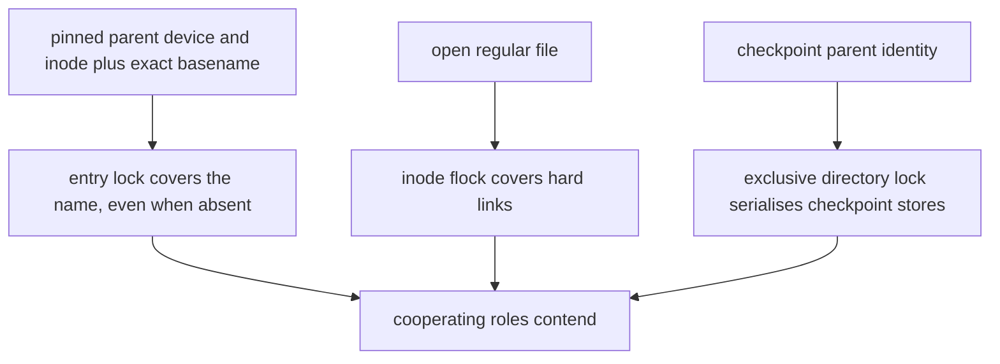

### 11.2 Entry identity and pinned opens

`entry-<sha256>.lock` is keyed by the parent handle's `(st_dev, st_ino)` and the exact UTF-8 basename. The checkpoint
and device take it exclusively; the old image and streamed payload take it shared. A same-entry writer and reader
contend even if the record is currently absent. Two readers can share it. Lock files live in the validated common
namespace and are retained, not unlinked.

For device, old image and streamed payload, `role_entry` opens the parent, obtains the identity from that handle, takes
the entry lock, then the role is opened with `openat` on that same pinned parent, `O_NOFOLLOW` and `O_NONBLOCK`.
Parent symlinks may be followed when opening the parent; later retargeting cannot redirect the role open. A final symlink,
including a dangling one, is refused. Checkpoint record operations use their own pinned parent and likewise refuse final
symlinks on load. Buffered and reset payloads instead use ordinary `File::open`: they can follow a final symlink and have
no payload entry or identity lock.

### 11.3 Inode and device identity locks

Regular role files are locked with shared or exclusive `flock` on the open file, so a different hard link contends.
Block devices instead use a namespace lock keyed by `st_rdev`; separate nodes for the same device contend. The store
locks an existing regular record inode exclusively before load and refuses a record with more than one hard link on
load. Each fresh staging inode is locked before publication, and the store retains that same lock after rename; clearing
the record drops its inode lock after successful unlink. These are advisory protections for cooperating runs, not barriers
to arbitrary filesystem operations.

### 11.4 Ordering and alias checks

The complete streamed order is in §10.3. The store's entry, directory and existing record inode locks precede device
and old-image entry locks; their identity locks follow comparison. `roles::open` remembers entry locks already held by
the store or payload and avoids taking those same lock names twice, so a same-entry device or old-image alias can be
reported by the identity comparison instead of self-contention. A streamed payload already holds its locks before store
open; a checkpoint alias can fail earlier, and the code attempts to improve that error by comparing the payload with a
path lookup. That diagnostic lookup does not authorize any operation. All lock attempts are nonblocking.

### 11.5 Streamed payload pin lifetime

`PayloadPin` owns the shared entry lock, its open file and the shared identity lock (or block lock file). It is acquired
before metadata is read. Later sources clone the same open file rather than reopening the path. `run_stream` keeps the pin
outside the one-shot source-opening closure, through `apply`, final target verification, completion-record replacement,
and re-verification of an already complete update. The test seams in `ota-cli/tests/stream-locks.rs` probe the locks at
those points; the test helper exercises the library path, while `main.rs` shows the CLI pin lifetime. Buffered apply and
reset do not have this protection during their initial read; the host must keep their payload stable.

### 11.6 Limits and platform responsibilities

- **Advisory, shared protocol.** All participants must use the same trusted lock namespace and protocol. A nonparticipant,
  mounted filesystem or same-user process can write, rename or unlink despite locks. Parent pinning does not prevent an
  attacker from modifying entries in that directory. Keep the checkpoint parent, staging directory, namespace and their
  hierarchy trusted and exclude other writers.
- **Naming aliases.** Entry locks hash exact bytes, not the filesystem's equivalence classes. The per-directory lock
  serialises checkpoint stores even with different spellings, but other roles do not take that lock. In a casefolded
  directory, a differently spelled role may evade an entry lock, especially when the checkpoint is absent or being
  replaced. The checkpoint's ASCII case probe checks one name at one moment, not every alias or future flag change;
  it does not validate other roles' directories. The platform must prohibit casefold, normalization, short-name and
  other aliases that make distinct role basenames resolve to the same entry.
- **Reserved ancestry.** Role checks reject reserved path components and walk pinned ancestors, comparing each with its
  parent's `.ota-checkpoint.staging` entry; `/proc/self/fd` adds resolved-name checks when available. This is not a
  sandbox: bind mounts, a staging directory already renamed, and concurrent ancestor renames can evade the ancestry
  check. Keep the hierarchy stable and trusted, including mount topology. Checkpoint paths use the store's own name
  validation, not the full role ancestry walk.
- **Storage overlap.** Distinct device numbers and file identities do not prove disjoint storage: overlapping partitions,
  device mappings or a file backed by the target can evade identity checks. The platform must establish non-overlap among
  payload, checkpoint, old image and device storage, and keep the checkpoint off storage the update writes.
- **Filesystem semantics.** Validate advisory shared/exclusive locks and atomic cross-directory rename, file sync and both
  directory syncs on deployment storage, including network or FUSE filesystems if used. Sweeps require procfs to enumerate;
  if unavailable they silently leave debris. The lock-file publication path separately requires `O_TMPFILE` and procfs
  linking (§9.1).

Relevant regression tests include the entry and hard-link cases in `ota-cli/src/filelock.rs`, pinned-parent and final-link
cases in `ota-cli/src/roles.rs` and `ota-cli/src/filesource.rs`, staging marker and bounded sweep cases in
`ota-cli/src/filecheckpoint.rs`, and `ota-cli/tests/stream-locks.rs`. Tests do not establish mount-topology safety or
real power-loss guarantees.
