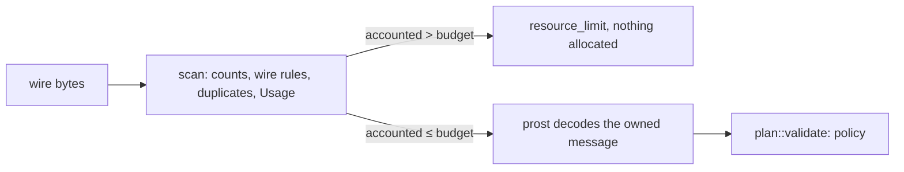
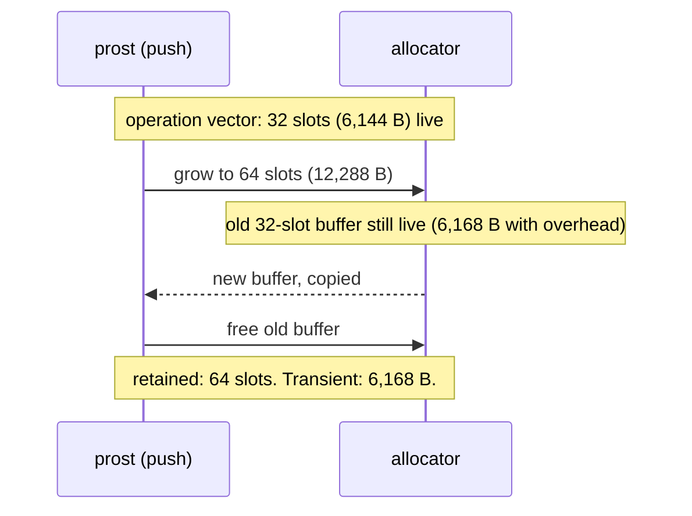
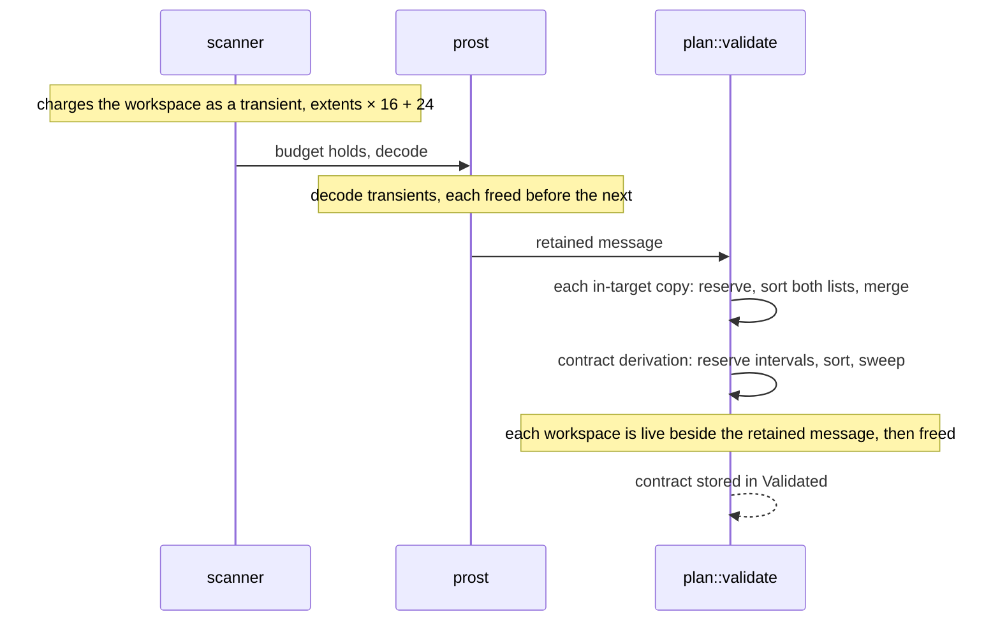
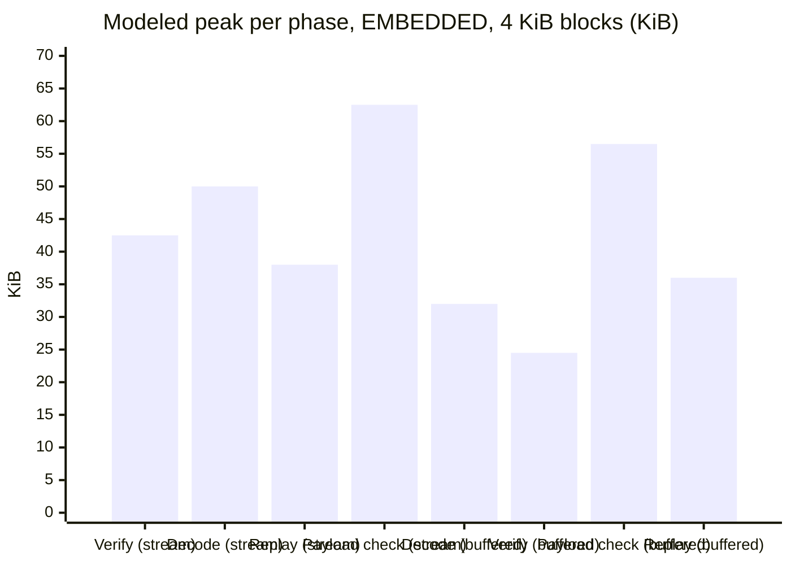
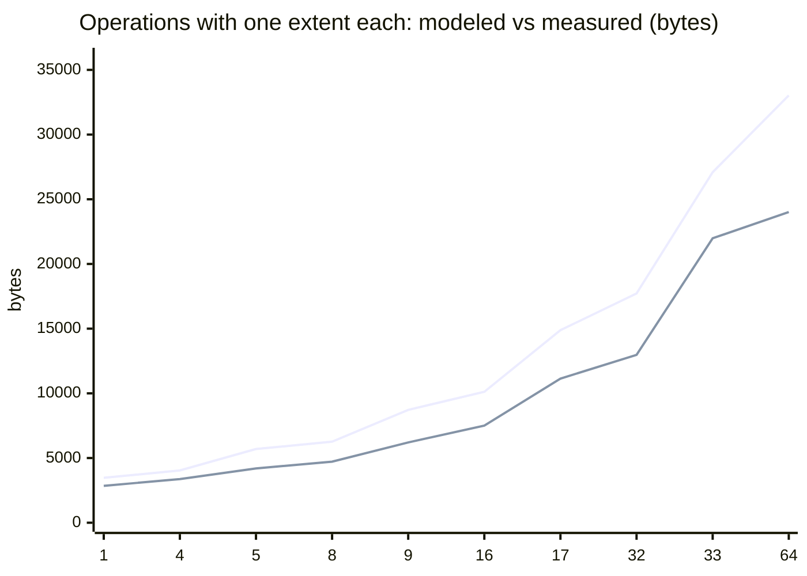
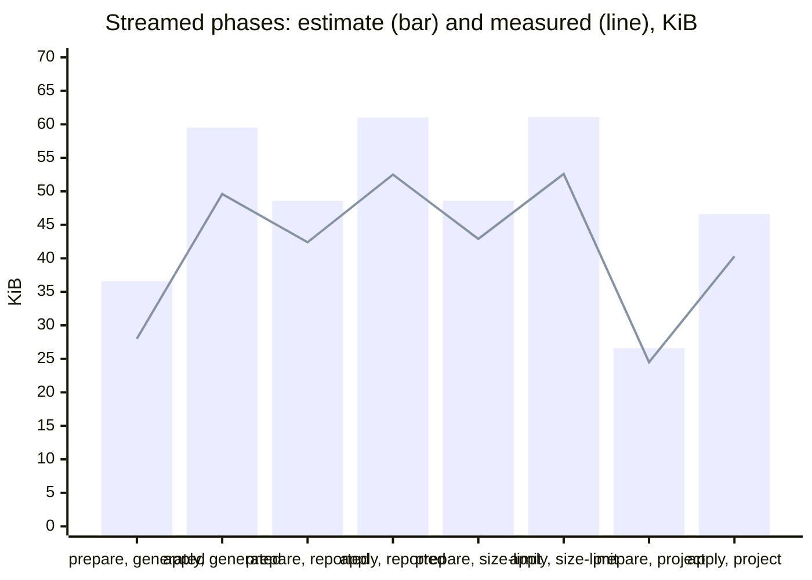

# Decoded-memory model

The client decodes untrusted metadata with prost, and prost allocates as it
decodes. Before it runs, the pre-decode scan must know how much memory the
decoded message will hold, and it must refuse anything over the budget. This
document describes that model, the allocator behaviour it assumes, the input
policy that keeps it exact, the phases that combine into the device's memory
peak, and what has and has not been measured.

Three kinds of figure appear here, and they are labelled throughout:

| Kind | Source | Trust |
| --- | --- | --- |
| **Enforced model limit** | `delta_update_payload::profile::Usage` and the scanner's count and size checks, computed from wire bytes | Enforced before prost allocates. Each bound is an upper bound, under the assumptions in §3. |
| **Host measurement** | `delta-update-client/tests/peak_memory.rs`, `peak_stream.rs`, `peak_completed.rs` | A counting allocator on the host, simulating the target's worst cases (§3). It is not a measurement of the device. |
| **Unmeasured** | not measured anywhere | Device RAM, stack, the real allocator and its fragmentation, and the riscv32 runtime. No emulator is available. |

## 1. What is bounded, and how



- **Counts** (operations, extents, partitions, signature entries) and **sizes**
  (strings, hashes, signature data) are checked during the walk, as the wire is
  read. These are the wire-level limits in `docs/protobuf.md`.
- **Repeated singular fields** are refused during the same walk (§2.3). A second
  byte, string or message field is `bad_protobuf`, before prost runs.
- **Memory** is the modeled decode peak, `Usage::accounted()`, checked once the
  walk completes and before prost allocates. The budget is
  `EMBEDDED.max_decoded_bytes` (32 KiB) for a manifest, and the same budget for a
  signature message.
- The **generator** runs the same scan (`evaluate::payload_size`), so it refuses a program
  until the modeled cost fits, rather than producing a manifest the client refuses.

The model is deliberately conservative, and the rest of this document checks
that it is. A prescan-directed decoder, which allocates each vector exactly once,
was considered. It was not needed: the conservative model still admits every
manifest the generator emits under the embedded profile, and the stricter budget
only moves the coalescing boundary (§5.2).

## 2. The model

`accounted = slot bytes + heap bytes + transient bytes`

| Component | Charge | Reason |
| --- | --- | --- |
| top-level struct | `MANIFEST_COST` 256 B, or `SIGNATURES_COST` 32 B | The owned value is held by the prepared state. |
| element storage | `vec_slots(n) × element bound` | A `Vec` filled by `push` has capacity `max(4, next_pow2(n))`, so the allocation can exceed `n`. |
| vector buffer | `ALLOC_OVERHEAD` (24 B) per non-empty vector | Each vector is one allocation, and each allocation carries bookkeeping. |
| byte or string field | `max(len, 8) + 24` per non-empty field | prost fills the field through a `Vec<u8>`, whose minimum non-zero capacity is 8. |
| transient | the **largest** single temporary, see below | Charged once, because only one temporary is live at a time. |
| contract workspace, also the copy check's | `16 × extents + 24` as a transient | Live beside the decoded message during validation, which runs after decoding. Shared by the contract derivation and the copy check (§2.5). |

Element bounds (`OP_COST` 192, `EXTENT_COST` 32, `PARTITION_COST` 512,
`SIGNATURE_COST` 48) are upper bounds on the host `size_of` of the prost types.
A `const` assertion in `delta_update_payload::manifest` checks each bound at compile time,
for every target, including riscv32.

### 2.1 Transients

There are two sources of transient memory, and both are modeled.



Growth is allocate-copy-free: the new buffer exists before the old one is freed,
so both are live at the copy. A vector that grows from `s/2` to `s` slots has
a transient of `(s/2) × element + 24`. Below the minimum capacity of 4 there is no
old buffer, so there is no transient.

A byte or string field is filled in place. prost 0.14.4 gives its `Vec<u8>` a
`reserve` and then copies the bytes into it, so the field's buffer is the only
allocation for that field. The model still charges that buffer as the transient
as well as in the heap. That charge is conservative: it counts the field's
buffer twice, and it is not the size of any temporary (§3, A4).

### 2.2 Why the transient is a maximum, not a sum

Decoding is sequential. A growth never runs inside another growth, and each
allocation that is a transient is live only while its field or vector is being
built. So at most one transient is live at any moment, and the peak is
`retained + max(transient)`. Summing the transients would still be a valid
bound, but it charges every hash as if all of them were being built at once. That
is needlessly strict. Under the sum, the budget edge in §5.2 would drop from 45
operations to roughly 32.

This argument needs one more fact: each singular byte, string and message field
is decoded once. §2.3 is the policy that guarantees it.

### 2.3 Repeated singular fields are refused

The scanner refuses a second occurrence of any singular byte, string or message
field. It returns `bad_protobuf` before prost runs. Repeated scalars and repeated
unknown fields are accepted, as protobuf allows.

| Field kind | Examples | Policy |
| --- | --- | --- |
| repeated message or repeated extents | operations, extents, partitions, signature entries | Accepted. Each is counted against its own limit. |
| unknown field, any number of times | field 40, repeated | Accepted and skipped. |
| singular scalar | `block_size`, `type`, `data_offset`, `size` | Accepted. The last value wins, and prost allocates nothing for it. |
| singular byte or string | `data`, `data_sha256_hash`, `partition_name`, `security_patch_level` | **Refused** on a second occurrence. |
| singular message | `old_partition_info`, `new_partition_info` | **Refused** on a second occurrence. |

**Why this policy.** prost replaces a repeated singular byte or string in place,
and merges a repeated singular message into the one it already holds. The model
charges one buffer per field, so a second occurrence would add a regrowth whose
size depends on both lengths. The model already over-charges such input, since it
charges each occurrence in full, and prost's regrowth is at most twice the new
length. The rule removes that argument. Each field is then one allocation, which
the model charges exactly, and the single-transient rule of §2.2 holds by
construction.

**What the rule does not claim.** It does not fix an under-count. A probe of the
reported `data` sequence, 256 bytes and then 257, measured 1,072 B against a
modeled 1,090 B when both occurrences were charged, so that sequence was already
inside the model. The rule narrows the accepted encodings instead. The cost is
that some legal protobuf encodings are refused. The generator never produces
them, because prost's encoder writes each field once. Such payloads come from
hand-built or foreign encoders.

The phase figures in §4 also depend on this section. The metadata-verification
figure was previously set from one signature entry. A three-entry message is a
different shape, and §4 corrects that figure.

### 2.4 A worked example

One operation, one destination extent, a 32-byte data hash, partition name `A/B`:

| Item | Bytes |
| --- | --- |
| manifest struct | 256 |
| partition vector, 4 slots × 512 | 2,048 |
| operation vector, 4 slots × 192 | 768 |
| destination extent vector, 4 slots × 32 | 128 |
| retained buffers: 3 vectors + name (8 + 24) + hash (32 + 24) | 160 |
| transient: the hash buffer (32 + 24) | 56 |
| **accounted** | **3,416** |

The same arithmetic is pinned by `prescan::tests::accounting_charges_every_buffer_and_its_overhead`.

### 2.5 The contract workspace

`plan::validate` uses sorted intervals in two places, and each reserves its workspace before filling
it, with `try_reserve_exact`, so a list the allocator refuses is a `resource_limit` and not an abort.

- **The contract derivation** sorts one interval per destination extent of the program and sweeps
  them for coverage. It runs once, and no later apply or reset derives the contract again
  (`docs/client.md` §11).
- **The copy check** sorts the source and destination intervals of one in-target copy and merges
  them, so that its overlap cost is `n log n` rather than the product of the two lists
  (`docs/client.md` §3.2). It runs once per in-target copy, and each run reserves its own workspace.

Both use `SPAN_COST` (16 B) per interval. The scanner charges one workspace for the whole manifest,
as a transient, before its budget check:

```text
contract workspace = extents × 16 + 24          (Usage::temporary, prescan::scan_manifest)
```

`extents` counts source and destination extents together. The derivation holds at most one interval
per destination extent, and the copy check holds one per extent of a single operation. Both are at
most the total the scanner admits, so one charge bounds them both. The copy check adds no term to the
model. Its workspace is one operation's extents, and an operation's extents are part of the total.
No figure in the table below changes.

The charge is a transient rather than a separate term, for the reason in §2.2. Validation runs
after the message is decoded, so the workspace is never live beside a decoder temporary, and the
largest transient covers it. It is live beside the retained message, which the budget also
bounds, so `retained + workspace ≤ accounted ≤ max_decoded_bytes`.

The generator's device charges the same workspace in its size shader, with the same zero-extent and
maximum-of-transients rules, so the search and the client agree on every budget
(`docs/generator.md` §5.3, `docs/locking-and-recovery.md` §4).



Where the charge changes the largest transient, the effect is small:

| Shape | Workspace | Largest transient before | Largest transient now |
| --- | --- | --- | --- |
| 4 operations × 1 extent | 88 B | 32 B (name copy) | 88 B |
| 2 operations × 64 extents | 2,072 B | 1,048 B (extent growth) | 2,072 B |
| 45 operations × 1 extent (budget edge) | 744 B | 6,168 B (operation growth) | 6,168 B, unchanged |
| 64 operations × 2 extents (budget edge) | 2,072 B | 6,168 B (operation growth) | 6,168 B, unchanged |

The workspace matters only when few operations carry many extents, because then no operation
vector grows large enough to dominate. The budget edges in §5.2 are unchanged. The four-operation
figure moved by 56 B, so the step from four to five operations is 1,624 B.

## 3. Allocator assumptions

Every modeled bound holds only under these assumptions. Each one is named, so
that a different target can be checked against it.

| # | Assumption | Evidence | If it is false |
| --- | --- | --- | --- |
| A1 | An allocation costs its size plus at most 24 B of bookkeeping and rounding. | Simulated in `common/mod.rs`: `round16(size + 8)`, at most size + 23. | Raise `ALLOC_OVERHEAD`. The budget then binds earlier, and the generator coalesces more. |
| A2 | `realloc` is allocate-copy-free: the old and new buffers are live together. | The host allocator is modeled to do this explicitly. | An in-place allocator only lowers the real peak, so the model still holds. |
| A3 | Vectors grow by doubling from 4 slots (8 bytes for byte vectors). | Rust's `RawVec` policy, via `min_non_zero_cap`. Checked by the grid test. | A different policy changes `vec_slots`, and the grid test would fail. |
| A4 | Each byte field is one allocation of `max(len, 8)`, filled in place. | prost 0.14.4 `Vec<u8>::replace_with` (`clear`, `reserve`, copy); the generated fields are `Vec<u8>`. | Not a risk to the bound: the model charges the buffer twice. The measured three-entry signature decode is 2,288 B, and without the byte transient the model would be 1,856 B, so that transient is what covers it. The allocation behind that measured excess is not identified. |
| A5 | Decoding is sequential, so at most one transient is live at a time. | Read from the decoder: no nested growth or copy. | The peak would be the sum of transients. §2.2 explains why that is not needed. |
| A6 | Not modeled: fragmentation, alignment beyond the granule, stack, and the RSA workspace. | Stack and fragmentation are unmeasured. The RSA workspace is measured as an allowance (§5.5). | These must be covered by device headroom, which is unmeasured. |
| A7 | Each singular byte, string and message field is decoded once. | The scanner refuses a second occurrence (§2.3). Tests: `prescan::duplicate_*`, `verify::duplicate_signature_data_is_refused_before_any_entry_is_checked`. | Replacement or merge would add a regrowth the model does not charge. §2.3 bounds that growth at twice the new length, so a model extension would be needed, not a larger budget. |

`ALLOC_OVERHEAD` was 16 B before this change. A simulated allocator with an
8-byte header and 16-byte granules can add up to 23 B, so 16 was not a bound for
that allocator. The value is now 24.

## 4. Phases

The device holds several allocations at once only inside a phase. Each phase's
peak is its live set, so each estimate is a sum of the terms live in it. The
signature-verification phases add two terms, which are the decode of the
signature message and the RSA workspace:

```text
verification estimate = existing live allocations
                      + signature decode peak (scanner model, this message)
                      + RSA workspace allowance (host-measured)
```

Adding the two terms is conservative, since their peaks do not coincide. The
RSA allowance is a host-measured figure, not a formally established bound (§5.5).

The universal figures for the streamed pipeline under `EMBEDDED` are:

| Term | Value | Source |
| --- | --- | --- |
| raw manifest buffer | 16,408 B = 16,384 + 24 | Largest encoded manifest, plus the allocator overhead. |
| signature slot | 2,072 B = 2,048 + 24 | `max_signature_message`, plus the overhead. |
| chunk buffer | 4,120 B = 4,096 + 24 | One chunk buffer, plus the overhead. Every operation, of any size, is replayed through it. |
| decoded manifest | ≤ 32,768 B | The scanner's budget. Every admitted manifest is under it. |
| signature decode | ≤ 2,904 B | Four entries of 512, 512, 488 and 512 data bytes, omitting optional size and version fields, fill the 2,048-byte limit exactly. |
| RSA-4096 workspace | 22,176 B | Measured alone, §5.5. |
| zlib codec | 10,524 B = 10,500 + 24 (riscv32); 10,528 B on the host | `DECODER_STATE_BYTES` plus the allocator overhead. One allocation, released when replay returns. |
| zlib staging block | 4,120 B = 4,096 + 24 | One block, allocated when replay starts if a frames or sparse operation is still to be replayed. A completed re-apply, or a run resuming at `AwaitingFinal`, replays nothing and never allocates it (`docs/client.md` §7.1). |

| Phase | Memory that must be considered together | Modeled peak |
| --- | --- | --- |
| Metadata verification, streamed | raw manifest + signature slot + signature decode + RSA-4096 | 43,560 B |
| Manifest decoding, streamed | raw manifest + signature slot + decoded | 51,248 B |
| Streaming replay, streamed | decoded + signature slot + one chunk | 38,960 B |
| **Payload-signature verification, streamed** | decoded + signature slot + one chunk + signature decode + RSA-4096 | **64,040 B** |
| Decoding, buffered | decoded (the payload is borrowed, not copied) | 32,768 B |
| Metadata verification, buffered | signature decode + RSA-4096 (no raw copy) | 25,080 B |
| Payload-signature verification, buffered | decoded + signature decode + RSA-4096 | 57,848 B |
| Replay, buffered | decoded + one block (4,096 + 24) | 36,888 B |
| Replay with zlib frames, streamed | decoded + signature slot + one chunk + staging block + codec | 53,604 B |



The largest phase is streamed payload-signature verification, at 64,040 B. Replay
with the codec, 53,604 B, is below it. Revision 17 replays through one chunk
buffer instead of two, which removed the compare buffer of the earlier read-back
resume, so both figures are 4,096 B below their revision-16 values. The two do not overlap,
because the codec is released before the payload signature is checked, so the
apply estimate is the larger of the two phases and not their sum. Both earlier figures used one signature entry's verification
allowance, 22,880 B, which includes that single entry's decode. A message with
three entries needs more than that. The reported shape, a 16 KiB manifest with
three RSA-4096 metadata entries, measured 42,400 B during preparation. That
exceeds the old metadata-verification figure of 41,312 B by 1,088 B. The estimate
now adds the decode model and the RSA allowance, separately.

**Validation.** The contract workspace (§2.5) lies inside the decoded budget, so validation adds no
term to any phase figure above. Its peak is the retained message plus a workspace no larger than
the budget's transient maximum, and that sum is already within `max_decoded_bytes`.

**Headroom.** The largest phase leaves 38,360 B (37.5 KiB) of a 100 KiB device
(102,400 B). That figure is arithmetic on the modeled bounds. It is not a
measurement, and it does not account for the stack or the device's allocator (§6).

## 5. Measurements

Every figure in this section comes from the simulated allocator, so debug and
release builds give the same numbers. The simulation counts allocations, and the
code allocates the same way at either optimization level. The release check is
`cargo test --release -p delta-update-client --test peak_memory --test peak_stream --test peak_completed`.

### 5.1 Host measurements, simulated allocator, manifests

`cargo test -p delta-update-client --test peak_memory -- --nocapture` decodes 229 manifest
shapes under the embedded profile with its budget lifted, so every count-valid
shape is compared with its model. The shapes are:

- a grid of operation counts (1, 4, 5, 8, 9, 16, 17, 32, 33, 64) crossed with
  extent counts (1 to 128) at each growth boundary, within the total-extent limit;
- six uneven mixes (staircase, alternating, source-heavy, straddling each
  boundary, one heavy operation, mixed), each with name and patch lengths at
  1, 7, 8, 9, 255 and 256 bytes;
- the admitted edge of §5.2.

Every shape has measured peak ≤ modeled. The largest ratio is 0.90, for 33
operations with one extent each (24,288 B against 27,088 B modeled).



The modeled curve steps where each vector doubles, and the measured curve steps
at the same points. The gap comes from the constants being upper bounds: an
operation struct is 168 B on the host and charged 192, and the simulated allocator
adds at most 23 B per block where the model adds 24.

### 5.2 The budget binds before the operation ceiling

The embedded profile's 64-operation ceiling is not all admissible together. The
scanner finds the largest count the budget admits for a shape with both hashes on
every operation:

| Extents per operation | Largest admitted | Modeled | Measured (simulated) |
| --- | --- | --- | --- |
| 1 | 45 operations | 32,720 B | 26,400 B |
| 2 | 45 operations | 32,720 B | 26,400 B |

The two rows agree because the extent list of each operation is one vector,
and a vector of 1 to 4 elements always costs four slots. The measured figure rose
from 24,096 B to 26,400 B when the operation struct grew to its current 192-byte
bound, which the `frame_table` field caused (`docs/format.md` §4.2). The modeled
figure and the edge are unchanged, because the bound is the same. At 64 operations with two
extents and both hashes the model is 37,736 B, which is refused. The generator
therefore coalesces that delta rather than emitting it.

`delta-update-client/tests/peak_memory.rs` checks both edges. 45 is admitted, and 46 is
refused with `resource_limit`.

### 5.3 The generator is unchanged in output

The stricter budget refuses the largest manifests, and the generator coalesces
them. The 16 MiB target-scale tests in `delta-update-client/tests/target_scale.rs` and the
generator's own target-scale tests pass unchanged, and they check that each
payload fits the embedded profile and applies through both pipelines. The
duplicate rule does not change the generator's output, because prost writes each
singular field once.

### 5.4 Signature messages: decode and verification

`peak_memory` measures each admitted signature shape in two windows. The decode
is measured alone against the scanner's model. The full verification, which
includes the decode and the RSA check, must stay within the model plus the RSA
allowance from §5.5. Every shape carries a valid entry, so each verification
authenticates.

| Shape | Bytes | Model | Decode measured | Verification measured | Bound: model + RSA |
| --- | --- | --- | --- | --- | --- |
| one RSA-4096 entry | 523 | 1,320 | 1,056 | 22,880 | 23,496 |
| three full-size entries | 1,569 | 2,392 | 2,288 | 23,936 | 24,568 |
| four entries, within the limit | 1,996 | 2,832 | 2,720 | 24,368 | 25,008 |
| mixed: empty and junk entries, valid last | 1,048 | 1,856 | 1,760 | 23,408 | 24,032 |
| three full-size, padded to the limit | 2,048 | 2,392 | 2,288 | 23,936 | 24,568 |
| four entries, sizes omitted | 2,048 | 2,904 | 2,784 | 24,432 | 25,080 |

The "four entries" shape has three 480-byte junk entries and one valid 512-byte
entry. Its encoded size is 1,996 B of the 2,048 B limit. The padded shape fills
the limit with an unknown field. The model ignores unknown fields, so padding
does not change the decode figure.

The size-omitted shape has 512, 512, 488 and 512 data bytes, with the valid
RSA-4096 signature last. Omitting `unpadded_signature_size` saves five bytes per
entry, so the four entries can hold 20 more data bytes than the previous
2,884-byte model maximum allowed. Without size or version fields, each entry
needs six framing bytes, leaving 2,024 data bytes in a 2,048-byte message. The
corrected modeled decode maximum is
`32 + (4 × 48 + 24) + (2,024 + 4 × 24) + (512 + 24) = 2,904 B`.
The regression pins both the encoded size and this model value, then checks
decoding and successful authentication within the estimate.

The decode is measured below the model in every shape. The tightest ratio is 0.96,
for omitted sizes (2,784 against 2,904). Verification stays below the model plus
the allowance, which is the bound the phase estimates use.

### 5.5 RSA workspace allowance

The RSA workspace is measured in its own window, with the key and the signature
prepared before the window opens, and only `rsa_verify` inside it. It is an
allowance under the simulated allocator. It is not a bound established for the
device.

| Key | Allowance (host-measured) | Used by |
| --- | --- | --- |
| RSA-2048 | 11,680 B | Not used in the phase tables; the largest admitted key sets the figure. |
| RSA-4096 | 22,176 B | Every verification phase. |

The allowance is the larger of one valid and one junk verification, since both
run the same arithmetic on full-size inputs. Earlier figures of 12,128 B and
22,880 B included the decode of one signature message. They are superseded by the
two terms measured separately.

### 5.6 End-to-end streamed peaks

`delta-update-client/tests/peak_stream.rs` streams three payloads through `stream::prepare`
and then `Prepared::apply`, counting every allocation in each window. The
windows open in pipeline order, so the apply window includes what prepare leaves
live.

| Fixture | Manifest | Metadata / payload entries | Prepare measured / estimate | Apply measured / estimate |
| --- | --- | --- | --- | --- |
| generator's payload | 2,632 B | 1 / 1 | 28,624 / 37,464 B | 50,800 / 60,960 B |
| reported shape | 16,384 B | 3 / 4 | **43,424 / 49,752 B** | 53,760 / 62,472 B |
| size-omitted signatures at limit | 16,384 B | 4 / 4 | 43,904 / 49,752 B | 53,872 / 62,544 B |
| every project operation (copy, frames, sparse, raw, zero) | 1,646 B | 1 / 4 | 25,088 / 27,238 B | 41,232 / 47,752 B |

Each estimate uses only the decode model of the fixture's own messages, the
allocator overhead of each buffer, and the RSA allowance measured alone. No
estimate is taken from a window that measures the pipeline. The prepare estimate
is the largest of its three moments: metadata verification, the decode, and the
scratch allocation. The apply estimate is the replay start plus the payload
signature's decode and RSA. The reported fixture's prepare peak, 43,424 B, is
the figure the revised estimate must cover, and it does. The apply window
measures only what the apply allocates while prepare's objects are live: the
fixture borrows its payload, because a copy made before the window and freed
inside it would lower the live charge the window starts from. The project fixture is the
only one whose apply window includes the codec. It has a copy, which reads the
old image through `apply_with_image`, so no image buffer is allocated. The size-limit fixture
omits optional sizes in both signature messages, exercising the 2,904-byte decode
maximum during metadata and payload verification.



### 5.7 Completed re-apply, and the fresh path against HEAD

`delta-update-client/tests/peak_completed.rs` re-applies a completed compressed update on the
streamed path. The first run is not measured. The window opens after `stream::prepare`,
so the figure is what the apply allocates above the prepared state. The bound is one
chunk buffer and one signature buffer, which are the only allocations a completed
re-apply makes (`docs/client.md` §7.1).

| Build | Trust | Peak above prepared state | Against the bound (4,400 B) |
| --- | --- | --- | --- |
| HEAD (chunk buffer, then staging frame) | unverified | 8,224 B = 4,112 + 4,112 | fails |
| this change (chunk buffer, then signature buffer) | unverified | 4,400 B = 4,112 + 288 | passes, exactly |
| HEAD and this change | verified, RSA-2048 | 16,528 B on both | the RSA workspace is the largest term, and the frame is never live beside it |

The verified row is equal on both builds, which is the expected result: HEAD released the
frame before the signature check, so the frame never shares a peak with the RSA workspace.

The fresh path is unchanged. HEAD and this change were built in separate target
directories and their release `peak_stream` and `peak_memory` binaries were run
alternately, three rounds, in one session. Every `peak_memory` line matched in all three
rounds. In the first two rounds every `peak_stream` line matched. In the third round the
search produced a different `generated` payload on the two builds, so the three fixtures
built from it (`generated`, `reported`, `size-limit`) differed, and the `project` fixture
still matched. The search-generated payloads therefore vary between runs. The figures in
§5.6 are not reproduced by this revision, since HEAD prints different values for them too.

### 5.8 Contract workspace

`delta-update-client/tests/peak_memory.rs` measures `validate` alone, with the decoded message already live,
for five shapes: 1×1, 1×2, 2×64, 1×128 and 8×16 destination extents. Each measured peak is at least
the workspace the derivation needs (`SPAN_COST` per interval) and at most that workspace plus the
24 B of allocator bookkeeping.

The copy check is measured the same way, on one `TARGET_COPY` of `n` source and `n` destination
extents, for `n` = 1, 16 and 64. A copy reads the target, so the contract derivation is not reached,
and the copy check's workspace is the only one validation allocates for these shapes. Each measured
peak is therefore at least `2n × SPAN_COST` and at most that plus 24 B. For a one-operation manifest
that is exactly the scanner's charge, so the charge is measured to cover the copy check. The test
does not print the peaks, so the figures are the bounds it enforces.

The check runs inside the single test function, because the counting allocator is shared and parallel
tests would distort each other's windows.

## 6. What is not measured, and what is not claimed

- **Device RAM.** No riscv32 runtime is available, so the device's heap, stack and
  allocator have not been measured.
- **The 100 KiB fit is not demonstrated.** The largest modeled phase is 68,136 B,
  and the remaining 34,264 B is arithmetic, not a measured property of the device.
  The remainder must cover the stack, the allocator's real overhead, and everything
  else.
- **The RSA workspace on the device.** §5.5 is a host measurement under the
  simulated allocator. The riscv32 build uses the same arithmetic, but its
  allocation pattern and digit width have not been measured.
- **Allocator overhead and fragmentation.** §3 A1 is a stated assumption, simulated
  on the host. Fragmentation is not modeled.
- **Stack.** Not measured at run time on any target. The compiled frame sizes below are from the
  riscv32 release build's assembly (`delta-update-client`, `riscv32imac-unknown-none-elf`), measured for this
  revision and for HEAD in a separate target directory: `apply::prepare` 1,408 B (HEAD 1,392 B),
  `decode_manifest` 560 B (HEAD 560 B), `plan::validate` 160 B (HEAD 96 B, the increase being
  `derive_contract` inlined into it), `BlockDecoder::new` 256 B and `BlockDecoder::decode` 32 B (both
  as HEAD). The inflate frame, 112 B in an earlier build, has not been re-measured. The frame figures
  of earlier revisions (640 B for prepare, 512 B for decode, 416 B for validate) did not match HEAD's own
  build, and are withdrawn. A debug build is much larger; an earlier measurement, not repeated here, put
  `BlockDecoder::new` at a 30,400-byte frame, because it builds the 10.5 KiB codec state on the stack before moving it to the heap
  (`docs/format.md` §11). **Device images must therefore be optimized builds.** The decoded message and
  the RSA workspace are on the heap.
- **The measured excess in signature decoding.** The three-entry decode measures
  2,288 B, which the model covers only with the byte transient (§3, A4). The
  allocation that produces the excess has not been identified.

## 7. What the tests pin

| Test | Claim |
| --- | --- |
| `prescan::accounting_charges_every_buffer_and_its_overhead` | Every buffer, its overhead, and the largest transient, to the byte. |
| `prescan::growth_is_a_transient_only_above_the_minimum_capacity` | Growth is charged only from the second allocation onward. |
| `prescan::only_the_largest_transient_is_charged` | The peak uses a maximum, not a sum. |
| `prescan::accounted_is_monotone_in_every_count` | Adding an operation or extent never lowers the model. |
| `prescan::count_limits_are_not_all_admissible_together` | The 64 × 2 × 2 shape is refused by the budget, not by a count. |
| `prescan::reported_signature_data_sequence_is_refused_in_prescan`, `duplicate_signature_data_is_refused_at_every_replacement_size`, `duplicate_strings_are_refused`, `duplicate_hashes_are_refused`, `duplicate_submessages_are_refused` | A second singular byte, string or message field is `bad_protobuf`, at every size pair tested. |
| `prescan::repeated_and_unknown_fields_remain_accepted` | Repeated operations, extents, signature entries, unknown fields and scalars are accepted. |
| `verify::duplicate_signature_data_is_refused_before_any_entry_is_checked` | The reported sequence, a valid 256-byte signature followed by 257 bytes, is refused before the valid entry is checked. |
| `peak_memory` grid, uneven and edge checks | Measured ≤ modeled at every growth boundary and uneven mix. |
| `peak_memory` budget check | 45 is admitted, 46 is refused, for both extent counts. |
| `peak_memory` signature shapes | Each shape decodes within its model and verifies within the model plus the RSA allowance; omitted sizes fill 2,048 encoded bytes and pin the 2,904-byte maximum. |
| `peak_stream` | All three fixtures stay within their phase estimates, including size-omitted signatures at the encoded limit in both verification phases. |
| `target_scale`, generator tests | The coalesced output still fits the stricter budget. |
| `peak_memory` packed shape | A full frame table decodes under its model (16,624 B measured against 19,792 B); a second one is refused by the encoded limit before prost runs. |
| `peak_memory` codec state | The zlib decoder's state, measured alone, fits `DECODER_STATE_BYTES` plus the allocator overhead (10,512 B against 10,528 B). |
| `peak_stream` project fixture | One payload with a copy, frames, sparse spans, raw and zero operations stays within its prepare and apply estimates. The apply window includes the codec. |
| `prescan` packed-component tests | A table or map is admitted at its limit and refused one byte over, on its own, in either protobuf field order. |
| `plan` packed and empty-blob tests | Direct plan validation applies the same component limits, and a sparse operation with an empty blob needs the empty digest. |
| `sparse.rs` regressions | A raw replacement at one-byte blocks, with zero and nonzero bytes, applies through both pipelines; a signed empty sparse blob with the wrong digest is refused at prepare. |
| `peak_completed` | A completed compressed update's re-apply, unverified, allocates its chunk buffer and signature buffer and no staging frame: 4,400 B, against 8,224 B on HEAD (§5.7). |
| `prescan::the_contract_workspace_is_a_transient_that_counts_against_the_budget` | The workspace is charged at 16 B per extent plus the overhead, and a budget one byte under the charged peak refuses the shape (§2.5). |
| `prescan::accounting_charges_every_buffer_and_its_overhead` | Pins the figures with the workspace included: 88 B for four operations, and a 1,624 B step to five. |
| `plan` contract tests | Empty, adjacent, one-byte-gap, overlapping and 128-extent programs are classified by the union of their extents, and a gap anywhere is base-dependent. |
| `peak_memory` contract workspace | Validation's measured peak lies within its workspace charge (§5.8). |
| `peak_memory` copy-check workspace | A `TARGET_COPY` of 1, 16 and 64 extents per list: the measured peak lies between its workspace and that plus 24 B, which is the scanner's charge for the one-operation manifest (§5.8). |

The release memory tests were re-run after the packed-component limits and the raw
fallback (`cargo test --release -p delta-update-client --test peak_memory --test peak_stream`), and again with `--test peak_completed` for §5.7.
The component checks refuse exactly the shapes
that `docs/format.md` §10 excludes, and the combined bound still admits every shape
within them. The fallback is reached only for images the capped search cannot fit.
After the completed-update change the release suites were run again with
`--test peak_completed`, and the fresh-path figures matched HEAD's (§5.7). The §5.6
table is the revision-17 record and is not reproduced by HEAD's current search output.

## 8. Decisions and their reasons

- **One packed field for frames and maps.** A sparse operation keeps its block
  map and frame table in one bytes field, `frame_table` (100). A second field
  would add 24 B to every prost `Operation` (216 B against the 192 B bound), which
  would change the model for every payload, including those without a project
  operation. The map's length follows from the block count, so no prefix is needed.
- **Conservative accounting, not a new decoder.** The model errs toward
  over-estimation, and the measurements check it. Replacing prost would have meant
  maintaining a second decoder for every field.
- **Each packed component has its own limit.** The combined field bound stays as
  an early guard, before the field is charged. It is not the rule. A field can fit
  the sum and still hold an over-long map or table, which the sum would admit. Each
  component is checked after the type and span are known, so the verdict is the
  same in any field order, and no allowance moves to the other component.
- **Maximum transient, not a sum.** See §2.2.
- **Repeated singular fields are refused.** See §2.3. The rule makes each field one
  allocation, so the single-transient argument is exact by construction. It narrows
  the accepted encodings, and the generator is unaffected.
- **The contract is derived once, in `validate`.** It was derived on every query, and each derivation
  allocated an unbounded list. Storing the result makes the allocation fallible and bounded, and the
  budget charges it (§2.5).
- **A stricter budget, not a larger one.** The 32 KiB ceiling is the device's
  allowance. A manifest that exceeds it after this change is coalesced by the
  generator, which keeps the device contract unchanged. The `EMBEDDED` limits are
  unchanged by this revision.
- **Signature messages use the same budget.** The signature decoder is one of the
  paths that decode untrusted input, and it has the same obligation.
- **Verification phases add the decode and the RSA allowance.** Both terms are
  live in the same window. Adding them is conservative, and it replaces the
  single-entry figure, which the reported shape exceeded.
- **The RSA term is measured alone.** A phase estimate is never taken from a
  window that measures the pipeline, so a measured peak is not checked against
  itself.
- **The generator runs `plan::validate`.** It previously claimed to, and did not.
  A payload the client refuses is now refused before it is returned.
