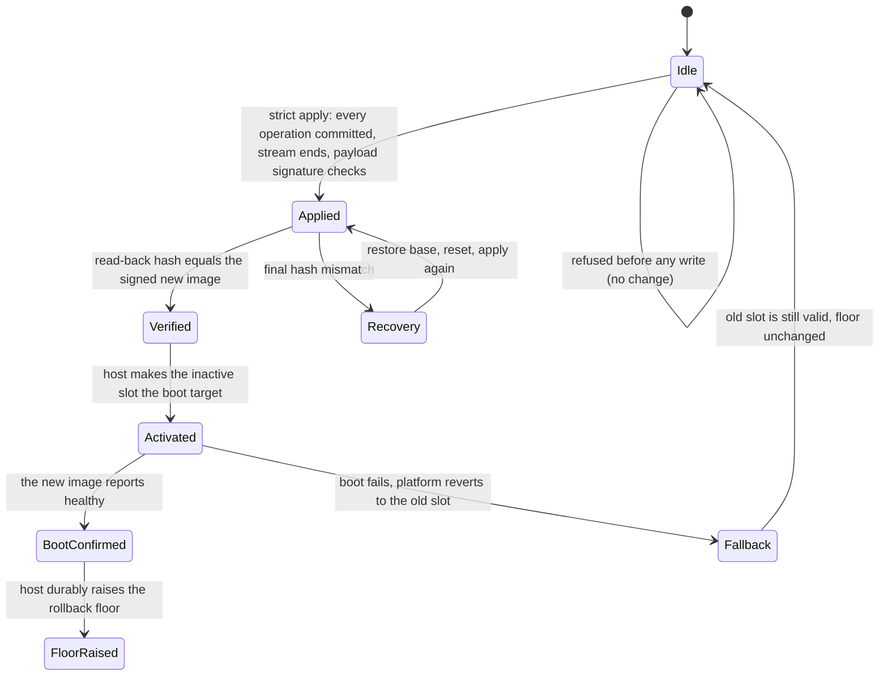
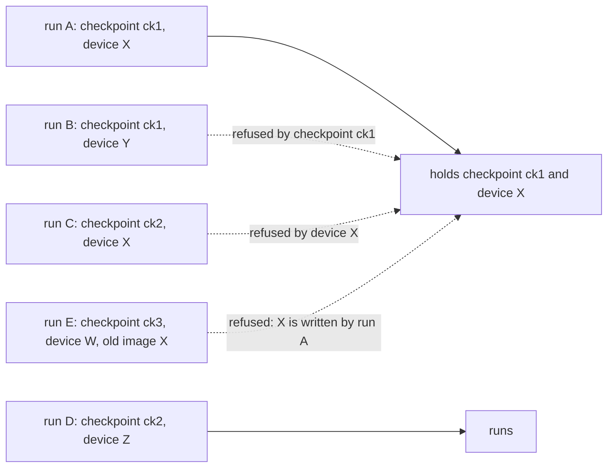
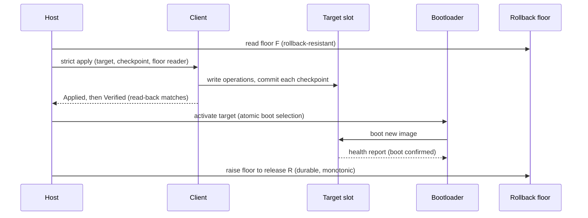

# Platform integration contract

The client is a `no_std` middleware. It can check what its inputs say and what it
writes. It cannot check what a bootloader does, what storage keeps across power loss,
or whether another writer touches the device. This document states what the host must
provide, in what order it must commit, and which guarantees belong to the project and
which to the platform. Simulated tests cover the client's side. Hardware behaviour
needs validation on the platform (§8).

## 1. Four boundaries, and who crosses each

Success is not one event. The client establishes the first boundary. The host
establishes the rest, and the host must not cross one before the one before it holds.

| Boundary | Established by | Means | Checked against |
| --- | --- | --- | --- |
| **applied** | client, `Outcome::Applied` | every write was flushed and its checkpoint committed; the stream ended and the payload signature verified | the signed stream, the signature |
| **verified** | client, `Outcome::Verified` | the target was read back and its new-image prefix equals the signed new hash | the signed new size and SHA-256 |
| **activated** | host | the boot selection names the target | the host's own record |
| **boot-confirmed** | platform (bootloader plus health check) | the new image ran and reported healthy | the platform's health criteria |
| **floor raised** | host, after boot confirmation | the device will no longer accept a release below this one | the signed `release_version` |

`Outcome::Verified` is the strongest thing the client can say. The client never reports
activation, boot confirmation or floor advance, and no host may treat `Applied` as
verified.

## 2. Target selection, identity and exclusivity

The host must provide these before the client is called. The client checks none of
them except the identity recorded in the checkpoint.

| Requirement | Host obligation | What the client does |
| --- | --- | --- |
| **Selection** | Choose a non-active target. Never pass the running slot. | Writes exactly the storage it is given. |
| **Identity** | Assign each target one stable, unique `TargetId` and pass the same value on every run. Do not derive it from a path or device number, which identify no physical storage. | Records the identity in the checkpoint, and refuses a run whose identity differs (`checkpoint_mismatch`, with no write). |
| **Exclusivity** | Hold the target exclusively from the first checkpoint write until the update is verified, or until a reset completes. No other updater, no mounted filesystem, and no second handle may write it. Nor may a writer change the old image or a streamed payload while a run reads it. | Cannot detect a concurrent writer. The reference CLI holds advisory locks on the checkpoint and the device exclusively, and on the old image and a streamed payload shared, for the run (below). Only cooperating `ota-apply` processes respect them. |
| **Immutable old image** | A base-dependent update, and every `SOURCE_COPY`, reads the old image. It must not change between runs. | Checks the image's size and hash before the first write, and each copy's source hash. It cannot detect later changes except through those hashes. |
| **Non-overlap** | The old image, the payload and the target must be different storage. | The reference CLI refuses two paths that are the same file, by device and inode, and two device nodes for one block device, by its device number. It cannot see two partitions on one disk, which have different numbers, and the platform must keep their storage apart. |
| **Persistence** | The storage's `flush` must make earlier writes survive power loss. | Calls `flush` after each operation, and treats a flush error as a failed operation. |

The reference CLI takes locks without waiting and holds them through apply or reset. A streamed payload's entry and shared identity locks come first, before it is read; the checkpoint entry, directory and existing record inode follow; then device and old-image entry locks, alias checks, and device and old-image identity locks. A refusal releases acquired guards. See `docs/locking-and-recovery.md` §11 for the order and its limitations.

The locks of a file that is read, the old image and a streamed payload, are **shared**. A shared lock admits another
reader and refuses a writer, so two runs may read one file, and a run that writes it is refused while the other reads.
A buffered payload is read once, before any lock, and its authenticated bytes are what is applied, so it holds none.

Entry, checkpoint-directory and block-device locks are files in one **lock namespace**, the directory given by `--lock-dir`, which every run on the host must name. Regular-file identity locks are held on their open files in addition to entry locks in the namespace.

| Lock | Mode | Identity | What it stops |
| --- | --- | --- | --- |
| role entry | exclusive for checkpoint and device; shared for old image and streamed payload | pinned parent directory's device and inode plus final name, as `entry-<sha256>.lock` | cooperating runs naming that entry, including while absent or being replaced |
| checkpoint directory | exclusive | parent directory device and inode, as `checkpoint-<sha256>.lock` | other checkpoint stores in the same directory |
| checkpoint record inode | exclusive | open regular-file inode, including the locked staging inode after publication | cooperating roles reaching that inode through hard links |
| device, regular file | exclusive | the file's inode, through its open file | every other run on that file, through any path or hard link. No file is created in the namespace |
| device, block device | exclusive | the device number, as `block-<major>-<minor>.lock` in the namespace | every other run on that device, through any device node. Other devices and other partitions are not blocked |
| old image, regular file | shared | the file's inode, through its open file | a writer of that file, through any path or hard link. Another reader is admitted |
| old image, block device | shared | the device number, as `block-<major>-<minor>.lock` in the namespace | a writer of that device, through any node. Another reader is admitted |
| streamed payload | shared | as the old image, for the payload's file | a writer through final verification and checkpoint completion |

The lock files are created exclusively and set to `0600` through their open handle, whatever the umask. They
are never removed, and they do not follow symbolic links. A crashed holder releases its locks when it exits.

### 2.1 Lock namespace: what the platform must provision

The namespace is a host obligation. The tool checks what it can check, and the rest is the platform's.

| Requirement | Who | How it is checked |
| --- | --- | --- |
| **One namespace per host.** The same path on every `ota-apply` run on the host, including reset runs | platform | Not checked. The tool cannot see other invocations, so it cannot verify that every run uses this namespace. It validates only the owner and privacy of the handle it opens |
| **A real directory**, not a symbolic link, at that path | platform | Opened without following a link. A symbolic link or a file is refused |
| **Owned by the updater's user, with mode `0700`.** No group or other permission bits, so no other user can reach a lock file | platform | The open handle's owner and mode. On Linux the group bits also show any ACL entry that grants access (they hold the mask), so an ACL that admits another user is refused |
| **Under trusted, stable ancestors.** No other user can rename, replace or create an entry on the path to it | platform | Not checked. A path walk would be racy and would not decide the question |
| **The namespace's filesystem supports unnamed files (`O_TMPFILE`), and `linkat` through `/proc/self/fd` works for the updater's user.** A lock file is published by that link | platform | Checked by the create: a filesystem without `O_TMPFILE` refuses the run with a message that names this requirement. Verified on ZFS and overlayfs; any other filesystem must be verified the same way |
| **Checkpoint storage that is case-sensitive for ASCII names, writable only by the updater, and durable.** The record's directory, which is not the namespace | platform | The case probe at open refuses a folding directory, as evidence and not a guarantee. The directory lock does not depend on it. Writability and durability are not checked. `docs/checkpoint.md` §5.2 lists the full set |
| **Stable, trusted role and checkpoint storage without alternate entry spellings** (including case folding, short names, bind-mount aliases, or renamed staging directories) | platform | Not fully checked. Entry locks use the resolved parent identity and exact name; ancestor and staging checks cannot establish all aliases or prevent non-cooperating mutation. Unsupported aliases require platform isolation (`docs/locking-and-recovery.md` §11). |

The tool opens the namespace once per run and validates that handle. Every lock file is then opened
relative to it, so a path replaced during the run cannot redirect a lock. The handle protects one run.
It cannot make a later run reach the same directory, which is why the ancestors and the path must be
provisioned. A run whose namespace is missing or does not meet these rules exits before it locks or
writes anything.

A new lock file is made unnamed, set to `0600` through its handle, and then linked to its name, which fails if
the name exists (`docs/locking-and-recovery.md` §9.1). So the umask cannot leave a usable name unusable, and an
interruption leaves no name. An existing lock file that is accessible to group or others is refused and left
unchanged. The updater never widens or repairs a file's access. A lock file that an earlier release left without
owner access is repaired by the operator (`docs/locking-and-recovery.md` §8.5).

**Migration.** Earlier releases kept checkpoint locks as `<name>.lock` beside the record, and as a per-name file in the
namespace, and block device locks in an arbitrary `--lock-dir`. This release reads none of them, and it neither removes
nor follows them. Stop every older `ota-apply` before switching, since an older process holds locks this release does
not see, and a run of this release does not contend with it. The old files may be deleted by the operator once no older
updater can run.

The locks are advisory, so they stop only processes that take them. They do not see another writer to
the device, a mounted filesystem, or two partitions that share one disk. A shared lock on the old image protects
the run's reads only against writers that take a lock, so the host must keep the old image unwritable by anything
else. Their behaviour on network filesystems depends on how `flock` is emulated there. A host with a different
updater must provide the same exclusivity itself.

When the old image and the target are the same storage (an in-place update), the
old-image requirement cannot be met by a separate file, and the host must not claim
the update is base-independent. The strict policy refuses a base-dependent update
whose destination is unreadable, and the destination check is the only base check
for an in-place target.

## 3. The release version and the rollback floor

A payload carries a signed `release_version` (project field 100 of the manifest,
`docs/format.md` §13). The signer chooses it as a monotonic counter. It is not a
timestamp, and two payloads with the same value are the same release for this purpose.

The host holds a **rollback floor**: the lowest release it still accepts. The floor
must live in state an attacker cannot roll back, such as a secure counter, a fuse or
a TEE-protected store. A checkpoint file, a configuration file and a command-line
value are not such state, and the reference CLI's `--release-floor` is only a value
the operator supplies.

The client's rules under the strict policy, before any write:

- The payload must carry a release version. A payload without one is refused.
- The release must be at least the floor. A lower release is refused with
  `rollback_refused`.
- A release equal to the floor is accepted, so the same release can be reinstalled.
- A floor read that fails refuses the update. The client never assumes a floor.

The host raises the floor. It does so only after boot confirmation (§4), never before,
and only upwards. A write that fails is not reported as a raise.

## 4. Commit ordering and power loss

The order is fixed. Each arrow depends on the one before it:

1. **Read the floor before writing.** The client compares the release with the floor
   it is given, and refuses a lower release before the first write.
2. **Verify before activating.** Activation without `Verified` is a host bug, because
   nothing else has established that the target holds the signed image.
3. **Activate atomically.** The boot selection must change in one durable step, and a
   torn change must leave the old selection valid.
4. **Confirm boot before raising the floor.** While the floor is still the old value,
   the old slot remains a valid fallback. Raising it earlier would make a failed boot
   unrecoverable, because the old slot's release could then be below the floor.
5. **Raise the floor durably, and only upwards.**

### 4.1 Power loss at each boundary

| Interrupted at | State after restart | Recovery | Can an older image become active? |
| --- | --- | --- | --- |
| during apply, before `Applied` | checkpoint at `Initialized`, `Applying` or `AwaitingFinal`; target partly written | rerun the same payload; the client resumes at the first uncommitted operation | No. The target is not activated, and the old slot is still selected. |
| after `Applied`, before `Verified` was observed | checkpoint at `Complete` (or `AwaitingFinal` before the read-back) | rerun; `Complete` re-checks the stream and the read-back, and writes nothing | No. |
| during the read-back | as above | rerun | No. |
| during activation | the boot selection is either the old or the new value, if the host's change is atomic | the platform must fall back to whichever selection is valid | Only a valid slot of release at least the floor can be chosen. |
| after activation, before boot | new slot selected | boot it | The old slot is still at least the floor. |
| during a boot that never confirms | trial counter exhausted or no confirmation | platform reverts to the old slot | No: the floor is unchanged, so the old slot is valid. |
| after boot confirmation, before the floor is raised | the new image is running; floor still old | the host raises the floor on its next start | **Yes, within the window**: a release at or above the old floor and below the new one could be installed by someone holding a correctly signed older payload. The window lasts until the floor write is durable. The host bounds it by raising the floor as soon as confirmation is durable. |
| during the floor write | floor old or new, never a mixture, if the write is atomic | rerun the raise | The same window as above, until the write is durable. |
| after the floor write | floor at the new release | none | No. |

The window in the seventh row is the price of keeping a fallback. It cannot be closed
by the client. It can be closed only by raising the floor at activation, which gives
up the fallback. The project's default is the fallback. A platform that prefers no
window must say so in its own integration.

## 5. Failure handling for the host

| Client result | Meaning | Host action |
| --- | --- | --- |
| `Outcome::Verified` | read-back matched the signed new image | activate, subject to §4 |
| `Outcome::Applied` | writes complete, not read back, or metadata not authenticated | do not activate. The development path only |
| `hash_mismatch` after writes | the final check failed; the checkpoint now reads `Mismatch` | recovery (`docs/checkpoint.md` §8). Do not activate |
| `recovery_required` | a `Mismatch` checkpoint is present | restore the target as its contract requires, then reset |
| `rollback_refused` | release below the floor | refuse the payload. Nothing was written |
| `signature_missing`, `required_field_missing`, `target_not_readable` | the strict policy's requirement is unmet, or a write-only sink was given a base-dependent program, whose kept bytes it cannot supply | fix the payload or the host, then retry. Nothing was written |
| `checkpoint_mismatch` | the checkpoint is for another payload or target | do not reset without establishing which one the device holds |
| `checkpoint_unconfirmed` | a stored record was replaced, but its replacement is not confirmed durable | nothing was written. The record is not used until a later run confirms it. Retry once the storage syncs (`docs/checkpoint.md` §5.3) |
| `checkpoint_removal_uncertain` | a reset removed the record, but the removal is not confirmed durable | the record may be absent or may return after a crash. Check the record and the device first, then reset again if the record is present (`docs/checkpoint.md` §8.1) |
| `checkpoint_invalid` | the record is damaged | do not trust it. A reset requires the record to be readable |
| `device_io`, a flush error | a storage failure | retry from the checkpoint once the device is healthy |

## 6. Threat model and trust assumptions

| Actor | Can | Defence | Limit |
| --- | --- | --- | --- |
| Network attacker | alter the payload, replay an old one | signatures over metadata and payload; the rollback floor refuses an older signed release | the floor's own storage must be rollback-resistant |
| Holder of an older signed payload | install it, if its release is at or above the floor | the floor, raised after confirmation | the confirmation window (§4.1) |
| Local attacker with write access to the checkpoint file | rewind, forge or clear progress | the record's integrity hash detects damage, not forgery. A forged, consistent record is accepted | the checkpoint is trusted execution state. It must be writable only by the updater, and it is never a rollback defence |
| Local attacker with write access to the target | corrupt bytes the client has already checked | the post-flight hash detects a change made before `Verified` | a change after `Verified` is the platform's problem: it must protect the activated slot |
| Concurrent writer | write the target during an update | exclusivity (§2) | not detectable by the client |
| Power loss | interrupt any step | the checkpoint, the order in §4, and the `flush` contract | flash and device durability are the platform's, and are not simulated |

The integrity hash in a checkpoint record protects against torn and damaged writes,
which the atomic replacement already makes rare. It does not authenticate the record.

## 7. What the reference CLI guarantees, and what it does not

`ota-apply` is a reference binding, and a development tool for an operator who
supplies the rollback floor.

- It verifies signatures against the keys it is given, and refuses to run without
  any key unless `--development` is passed.
- It applies under the strict policy by default, and reports `verified` only when the
  read-back matched.
- It refuses the payload, the device, the checkpoint and the old image when two of
  them are one storage object: a regular file by device and inode, and a block device by its device number, so two
  device nodes for one device are refused too. It compares the open handles of the four, before any write and before
  any device or old-image lock is attempted, so a path retargeted during the run does not hide an alias, and an alias
  is not reported as a held lock (`docs/locking-and-recovery.md` §9.2, §10.2, §10.4). Two partitions with different
  device numbers are not compared; keeping them apart is the platform's obligation.
- It holds an exclusive lock on the checkpoint's directory and one on the device for the whole run, and refuses
  a second run on either at once, under any checkpoint name, path or hard link (§2). A second record in the same
  directory is held by the first run's lock, whatever its name. It holds a shared lock on the old image, and on a
  streamed payload, so a run that writes either is refused while the run reads it (§2, `docs/locking-and-recovery.md` §10.3).
- It refuses a checkpoint that is a symbolic link or has a second name, since a replacement
  would leave the other name stale (`docs/checkpoint.md` §5). It refuses a checkpoint name that begins with
  `.ota-checkpoint.`, which the store uses for its own files (`docs/checkpoint.md` §5.2).
- `--reset-checkpoint` clears this payload's checkpoint for this device, under the same checks and
  locks as an apply, and writes nothing to the device (`docs/checkpoint.md` §8.1). It does not open the old image, so
  `-s` cannot make it fail. With `--stream` it reads only the payload's metadata, as a streamed apply does, so a large
  payload is never held whole. If the removal cannot be confirmed durable, it fails and says so, because the record may
  return after a crash.
- A resume refuses a checkpoint record whose replacement is not confirmed durable, before it writes anything. It confirms the
  record by syncing its directory and the staging directory again (`docs/checkpoint.md` §5.3), so a failed sync after a
  rename is never resumed on trust.
- The buffered path reads the whole payload into memory, within `--max-buffered-payload` (64 MiB by default, a host limit and
  not the embedded budget). A larger payload is refused before any of it is read, and `--stream` applies it. Key files are
  read within a separate fixed bound of 64 KiB. Neither read follows a named pipe or a character device: a file that is not a
  regular file is refused without being read.
- Staging uses a private, validated `.ota-checkpoint.staging` directory. A bounded best-effort sweep runs under the checkpoint-directory lock at open. A replacement whose name window is full removes the stale files at its own names by lookup, so the sweep's window does not decide it. Every open syncs the staging directory. A record's own second staging link is removed by lookup of names derived from the record, so the sweep's window does not decide it; legacy prefix-named files in the record directory are not removed. Failures and trust requirements are described in `docs/checkpoint.md` §5.2 and `docs/locking-and-recovery.md` §11.
- It does **not** keep a rollback floor, activate a slot, confirm a boot, or make
  storage durable beyond what its file device's `fsync` provides.

## 8. Simulated and hardware validation

| Property | Covered by | Simulated? |
| --- | --- | --- |
| strict refusals before any write, including unverified metadata, missing hashes, wrong base, rollback | `delta-update-client/tests/policy.rs`, `delta-update-cli/tests/policy.rs` | yes |
| final-check failure, recovery, reset under both contracts, interrupted reset, damaged and foreign records | `delta-update-client/tests/recovery.rs` | yes |
| interruption at every write, flush and checkpoint replacement | `delta-update-client/tests/resume.rs`, `model.rs` | yes |
| commit ordering and power loss at each boundary (§4.1) | this document, and the checkpoint tests above | the client's side only |
| bootloader activation, boot confirmation, fallback, floor storage | none in this repository | **no**: platform validation |
| flash durability, torn sector writes, write ordering inside the device | none | **no**: platform validation |
| concurrent writers and the running system's mounts | none | **no**: platform validation |
| block-device lock identity: distinct device nodes that name one block device share one lock | identity selection is unit-tested (`delta-update-cli/src/identity.rs`); `delta-update-cli/tests/locks.rs` checks identity, alias refusal and shared/exclusive lock contention using two nodes when `OTA_TEST_BLOCK_DEVICE` is set | **no**: platform validation, with privileged device nodes |
| a case-folded checkpoint directory is refused before and after the record exists, under either spelling | the probe is unit-tested with an injected folding result; `delta-update-cli/src/filecheckpoint.rs::a_case_folded_directory_refuses_the_record_before_and_after_it_exists` runs only with `OTA_TEST_CASEFOLD_DIR` set, and it was not run here | **no**: platform validation on a case-insensitive filesystem (`docs/checkpoint.md` §7) |
| two spellings of one checkpoint entry on a case-folded directory are serialised by the directory lock, and the reserved names are refused in any case on that directory | the directory lock is tested on a case-sensitive directory, where the two spellings are two records and take turns; the folded directory is not available here | **no**: platform validation on a case-insensitive filesystem (`docs/checkpoint.md` §5.2, §7) |
| lock-file publication through `O_TMPFILE` and `linkat` on the namespace's filesystem, with a power cut during the creation | the publication is tested on ZFS and overlayfs with injected mode failures and concurrent contenders; no test cuts power | **no**: platform validation on the deployment's filesystem (`docs/locking-and-recovery.md` §6, §9.1) |
| the checkpoint and lock directories, owned by the updater, with lock files that no other user can open | the permission checks are unit-tested on directories the test creates | **no**: platform validation of the provisioned layout |
| lock behaviour on the target filesystem (network or FUSE filesystems) | none | **no**: platform validation |
| power loss between a record's unlink and its directory sync (`checkpoint_removal_uncertain`) | the reported outcome and the absent record, with an injected sync failure | **no**: platform validation of the crash state (`docs/checkpoint.md` §8.2) |
| power loss between a replacement's rename and its directory syncs (`checkpoint_unconfirmed`) | the store and the apply, with a failed sync and a crash state that keeps or loses the rename (`delta-update-client/tests/durability.rs`, `delta-update-cli/tests/durability.rs`, `delta-update-cli/src/filecheckpoint.rs`); no test cuts power | **no**: platform validation of the crash state on the deployment's storage (`docs/checkpoint.md` §5.3) |
| power loss during staging initialization, at each of its seven steps | each step is tested by an injected failure and a retry, with the on-disk state each leaves, and the owner modes a umask can leave are restored before the retry (`delta-update-cli/src/filecheckpoint.rs`, `delta-update-cli/tests/staging_umask.rs`); no test cuts power | **no**: platform validation of the directory syncs (`docs/checkpoint.md` §5.3) |
| the buffered payload and key reads: limits, growth past a limit, named pipes and character devices | `delta-update-cli/tests/limits.rs` and the reader's unit tests in `delta-update-cli/src/main.rs`; the test host's files only | yes, and the limits are host settings, not a platform property |

To run the optional block-device test, set `OTA_TEST_BLOCK_DEVICE` to an existing block device and provide
`CAP_MKNOD` for the temporary device nodes. Without the variable, or if node creation is refused with `EPERM`,
the test skips. It uses metadata-only `O_PATH` handles and namespace lock files: it does not read or write the
block device or apply a payload. It does not exercise a writable device or the full CLI apply path. No test uses
`OTA_TEST_BLOCK_DEVICE` to write a device; destructive apply tests require separately provisioned disposable storage.

`OTA_TEST_CASEFOLD_DIR` is different: the case-folding test creates probes and writes, truncates, and removes `ckpt`
in the named directory. Point it only at an empty, disposable test directory, never a directory containing valuable data.

A platform integration is not complete until its own tests cover the rows marked
**no**, with its real bootloader, storage and power-cut method.
