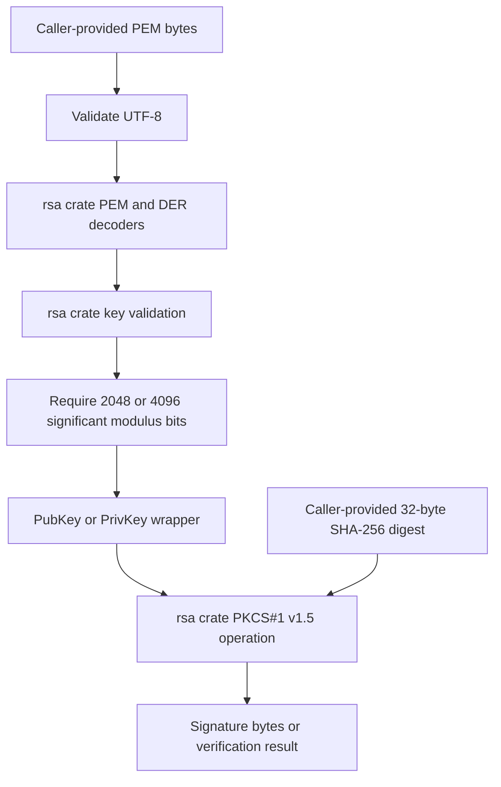
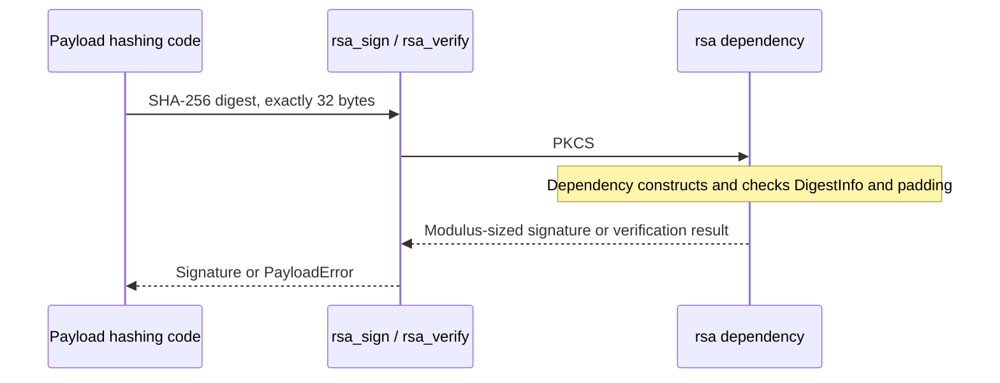

# RSA keys and payload signatures

## Purpose and scope

`ota-payload/src/rsa.rs` implements PEM key loading and prehashed RSA signatures
using RustCrypto's `rsa` crate. It does not implement RSA arithmetic, ASN.1/DER,
PEM decoding, DigestInfo encoding, or PKCS#1 padding itself. Payload transport,
payload hashing, and protobuf signature-message encoding remain outside this
module.

The wire-format reference is read-only:

- `update_engine/payload_generator/payload_signer.cc`, `PayloadSigner::SignHash`
  signs an already-computed SHA-256 digest with PKCS#1 v1.5 encoding.
- `update_engine/payload_consumer/payload_verifier.cc`,
  `PayloadVerifier::PadRSASHA256Hash` constructs the standard SHA-256 DigestInfo
  and allows 256- or 512-byte RSA moduli.

The implementation accepts standard 2048- and 4096-bit keys. Smaller keys are
rejected, including nonstandard moduli with fewer than 2048 significant bits
that would still occupy 256 bytes. Other key sizes, including RSA-3072, are
unsupported rather than silently expanding the reference's supported profile.

## Design



### Public API

| Item | Contract and rationale |
| --- | --- |
| `parse_pubkey_pem` | Accepts SPKI `PUBLIC KEY` and PKCS#1 `RSA PUBLIC KEY`. Both decoding paths are supplied by `rsa`. |
| `parse_privkey_pem` | Accepts unencrypted PKCS#8 `PRIVATE KEY` and PKCS#1 `RSA PRIVATE KEY`. Encrypted keys and non-RSA algorithms are not supported. |
| `PubKey`, `PrivKey` | Own validated dependency key types behind private fields. Public `size` retains the byte-count API used by the payload generator. Cryptographic operations use the actual key, not this mutable size field. |
| `rsa_sign` | Signs a precomputed SHA-256 digest with `Pkcs1v15Sign::new::<Sha256>()`. It does not hash the digest again. |
| `rsa_verify` | Verifies the digest, complete PKCS#1 v1.5 encoding, and modulus-sized signature using the dependency. A successful return means the signature matched. |
| `Signature` | Retains the existing fixed `[u8; 512]` storage and `len` API. Valid signature bytes occupy `bytes[..len]`; the unused tail is zero. |
| `KEY_SIZE_BIG` | The 512-byte capacity required for RSA-4096 signatures. |

Private fields prevent callers from supplying unvalidated oversized keys, so
signing cannot exceed the fixed signature buffer. There is no duplicate storage
of modulus, exponent, primes, or CRT coefficients in project-owned integer types.

### Prehashed signing, not message signing



The signing scheme includes SHA-256's algorithm identifier. An unprefixed
PKCS#1 v1.5 signature over only the digest is deliberately rejected. The same is
true of signatures over a rehashed digest: callers must pass the original digest
of the content being authenticated.

### Error mapping

| Failure | `PayloadError.code` |
| --- | --- |
| PEM bytes are not UTF-8 | `parse` |
| Malformed PEM/DER, wrong key kind, unsupported algorithm or encryption | `key_unsupported` |
| Decoded modulus has fewer than 2048 bits | `key_too_small` |
| Other decoded modulus size | `key_unsupported` |
| Invalid digest length, signing failure, wrong signature/key/hash or signature length | `signature_mismatch` |

Errors use static messages and never include private key material. PEM decoders
also validate key structure; a failure at that stage maps to `key_unsupported`
before the module's size policy is evaluated.

## Dependency and runtime requirements

`rsa` 0.9 is configured with `default-features = false` and the `pem`, `sha2`,
and `u64_digit` features. Disabling defaults avoids enabling its `std` feature;
PEM parsing remains available, and 64-bit limbs preserve the dependency's normal
integer representation.

RSA key storage and cryptographic operations allocate. A `no_std` consumer must
provide an allocator. Verification of one RSA-4096 signature peaks at about
23 KiB of heap in the host measurement (`ota-client/tests/peak_memory.rs`, on a
simulated allocator, `docs/memory.md` §5.5). The phase budget charges that
workspace on top of the decoded manifest, where the two are live together. The
fixed signature return buffer does not make the cryptographic implementation
allocation-free.

The module uses the dependency's re-exported `rsa::sha2::Sha256`, which matches
its digest traits and enables SHA-256's OID support. The project's separate
`sha2` 0.11 dependency is left unchanged: `rsa` 0.9 uses the older digest 0.10
traits internally. Both SHA-256 versions consequently appear in the lockfile.

### Signing security limitation

The existing `rsa_sign` API takes no RNG, so it uses `RsaPrivateKey::sign`, an
unblinded private-key operation. No host-specific entropy source or new platform
abstraction is introduced. Do not expose this function as a signing service to
adversarial callers able to measure execution timing. The `rsa` 0.9 dependency
also has known timing-side-channel limitations; using a maintained dependency
does not establish side-channel resistance. A hardened signing deployment needs
a separate security review and potentially an RNG-taking API or signing backend.
Public-key verification does not use private key material.

## Tests and fixtures

Unit tests live beside the implementation and cover:

| Area | Coverage |
| --- | --- |
| PEM decoding | SPKI/PKCS#1 public keys, PKCS#8/PKCS#1 private keys, LF and CRLF |
| Interoperability | Byte-for-byte equality with OpenSSL SHA-256 signatures for RSA-2048 and RSA-4096; verification of both vectors |
| Signature storage | Correct `len`, modulus-sized output, zero unused tail |
| Key rejection | Malformed input, invalid UTF-8, wrong key kind, encrypted-key label, undersized and unsupported moduli |
| Signature rejection | Changed digest, changed signature, same-size wrong public key, invalid signature lengths, absent SHA-256 DigestInfo |
| Digest contract | Empty, 31-, 33-, and 64-byte hashes rejected by signing and verification |

The existing `private.pem`, `public.pem`, `msg.bin`, and `sig.bin` RSA-2048 test
fixtures are reused without modification. `private4096.pem` is copied from the
golden reference's `unittest_key_RSA4096.pem`; it is a public **test-only** key,
not a production secret. `sig4096.bin` is generated with:

```sh
openssl dgst -sha256 \
  -sign ota-payload/tests/fixtures/private4096.pem \
  -out ota-payload/tests/fixtures/sig4096.bin \
  ota-payload/tests/fixtures/msg.bin
```

The normal test command is:

```sh
cargo test -p ota-payload --lib rsa::tests --offline
```

At implementation time, the crate already contained missing `der`/`pem` modules
and unfinished `sha256.rs`, `sign.rs`, and `verify.rs`. Those unrelated files
were not completed as part of this change. To exercise the actual RSA source
independently, a temporary harness under `target/rsa-validation/` uses this
`Cargo.toml`:

```toml
[package]
name = "rsa-module-validation"
version = "0.0.0"
edition = "2021"

[workspace]

[lib]
path = "lib.rs"

[dependencies]
rsa = { version = "0.9", default-features = false, features = ["pem", "sha2", "u64_digit"] }
```

Its `lib.rs` imports the real modules, without copying their implementations:

```rust
#![no_std]

#[path = "../../ota-payload/src/error.rs"]
pub mod error;
#[path = "../../ota-payload/src/rsa.rs"]
pub mod rsa;
```

Run it from the workspace root with:

```sh
cargo test --manifest-path target/rsa-validation/Cargo.toml --offline
cargo check --manifest-path target/rsa-validation/Cargo.toml --offline
cargo clippy --manifest-path target/rsa-validation/Cargo.toml --offline --all-targets -- -D warnings
rustfmt --edition 2021 --check ota-payload/src/rsa.rs
git diff --check
```

This validates the module and a host `no_std` build, not the complete workspace
or an embedded cross-compilation target. The temporary harness and its build
artifacts are not part of the committed implementation.
