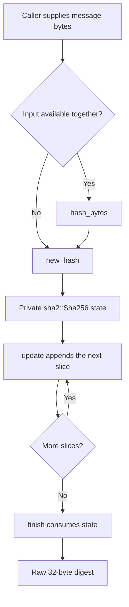

# SHA-256 hashing

## Purpose and reference behavior

`delta-update-payload/src/sha256.rs` implements incremental and one-shot SHA-256 using
RustCrypto's existing `sha2` 0.11 dependency. There is no project-owned compression
function, padding, block buffering, or message-length accounting.

The read-only golden reference is `update_engine/common/hash_calculator.cc`:
`HashCalculator` delegates initialization, updates, and finalization to OpenSSL,
and `RawHashOfBytes` composes these operations for a complete message. The Rust
module follows the same byte-stream semantics and returns a raw 32-byte digest,
not hexadecimal or Base64 text. It does not implement the reference's file I/O
or serialized hash contexts, and it does not implement payload transport.

## Design and rationale



| Item | Contract and purpose |
| --- | --- |
| `SHA256_SIZE` | Public constant equal to 32, for digest buffer and return types. |
| `Sha256` | Owns a private `sha2::Sha256`; callers cannot manipulate internal hash state. |
| `new_hash()` | Starts a fresh, independent message. |
| `update(&mut Sha256, &[u8])` | Appends bytes in order. Empty slices have no effect, and chunk boundaries do not affect the digest. |
| `finish(Sha256)` | Consumes the state and converts the dependency's fixed-size output into `[u8; SHA256_SIZE]`. Ownership prevents updating or finalizing that state again. |
| `hash_bytes(&[u8])` | Composes initialization, update, and finalization so both entry points share the same implementation. |

The former placeholder fields (`state`, `block`, `block_len`, and `msg_bytes`)
are replaced by the dependency's state. The four public function signatures are
preserved. No new dependencies or dependency-version changes are needed.

The wrapper uses neither `std` nor heap allocation. Its state and result have
fixed size; input slices remain caller-owned. It uses the project's direct
`sha2` dependency, not the older SHA-256 type re-exported by `rsa`. Only digest
bytes cross the boundary into prehashed RSA operations, so the differing digest
trait versions do not affect interoperability.

SHA-256 alone is not authentication. A caller verifying an OTA payload must
also verify its signature and hash exactly the byte ranges required by the
payload format; this module does not select or validate those ranges.

## Snapshots: resumable hash state

The payload signature covers header, manifest and blobs, and a resumed run must
verify it without reading the bytes already committed. So the hash state is
serialized into the checkpoint (`docs/checkpoint.md`) and restored on resume.

- `snapshot(&Sha256) -> [u8; SNAPSHOT_SIZE]` writes a version byte, then the
  algorithm's serialized state. The state comes from the `digest` crate's
  `hazmat::SerializableState`, which is the supported serialization for it. The
  object's memory is never copied.
- `restore(&[u8]) -> Option<Sha256>` accepts only the exact length and version,
  and then the algorithm's own deserialization. A restored hash continues to the
  same digest as the uninterrupted one.
- `SNAPSHOT_SIZE` is 105 bytes: one version byte and the 104-byte state. Its size
  does not depend on how much has been hashed.

## Test coverage

Unit tests are colocated with the implementation and use fixed known-answer
values rather than relying solely on comparisons with the same dependency.

| Test area | Evidence |
| Snapshots | restoring at every split point, including block and padding boundaries, continues to the same digest; the size is fixed and small; other versions, short and long snapshots are refused |
| --- | --- |
| Standard vectors | Empty input, `abc`, the standard 56-byte message, and the standard 112-byte message. |
| Golden reference compatibility | The OpenSSL-derived `hi` digest from `update_engine/common/hash_calculator_unittest.cc`, tested both one-shot and as separate `h` and `i` updates. |
| Empty stream and updates | Finalization without updates and empty slices before and after nonempty input. |
| Chunk invariance | Binary input of lengths 0, 1, 55, 56, 63, 64, 65, 111, 112, 127, 128, 129, and 1024, split into chunks of 1, 7, 55, 56, 63, 64, 65, and 128 bytes. |
| Long incremental input | The standard million-`a` digest, supplied in 1000-byte chunks. |

The lengths around 56 bytes exercise padding boundaries, while lengths around
64-byte multiples exercise compression-block boundaries. These are regression
tests for the wrapper's stream semantics; cryptographic internals remain the
responsibility of `sha2`.

## Validation

The normal command is:

```sh
cargo test -p delta-update-payload --lib sha256::tests --offline
```

At implementation time this command is blocked by pre-existing missing `der`
and `pem` modules and unfinished `sign.rs` and `verify.rs`. Those files are
outside the scope of this implementation and remain unchanged.

An uncommitted harness under `target/sha256-validation/` validates the actual
source without copying it. Its `Cargo.toml` is:

```toml
[package]
name = "sha256-module-validation"
version = "0.0.0"
edition = "2021"

[workspace]

[lib]
path = "lib.rs"

[dependencies]
sha2 = "0.11"
```

Its `lib.rs` is:

```rust
#![no_std]

#[path = "../../delta-update-payload/src/sha256.rs"]
pub mod sha256;
```

The following commands pass, including all five unit tests:

```sh
cargo test --manifest-path target/sha256-validation/Cargo.toml --offline
cargo check --manifest-path target/sha256-validation/Cargo.toml --offline
cargo clippy --manifest-path target/sha256-validation/Cargo.toml --offline --all-targets -- -D warnings
rustfmt --edition 2021 --check delta-update-payload/src/sha256.rs
git diff --check
```

This establishes module-level correctness and a host `no_std` build, not a
successful full-workspace build or embedded-target cross-compilation.
