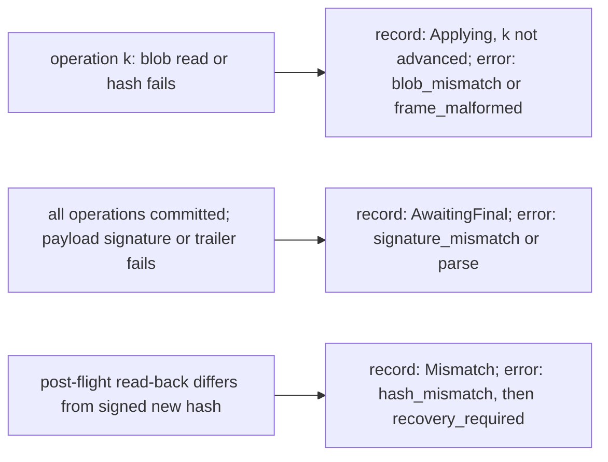

# Streaming, resumable apply

The streaming pipeline pulls payload bytes through a `Source` instead of
requiring the whole payload in memory. It has the same two phases as the
buffered pipeline (`docs/client.md` §1): `prepare` reads and authenticates the
metadata region, and `apply` replays the blobs onto the target. The difference
from the buffered pipeline is that the payload is read once, forward, and the
run can be cut at any point and resumed from its checkpoint (`docs/checkpoint.md`).

## 1. Why one pipeline serves both features

The payload is a sequential byte stream: header, manifest, metadata signature,
blobs, payload signature, in physical order. Every size is in the header or in
the authenticated manifest, so a `Source` that only pulls bytes forward is
sufficient. The delta never has to be resident.

Resume needs no read-back and no journal. Each operation is committed by a
checkpoint after its writes are flushed. A resumed run reads the payload from the
offset the checkpoint names, so it reads only the operations it still needs, and
it replays the one that was running from its first chunk.

## 2. Phases and their order

```mermaid
sequenceDiagram
    autonumber
    participant H as Host
    participant S as Source
    participant M as stream::prepare
    participant E as engine
    participant C as Checkpoint store
    participant D as Target
    H->>M: prepare(source, Trust, profile)
    M->>S: read header (24 B, bounded by profile)
    M->>S: read manifest (≤ profile.max_encoded_manifest)
    M->>S: read metadata signature (≤ profile.max_signature_message)
    M->>M: verify metadata signature over header + manifest
    M->>M: decode, plan::validate
    M-->>H: Prepared (geometry, partition name, metadata digest; no target touched)
    H->>E: apply(open, target, store, identity, progress)
    E->>D: capacity at least new length and target reach (before access)
    E->>E: validate supplied old image, even without copies
    E->>C: load record, validate it (no write)
    alt record is Complete
        E->>H: open(blobs end)
        E->>H: read the payload signature, verify it, require end of stream
        E->>D: post-flight hash, when the target is readable and a hash is recorded
        Note over E,C: nothing is written and no record is replaced
    else fresh, or Initialized, Applying, or AwaitingFinal
    E->>H: open(payload offset from the checkpoint, or blobs start)
    alt fresh session
        E->>D: old-prefix pre-flight if readable and no separate image
        E->>C: replace: Initialized
    end
    loop each uncommitted operation, in manifest order
        E->>H: read its stored bytes through the source (none for kept, zero or copy)
        E->>D: write each chunk as it is produced
        E->>E: verify the operation's data hash
        E->>D: flush
        E->>C: replace: next operation, or AwaitingFinal after the last
    end
    E->>H: read the payload signature, verify it over the restored hash state
    E->>H: require end of stream
    E->>D: flush, post-flight hash
    E->>C: replace: Complete
    end
```

Two things here are deliberate. Capacity is checked against the recorded new
length and operation reach before anything touches the device; equality is not
required, and bytes after the new prefix are unchanged. And the payload is opened by the host
**after** the checkpoint is read, at the offset the checkpoint names, so the bytes
of committed operations are never read again.

## 3. The trust order

| Step | Buffered | Streamed |
| --- | --- | --- |
| header bounded by profile | yes | yes, before any further read |
| metadata signature verified | before decode | before decode |
| manifest decoded and validated | before any write | before any write |
| every blob's data hash | **before any write** (`prepare` reads them all) | per operation, **after its writes and before its checkpoint** |
| payload signature | before any write (`prepare`) | at end of stream, after the blobs were written |
| bytes after the payload signature | refused before any write | refused at end of stream, after the blobs were written |
| old image (hash, copy hashes) | before any write | before any write |
| target: pre-flight hash of old prefix | fresh readable session, no separate image | fresh readable session, no separate image |
| target: post-flight hash of new prefix | when readable and recorded | when readable and recorded |

The streamed column differs in three rows, and they are inherent to a stream. A
blob's bytes are written before the bytes that prove them arrive, because a
stream cannot be read twice. The payload signature covers the blobs, so it can
only be checked at the end. And a trailing byte is seen only when the stream
ends.

The consequence differs by row, and the difference is the important part:

- A damaged **blob** is refused at its own operation. That operation's record is
  never written, so a resumed run replays it.
- A damaged **payload signature**, or **trailing bytes**, are seen only after every
  operation has been written and committed. The record is `AwaitingFinal`, not the
  record of the last operation as it was before the stream ended. The target holds
  the whole new image. The update is not complete, and the rerun reads the signature
  again from the restored hash state (§5.1).

An earlier version of this document said a signature failure always left an operation
uncheckpointed. That was wrong for the final check, and the table below is the
correct statement.

## 4. Resume mechanics

A run is resumed by its checkpoint, not by comparing the device with the payload:

| Checkpoint phase | The resumed run |
| --- | --- |
| none | a fresh update: pre-flight, `Initialized`, then every operation |
| `Initialized` | operation zero, from its first chunk. No pre-flight: the device may hold operation zero's partial writes. |
| `Applying` | operation `next_op`, from its first chunk, then the rest |
| `AwaitingFinal` | no operation. The payload signature is read from the restored hash state, the stream is required to end, and the update completes. Nothing is written. |
| `Complete` | nothing is written, and no record is replaced. The signature and the end of the stream are still checked, so a trailer is still refused. On a readable target the post-flight hash is checked as well, so a target altered since completion is refused with `hash_mismatch`. |

Replaying an operation from its first chunk is safe. Its destination bytes are
determined by its blob (or by its copy source, which is disjoint from its
destination) and by nothing that an earlier operation wrote after its own
commit. `docs/format.md` §6 states this.

A resumed run needs the payload from a particular offset, and it gets that
offset from the record. If the host opens the wrong offset, the first blob fails
its data hash, or its frame fails to decode, and the record is not advanced. A
correct offset then converges.

## 5. What a rerun repairs

| What went wrong | What the target holds | What a rerun does |
| --- | --- | --- |
| stream ends early | committed operations, and a partial operation | replays the partial operation and the rest |
| blob corrupt in operation *k* | operations before *k* committed, *k* partly written | the corrupt blob is refused again; the rerun cannot finish until the stream is good, then replays *k* |
| payload signature bad | every operation committed (`AwaitingFinal`); the signature fails at end of stream | the same stream is refused; a good stream completes. The record is never `Complete` before the signature verifies |
| trailing bytes after the payload signature | every operation committed (`AwaitingFinal`) | the same stream is refused; a clean stream completes |
| zlib frame does not decode | operations before the frame's operation committed | the same stream is refused at the same frame; a good stream completes |
| flush fails | written, not yet durable | the operation is replayed |
| checkpoint replacement fails | the operation's writes are durable, its record is the previous one | the operation is replayed (a repeat of identical writes) |
| device I/O error | whatever was written | replays from the last committed operation, once the device is healthy |
| the old image changes between runs | blocks written by earlier runs, copies that now read different bytes | not repaired: the copy's source hash refuses it. The old image must be unchanged for the whole update (`docs/format.md` §8). |

The middleware never leaves the target in a state that a rerun of the same
payload, against the same checkpoint, cannot repair, as long as the target stays
readable and writable.

## 5.1 Failure phases, and what the host must do with each

A streamed failure belongs to one of three phases. Each has a different error, a
different record, and a different obligation on the host.



| Phase | Error | Record after the failure | Host obligation |
| --- | --- | --- | --- |
| a current operation's blob hash or read | `blob_mismatch`, `frame_malformed`, `device_io`, `parse` (truncated) | `Applying` for the last committed operation | retry from the checkpoint with a good stream. Do not activate |
| the final payload signature, or bytes after it | `signature_mismatch`, `parse` | `AwaitingFinal`, with every operation committed | retry with a good stream. Do not activate, and do not treat the target as complete |
| the final read-back | `hash_mismatch`, then `recovery_required` | `Mismatch` | recover (`docs/checkpoint.md` §8). Do not activate |

No phase can produce a verified activation. `Outcome::Verified` is returned only
after the signature, the end of the stream, the flush and the read-back have all
succeeded (`Complete` is written last).

**Staged target.** A streamed run writes the target before it has proved the blobs
(§3). The host therefore keeps the streamed target unavailable for boot or
publication until the call returns `Outcome::Verified`: the target is staged, not
installed. A host that needs the payload authenticated before any write must use the
buffered path, or a host-provided payload that it can re-read. A one-pass, bounded
memory stream cannot give that guarantee without staging.

## 6. Buffers and memory

| Buffer | Size | Lifetime |
| --- | --- | --- |
| manifest bytes | ≤ `profile.max_encoded_manifest` (16 KiB embedded) | released after decode |
| metadata signature | its declared size, ≤ `profile.max_signature_message` (2 KiB embedded) | released after the metadata is verified |
| chunk buffer | one manifest block size (≤ 4 KiB embedded) | allocated after validation; alive for the whole apply |
| zlib staging | one chunk buffer | allocated when replay starts, if a frames or sparse operation is still to be replayed; released with the codec. A completed re-apply, and a run resuming at `AwaitingFinal`, replay nothing and never allocate one (`docs/client.md` §7.1) |
| zlib codec | about 10.5 KiB (`DECODER_STATE_BYTES`) | created on the first zlib frame; released before the payload signature is checked |
| payload signature | its declared size, ≤ 2 KiB embedded | read at end of stream, after the codec is released |
| decoded manifest | modeled peak ≤ 32 KiB embedded (budget) | the whole apply |
| checkpoint record | 221 B on the stack; the store keeps its own copy | written and replaced per operation |

Every allocation is fallible (`try_reserve_exact`), so an input-sized request
returns `resource_limit` rather than aborting. The chunk buffer is the only
replay buffer that is not sized from the operation: an operation of any size is
written through it, one chunk at a time, so memory does not grow with the delta.

The largest modeled phase is the payload-signature check, at 64,040 B under the
embedded profile (`docs/memory.md` §4). It holds the decoded manifest, the
signature slot, the chunk buffer, the signature decode and the RSA workspace. The
codec is released first, so it is not live with the signature check.

## 7. API

```rust
use ota_client::checkpoint::TargetId;

let prepared = ota_client::stream::prepare(src, Trust::Verified(&keys), &EMBEDDED)?;
let g = prepared.geometry();          // optional NEW length, chunk size, operations, reach
let name = prepared.partition_name(); // adapter routing; authenticated under Verified only
// The host opens the payload at the offset the checkpoint names. A fresh run is
// handed the blobs' start, and a resumed run is handed its record's offset.
let open = |offset: u64| open_payload_at(offset);
prepared.apply(open, &mut dev, &mut store, &target, &progress)?;
prepared.apply_with_image(open, &mut dev, &old, &mut store, &target, &progress)?;
```

`prepare` takes the source by value, and `&mut S` implements `Source`, so a
caller that keeps the cursor can inspect how far the run read. The end-to-end
tests use that to check that the whole stream was consumed. `apply` takes
`&self`, so an interrupted run can be retried on the same prepared payload.

A plan that copies from the old image is refused by `apply` with
`source_missing`, before any write, so a caller cannot forget the image.

## 8. What the tests pin

- **Equivalence**: streamed and buffered results match, on fresh, interrupted and
  resumed runs (`ota-client/tests/model.rs`, `resume.rs`).
- **Every cut point**: a run cut at each of its writes, each flush and each
  checkpoint replacement resumes to the target (`ota-client/tests/resume.rs`).
- **Resume is by checkpoint**: an interrupted operation is replayed in full, and
  committed operations are skipped without being read or compared
  (`ota-client/tests/frames.rs`, `sparse.rs`, `copy.rs`).
- **Idempotence**: a completed update, re-applied with its checkpoint, writes
  nothing, and its trailer is still refused. A target changed since completion is
  refused (`ota-client/tests/resume.rs`, `ota-cli/tests/cli.rs`). Its allocations are
  measured in `ota-client/tests/peak_completed.rs`.
- **Short reads**: the source hands out 7-byte, 613-byte and 64 KiB pieces.
- **Truncation and trailing bytes**: refused. A trailing byte is seen only at end
  of stream, after the blobs were written (`ota-client/tests/regressions.rs`).
- **Late rejection**: an unsupported operation or a bad hash is refused in
  `prepare`, before any device exists.
- **Bounds before reads**: a manifest above the profile is refused after the
  header only, and the source cursor shows nothing else was read.
- **Capacity before access**: an undersized device is refused with zero target
  reads and writes. Larger devices, grow/shrink updates, prefix hashes and unchanged
  tails are covered by `ota-client/tests/sizes.rs` (`docs/image-geometry-and-cli.md`).
- **Peaks**: the streamed phases stay within their modeled bounds
  (`ota-client/tests/peak_stream.rs`).
