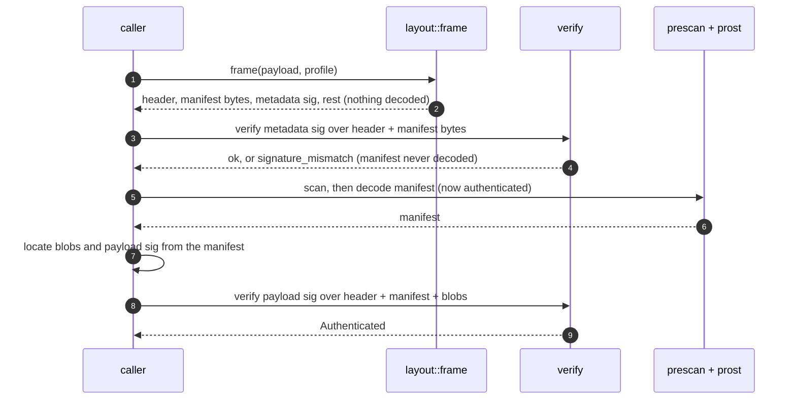

# Complete-payload signature verification

`ota_payload::verify` authenticates a payload: it checks the metadata signature
over the raw header and manifest bytes, then the payload signature over the
header, manifest and blobs. It is the only code that produces an
`Authenticated` value, so code that accepts one can rely on the signatures
having been checked.

## 1. Purpose and scope

- Authenticates a complete payload held in memory or in a borrowed slice.
- Used by the buffered pipeline directly, and by the streaming pipeline through
  `verify_message` on each signature message as it is read.
- Does **not** interpret the manifest's application semantics. That is
  `ota_payload::plan`, which runs after authentication.
- Does not compare an externally supplied whole-file hash. That is a transport
  concern, out of scope.

## 2. Byte layout and signed ranges

```text
offset 0          24                  24+M        24+M+S          24+M+S+B        end
       | header    | manifest (M)      | metadata  | blobs (B)     | payload sig     |
       |           |                   | sig (S)   |               | (P)             |
       +-----------+-------------------+-----------+---------------+-----------------+
       metadata range = [0, 24+M)
       payload range  = [0, 24+M) ∪ [24+M+S, 24+M+S+B)              (sig messages excluded)
```

- The header is 24 bytes: `"CrAU"`, a big-endian `u64` major version of 2, a `u64`
  manifest size, and a `u32` metadata signature size.
- `S` and `P` are the encoded `Signatures` messages. `S` comes from the header.
  `P`'s offset and size come from the manifest, relative to the blobs start.
- Neither signature message is part of the signed hashes, which matches
  `CalculateHashFromPayload` in the reference.

## 3. Authentication order



Two points in the order matter:

1. **The manifest is decoded only after its own signature verifies.** Until
   then, nothing it says is used. Its `signatures_offset` and
   `signatures_size`, which locate the payload signature, are trusted only
   after authentication.
2. **The payload signature is checked last.** It depends on the manifest's layout,
   so it cannot be checked earlier. The blob bytes it covers are therefore
   read before it is checked, which is the case the streaming path documents.

The earlier order decoded the manifest first and checked presence fields before
verifying anything. A forged manifest could then reach layout checks before its
signature was examined. The reordering removes that.

## 4. Verification flow and trust policy

| Check | Failure |
| --- | --- |
| header: magic, major version, declared sizes within the profile | `bad_magic`, `unsupported_major_version`, `manifest_too_big`, `resource_limit`, `parse` |
| framing: the declared regions fit the payload | `overflow` |
| metadata signature present | `signature_missing` |
| metadata signature verifies against a trusted key | `signature_mismatch` |
| manifest passes the scan and decodes | `resource_limit`, `bad_protobuf`, `required_field_missing`, `unsupported_field`, `hash_length` |
| payload signature present and nonzero | `signature_missing` |
| offsets and sizes are checked, with overflow | `overflow` |
| the declared payload signature ends exactly at the payload's end (`layout::locate`, shared with unverified parsing) | `overflow` if truncated, `parse` if bytes follow |
| each signature message is within the profile, checked before a byte is scanned | `resource_limit` |
| payload signature verifies against a trusted key | `signature_mismatch` |

Each signature message must match at least one trusted key. The metadata and
payload signatures may match different keys, which supports rotation. An empty
key list verifies nothing and rejects every signed payload.

Within a message, the verifier follows the reference's ordered search: an empty
list is rejected, an `unpadded_signature_size` prefix is honoured, a missing
`data` field is skipped, and any entry matching any key succeeds. A malformed
message is rejected whole, even after a valid entry, because the message is
decoded in full before any entry is accepted.

## 5. Error model

Verification errors are returned as `PayloadError` with a `Code`, and they never
panic. Arithmetic on signature offsets and sizes is checked, and the regression
tests cover both `u64::MAX` offset and size cases.

A verification failure is always a metadata-class error. Nothing has been
written when it is returned on either pipeline, because verification runs before
the first write.

## 6. Relationship to the other crates

| Caller | Uses |
| --- | --- |
| `ota-client::apply::prepare` (verified) | `verify_payload`, then `plan::validate` |
| `ota-client::stream::prepare` (verified) | `verify_message` on the metadata signature, then `decode_manifest` and `plan::validate`; `verify_message` again on the payload signature at end of stream |
| `ota-generator` self-check | `verify_payload` under the same profile, with the public key derived from the private key, then `plan::validate` on the authenticated manifest |
| `ota-cli` tests | `verify_payload` directly, for tamper and key-rotation cases |

## 7. Tests

- Round trips with 2048- and 4096-bit keys.
- Key rotation: each signature may use a different key, and an empty blob
  region is valid.
- Tampering in every authenticated region is rejected with `signature_mismatch`.
- Missing signatures, incomplete optional fields, trailing bytes, truncation and
  bad magic each map to their code.
- Offset and size overflow return `overflow` without panicking.
- Multiple signatures, optional unpadded size, and nonzero padding.
- Empty and malformed signature messages, with malformed suffixes after a valid
  entry, and over-limit entry counts.
- A duplicated `data` field is refused as `bad_protobuf` even after a valid
  signature, since the whole message is scanned before any entry is checked
  (`docs/memory.md` §2.3).
- Signature messages at the size limit are accepted, and one byte over is a
  `resource_limit` from both `decode_signatures` and `verify_message`, even when
  the valid signature is padded with unknown fields and the tail is malformed.
- A payload signature region one byte over the profile is refused after the
  metadata authenticates.
- Unknown fields at both nesting levels are skipped.
